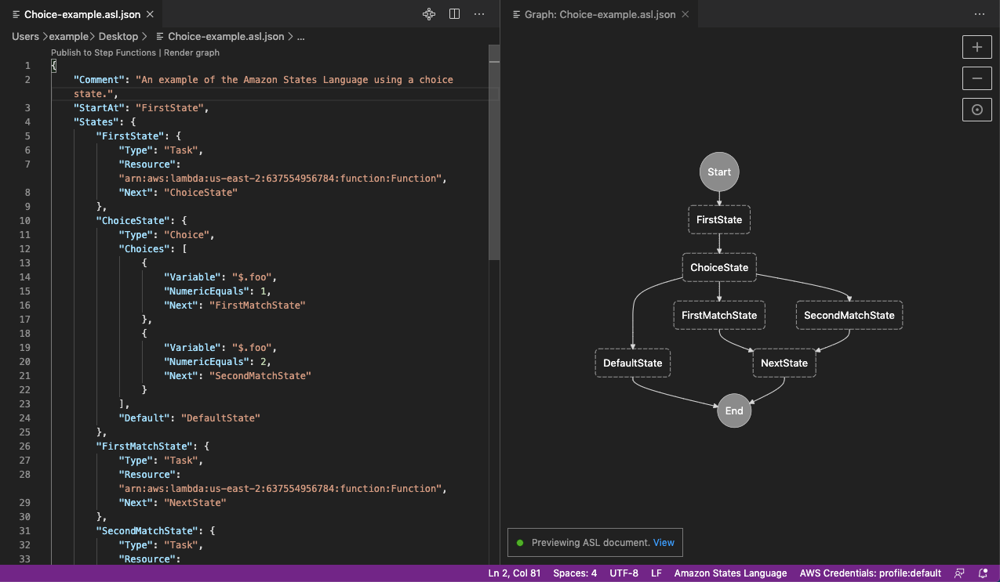

### Amazon States Language

If you have ever worked with StepFunctions you have definitely realised how [ASL](https://docs.aws.amazon.com/step-functions/latest/dg/concepts-amazon-states-language.html 
) ( a JSON-based, structured language used to define your state machine ) is not such a pleasant experience.

You can use [Workflow Studio](https://aws.amazon.com/blogs/aws/new-aws-step-functions-workflow-studio-a-low-code-visual-tool-for-building-state-machines/) of course, but I generally don't like clicking around in the AWS UI Console that much.

Last week I found out [this interesting project on github](https://github.com/Stedi/ts2asl) that allows you write your state machines in Typescript. 
Haven't tried it yet, but if you are already using TS to describe your Stack with AWS CDK it might provide an easier learning curve in the adoption of StepFunctions for your processes.

You can try out the TS2ASL in [this playground app](https://asl-editor-spike-ts-stedi.vercel.app/).

In the meantime you can use [Visual Studio Code AWS Toolkit](https://docs.aws.amazon.com/toolkit-for-vscode/latest/userguide/building-stepfunctions.html#building-stepfunctions-visualizations) to write ASL ( with snippets and templates) and visualise the Graphs.  Eagerly waiting for such functionality [in IntelliJ](https://github.com/aws/aws-toolkit-jetbrains/issues/584).

### Sustainability, Energy prices and Polar Bears

I was reading a discussion in the AWS Community Builders Slack that caught my attention

> In the context of higher energy costs (at least in Europe) do you think AWS will increase prices in any regions?
I'm asking because there are some companies that already said that they will increase their prices. 

Then found out about [the plans](https://sustainability.aboutamazon.com/environment/the-cloud?energyType=true#renewable-energy-map) from AWS to switch entirely to 100% renewable energy by 2025 and that you can even [determine your carbon footprint]((https://aws.amazon.com/aws-cost-management/aws-customer-carbon-footprint-tool/)  (in relation of AWS Services use from your applications, of course).

Later on this week my _selective attention_ brought me to an [interesting article by Jeremy Daly](https://www.jeremydaly.com/can-serverless-really-save-polar-bears/) about the possible (good) impact that a serverless approach in architecting our applications could have on the environment! 

### State of AWS Security
Did you know that _75 percent of IAM users have an active access key that's older than 90 days._?

and that _2 percent of all S3 buckets are publicly exposed_?  

I didn't, until I read [this report from DataDog]( https://www.datadoghq.com/state-of-aws-security/) who
took a closer look at various types of **misconfigurations that 
unintentionally expose sensitive resources publicly  and 
contribute to the most common causes of security breaches**.

Very interesting, and somehow scary, read. Highly recommended.

### CDK Best practices
Useful tips and best practices list about AWS CDK,
https://www.ranthebuilder.cloud/post/aws-cdk-best-practices-from-the-trenches

I have been using CDK in last couple of years, but I must say that never really explored custom construct that much, found very interesting the approach mentioned in the article

I also share the same sentiment about CDK tests: 
> Use AWS CDK tests to ensure vital resources are not deleted, and meaningful resource connections remain intact. 

This is definetely something I need to remember : 
`Avoid changing the logical id of stateful resources.`
