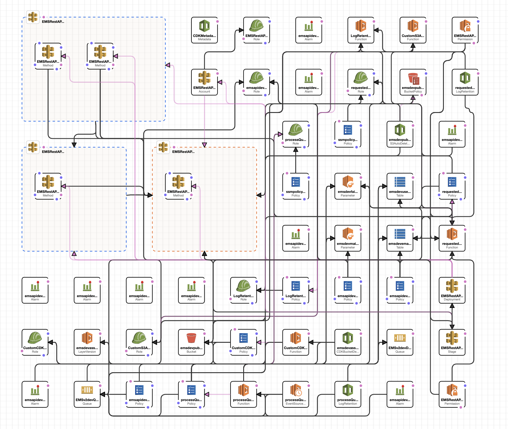
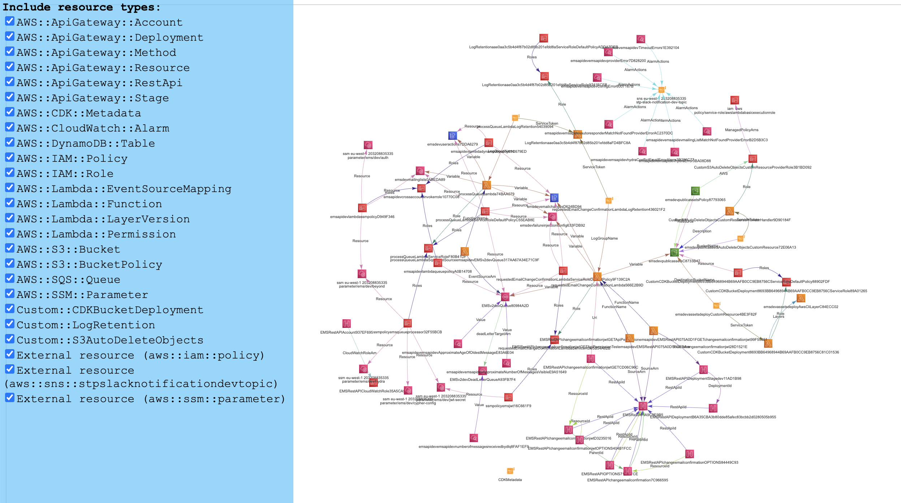
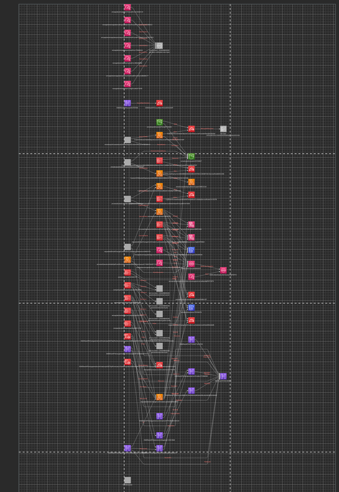

Documenting and keeping track of the changes in the architecture of an application is very important but at the same time very often underestimated.

Yes, you might start with some sketches, maybe even draw and present those diagram to your team, but often, as soon as you start writing code/templates of it in your IaC of preference ( be it CloudFormation, Serverless, CDK or Terraform) most of the times we tend to ignore the visual part of it.

Be it a RFC ([Request For Comments](https://brunoscheufler.com/blog/2020-07-04-documenting-design-decisions-using-rfcs-and-adrs#-rfcs-discuss-technical-ideas-as-a-team)) for peer Engineers or Architects, or ADR ([Architecture Decision Record](https://ozimmer.ch/practices/2021/04/23/AnyDecisionRecords.html) to explain the architectural choices months after down the production line, having nice, readable, and uptodate diagrams makes things so easy.

I normally used [Draw.io](https://app.diagrams.net/) within. company Google Drive for sketching Architecture Diagrams and sharing with colleagues, then I save the diagram as image and put it directly in the Repo, linking the source in the Readme.  
After months though, it is very likely that the source diagram does not reflect the changes in the CDK code anymore.
There are plenty of tools around -  you can even download all AWS Services Icons to use them where you want - check the [official link here](https://aws.amazon.com/architecture/icons/?nc1=h_ls). 

Bringing the diagram closer to the repo, using a plugin in your editor simplifies things - you can use [this plugin for Visual Studio Code](https://marketplace.visualstudio.com/items?itemName=hediet.vscode-drawio) or [this (unofficial) plugin for IntelliJ](https://plugins.jetbrains.com/plugin/15635-diagrams-net-integration).
Those though, does not solve of creating diagrams FROM your IaC.

Recently I found out a couple of tools to create diagrams directly from your code, or better the template coming out of it. 

### CloudFormation Designer

[CloudFormation Designer](https://eu-central-1.console.aws.amazon.com/cloudformation/designer) is an official tool from AWS, but honestly it displays way too much stuff and does not provide real customisation options.
I would find it useful only to edit _back_ the template, if i were using Cloud Formation directly to describe my IaC (which I don't - having long ago adopted Serverless Framework first and the AWS CDK).

### CFN Diagrams

[CFN Diagrams]([CFN-Diagram](https://github.com/mhlabs/cfn-diagram)) is a CLI tool that allow you to visualise CloudFormation/SAM/CDK templates as diagrams, and allows you to choose between different outputs that could fit more your target audience ( for a README - or some Word Document / Slide I'd favour static images, for Presentations the interactive HTML could look fancier).

#### HTML output
What you get when you select HTML as an output is a very nice and fancy page that allows you to navigate the architecture. You can also select and filter the different services to make the diagram less messy.  

#### Draw.io output
In this case your output will be a file similar to those created on Google Drive or from Visual Studio code plugin.

Similarly to the HTML output you can deselect some resources by type or name to reduce the clutter in the output, but you can do that only from the CLI. 

 

Of course, since I am already using Draw.io for my initial sketches, this is my most preferred output. 

--- 

The problem with this tools though is that - of course - if you edit your diagram from an output, next time you will generate a template after some CDK changes, your changes will be lost (if file is overridden ) or you will have to edit the output again to reflect the update, and your previous changes.

There is still the risk that code and documentation do not match anymore, but that is in the end true for most documentation, (we must have the discipline to keep documentation updated, after all) and having such tools is very handy because - unless we really customized the visualisation - having the graph updates is just a (assuming you are using CDK for example) a `cdk synth` away and reimport into your tools of choice (or even, in case of CFN , synth is done by default, thus `cfn-dia d` ).

I hope this helps, (if you use other tools, feel free to mention it in the comments!)
