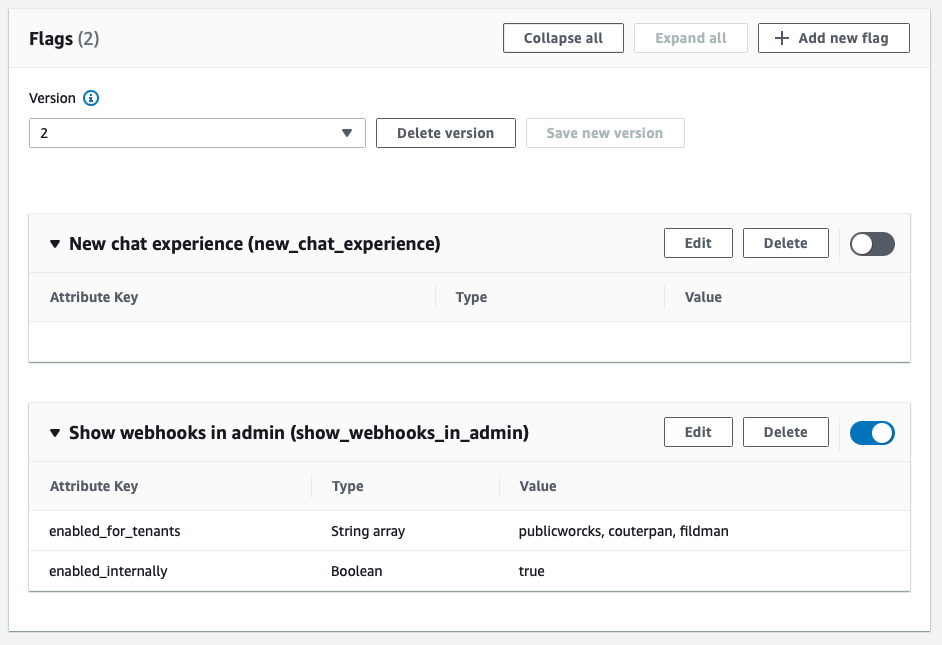

### AWS Parameters and Secrets Lambda Extension
[AWS Parameters and Secrets Lambda Extension](https://aws.amazon.com/about-aws/whats-new/2022/10/aws-parameters-secrets-lambda-extension/)

So far we always used a custom Middy middleware that we wrote to connect to ssm and handle cache,  but this is definetely a very welcomed improvement.

Of course I wanted to play around with this feature and write a post, but just within few hours other AWS Community Builders were faster. Here is [one of the most extensive article](https://alatech.medium.com/potential-costs-and-latency-improvements-with-aws-parameters-and-secrets-lambda-extensions-40b6af151b0).

### Feature Flags

[A very interesting overview](https://www.luminis.eu/blog/cloud-en/move-faster-with-new-feature-flag-capabilities-in-aws/) about App Config and Feature Flags + 2 new services I didn't even know they existed about Real Time User Monitoring ( kinda Google Analytics ) and AB testing.

More about using FeatureFlags with AppConfig of course [on official AWS docs](https://aws.amazon.com/de/blogs/mt/using-aws-appconfig-feature-flags/)

### AWS Data Transfer charges
Every single post from Corey Quinn is time well spent reading!
He is able to provide so much detailed information without ever become boring, and I love his humour.
Just read his intro to his post about [AWS-Data-Transfer charges](https://www.lastweekinaws.com/blog/aws-data-transfer-charges-ingress-actually-is-free/)

> Free doesn't always mean "free," like when taking a Twix from an exhibit hall booth means I get suckered into an awkward sales pitch

Hilarious, and very informative.

### Sam connectors
Haven't used SAM much, was always more a fan of Serverless first and CDK afterwards, but I always keep an eye on it and this post from Jeremy Daly tells more about new Connector features and about [getting abstractions wrong](https://www.jeremydaly.com/getting-abstractions-wrong-with-aws-sam-serverless-connectors/)

### Lambda Powertools for Typescript
Last time I checked Lambda Powertools was April, after reading this very interesting article about [Idempotency for Lambda functions](
https://aws.amazon.com/de/blogs/compute/handling-lambda-functions-idempotency-with-aws-lambda-powertools/?trk=global_employee_advocacy&sc_channel=sm&advocacy_source=everyonesocial&es_id=56a49be12a).
There are a lot of useful things there, back then though the library for Typescript was not yet ready for production. It is now ( well, since August actually...), and even though the Idempotency module is not available yet ( it is for Python ) you can take advantage of Tracer, Logger and [Embedded Metrics](https://dev.to/aws-builders/cloudwatch-custom-metrics-with-cloudwatch-embedded-metric-format-452j).
