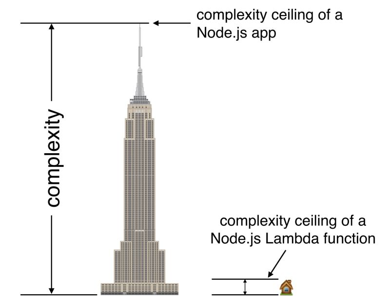
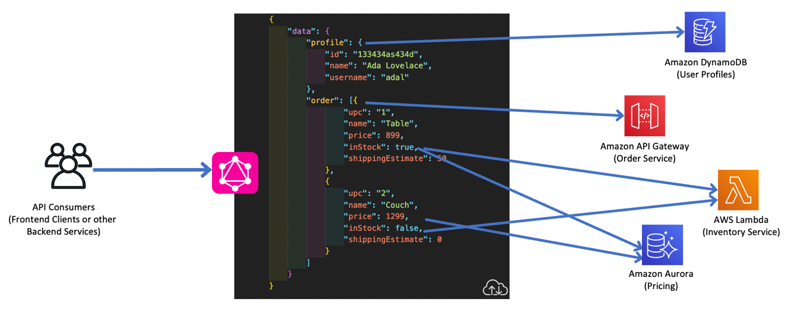
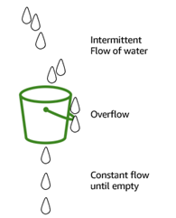

### Lambda: to Typescript or not to Typescript?

When I moved from Actionscript and C# to Javascript I hated the lack of types, therefore I was immediately advocating Typescript.  After that (very) big project I started building smaller applications with Serverless and started to find Typescript unnecessary.  Our lambdas were so tiny and all the logic nicely decoupled that having types was just unnecessary clutter.  Furthermore, unit tests were a better way to describe the application and document how to use methods and proof validation. 

Recently, since we moved from Serverless framework to CDK, and started writing our IaC with Typescript, ( and support for TS bundling is now effortless) we introduced again Typescript in our code base.

I was therefore quite surprised to read [this article from AWS Serverless Hero Yan Cui](https://www.linkedin.com/posts/theburningmonk_serverless-aws-awslambda-activity-6986994844820725760-5_xK?utm_source=share&utm_medium=member_desktop). I share his mindset and opinion about Typescript in Lambda, but never considered the adoption of TS could impact performance.

> I've had functions whose cold start go from sub-500ms to over 2s after changing to TS, without minimal changes. And when that function threw an error, the latency for the invocation was in the seconds, and it was with 1GB of memory. We tried pushing the memory up to 1.8GB (right before you unlock a 2nd CPU core since Node can really only use 1) and the error performance was about the same.

I really suggest reading his post and checking out how to [add some typing to your JS Lambda functions](
https://dev.to/aws-builders/add-types-to-your-javascript-lambda-functions-3pgn
) without having to add Typescript.

### Modernising API with GraphQL and AppSync

> Without using GraphQL, client applications must make multiple separate calls to different AWS services. Because each service is exposed through different API endpoints, the complexity of accessing data from the client side increases significantly. In order to get the data, you have to make multiple calls. In some cases, you might over fetch data as the data source would send you an entire payload including data you might not need. In some other circumstances, you might under fetch data as a single data source would not have all your required data.
**A GraphQL API combines the data from all these different services into a single payload that the client defines based on its needs**

Although I never worked on any project using AppSync nor GraphQL but I always found this approach of wrapping and adapting requests on the frontend to hide away the complexity of the backend somehow fascinating.

You can read more about [this topic here](https://aws.amazon.com/de/blogs/architecture/what-to-consider-when-modernizing-apis-with-graphql-on-aws/?trk=global_employee_advocacy&sc_channel=sm&advocacy_source=everyonesocial&es_id=e806c336cc)

### AppSync vs APIGateway
Lately I was researching about what solution to use for a project that needs Websockets. Dockerized Express application with Websockets, APIGateway Websockets or AppSync? 
Once again I ended up in [a very interesting article about pros and cons of APIGateway vs APPsync](https://lumigo.io/aws-serverless-ecosystem/aws-appsync-five-reasons-you-should-consider-it-over-api-gateway/) ( not only related to websockets!), written by AWS Serverless Hero Yan Cui. 
Highly suggested.

### Serverless is more expensive than Containers! Is it really?
Another topic, another AWS Serverless Hero.
In [this post](https://www.readysetcloud.io/blog/allen.helton/when-is-serverless-more-expensive/) Allen Helton makes some points about bills, total costs of ownership and other aspects we should keep in mind when comparing Serverless and Containers.

> Serverless costs are linear with usage, it does not get more expensive the more you use it. Oftentimes, it actually gets cheaper! Running into a situation where serverless becomes too expensive feels like a good problem to have. That means your app is gaining popularity and a new set of challenges comes into play.

Indeed! Reaching the tipping point when serverless becomes too expensive is a good problem, and a new challenge.  
That can be solved by rethinking and optimizing the serverless architecture ( maybe you don't need so many lambdas and [can use directly Integrations](https://dev.to/aws-builders/look-ma-no-lambda-lambdaless-apigateway-and-dynamodb-integration-with-cdk-2hbd) ) or by switching to containers ( but still taking advantage of a nicely decoupled business logic and code base.  It is definetely easier to aggregate some lambda code and put it into an express app on EC2 than splitting a stateful monolith into stateless functions.

### Preventing Email Throttling Concurrency limits

when working with Lambda and SQS I always found the polling system a bit cumbersome and awkward.  [This post](
https://aws.amazon.com/blogs/messaging-and-targeting/prevent-email-throttling-concurrency-limit/) shows a couple of different approaches and also gives a nice explanation of the Leaky Bucket algorithm. 

