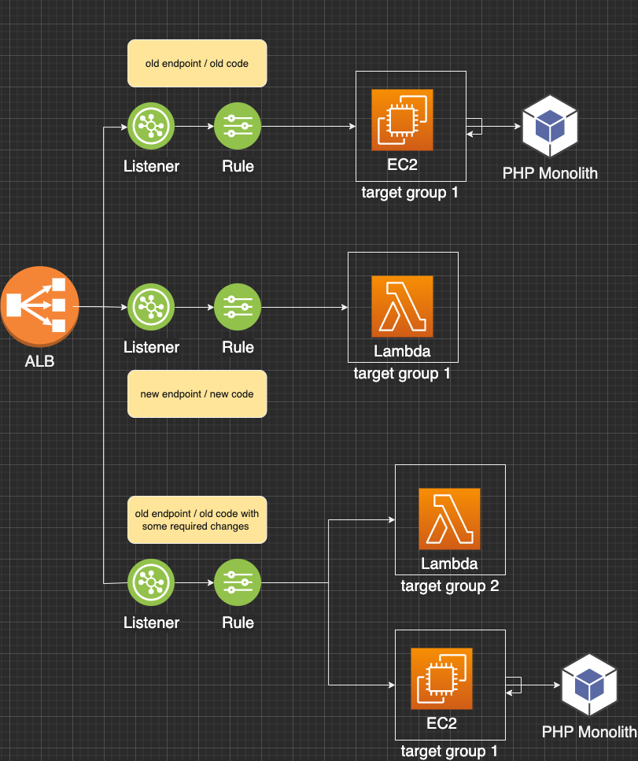
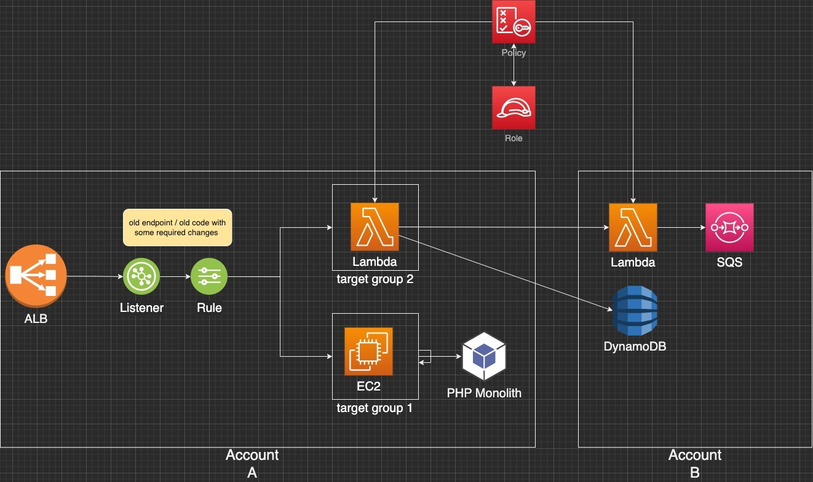
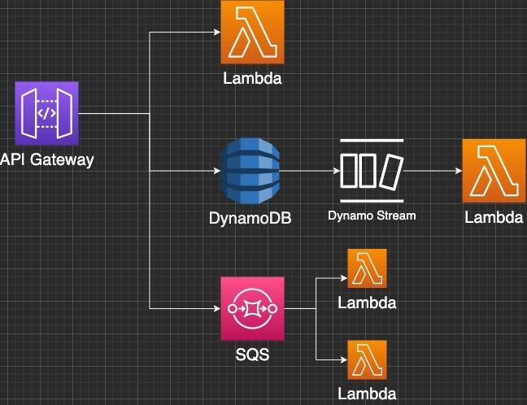
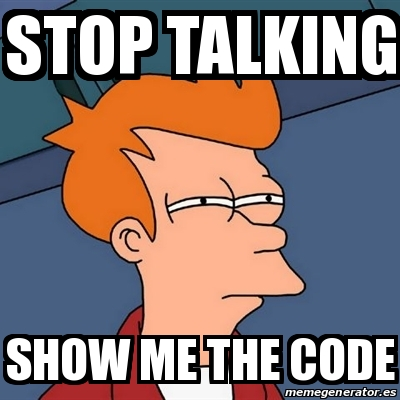
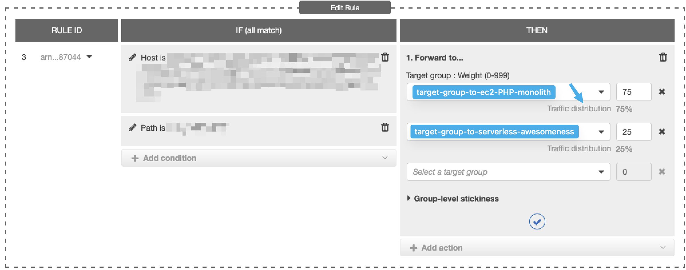

>How do you gradually and safely migrate from an old PHP legacy monolith to a serverless architecture? 
In this post I will show you how we used AWS CDK to deploy two stacks, cross-accounts, that leveraged ALB Rules and quotas to gradually switch traffic, endpoint by endpoint, to Lambdas and DynamoDB.

### A bit of context
Last year my team took over a legacy project consisting of a PHP application with a bunch of endpoints that have been always running and relied upon by many other different systems in the company, but that had never been updated in the last few years. 
Not a big deal, until we had to add an endpoint and adjust the functionality of one API. 

None of the developers who worked on that codebase was still in the company, documentation was lacking and mostly outdated, and in my team nobody had experience with PHP.

How could we **safely** make changes to _that_? I wasn't even sure I could check out the repo and redeploy it - given that many of it dependencies and framework were also by now outdated, if not entirely deprecated?


Despite our lack of PHP knowledge, reading the code and understanding what it was doing was not so complicated, and after struggling a bit with the **over-engineered OOP abstractions** ( mostly forced by the Dependency Injection Framework being used there) we came to the conclusion that if would have been much better to write the new feature ( and possibly gradually rewrite the entire thing) with a more modern approach in a tech stack we have understanding of.

Instead of some cumbersome PHP monolith deployed on EC2 we would go for **Typescript and Serverless**!

Yay! I was thrilled by being involved in such big rewrite, still we had the problem of **safely roll-out** the changes and most importantly **roll-back** in case of issues.

As additional complexity we had the desire/requirement of possibly gradually deactivate all services related to this application from the original team's account. 

### The solution

Luckily the application was already deployed on EC2 behind a Application Load Balancer and there were already some Listeners with specific rules to direct traffic to different Target Groups.  You can have a look at [this video to know more about ALB and TargetGroups](https://www.youtube.com/watch?v=0XMsnAgHXoo).

For the brand new endpoints we created new listeners with rule conditions matching the method and path and directed the traffic directly to our Lambda - in the previous application that endpoint didn't exist and no implementation was available in the deployed PHP.  Easy!

What to do with the existing endpoints and the existing codebase that we needed to modify?

Since **you can add multiple target group to each listener and split the traffic defining quotas for each target group**, we decided to create a new target group pointing to our Lambda, and then act on the quotas to gradually direct traffic to it.

We had of course to rewrite the original functionality but since we understood the business logic, writing new code in Typescript was way easier than fiddling with an old and undocumented PHP codebase. 



The power of this choice was that we could deploy the lambda and the target group with a very very low quota, like 99% and 1% and monitor the results for few hours or days.  If everything was going smooth, we would then increase gradually the quota until we reached 100%.  If at some point, we realised we made some mistakes in the business logic or introduced bugs, we could reduce the quota or deactivate the target group entirely, and focus on solving the problem.

The process went on for weeks as you might imagine, but we were able to migrate a fair amount of endpoints, and gradually dismiss the PHP application, improving the system introducing **a more modern, reliable, and even cheaper, architecture**: we moved to DynamoDB, fan-out load with SQS, and for some more complex logic that spans over different system and processes that could last days ( like approval requests  and subscriptions) we used Step Functions!

### What about the Cross Account issue?

Well, bringing the application under our team ownership required us to bring the services it was running on, under our own account. 
What we did, although increasing slightly the costs - and in some case the latency, was to have one lambda as target of the LoadBalancer in the old account, invoking the lambdas on our account or proxy the requests to Dynamo or SQS on our account. 

> Unfortunately, it is not possible (or I could not find a way) to have a Listener point to a target group into another account ( or having the target group point to a Lambda into another account ).



Although not optimal, and we had some headaches due to [Policies, Roles and Tokens - I wrote a post already, you can read it here](https://dev.to/dvddpl/invoke-aws-services-cross-account-from-lambda-with-aws-cdk-and-aws-sdk-v3-oll)), this solution allowed us to decouple the system and gradually take ownership of the system also from a costs perspective. 

In the future, when the process will be completed, the Load Balancer, the Listeners and the Target group pointing to that _proxying_ lambda, will be dropped and replaced by an APIGateway on our account. 



API Gateway can use different types of integrations to react to the specific method or endpoint, making it possible for example to Read and Write directly to DynamoDB in a **Lambdaless** manner as I described [here](https://dev.to/aws-builders/look-ma-no-lambda-lambdaless-apigateway-and-dynamodb-integration-with-cdk-2hbd)) or to pushing directly to SQS. Than thanks to Streams and Event Source Mappings Filters, different Lambdas would be triggered ( as described [here](https://dev.to/dvddpl/filter-lambda-events-from-dynamodb-stream-with-cdk-1gnm) - post is about DynamoDB but idea is the same) decoupling the logic even further.




### How was it done

Scope of this post is more sharing this experience (and possibly also **getting some feedback from the community**, about different possible approaches or tips to solve some of the pain points) rather than provide a _humongous cloud-formation-template or CDK stack_. But I will try to provide some snippets and explain some of the magic!

```
const ALBListener = ApplicationListener.fromApplicationListenerAttributes(this,`${id}-albListener`, {
    listenerArn: props?.envConfig.elbListenerArn, 
    securityGroup})

```

As mentioned above, our legacy app was already using Listeners and ALB, so here we are just referencing the ALBListener using the ARN we put in cdk.context.json.


```
const targetGroup = new ApplicationTargetGroup(this, `${id}-ELBTargetGroup`, {
    targetGroupName: `${id}-tg`,
    targets: [new LambdaTarget(myProxyingLambda)],
})
```

Then we create a TargetGroup which pointS to the Lambda function in charge of proxying every action to the Lambda on the new account.

```
ALBListener.addTargetGroups(`${id}-rule-for-endpoint-we-are-migrating-to-serverless`, {
    priority: priorityInt++,
    conditions: [
        ListenerCondition.hostHeaders([ourHost]),
        ListenerCondition.httpRequestMethods(['POST']),             
        ListenerCondition.pathPatterns([OUR_ENDPOINT_PATTERN])
    ],
    targetGroups: [targetGroup],
})

ALBListener.addTargetGroups(`${id}-rule-for-another-endpoint`, {
    priority: priorityInt++,
    conditions: [
        ListenerCondition.hostHeaders([ourHost]),
        ListenerCondition.httpRequestMethods(['GET']),
   ListenerCondition.pathPatterns([ANOTHER_ENDPOINT_PATTERN]),
    ],
    targetGroups: [targetGroup],
})

```

Lastly, we add the target group to the listener specifying ther rules / conditions based on which traffic will be directed to the target.
As you can see we are specifying here conditions by Host, by HTTPMethod and by path.

ENDPOINT_PATTERN can be a real path like `/subscriptions` or ,as the name suggest , a pattern like `/users/*/address` for example (so that condition will work whenever we invoke address endpoint for any user id.)
[Priority](https://docs.aws.amazon.com/cdk/api/v1/docs/@aws-cdk_aws-elasticloadbalancingv2.ApplicationListenerRule.html#priority) is a _unique_ integer that defines which rule will be used for every request ( rule with the lowest number has precedence).

That is basically the gist of it.
For brevity I am skipping how to set up a lambda ( you can find thousands of examples on the internet) and how to set up roles and policies ( you can check my posts listed below ). 

### Some pain points we had (and haven't solved yet)

- A bit too much hardcoded stuff: We really wanted to have deployment as simple as possible and to centralise the repository without getting lost into the 2 aws account and different gitlab repo ( we had different namespaces there too) , therefore we simply hardcoded the ARN of LoadBalancer and Listeners , as well as cross-account information inside the cdk.context.json. 
But at least we were able ( thanks to our SSO login and profiles ( I wrote about [working with multiple accounts and profiles here](https://dev.to/dvddpl/how-can-you-access-aws-resources-from-different-accounts-use-different-profiles-1gb9)) to deploy the Rules and the changes to the _proxying_ lambda directly from the same repo/cdk project of the real application. 
Just switch profile and choose the right stack:

```
AWS_DEFAULT_PROFILE=account-A npm run cdk deploy dismantle-the-monolith-changes

AWS_DEFAULT_PROFILE=account-B npm run cdk deploy awesome-serverless-implementation
```
- Priorities: when setting up rules you need unique values, since we were using CDK to append new rules and target groups to an already existing ALB ( which I can't even remember if was created manually from Console or some sort of IaC) we came up with some sort of _counter_ but having a way of retrieving the current rules would be cleaner.

- Rules and quota handling

Similarly, defining the quotas and adjusting them from the stack and the terminal would be the best option, we couldn't though find an easy way to do that - and since this behaviour was necessary only for a "relatively short" transition phase we were ok of adjusting the quotas manually from UI Console.



- CDK Constructs
Our CDK stack was in the end a bit too messy, and I would have loved to use Constructs, on the other hand though for the same reason above, we preferred to focus on getting the job done, and then after the migration throw away the intermediate stack, rather than slowing down the development with Constructs and CDK Tests.

----

I hope you find this post useful and I'd really like to hear from you in the comments about different possible approaches, or advice in solving the pain points we had!

Other posts you might find interesting about Serverless Architecture:

- [Lambda Event Filtering](https://dev.to/dvddpl/filter-lambda-events-from-dynamodb-stream-with-cdk-1gnm)
- [Lambdaless API Gateway Integrations](https://dev.to/aws-builders/look-ma-no-lambda-lambdaless-apigateway-and-dynamodb-integration-with-cdk-2hbd)
- [Cross-Account Lambda invocation](https://dev.to/dvddpl/invoke-aws-services-cross-account-from-lambda-with-aws-cdk-and-aws-sdk-v3-oll)
- [Multiple AWS Accounts and User Profiles](https://dev.to/dvddpl/how-can-you-access-aws-resources-from-different-accounts-use-different-profiles-1gb9)
- [How to draw architecture diagrams](https://dev.to/aws-builders/how-to-create-diagrams-of-your-architecture-1na6)


----


Photo by <a href="https://unsplash.com/@zoltantasi?utm_source=unsplash&utm_medium=referral&utm_content=creditCopyText">Zoltan Tasi</a> on <a href="https://unsplash.com/s/photos/monolith?utm_source=unsplash&utm_medium=referral&utm_content=creditCopyText">Unsplash</a>
  
