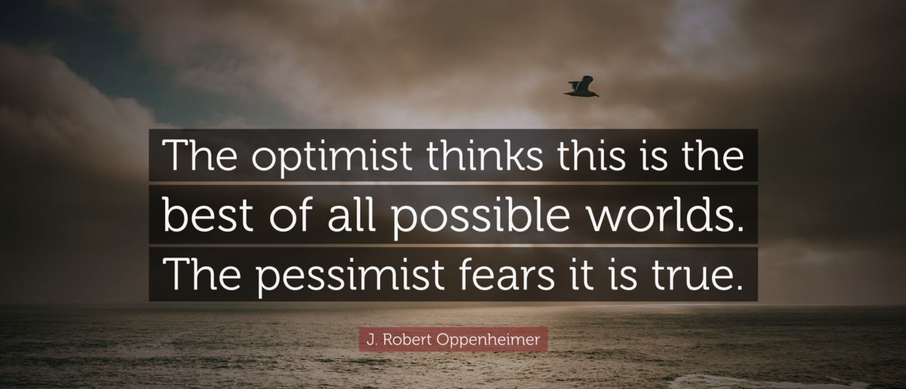

My father was Head of Quality Assurance in a Plastics Manufacturer.  
As soon as he got in his hands a package, like a plastic container  for cookies, he was silent for a few seconds while holding that thin plastic thing and looking at it from every angle.

> Ah. Ah! Gotcha! pointing and showing to all of us a ( invisible to our eyes tiny stain on the transparent foil.

After more than 15 years in software engineering I realised I developed a similar attitude and obsession to detail: 
some day ago for example, I was browsing with my wife and kids my son's school website looking for some information about afternoon classes.  While they were slowly looking for the information we needed, I already scanned the entire thing and was pointing out flaws. 

> See,  there is a typo there, and there!.
They also forgot to renew the Security Certificate,  and, if you ask me, the submit button should be disabled until the form is filled and valid.

Of course nobody asked me, and nobody was impressed by performance.

Why am i telling you this?

Because the world really needs more pessimists, people that are able to see flaws, to foresee problems.  That can focus on the negative!

So you can imagine how I felt when I found that in my toastmasters pathway I had to give 2 speeches with the subject "Focus on the positive!".

I kept this "diary" of feeling and gratitude for two weeks.  And I realised that most of the time,  the bad mood or the things that upset me the most were related to me finding something negative in a situation while everyone else saw no problem at all or had full "trust" in the "positive vibes"! 

Everyone else was:  _"Yeahhh  cool!  Awesome, let´s do that, It will be a success!!"_
While I was thinking: "Mmmm, not sure, if we do like they say, It will be a disaster!"

As a Technical Lead I sometimes  feel I am getting paid to  "ruin the party",  I am the one in the team that has to inform management if the delivery date can be met, that I have to discuss with the clients the feasibility of their requirements, or to instruct developers about possible pitfalls in their design.

There are a lot of other jobs and situations where it is necessary to focus on the negative, on the flaws, on whatever could go wrong, and on everything that could be improved. 

There are **a lot of situations where we would prefer not to listen to the truth, and we dislike who throws it at us**:
lawyers, doctors, teachers, financial advisors.

If you think about it,  even the Covid situation could have been better handled if politicians had in time listened more carefully and took more seriously those pessimist experts.  
But no,  _"let´s not slow down the economy, let´s not upset the electors, let´s hope for the best - it's just a flu!"_

The world really needs more pessimists, who are not afraid of telling others the truth.

Of course, that **has nothing to do with being depressed, passive and helpless**... or with being **an angry asshole.** 

Recognising problems or areas of improvement is just the first step. 

A **professional** pessimist is someone, negative by nature,  which learned to consciously exercise their "negativity" to anticipate, find problems  but are able to maintain a positive attitude to solve or help to solve problems and to communicate bad news to the optimists.

The problem is not about being positive or negative rather about bing a blind / naive optimist versus a defeatist cynical pessimist.

As much as the world needs optimists and dreamers to achieve the impossible, to fly high, it needs experts and pessimists to keep the feet on the ground and correct wrong assumptions.

A professional pessimist always finds something that does not work, or that could be better.  [Not because everything sucks](https://dev.to/dvddpl/my-jobs-is-boring-and-everything-sucks-or-not-1lnp) or there is no hope, but exactly because he has the trust and confidence that **there is always a chance of improvement and learning and success**. 

Oppenheimer said:  _"The optimist believes we live in the best of all possible worlds, the pessimists fears it to be true._

> How boring would the world and our life be if everything was already perfect and there was no chance for improvement?

Next time you meet a pessimist,  don't tell them annoyedly,  _"Oh come on..! Focus on the positive!!!"._
But rather thank them for the opportunity, and work together to **focus on what you both can control and change for the better.**

--- 

This is the transcript of a speech I gave at [my local Toastmasters Club](https://dev.to/dvddpl/my-first-speech-at-toastmasters-pnn) (an international organisation to practice **public speaking and leadership skills**) for Level 3 of my **Innovative Planning** Pathways where I had to keep a daily journal for 2 weeks and then tell a story about awareness of our own thoughts and feelings and the impact of your attitudes and thoughts on daily interactions.

You can consider it a **fictional** story, although a lot of what is described there comes from my direct experience.

After this speech I elaborated the topic a bit these thoughts under more professional lenses in this post: [Are good software engineers pessimists?](https://dev.to/dvddpl/are-good-software-engineers-pessimists-54ll)

I hope you find it interesting and of some help.
