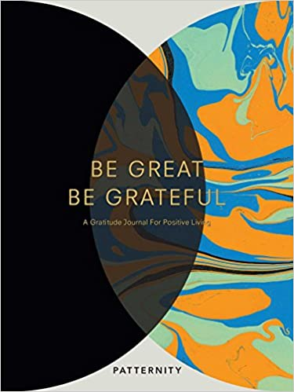
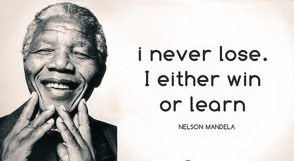

---
title: Focus on the positive, pt2 - How do you stay positive, when you lose?
published: true
description: transcript of a speech I held at Toastmasters about Positivity and dealing with failures
tags: publicspeaking mentalhealth motivation writing
background: /assets/uk8vryn2ie2c1zlaz0fp.png
series: Public Speaking and Leadership Skills - Toastmasters Pathway
---

Being positive might be easy if you have a good life,  a satisfying and well paid job, fulfilling relationships, a nice warm home and so on.  But how can you stay positive if something goes wrong? If you fail at something? 

First of all, focusing on the positive is not easy at all, **even if** you have a good life.
That is why _journaling_: keeping a kind of diary where you daily note down your moods and attitudes, your successes and efforts, and a few things for which you are grateful, is so important.  

I bought [this book](https://dev.to/dvddpl/how-to-deal-with-rejections-and-failures-cgb) few years ago. Inspired by its Motto:
 
> **Be great, be grateful**

Actually, I could never commit to their morning diary, and evening reflections.  Too busy for that!

Recently though I read about the **one line a day journal**, and that fits me more: just ( at least ) one sentence about something **positive** that happened during that day, something small that make you smile, happy or gave you a sense of achievement.   
It does not have to be anything extraordinary, focus on the positive, ordinary small things: A nice comment from a colleague,  a smile from a stranger while commuting, a relaxing walk in the park.

> Even the worst day has something so small that deserves to be recorded.

Still... _Find_ something positive in a bad day is ok. But how do you _keep_ yourself positive when you failed at something you cared about?

You applied for that dream job, and didn't work out.
You asked that girl out and she rejected you.
You organised your holiday to some exotic place and the pandemic stroke.

How do you stay positive when you lose?

> Well.  **I NEVER LOSE**

Sounds arrogant?  _I_ didn't say that.  _Nelson Mandela_ did.
Surprising?  Not so much if i complete the quote:

I never lose.  Either I win or I learn.

The only way of staying positive and never losing, is to **focus _not_ on the outcome you missed, rather on the experience you gained.**

After inventing the light bulb,  Thomas Edison was interviewed and asked about how he felt that he took so long and failed 1000 times. 
This is how he allegedly replied:

> I have not failed 1000 times. **I have not failed once. I have succeeded in proving that those 1000 ways will not work**. When I have eliminated the ways that will not work, I will find the way that will work.

Focus on the positive!
Be great, be grateful!

----

This is the transcript of the second speech I gave at [my local Toastmasters Club](https://dev.to/dvddpl/my-first-speech-at-toastmasters-pnn) (an international organisation to practice **public speaking and leadership skills**) for Level 3 of my **Innovative Planning** Pathways where I had to keep a daily journal for 2 weeks and then tell a story about awareness of our own thoughts and feelings and the impact of your attitudes and thoughts on daily interactions. (you can read [part I - The world needs more Pessimists! - here](https://dev.to/dvddpl/focus-on-the-positive-30hl) 

After these speeches I elaborated the topic a bit these thoughts under more professional lenses in this posts: 
- [Are good software engineers pessimists?](https://dev.to/dvddpl/are-good-software-engineers-pessimists-54ll) 
- [How to deal with failures and rejections](https://dev.to/dvddpl/how-to-deal-with-rejections-and-failures-cgb)

I hope you find my writings interesting and somehow useful.

---

Photo by <a href="https://unsplash.com/@nate_dumlao?utm_source=unsplash&utm_medium=referral&utm_content=creditCopyText">Nathan Dumlao</a> on <a href="https://unsplash.com/s/photos/positivity?utm_source=unsplash&utm_medium=referral&utm_content=creditCopyText">Unsplash</a>
  