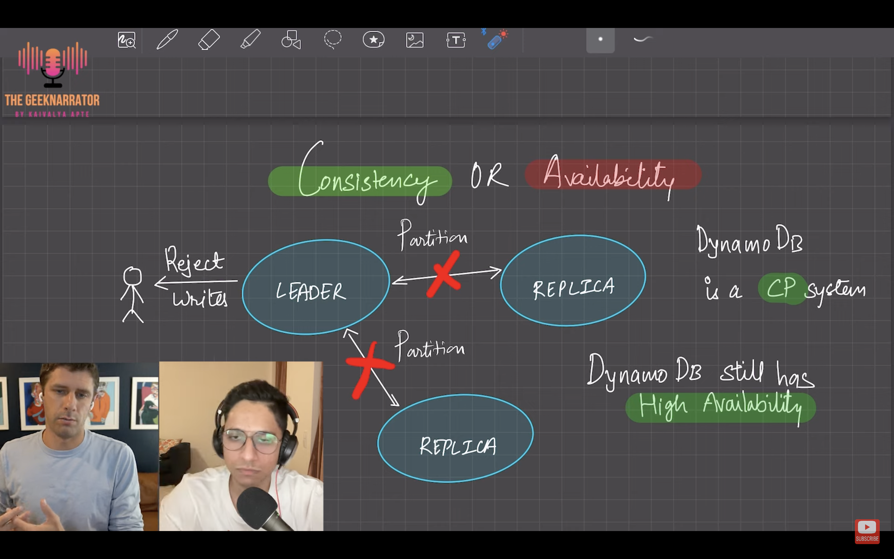
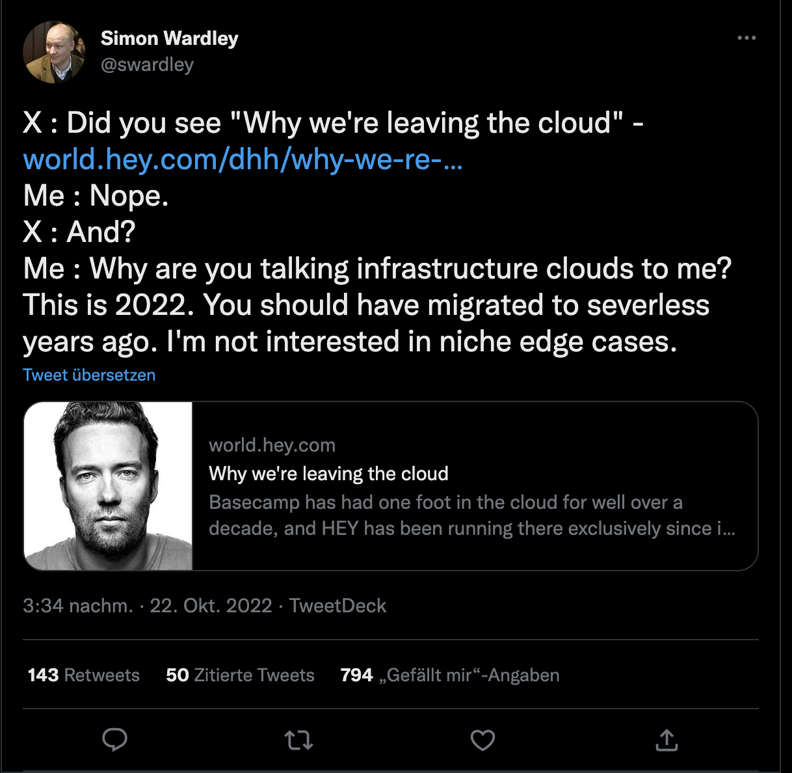
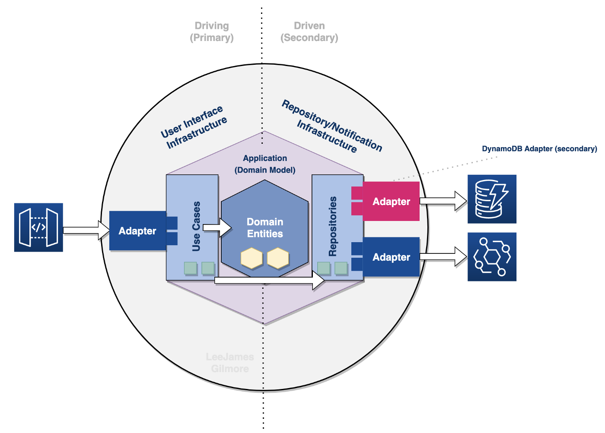
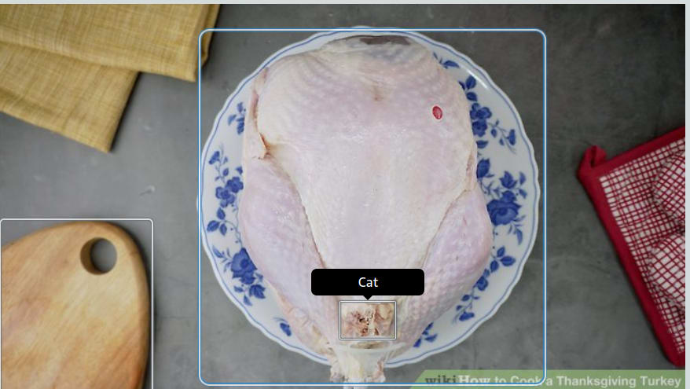

### AWS DynamoDB (Internals) Masterclass

I have been evaluating DynamoDB vs Aurora Serverless recently for a new project, and every time I do that, I end up in awesome resources from Alex De Brie.

<iframe width="560" height="315" src="https://www.youtube.com/embed/ifSckJlatWE" frameborder="0" allow="accelerometer; autoplay; clipboard-write; encrypted-media; gyroscope; picture-in-picture" allowfullscreen></iframe>

This time, interviewed by the Geek Narrator, it is about very deep internal stuff.  Highly recommended, especially the section where they discuss about the [CAP Theorem ( Consistency, Availability and Partition tolerance)](https://www.bmc.com/blogs/cap-theorem/)

### Serverless first!

[This article from Eric Elliot](https://medium.com/javascript-scene/whats-up-with-serverless-1b9bfa80f21f) is not really about AWS, rather Serverless in general, but makes very good points that I really agree.

> Serverless can save new development teams hundreds of thousands of dollars — sometimes millions — on the road to successful product launch and growth. With very few exceptions, almost all new software products should be serverless-first and only expand to add managed services on an as-needed basis.

When you are starting out with serverless, everything is  easier to build, easier to modify and iterate, easier to scale and adapt, and very likely it turns out to be cheaper too.  

If not, you are very likely **doing it wrong**.

### The cloud isn't the issue, you are just using it wrong

To continue with my absolutely _**confirmation-bias** free_ selection of articles under the search keywords **Serverless will rule the world.** here is another [great post from Serverless Advocate Jeremy Daly](
https://www.jeremydaly.com/the-cloud-isnt-the-issue-youre-just-using-it-wrong/).

I happened to read recently the article that spawn this post, because I generally like what David Heinemeier Hansson (DHH) writes, for example [this](https://world.hey.com/dhh/the-bubble-has-popped-for-unprofitable-software-companies-2a0a5f57) - and I was immediately thinking... _"wtf is he talking about?!"_.  Luckily someone with more credit than me can explain why that specific article and its arguments are nonsense. 

### Serverless Clean Architecture 

and speaking of Doing things wrong...
Over the years I heard many times people bragging about ** Clean Architecture** and **Exagonal Architectures (AKA Ports and Adapters)**: from Startups CTOs, throwing out these concepts because they just read them in a book, from Solutions Architects forcing it into applications which for size and complexity did not need that at all, and Hiring Managers expecting to see it applied in every code-challenge submitted by applicants.

The few times I encountered it in a code base, it was mostly very poorly implemented, at best over-engineered, and almost always unnecessary. 

Serverless Advocate Lee James Gilmore though, gives us **a perfect example of how things should be done**. 
It is a [_monster_ article](https://leejamesgilmore.medium.com/serverless-clean-architecture-code-with-domain-driven-design-852796846d28
)!  and with monster I mean it in a positive way,  the amount of detailed information that he provides and we have do digest is really impressive. 

Read it, and learn from it.  (but don't get carried away by the enthusiasm of such approach, not every app needs such an architecture.)

### Super funny article about AI/ML and AWS Recognition
Let's finish this article with something lighthearted.  
AWS Data Hero Renato Losio shows us [hot to (_not_) cook a thanksgiving turkey](https://dev.to/aws-heroes/how-to-cook-a-thanksgiving-turkey-according-to-amazon-rekognition-3d38) and why we should take carefully what AI/ML tells us - and more importantly, we should train the algorithm properly. And he does that with in a very humorous way.  I loved it!

