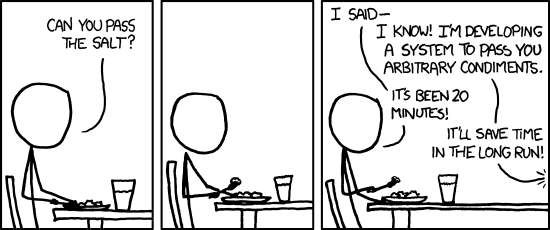

Recently I was digging into some repository and my attention was caught by this code:

  ```const nowInSeconds = ~~(Date.now() / 1000) ```

What the heck are doing the tilde there?  


I had to google it and of course ended up in [Stack Overflow](https://stackoverflow.com/questions/5971645/what-is-the-double-tilde-operator-in-javascript) 


The Tilde is the [bitwise NOT operator](https://developer.mozilla.org/en-US/docs/Web/JavaScript/Reference/Operators/Bitwise_NOT)

It behaves like that:

```
~N -> -(N+1)
```
A couple of examples
```
~-2 --> 1
~2 --> -3
```
**Why the heck would i need something like this in a normal context?**

yes.. i know that you can write clever hacks to convert falsy values or determine if you found something when using indexOf (~ -1 is 0, thus false)... but what are we even talking about?


> You can use it, to convert any floating point number to a integer without performance overkill that comes with Math.floor(). Additionally, when you care about minification of your code, you end up using 2 characters (2 tildes) instead of 12. [(from JS bitwise operators in practice)](http://rocha.la/JavaScript-bitwise-operators-in-practice)


Should we really use `~~(a/b)` to avoid writing `Math.floor(a/b)`? **Are you kidding me?**

Honestly, when used in a normal application, in simple methods that are not running thousands of operation per second, it just hides the intention and **hinders readability**. 
You might argue that it is just a matter of habit and I could be as well complain about the Spread Operator - in comparison to Object.assign:

```
const mergedOptions = {...optionsDefault, ...options};

const mergedOptions  = Object.assign({}, optionsDefault, options);
```

and you might be true. But sorry, no, it is not the same thing.  
These micro-optimisation using bitwise operator, are most of the time **unnecessary tricks to look smarter** during code reviews.


### Welcome to the cult

Just imagine this hypothetical conversation:

>Oh, you really didn't know the double tilde?   C'mon! it's a **bitwise operation** ( pronounced with low mysterious emphatic tone - welcome to the cult!) and it's _sooo much faster than Math.floor_.
Me: oh.. really?  how much faster? 
Up to 30% faster!!!
Me: wow, but, how much do we gain in milliseconds?
you can bring down 100000 operation from 44ms to 28s!!!!
Me: besides the fact who's gonna notice 20 milliseconds less in our application anyway, we are NOT running 100.000 operations! we are just running Math.floor ONCE at start-up!!!  Get outta here! 

I am not saying it is not useful.  it definitely is, **under some circumstances**. 
But as for any optimisation, we should do them when they are needed and they make sense.

[](https://xkcd.com/)


Otherwise, [keep it simple](https://dev.to/dvddpl/strive-for-simplicity-2131) and favour readability.


some other useful resources about the topic:
- [The Mysterious Double Tilde (~~) Operation](https://dev.to/asadm/the-mysterious-double-tilde-operation-mih)

- [JavaScript's Tilde: Its Real Use Is No Mystery](https://www.joezimjs.com/javascript/javascript-tilde-real-no-mystery/)