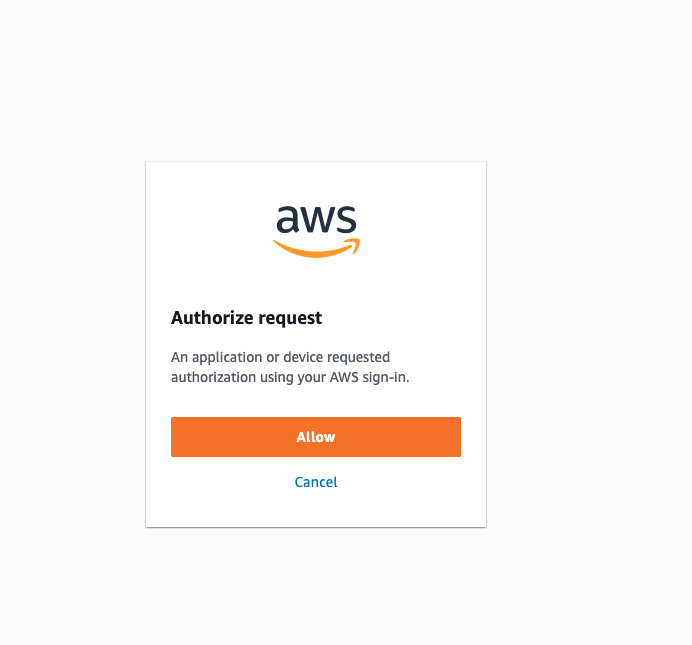
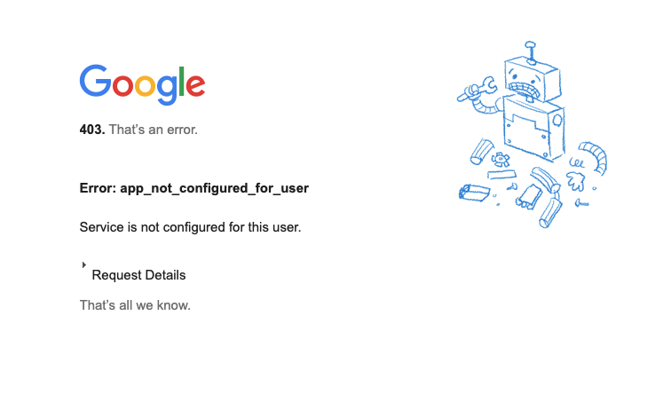

When you start out using AWS services one of the first things you do is configuring you AWS and setting up credentials on your machine.  
Nothing wrong about it but things can get trickier when you start having multiple AWS accounts or multiple Users/Profiles when working across multiple projects / teams.
Also having a file where secreds/key are hard-coded and valid ( until you disable them ) can potentially become a security problem.
Much better then, using temporary credentials and single sign on approach!

--- 

When I started writing this post in June service was called AWS SSO,  it has recently been rebranded to [IAM Identity Center](https://docs.aws.amazon.com/singlesignon/latest/userguide/what-is.html), but not much has changed the main point is that you can use an existing identity source to login to your AWS Account.

This Identity source can be Microsoft Active Directory, OTKA, [many others](https://docs.aws.amazon.com/singlesignon/latest/userguide/supported-idps.html), or like in our case [GSuite](https://aws.amazon.com/blogs/security/how-to-use-g-suite-as-external-identity-provider-aws-sso/) - basically I can login to AWS easily after I logged in in my company gmail. 

In order to do that you need to be part of an **AWS Organization** - a service that allows to easily manage multiple AWS accounts and even centralise billing.

Service is [free of charge](https://docs.aws.amazon.com/organizations/latest/userguide/orgs_introduction.html#pricing) and afaik there is no minimum number of accounts required to create one Organisation so, definitely it is suitable even for smaller entities. (do not confuse an AWS Account with an AWS User though - check [my previous post about IAM](https://dev.to/aws-builders/aws-iam-identity-and-access-management-cheat-sheetwrap-up-28mo) )


### Login Steps

Assuming you have an organization created this is how you can then set up your SSO login to AWS, and use and access AWS when building and interacting with AWS services.

- Access your specific company AWS page - this is not the usual AWS UI Console login page! - It should look something like this: _https://your-company.awsapps.com/start#/_.

- Follow the login path to your external identity provider - like ie Google Account - enter your credentials and give permissions if requested.

- You'll then be greeted by a "Start Page" with the different "AWS accounts/Profiles" you have access to (e.g. Team_Unicorn, Awesome_Devs, Devs4Marketing, DevOpsTeam and so on), select one and click "Management Console".

Now you should have the same AWS console you're used to working with, done!

The only visible difference is if you click on the right top corner on your account. It will show that you are a **Federated User** now, and **it will _not_ allow you to select other roles and switch back**.  
  
I honestly lack this functionality and the possibility of accessing AWS from the usual login (which is automatically suggested in the button of every AWS page and documentation) and find this a bit annoying, on the other hand the SSO Login page is just a bookmark away and you don't have to type in any credentials anymore.

### Setup for CLI

I assume that when building your applications and interacting with AWS Services accessing the AWS UI Console is **not** your preferred way but you are mostly  using the terminal and IaC tools like AWS CDK or Serverless. The so-called Click-Ops is useful just when you are starting out, especially with a new service, to understand how it works and how to configure it - after a couple of attemps, move to _infrastracture as code_ (you can version control every change and it is way more maintanable without thousand clicks!).

- Ensure you have aws cli version 2 by running `aws --version` to check.   **Update if necessary**. (very likely it will be easier to uninstall everything first). 
For more info - or if you really need to have both versions installed - check [this link](https://docs.aws.amazon.com/cli/latest/userguide/cliv2-migration-instructions.html)

- Rename your `~/.aws/credentials` and your `~/.aws/config` files so that you have a backup that does not interfere with this configuration - (renamed copy can be removed after successful setup).

- Run: `aws configure sso`: you will be prompted to enter your SSO start page ( the link I mentioned above ) and your region.

- At this point, a browser will be launched for you to login with google account (or any other provider you chose) and authorise, similarly as if you were logging in from the browser




- choose one of your roles (possibly your main one that you normally use for most activities within your team)

- under CLI Profile name, you can just write 'default' ( you can change it later if you have a multi-profile setup)
 
- now running `aws sts get-caller-identity`,  you should see in the response that your "UserId" contains the gmail ( or whatever provider you used). That means you successfully logged in and you session/token will last about 12 hours.

- whenever your need a new session, run `aws sso login`- browser will start, you can select a role and token will be refreshed for CLI access

> !! If you, like me, have multiple sessions of your browser open with different gmail accounts (I use one for browsing private private stuff and another one for work), make sure that when you run `aws sso login` your company one is on focus otherwise CLI will launch the wrong session and if you try to authorise with your private email, you will get an error ( because it is likely not authorised by your AWS Organisation)


 
### Multi-profile / multi-account setup

If you happen to be accessing resources from different account/profiles (see my previous post about [multiple accounts vs multiple profiles]( https://dev.to/dvddpl/how-can-you-access-aws-resources-from-different-accounts-use-different-profiles-1gb9) you will need to add them to your config.

- After logging in for the first time with `aws sso login` you will see that a new ~/.aws/config file was generated.  

- Open it, and copy the [profile default] section to use it as a template to create other profiles for any/all accounts/roles that you have access to with SSO.  Or you can simply copy your previous profiles from your the renamed copy of ~/.aws/config (see step above).

My previous config file was looking something like this :

```
[default]  <-- THAT WOULD BE MY TEAM **AwesomeDevs**
output = json
region = eu-west-1

[profile unicorn]
role_arn = arn:aws:iam::UNICORN_ACCOUNT_ID:role/AwesomeDevsCrossAccountAccess
source_profile = default

[profile marketing]
role_arn = arn:aws:iam::DEVS4MARKETING_ACCOUNT_ID:role/AwesomeDevsCrossAccountAccess
source_profile = default
region = eu-central-1
```

Now it looks like this:

```
[profile default]  <-- THAT WOULD BE MY TEAM Awesome_Devs
sso_start_url = https://COMPANY.awsapps.com/start#/
sso_region = eu-west-1
sso_account_id = AWESOME_DEVS_ACCOUNT_ID
sso_role_name = Awesome_Devs
region = eu-west-1
output = json


// I actually create a duplicate of the default with the right name  so it's clearer and can switch easily

[profile awesome] 
sso_start_url = https://COMPANY.awsapps.com/start#/
sso_region = eu-west-1
sso_account_id = AWESOME_DEVS_ACCOUNT_ID
sso_role_name = Awesome_Devs
region = eu-west-1
output = json

[profile unicorn]
sso_start_url = https://COMPANY.awsapps.com/start#/
sso_region = eu-west-1
sso_account_id = UNICORN_ACCOUNT_ID
sso_role_name = Team_Unicorn
region = eu-west-1
output = json

[profile marketing]
sso_start_url = https://COMPANY.awsapps.com/start#/
sso_region = eu-west-1
sso_account_id = DEVS4MARKETING_ACCOUNT_ID
sso_role_name = Devs4Marketing
region = eu-west-1
output = json
```

### Some more setup for CLI 🙄

Unfortunately, I noticed that when I was running my projects locally from my IDE ( like running a lambda connecting to dynamo ) or trying to deploy using serverless or cdk, (not just invoking AWS CLI commands from the terminal)  I was getting Unauthorised access.  
For the time being you need this small extra step:

- Install [aws-sso-credentials-getter](https://www.npmjs.com/package/aws-sso-credentials-getter) `npm install -g aws-sso-credentials-getter`  
- Ensure that an empty `~/.aws/credentials` file exists ( so that it can be overwritten, without a file command will fail)
- After every `aws sso login` you need to run: `ssocred default`  or `ssocred {profile}` if you have custom profile

Once you have done it, you can `cat ~/.aws/credentials` and check that token have been added and you can then use it with serverless. 

Likely, you will proabably need to add `AWS_SDK_LOAD_CONFIG=1` to your Run/Debug configuration in Intellij or VsSCode - that will tell the runner to load the configuration file you have now setup otherwise if your code is accessing resources cross-accoujt ( as I was doing and explain [here](https://dev.to/dvddpl/invoke-aws-services-cross-account-from-lambda-with-aws-cdk-and-aws-sdk-v3-oll)) without that - and without having run `ssocred` you would get this error:

```
>UnhandledPromiseRejectionWarning: ExpiredToken: The security token included in the request is expired at deserializeAws_queryAssumeRoleCommandError  .... 
```


### Troubleshooting

- Ensure you have a section `[profile default]` (or `[profile {profile}]` in ~/.aws/config
- Inspect the contents of ~/.aws/credentials after running `ssocred`, 
- ensure it has temporary credentials with an expiration date and nothing else
- **Really** pay attention that in your config file you have [profile PROFILE], at first I just created [PROFILE] and nothing was working (and i was getting `The config profile (Team_Unicorn) could not be found`)
- Try out switching a couple of times.

What i normally do is besides using `sts get-caller-identity` is accessing `s3` for each profile: I don't remember AccountIDs by heart but i can remember what buckets / projects we have in our different teams / account so I always quickly check it like that:

```
aws s3 ls --profile Team_Unicorn
aws s3 ls --profile Awesome_Devs
```

or
```
AWS_PROFILE=Team_Unicorn aws s3 ls
AWS_PROFILE=Awesome_Devs aws s3 ls
```

Personally though, I prefer to switch the AWS_DEFAULT_PROFILE I am on in the specific Terminal Window. 
By doing so, I don't have to be bothered to specify the profile in every command and i can use whatever script I find in the repo: most of the times in fact script of configs don't explicitly tell which profile they should use - they assume the default.  

Imagine a repo from UnicornTeam that I have access to.  They don't write in every their script --profile Team_Unicorn because their developers have that already set as their default.

If i run their script though, my default would take over and everything would break.   so i normally do
`export AWS_DEFAULT_PROFILE=Team_Unicorn`  and I can be sure **every CLI command from that moment on (in _that_ terminal window)** will act on Team_Unicorn account.

Sometimes it can be confusing, or can bite back, but I find it more handy.


### Some considerations

Especially if you constantly run and debug projects over multiple accounts you need to aws sso login and then run ssocred _for every profile you have_.

I am not super happy with this setup right now, but I know that **it is just a matter of getting used to it**. 
And more importantly, how tedious the process could sometimes be, from a security perspective it is definitely a better approach than **having  ACCESS ID AND SECRET saved permanently on my machine.**

In case laptop gets lost or stolen, or somebody gets access to it and is able to read the file, they will be able to impersonate you. **Until you go to your AWS console and _deactivate_ those credentials.**

Before .aws/credentials looked like this
```
[default]
aws_access_key_id=SOME_KEY_ID
aws_secret_access_key=AN_HASH
```

Only my main account was listed, which was able to assume other roles (listed in the config)

Now in that file ( after running `ssocred`) you can find access_keys and id for each profile individually, and each of them has **a token with expiration time** 


```[profile]
aws_access_key_id=SOME_KEY_ID
aws_secret_access_key=AN_HASH
aws_session_token=IQo_A_VERY_LONG_TOKEN_EJLZ
expiration=1655335572000

// for each account i have access to 
```

Temporary credentials reduce the risk, because they are, well **temporary**, they expire after 12 hours and require you to log in again. 


If you try to access any AWS resource from your code or use any CLI command the next morning you will get the following error:
> The SSO session associated with this profile has expired or is otherwise invalid. To refresh this SSO session run `aws sso login` with the corresponding profile.`

I must say that was annoying the first couple of days: you just start your day picking up the same code you left the evening before, you run it and it does not work anymore. Then you remember what you need to do to have it work again:  

```
aws sso login
// and then - to have your serverless and code working from your IDE
ssocred your_profile
```

A tad annoying but it just takes a couple of days to get used to it

---

Are you using SSO Login for your AWS accounts?  Do you have any tips or workflows to share to improve coding experience? 
Feel free to add them in the comments
