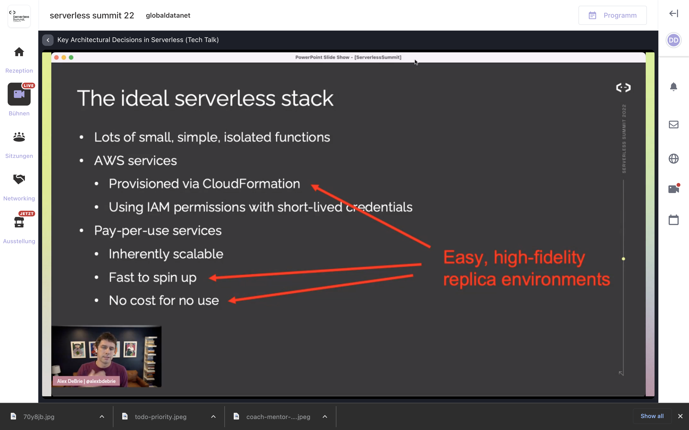
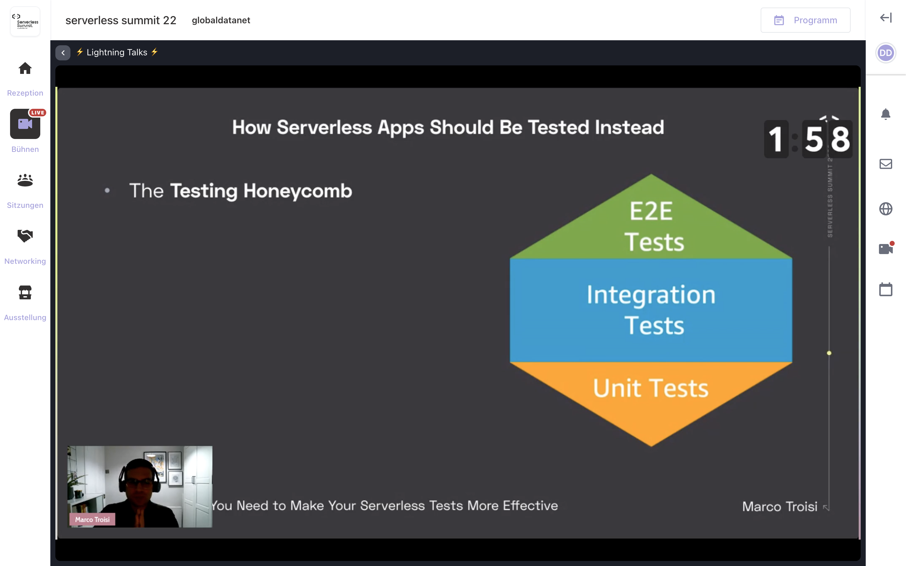
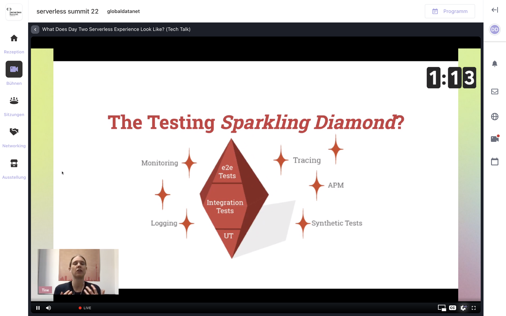

Yesterday was day one of [Serverless Summit](https://www.serverless-summit.io/) - a community-driven virtual conference about modern application development using serverless on AWS. 

It was packed with Talks, Panel discussions and Lightning Talks from many AWS Community Builders, AWS Heroes, Solutions Architect or Cloud Engineers willing to share their experience. (like **Alex De Brie, Yan Cui, Matt Culter, Allen Helton**, and many others I didn't know - and I will start to follow on their blogs!)

Here are some screenshots and thoughts from yesterday talks:

### Key Architectural Decisions in Serverless
Alex DeBrie

> Services that require a VPC are usually non-serverless services.  Try your best to avoid adding VPC ( and other non-serverless services to your application.

This statement hit me, VPC add complexity, costs, can impair development speed and testing capabilities.   I really need to dive deeper into this topic, because too often I see project with API Gateway and Lambda where a VPC is added by-default because of ... reasons!

--- 

Testing Serverless application was one of the main topic yesterday,  touched by many speakers - because it is not as easy as in _normal_ application.  Requires a shift in mindset and different tools.

The Testing Pyramid does not really apply anymore. What options do we have?

### The 1 Priority Change You Need to Make Your Serverless Tests More Effective - Marco Troisi

## The Testing Pyramid in a Serverless world - Kristine Jetzke

Kristine also concluded her speech with a quote I love and we should all remember to us and to producers/project managers every time discussions about technical debt, time-to-market and crunch times start to happen - there is no trade-off, really!:

> High performers understand that they don't have to trade speed for stability or vice versa, because by building quality in they get both. (Nicole Forsgren author of [Accelerate](https://www.amazon.de/Accelerate-Software-Performing-Technology-Organizations/dp/1942788339))

----

I really loved the Panel Discussions - really a friendly and informative chat about observability, tests, developer productivity and cool serverless solutions. But also the lighning talks were a packed of useful little _gems_ of serverless wisdom.

I am very looking forward to seeing today's talks.
Check out if you can still register, [tickets are limited, but free](https://www.serverless-summit.io/)!
