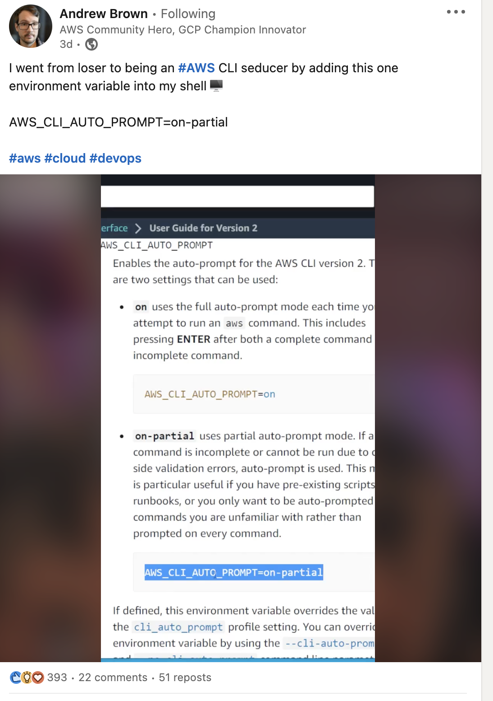
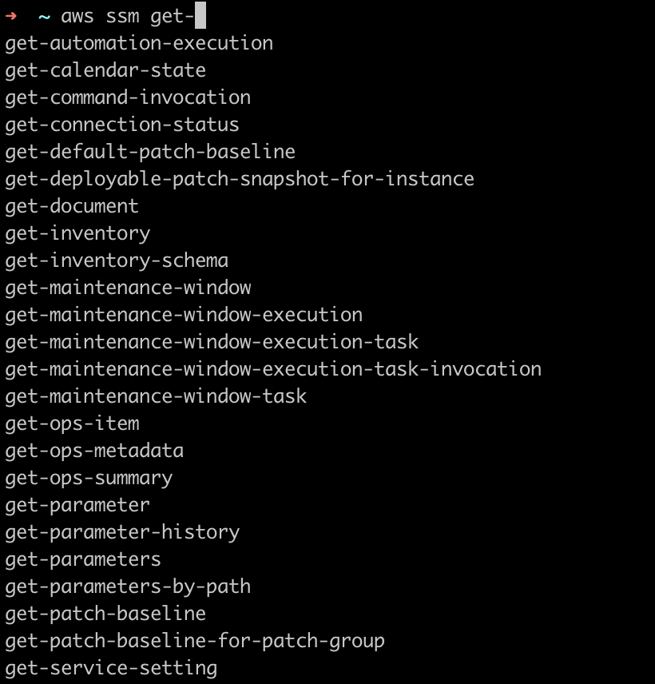
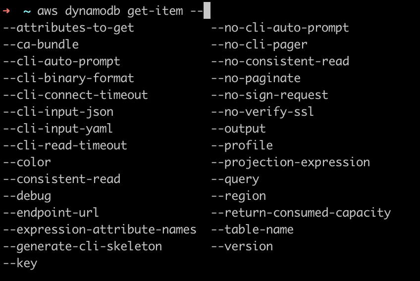

Days ago I was scrolling LinkedIn and noticed a video post from [AWS Hero Andrew Brown](@andrewbrown).

[
](https://www.linkedin.com/posts/andrew-wc-brown_aws-aws-cloud-activity-6999086879954362368-Aoko/?utm_source=share&utm_medium=member_desktop)

A prompt/autocomplete for AWS CLI Prompt?!? Cool!

Is that available only within [Cloud Shell](https://aws.amazon.com/de/cloudshell/) he's using in the video?
As Andrew already mentions in the comments, you can use it everywhere you have [AWS CLI](https://docs.aws.amazon.com/cli/latest/userguide/cli-usage-parameters-prompting.html), therefore I immediately tried it out, and it was mind-blowing.

Just type:

```
export AWS_CLI_AUTO_PROMPT=on-partial
```
in your terminal and everything you type next will be autocompleted ( or if there are more matches, the available matches will be prompted).

The cool thing is not that it autocompletes the available services - sure you can save some keystrokes if when typing `aws dy` you can get it autocompleted to `aws dynamodb` but that would not be so helpful.

No, it will prompt you all the available commands for that resource!



and most importantly, its parameters!



That is really cool, but... do I have to export that variable every time I launch a terminal window? of course not: 

Basically, Open your shell of choice ( I use .zsh ) export the **Completer** path (not just the **Prompt** variable), reload it and tadaa!

``` 
PATH=/usr/local/bin/aws_completer:$PATH
```


Check [the docs](https://docs.aws.amazon.com/cli/latest/userguide/cli-configure-completion.html) to find out how to set it up for your shell (bash, zsh and so on)

 