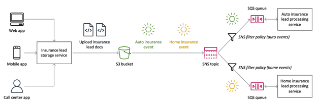

### Scared by direct integrations?
Some time ago I wrote a post about my experience [integrating directly API Gateway with DynamoDB without using a Lambda Function](https://dev.to/aws-builders/look-ma-no-lambda-lambdaless-apigateway-and-dynamodb-integration-with-cdk-2hbd).
I am very happy that this lambdaless approach is gaining traction, and somehow glad to see that lots of other ( way more experienced and influent professional shared some of the same concerns).  Check out my post above and the amazing and [very detailed article by AWS Hero Allen Helton](https://www.readysetcloud.io/blog/allen.helton/direct-integrations-arent-scary/) to find out why and when to use Direct Integration!
and remember:
> complexity != unfamiliarity

### Re:inventing the wheel?
Re:Invent is happening soon, and god knows how many new services and changes we will get. 
Since I started working with AWS I always found quite hard to figure out what was the latest, best service to use for a specific task.  There are so many services, and so many overlapping ones!  
 
Corey Quinn explains in this post titled _[The Feudal Lords of Amazon: AWS' Infinite Service Launches and Counterproductive Culture](https://www.lastweekinaws.com/blog/the-feudal-lords-of-amazon/)_ why this tendency from AWS is dangerous and counterproductive, with his usual dose of humour!

### 12 Factor methodology 
This is not new, actually is blog post from 2018! but I happened to reread it last week when concerned with some CI/CD approaches in a new project. It is always worth a read.
[12 Factor app Methodology in serverless applications](https://aws.amazon.com/de/blogs/compute/applying-the-twelve-factor-app-methodology-to-serverless-applications/#config)

### SNS payload filters
A very welcome new feature of SNS is the possibility to filter by Payload.

> You use SNS topics to fan out messages from publisher systems to subscriber systems, addressing your application integration needs in a loosely-coupled way. Without message filtering, subscribers receive every message published to the topic, and require custom logic to determine whether an incoming message needs to be processed or filtered out. This results in undifferentiated code, as well as unnecessary infrastructure costs.

See [official AWS Post](https://aws.amazon.com/de/blogs/compute/introducing-payload-based-message-filtering-for-amazon-sns/)

[Serverless Hero Yan Cui](https://www.linkedin.com/posts/theburningmonk_introducing-payload-based-message-filtering-activity-7000957186709274624-9DY6?utm_source=share&utm_medium=member_desktop), illustrated the main points why this is a very good news and and compares its use case with AWS Event Bridge 
