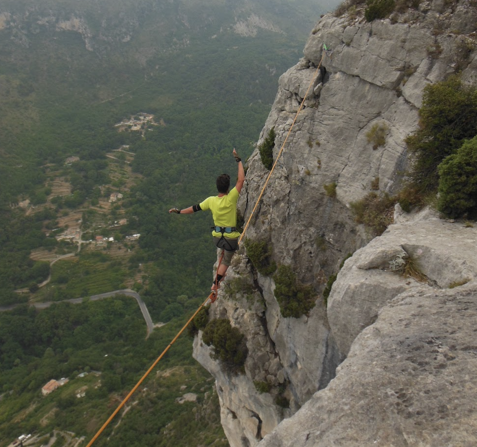
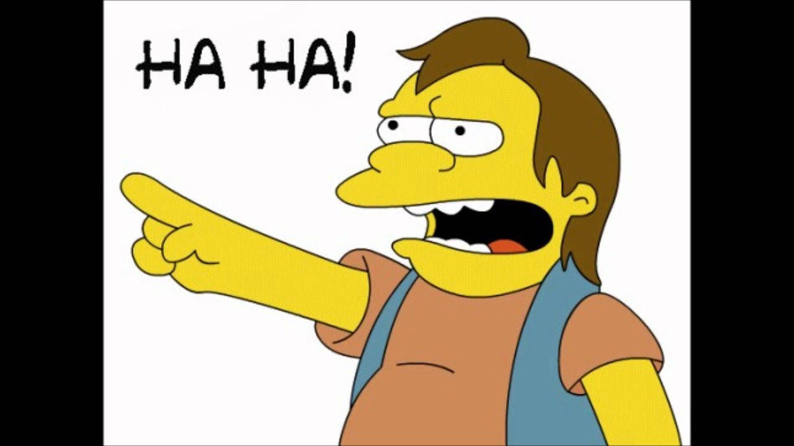
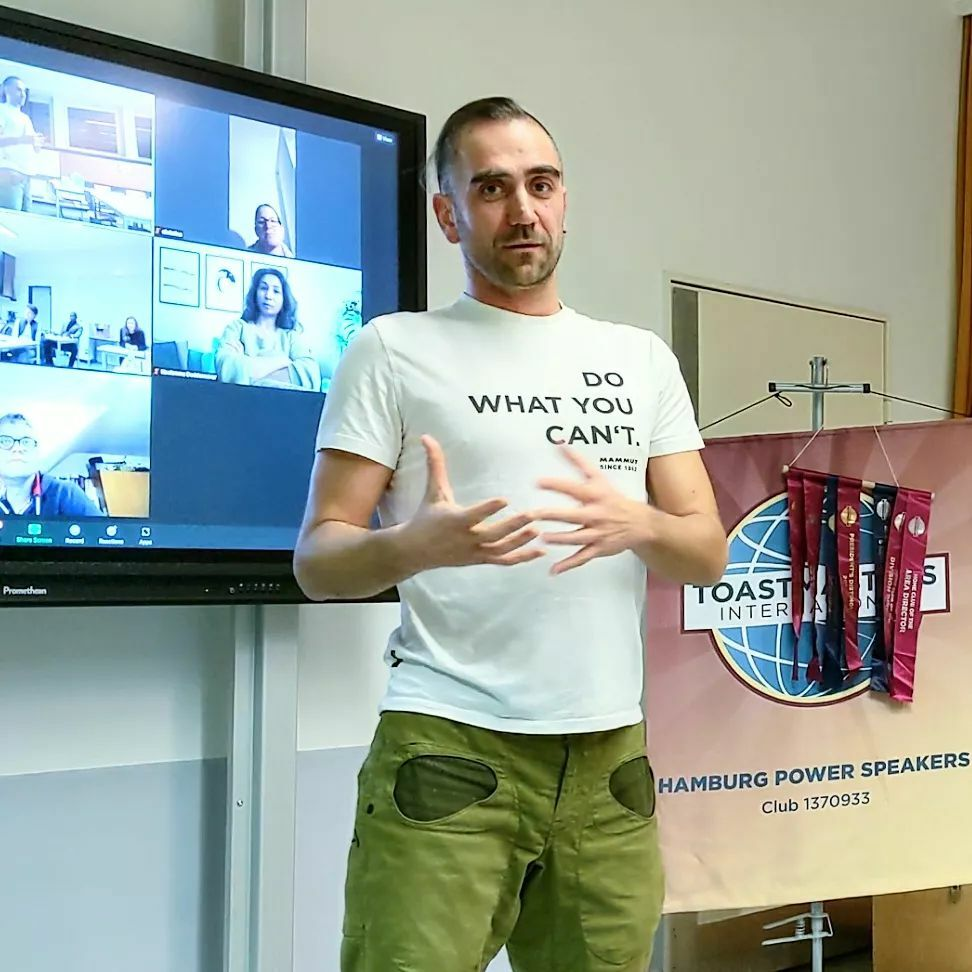
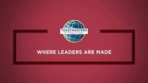

> What am I doing here? why do I do this to myself? 

Have you ever had these feelings and thoughts, whenever you decided to challenge yourself and push yourself **out of your comfort zone**?

This fear, and excitement, this force that pulls you towards something while at the same time, pushes you away and causes you dizziness, dry throat, stomach pain and sweaty hands.

**This is the feeling that I was always looking for.**

I have been looking for this all my life: walking a slack-line many meters off the ground, rock-climbing  or jumping off a cliff snowboarding, or well, giving speeches!!

4 years ago I really wanted to give a boost to my career and start giving speeches and workshops at Tech Meetups and conferences.  
But I was **petrified** just at the thought. 

I had already held some workshops or presentations to groups of colleagues in the past, but that was always in a safe environment: I knew I was the expert there, I knew already the people I was talking to, and there was no stage, just our usual meeting room and a big screen.
 
That's different than going on a stage in front of 50, 100, 200 developers who could in fact be more experienced than me, or could have no mercy in pointing out my mistakes. 

Therefore I joined a Toastmasters Club: to practice public speaking. 
The first evening, I was very very excited and I blushed just at the presentation round, and I looked at the speeches with awe.  

> wow…  I will never be that good.  these are just mini TED talks!  They are telling stories, they are not just reading out loud slides… 

In June 2019 [I gave my first speech](https://dev.to/dvddpl/my-first-speech-at-toastmasters-pnn), the icebreaker.  
Needless to say, I prepared that for days. 
I wrote a script, rehearsed it, rewrote it, rehearsed it many many times, alone, in front of a mirror, in front of my wife and kids, **I recorded myself and felt ashamed and deleted it immediately.**
  
When it was my turn I felt sick.
I thought I could not remember a single word, I needed to drink, but then I felt I needed to go to the toilet, in an endless loop of anxiety.

Then, after the host of the evening introduced my speech, I took a breath, and just started talking about myself and my passion - slack-lining - and time flew by. When I got back to my seat I just remember it my cheeks and hears were burning hot and I felt drained, but I happy and couldn't stop smiling.

From that moment I gave 18 speeches to get to this. The final one of my Toastmasters' Pathway.

**The stage fright never goes away**.

The stage fright is always there. The thing is, **you get comfortable with being uncomfortable.**

And most importantly, you can **reframe your feelings**. you can change how you want to feel about what's happening to you.

> Those sweaty hands and sizing stomach are not the result of fear and anxiety. No, that is excitement, adrenaline and dopamine running through you and giving all your strength and concentration to go on.

And, of course, the more you do the better you become at it. The more you expose yourself, the more your confidence increases. 
You will be sure, that your memory will not betray you, that even though you lose your train of thoughts and forgot a line,  you can easily make up something, improvise, - and even though you make a mistake - especially at Toastmasters - **nobody will point at you laughing…!**

Speech after speech, I realised I needed less training and preparation.  A couple of times I jumped in to cover someone who was sick and prepared a speech a couple of hours before the meeting, rehearsing it just a couple of times.  Probably it was not my best speech, but it still worked!

Something like this can indeed happen in life or at work: your boss comes and with very short notice asks you to give a presentation the next day because he is busy or your colleague is sick.  Knowing that you can do fairly well even when unprepared, is a great confidence booster. 

Unfortunately during this journey the pandemic stroke. 
Therefore [most of the speeches of my Pathways happened on Zoom](https://dev.to/dvddpl/public-speaking-in-times-of-covid19-4n66).  
Therefore... not really on a stage, in front of many people. 
For this reason, not much anxiety, not much stage fright.

Having to present online did not mean, I did not have an audience, or that I did not have to properly prepare a story, to know how to connect and keep the audience interested,  to think about eye-contact, the use of my voice and where to place my hands, and so on. 

Actually considering that since then I only worked, and will continue to **work remotely**, it has been very beneficial. 
 
Camera position, hand position, where to look at, mute unmute, keep online meeting engaging, dealing with **zoom fatigue**:  all this helped me in my career, let me feel **more confident in online job interviews.** 

And Toastmasters is not only about public speaking!

All roles you can take on during a Club Meeting are important and are little pieces that build up your confidence and skill set.  
You can choose how much to expose yourself before giving a speech or being the Toastmaster (the host) of the evening:   you can start with keeping the time, or counting Aahs, Ehms and filler words, then later take the challenge of 2 minutes Impromptu Speeches. And give feedbacks to the speakers. 

Oh, the feedbacks! Something that I really underestimated when starting my journey. Don't get me wrong - of course, I was interested in **feedbacks**, criticism and advice  are fundamental to becoming a better speaker.  
But I never looked at it from the perspective of learning how to **give feedback**.  Nor I was, initially, so interested in hosting meetings.  
The truth is that but by being exposed to it, taking up these roles, I realised how important they were, I became better, and unexpectedly I was giving better feedback to my colleagues at work ( we constantly review each other code ) and was more clear, confident in my communication with clients and colleagues from other departments. 

When I joined **I really did not care about the "leadership part of toastmasters" I just wanted exposure to public speaking.**  But my improvements in these so-called _"soft skills"_ likely, in part, contributed in allowing me to **[become a technical lead](https://dev.to/dvddpl/from-engineer-to-tech-lead-doubts-and-challenges-4n9e)**.

Something else I want to point out is the importance of the Board roles.  A Toastmasters Club would not work without board members. A toastmasters evening is not just 2 Wednesdays of the month.  Many things are organised and prepared during the previous weeks. 
Becoming a board member is the perfect way to **practice running meetings, making decisions, collaborating, delegate**, all skills which are needed at various levels in many companies and different jobs.   So... Join the board! 

Then, what can I tell more about my journey.
I changed so much since I joined Toastmasters, and in so many ways that I could never imagine. 
The benefits I have seen are not only in my professional life, but also in my private one, be it introducing myself at a party in a charming way rather than with a boring _"yeah… i am a developer…"_, or chatting with other parents out of school ( as an introvert, small talk is still incredibly tough for me).

In one word, all the learnings at Toastmasters could sum up to:
> **Confidence**.

Being able to speak in front of a public, moderate a heated discussion, give negative feedback without hurting feelings, goes down to confidence in yourself.  
And **when you have confidence in yourself, then everything, everything in life looks easier**.  
You understand yourself better, you know your value ( and this helps at job interviews and **salary negotiations**"), you know that you can achieve whatever goal you set to yourself .

> According to most studies, people's number one fear is public speaking. Number two is death. Death is number two. Does that sound right? This means to the average person, if you go to a funeral, you're better off in the casket than doing the eulogy! (Seinfeld)

<iframe width="560" height="315" src="https://www.youtube.com/embed/yQ6giVKp9ec" frameborder="0" allow="accelerometer; autoplay; clipboard-write; encrypted-media; gyroscope; picture-in-picture" allowfullscreen></iframe>

We are all here to face our fear of public speaking. And we are all alive!!!

---

This is the transcript of the last speech I gave at [my local Toastmasters Club]() for Level 5 of my **Innovative Planning** Pathways: Reflect on Your Path. 

I hope you find my writings interesting and somehow useful.

[Toastmasters](https://www.toastmasters.org/) is an international organisation to practice **public speaking and leadership skills**. Check out their website to find a club near you!

