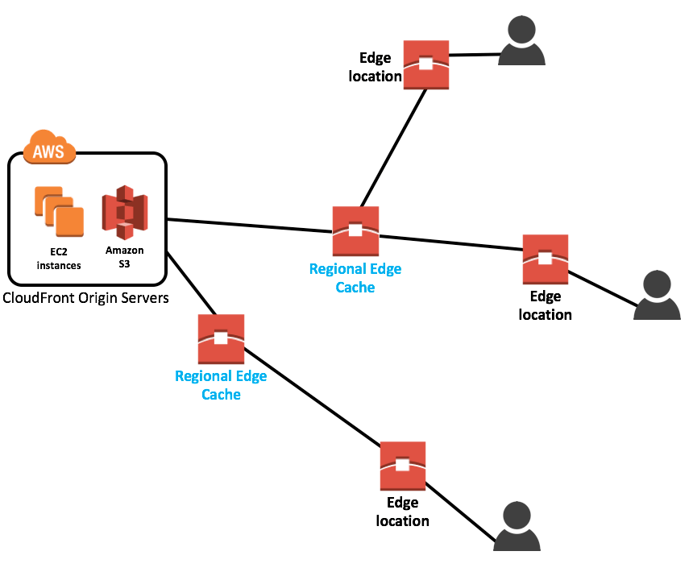
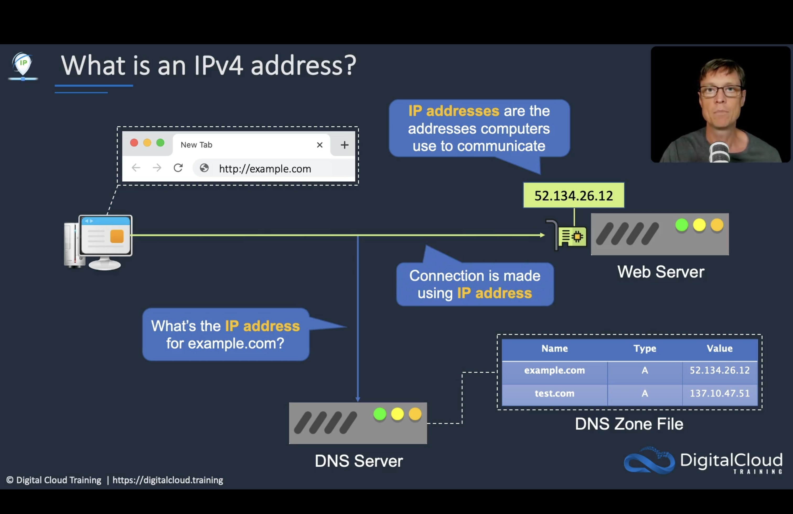

Before diving into Virtual Private Cloud concepts useful for the exam, let's start with the main concepts/components of AWS Global Infrastructure, in regards with closeness to the end user, and where our resources resides - on-premises or in the cloud. 

<iframe width="560" height="315" src="https://www.youtube.com/embed/UuRX2gK0IYw" frameborder="0" allow="accelerometer; autoplay; clipboard-write; encrypted-media; gyroscope; picture-in-picture" allowfullscreen></iframe>

## AWS Global Infrastructure

- **Region**: collection of AZ geographically closely located (usually same city) so that worldwide customer base can take advantage of low latency connections;  regions also allow compliance with with regulations, laws and governance relating data storage. (currently 26+)  
- **Availability Zone** : essentially physical data centers;  2 or more in each region, isolated from each other using separate power and network connectivity.
- **CloudFront**: is a CDN, to get content closer to users
- **Edge location**: AWS sites deployed in major cities/ highly populated areas. Not used for deployment our own infrastructure, but used by many services like CloudFront and Lambda@Edge to cache and reduce latency.
- **Regional Edge Cache**: AWS sites located between Cloudfront Origin servers and Edge Location; they have a larger cache than individual Edge location and lower latency than Cloudfront. 

- **AWS Outposts**: with outpost you can run _some_ AWS services on dedicated hardware within your on-prem data centers
- **AWS Local Zones**: for ultra low latency applications (live video, MRL, AR/VR)
- **AWS Wavelength Zones**:  similar to LocalZone but for 5G devices (single digit ms latency)
- **VPC (Virtual Private Cloud)**: **a logically isolated portion of AWS cloud within a region**
- **Private and Public subnets**: **a range of IP addresses in the VPC** where we can place groups of isolated resources

Also some introductory concepts as IP Addressing, CIDR Blocks and Subnetting is necessary to understand how to properly configure a VPC:

##IPv4 and IPv6 Addressing

An IPv4 address is 32 bits long (4 octets ): this means there are 4.3 billion addresses available which are going to be soon exhausted.

The first 3 binary octects are Network Id, while the last one is the Host ID
Different Computers on same Network will have same NetworkId, ( like 192.168.0) but have unique HostIDs.

IPv6 addresses are 128 bits long and use hexadecimal instead of dotted decimal.  

When using IPv6 for VPC CIDR Block AWS will provide a /56 CIDR block from their own pool.

All IPv6 addresses are publicly routable and no NAT is necessary. If we want to allow only outbound traffic, we can use **egress-only internet gateway**.
