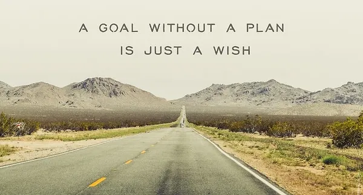
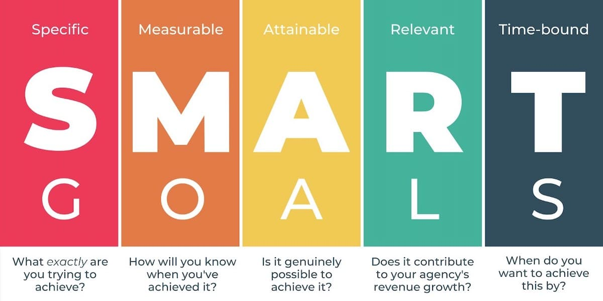
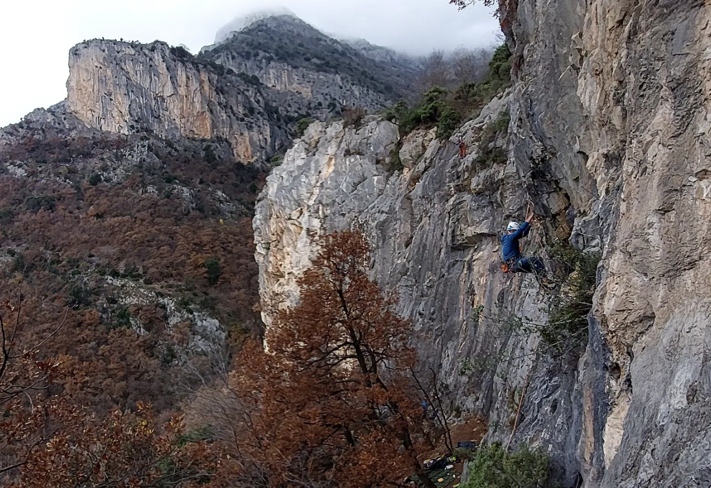

[In my previous post](https://dev.to/dvddpl/my-2022-was-not-as-bad-as-i-thought-after-reading-all-other-peoples-yearly-retrospectives-a5p) I addressed the problem of how **constantly checking social networks** ( or any sort of blogging-podcasting feed) - both for private and professional purposes - **can become toxic**.

These sources of content where _everyone shares their best part_ ( be it a promotion or new job on LinkedIn, an exotic trip pic on Instagram, or tons of tutorials on youtube or dev.to ) are in fact an endless source of inspiration and motivation to do _more_ that can bring huge benefits on your personal life and your career:

> Learn more, work more, earn more. 
Have more impact, be more satisfied with your team/company/projects.
Travel and discover more.
Eat healthier and make more exercise.
Connect more with people around you (both online and offline).

But it can also put tremendous pressure on you. So much so, that sometimes you might be tempted to **simply give up**. 
After scrolling and seeing all those amazing achievements made by hundreds of people and looking back to your routine, you might feel discouraged, or unworthy, or incapable of achieving anything at all.  

What we should remember is that _all those amazing achievements made by hundreds of people_ are, well.. made by many different people, and we don't know how long they took to get there, where they started from, what is their private life, under which circumstances they are able to do all that. And most of the times, we are not shown all their failures. 

But reality is that we are all different, with different goals, backgrounds and talents and we should **stop measuring ourselves against others** and we should instead just comparing ourselves with what we were in the past, and **competing only with the we of yesterday**.

Now that we moved _the others_ out of the equation let's focus on what we were, what we are and what we want to become.

I love this quote from Alain de Botton:

> Anyone who isn't embarrassed by who they were last year probably isn't learning enough.

I honestly don't like much the word _embarassed_ or _ashamed_ but I get the idea and agree with it. 
How many times have I checked some code of mine committed 3 years ago ( or even just 6 months ) and think "What the heck?! That was not me - how could have I written such silly code" - a lot!

How many times have I watched some videos of me climbing and wonder how come I was struggling, sweating, hanging hectically from routes I find easy? a lot!

Same goes if I think back at workshops and presentation I have held, or blog posts I have written.  

> Was I really so bad, so naive, so hesitant, so unskilled? 
That is embarrassing! Destroy all the evidence! 

The point here is _not_ that **we should feel ashamed of ourselves**,  rather the opposite! **we should be happy and proud of ourselves**, we should pat ourselves on the back for all the effort we put into becoming better and get to where we are now!

How can we make this transformation, this process of getting better, more purposeful, intentional and structured?

I am by now way an expert, and I haven't been really consistent over time, but what really helped me in the past years has been simply the following:

- Focusing on building Habits rather than just setting goals.
- Defining SMART goals
- Keep a gratitude journal

### Habits vs Goals
Our effort should point to establish a behaviour (that we likely find beneficial and we want to maintain over time) rather than just achieving a specific status/condition.

Loosing weight has little meaning, if after we got to our desired weight ( with lots of sacrifices and sweat ) we go back to eating junk food or we stop training. 
Much better is defining an healthy and reasonable diet and exercise routine that we can stick to. 

If we want to read more, we need to cut out time for it every day, or every weekend, so that it becomes a routine, instead of being happy that last year we managed to read 5 books in 3 weeks (but only because we were locked home because of COVID quarantine).

Example could go on for everything, study, career, sport and so on. 

The point is not just crossing the final line of your goal, but happily keep on going even after ( if that matters to you of course ).
Even if you are not interested in continuous improvement - say that you just want to pass an exam, how do you achieve that goal?  

You **still need a plan and build the habit** of spend some times on books every day - rather than hoping you will find the time and motivation while seeing the deadline - and the failure - approaching.

I won't go into the details of how to define goals that are SMART, there are lots of articles around explaining much better than I could ever do, but this is the gist of it:

- **S**pecific: target a particular area for improvement  
- **M**easurable: quantify or suggest progress metrics  
- **A**ttainable: ensure you can reasonably achieve your goals with the given resources  
- **R**elevant:  make sure your goals align with your values and long-term objectives
- **T**imely: highlight when your goal should be achieved  

## Don't break the streak
In order to build the habit, we need some discipline. And we need to visualise our commitment and our effort. 

Sometimes _showing up_ to just not break the streak is enough.

Often I feel too tired to go running and I could pick up any excuse for avoiding it - my knee hurts,  it's raining, when it's too cold, then I have asthma... - I try to resist to these lazy impulses and tell myself "Ok, I will just get ready and run 200 meters, then I can just walk at a fast pace, or just stroll and have a quiet time".  Most of the time, I then find myself completing the usual training, or at least doing a lot more than that bare minimum I agreed with myself just to not break the streak.

Anyway, _if you happen to have broken a streak, don't take that as an excuse to give up_: _Nothing_ is lost, **don't beat yourself up!** Just restart your streak! 

## Keep a Journal

Try to write regularly, every evening, or every sunday morning, or whenever you feel like, your small achievements, those little things that make you proud of you, or that made your day a bit happier.  
**Take the time to reflect, be mindful, be grateful and take pride of the tiniest progress.**
It will help to boost your motivation when at its lows, and be the evidence of your effort and of your process.

---

I hope these tips help, and now... let's see what I am "officially" committing to for this 2023!

# My 2023 resolutions
## Public speaking
I already applied to 5 CFP for events happening in the first few months of 2023, hopefully my submission will get accepted and I will finally have the chance to deliver some tech talks, ideally at least: 
- 1 online 
- 1 in person
 
## AWS Solutions Architect Associate certification
I have been postponing this for 3 years already, this must be the year - at least I have already bought and watched a fair amount of hours of Online Courses.
I will try to keep a streak of 30 mins minimum each day to study, let's see if I can take the exam within second quarter!

## Climbing
Since last summer I was able to consistently training climbing 2 times a week and bouldering 1 to 2 times a week, while I have been less consistent with running and yoga and stretching. 
Ideally I would like to go jogging and do stretching for the other 2 days of the week, to alternate from climbing and then have a full rest the remaining day. 

I was already able to see some progress in terms of stamina and technique ( as well as overall confidence and less fear of falling/getting injured), hopefully by the end of the year I will be able to **climb on-sight a route of grade 7+/8- UIAA (6C French / 511.a US).**

## Reading
I really need some time off-screen, so I'd like to dedicate 20 mins daily before sleeping to reading a book. It's nothing compared to when I was reading 3 hours a day ( because of commuting) and was spending the entire sunday devouring books) but I hope I can still get to 10 books this year.

## Blogging
I am quite happy with the number of posts I wrote last year 
(40!) - a bit less with the views and reactions.  Not much because I write only for the likes, _I write to keep track of my learnings, to vent off, to share some ideas and a bit of what I know, but it would be nice to see that these sharing has some impact on other people._ 
I will try to reduce the number of posts and focus on more technical ones - especially about AWS and Serverless. 
Most importantly I need to become more disciplined in terms of **organisation, time management, scheduling and cross posting**!
> sometimes I sit down with a quick idea for a blog post, find myself spending 3 hours, which then I can't resist posting at 1 AM of a Sunday ending up with less than 50 views.. 

##  AWS Community Builder
Hopefully I will continue my journey as Community Builder.  Sometimes it is overwhelming and daunting to see how many people are so skilled and so motivated and are able to post high quality content all the time, that I am a bit concerned my submission will not be renewed, but we will see.

## Career
As soon as I will be done with the Solutions Architect Certification I need to **solve the tech lead trap**.
I don't know if that will mean change company or talk with my Leads/Directors to redefine my role, or what else, but I would like to lead bigger team who are working on more complex - possibly serverless - projects.

## Traveling
This year, if Covid does not strike back, we planned a 2 weeks trip abroad in October (Asia or America). We still don't know where - considering flight time, time zone and rain season... any suggestion is highly appreciated.

## Quality time and gratitude
This is the toughest part. Often I am so focused on doing stuff that I miss the opportunity to appreciate what I have. 
I need to create an habit of _just chilling_ and playing or chatting with my kids and wife. 
Working from home has somehow made that more complicated, because I am always home, I see them all the time, I am always there if they need something, but in reality, I am not really _there_ - I am still busy doing something else.  

I need to improve being grateful and **force myself to be mindfully present**. 

---
Some related posts you might find interesting:
- [How to deal with rejections and failures](https://dev.to/dvddpl/how-to-deal-with-rejections-and-failures-cgb)
- [Your jobs is boring and everything sucks](https://dev.to/dvddpl/my-jobs-is-boring-and-everything-sucks-or-not-1lnp)
- [Focus on the positive! how do you stay positive when you fail](https://dev.to/dvddpl/focus-on-the-positive-pt2-how-do-you-stay-positive-when-you-lose-395m)
- [What mass layoffs, cancelled projects and chinese farmers can teach us about resiliency](https://dev.to/dvddpl/what-mass-layoffs-cancelled-projects-and-chinese-farmers-can-teach-us-about-resiliency-1ln1)
- [What does Agile mean to you? An open letter to my Project Manager](https://dev.to/dvddpl/what-does-agile-mean-to-you-an-open-letter-to-my-project-manager-4mgb)

---
Foto von <a href="https://unsplash.com/@neonbrand?utm_source=unsplash&utm_medium=referral&utm_content=creditCopyText">Kenny Eliason</a> auf <a href="https://unsplash.com/de/fotos/Ak5c5VTch5E?utm_source=unsplash&utm_medium=referral&utm_content=creditCopyText">Unsplash</a>
  
