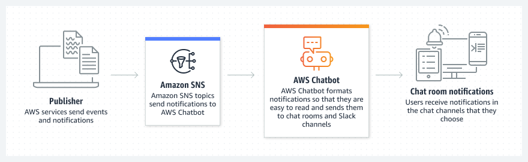
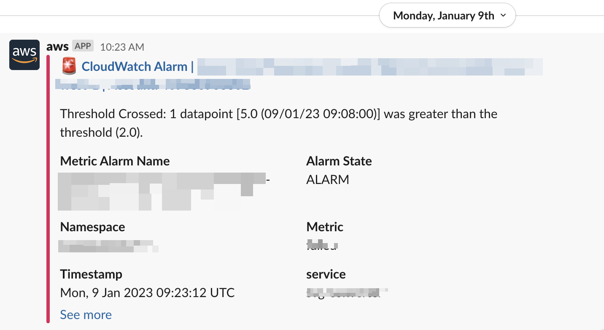
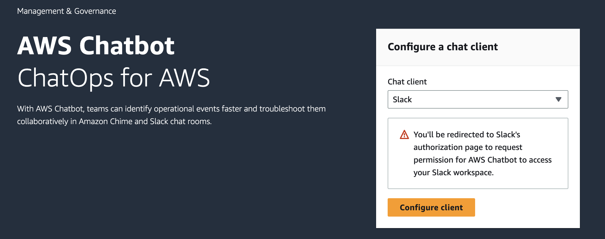
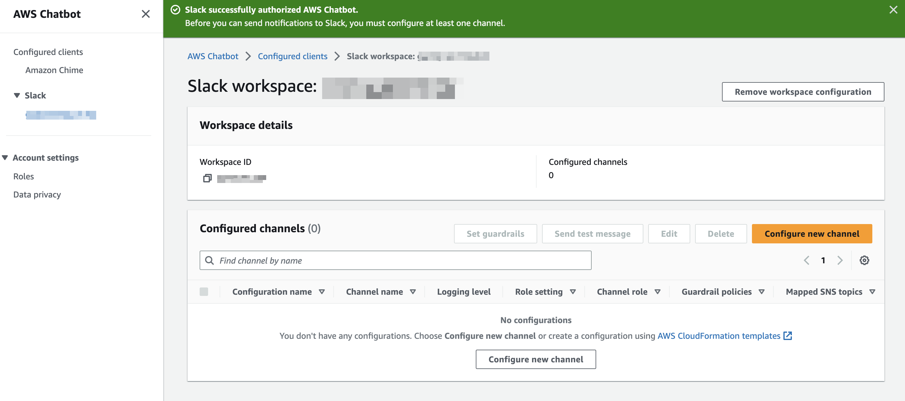
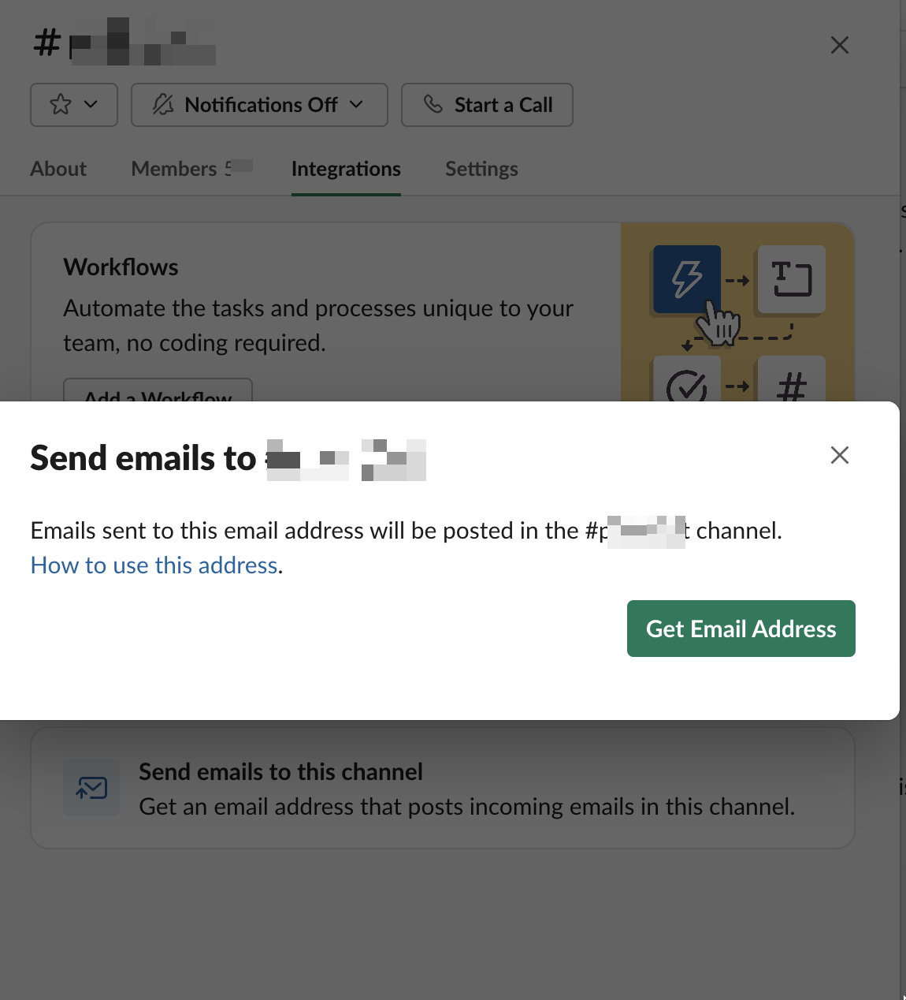

What I really love about AWS and Serverless is that over time new services pop up ( _yeah well, this is not always a good thing, as pointed out by [Corey Quinn](https://www.lastweekinaws.com/blog/the-feudal-lords-of-amazon/)_) or **features are added that make everything simpler and even cheaper**. 

For our project we always set up **Metrics, Alarms and Notifications** to be able to quickly react when something is behaving weirdly.
One of the way we set up our monitoring system was via **Slack Notifications**.


## Old approach: SNS + Lambda 
In order to send notifications to Slack, we used [SNS](https://aws.amazon.com/sns/) and Lambda.

In our CDK stack we:

- created an SNS Topic 
- created a Lambda function in charge of sending out the notification to Slack
- created a subscription to the above topic for our lambda

```
import {LambdaSubscription} from '@aws-cdk/aws-sns-subscriptions'
import {Topic} from '@aws-cdk/aws-sns'

const topic = new Topic(this, `SlackNotificationTopic`, {
            displayName: `slack-notification-topic`,
            topicName: `slack-notification-topic`
        })

const lambda = new lambda.Function(this, 'SendSNSToSlack', {
            // usual lambda props 
})

const slackSubscription = new LambdaSubscription(alarmsToSlackFn)
        
topic.addSubscription(slackSubscription)
```

In order to send messages to Slack, you need to enable **WebHooks**, see [here](https://api.slack.com/messaging/webhooks).

Our Lambda function needed that webhook url, together with the ID of the Channel we wanted to send notification too ( and we decided to pass them via `CDK context.json`. 

Our Lambda was not doing much actually, just grabbing the message from the SNS Event it receives as payload - as described [here](https://docs.aws.amazon.com/lambda/latest/dg/with-sns-example.html#with-sns-example-create-test-function) - and then use [axios](https://axios-http.com/docs/intro) (but any http client would do) to send an http request to slack webhook.


```
exports.handler = async function (event) {
    const snsEvent = event.Records[0].Sns
    const postData = {
        channel: CHANNEL_ID,
        username: `whatever you want to show as Message Sender`,
        text: `\t \n *_${snsEvent.Subject}_* \n`
     }

    const msg = JSON.parse(snsEvent.Message)
    const reason = snsMessageObj.NewStateReason

    const alarmArnArray = msg.AlarmArn.split(':')
    const region = alarmArnArray[3]
    const alarmName = alarmArnArray[alarmArnArray.length - 1]

    const severity = /critical-alarm/.test(alarmName) ? 'danger' : 'warning'

    const link: <https://eu-west-1.console.aws.amazon.com/cloudwatch/home?region=${region}#alarmsV2:alarm/${alarmName}|Go to Alarm>

    postData.attachments = [
        {
            color: severity,
            text: `${reason} \n ${link}`
        }
    ]

    await axios.post(SLACK_WEBHOOK, JSON.stringify(postData), {
        headers: {
            'Content-Type': 'application/x-www-form-urlencoded;charset=utf-8'
        }
    })
}

```

As you can see above, we had to manipulate a bit the SNS message object in order to extract meaningful information we wanted to display in the slack notification.

Then, in any project where we had metrics and alarm, we had to simply retrieve the Topic we created above and bind it to an Alarm Action.

```
const topic = Topic.fromTopicArn(this, 'SlackNotificationTopic', "arn:aws:sns:<REGION>:<ACCOUNT>:<TOPIC_NAME>")
alarm.addAlarmAction(new SnsAction(topic))
```
  
## New approach: SNS + AWS Chatbot 
It was as you can see already simple enough, and we used that for years already. Recently I was setting up Slack Notifications for a new project on a new team and while I was checking out that old repo and some newer documentation I realised [AWS ChatBot](https://aws.amazon.com/de/chatbot/) exists.



> AWS Chatbot is an interactive agent that makes it easier to monitor and interact with your AWS resources in your Slack channels and chat channels. By using AWS Chatbot, you can receive alerts and run commands to return diagnostic information, invoke AWS Lambda functions, and create AWS Support cases so that your team can collaborate and respond to events faster.

Of course, Chatbot does a lot more than receiving Slack Notifications - actually it is more a powerful tool to **send** messages from Slack in order to run some commands on your AWS resources (like launching deployments, starting instances, triggering lambdas and so on)  but I will explain that in another post. 

But for now let's focus on how Chatbot simplified our Monitoring system basically allowing us to **get rid of the Lambda function**.

In our new SlackNotification stack we still create a Topic, but then instead of creating a Lambda, you set up the configuration of your SlackBot.

```
import { Topic } from 'aws-cdk-lib/aws-sns'
import { LoggingLevel, SlackChannelConfiguration } from 'aws-cdk-lib/aws-chatbot'

const topic = new Topic(this, 'alerts-topic', {
			topicName: `alerts-topic`,
		})
		
const chatbot = new SlackChannelConfiguration(this, 'chatbot-config', {
	slackChannelConfigurationName: `my-chatbot-configuration`,
	slackWorkspaceId: 'take it from https://your-organization.slack.com/home/',
	slackChannelId: 'take it from your slack-channel settings',
	notificationTopics: [topic],
	loggingLevel: LoggingLevel.INFO,
	logRetention: RetentionDays.ONE_WEEK
})
```

> **beware**: it is not possible to create a new SlackChannelConfiguration on a Slack Channel already assigned to another configuration, so make sure you create it in a separate specific repository, and you just reference it in other project ( something that we also did for the old approach, anyway)

Once you have your Slackbot set up, wherever we want to send slack notification when an Alarm enters Error state, we do as before.
In any project just get the topic from its ARN and attach an Action to your alarm.

```
const slackTopic = Topic.fromTopicArn(this, 'SlackNotificationTopic', "arn:aws:sns:<REGION>:<ACCOUNT>:<TOPIC_NAME>")
myAlarm.addAlarmAction(new SnsAction(genericTopic))
```



### Set up a Chatbot client
The code above shows you how to set up a Slack Channel Configuration for your AWS Chatbot.  
For some reasons though I found quite tricky to set up the ChatBot client for the entire workspace.
Recently I was creating another Chatbot/Channel for a different AWS account in our organisation and I was getting a weird error:

```
CREATE_FAILED AWS::Chatbot::SlackChannelConfiguration  "Invalid request provided: AWS Chatbot can't create the configuration because Slack workspace XYZ is not authorized with AWS account 123456789. 
``` 

Reading again the docs [here](https://docs.aws.ama
zon.com/chatbot/latest/adminguide/slack-setup.html#slack-client-setup) I realised that I was missing the main Workspace/Client Configuration.



From your account console open AWS Chatbot and select create Client Configuration, grant the permissions for your AWS Chatbot to access your Slack workspace and _voila'_.



Once you have your Client, your CDK stack will be able to create a SlackChannel Configuration.

### But you are just exchanging Lambda with Chatbot, where's the gain?
I might argue that you have less code to maintain, easier infrastructure, but that wouldn't be a great selling point - we are talking about one single Lambda, which we haven't touched in years - so let me say just this:

> **There is no additional charge for AWS Chatbot**. You pay only for the underlying services. [source](https://aws.amazon.com/chatbot/pricing/)

So, basically, by getting rid of the Lambda, you are not going to pay for all the lambda invocations for every single slack notification, and you only pay, as before, only for the use of SNS.
Again, hopefully you do not have millions of slack notifications every day, so costs could be quite irrelevant, but if you can have a simpler system for less money, why not?
Even migrating takes few minutes ( it definitely took me longer to write this post!) 

### where do I find Slack IDs?

the easiest way to find both the WorkspaceID and the ChannelID is to open your Slack Application in your browser and go to channel you want to become your recipient. The URL will be something like this - `https://app.slack.com/client/WORKSPACE_ID/CHANNEL_ID`.

---  
While reading [Slack documentation I found another option](https://slack.com/help/articles/206819278-Send-emails-to-Slack) you might find interesting. It seems you can send emails directly to slack by simply getting an email for your channel:



Since SNS can send emails without many hassles or configuration overhead it might be an easy solution.  I haven't tried that though, so I can tell you much more. (feel free to comment below if you have experience and opinions)

---

Other posts you might find interesting:

- [When everything is urgent, nothing is. What is Alarm Fatigue and how to deal with it](https://dev.to/dvddpl/when-everything-is-urgent-nothing-is-what-is-alarm-fatigue-and-how-to-deal-with-it-1321)
- [API Gateway Lambdaless integrations](https://dev.to/aws-builders/look-ma-no-lambda-lambdaless-apigateway-and-dynamodb-integration-with-cdk-2hbd)

--- 
Foto von <a href="https://unsplash.com/@hostreviews?utm_source=unsplash&utm_medium=referral&utm_content=creditCopyText">Stephen Phillips - Hostreviews.co.uk</a> auf <a href="https://unsplash.com/de/fotos/aE0iX-bLCJc?utm_source=unsplash&utm_medium=referral&utm_content=creditCopyText">Unsplash</a>
  
