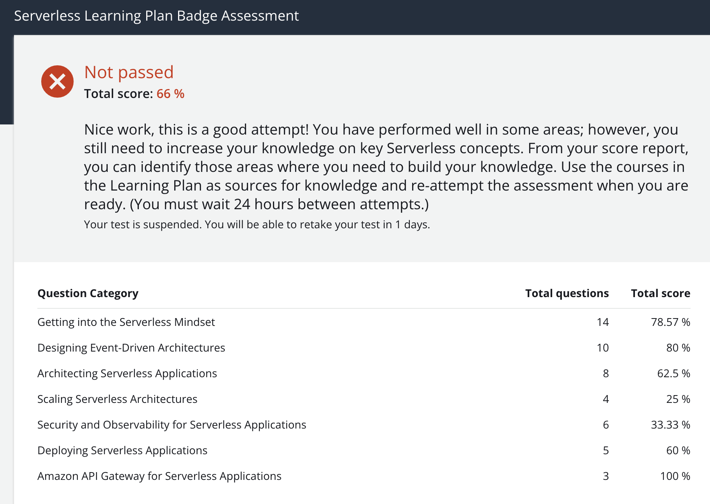
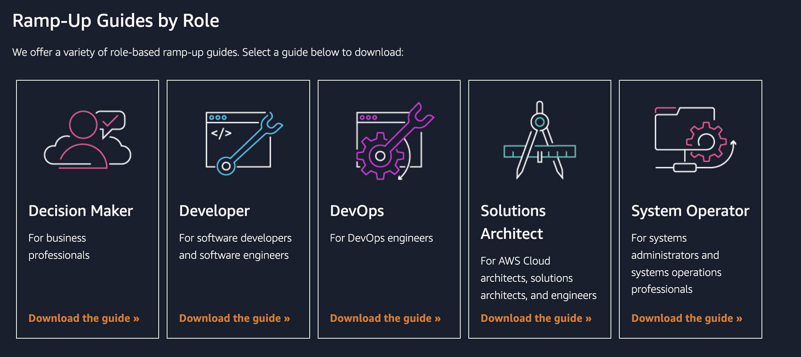
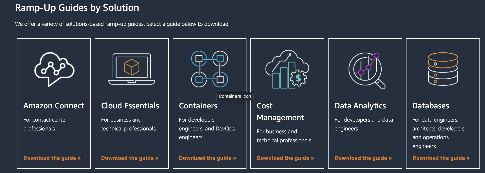
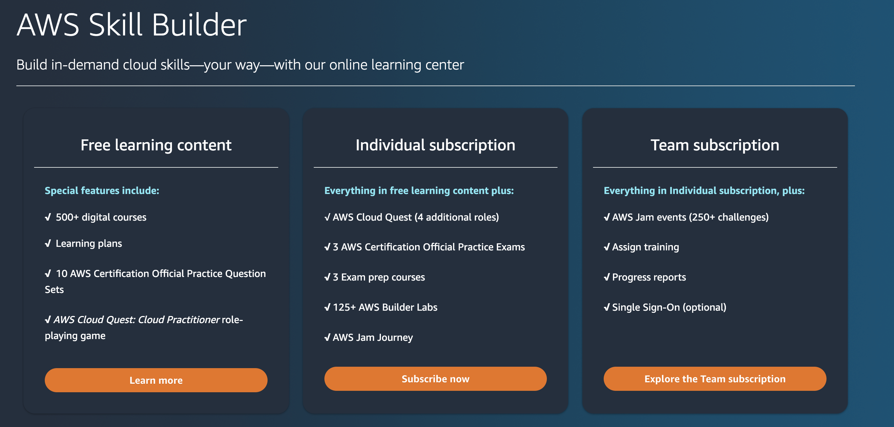
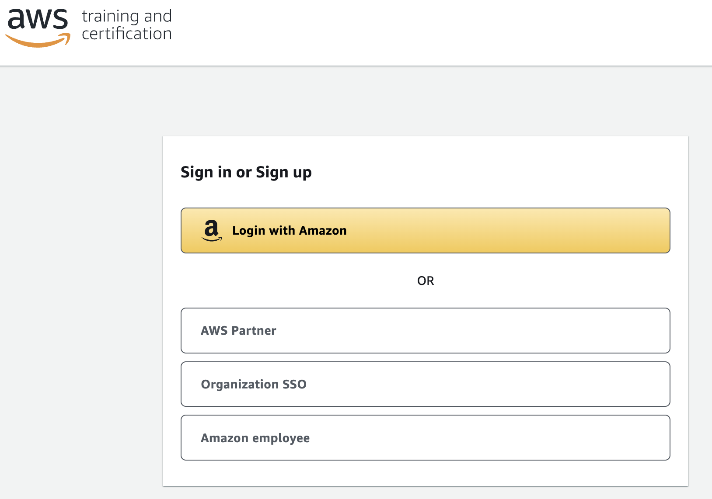

Do you think that after completing a bunch of tutorials on youtube **you know serverless**? 
 
Are you sure that after a few years building applications with  API Gateway, Lambda functions and DynamoDB you are **pretty damn good at it**?

Try out the [AWS Serverless Badges](https://aws.amazon.com/blogs/compute/introducing-new-aws-serverless-digital-learning-badges/)!  
Try out any [AWS Certification](https://aws.amazon.com/certification/)!

You might have a bad surprise...

I have been working in Software Engineering for many years ( and _many_ is not just 5+ as you can see in lots of job ads for  senior developer roles ) and in the last 4 years I have developed and [architected](https://dev.to/aws-builders/look-ma-no-lambda-lambdaless-apigateway-and-dynamodb-integration-with-cdk-2hbd) many [different projects](https://dev.to/aws-builders/from-php-monolith-to-serverless-multi-stack-cross-account-canary-rollout-njo) with Serverless (using API Gateway and Lambdas, Aurora Serverless, DynamoDB, SQS, StepFunctions, S3 Object Lambda and so on).  

Some months ago I started learning for **AWS Solutions Architect Certification**, and the journey so far has been,  ... rather depressing!!!

There is _sooo_ much stuff that I had so little knowledge of! 
So, when I found out about the **Serverless Badge**, I decided to just give it a try, without even going through the course -  I might know shit about _Networking and CIDR Blocks_ but with all my experience the Assessment Test will be a piece of cake!

Even though some questions were in fact easy I immediately realised some of them, especially how they were posed, were indeed tricky. 

And then the harsh reality check!!

I started telling myself excuses: like in the **driving licence test** it's all about how questions are just purposely phrased in a tricky way, it is just having had the right exposure to specific services or about **memorising stuff** like SAM commands (while at work I use either Serverless or CDK) ( and ultimately I told myself that in the end: **[the more you know, the more you realize you don't know](https://ardalis.com/the-more-you-know-the-more-you-realize-you-dont-know/)**

> **Who cares about badges and certifications anyway**... what matters is the experience on the field! 

But the doubt had already started to creep in.

 
I already mentioned [in this post that sometimes it is good to **listen to that little voice that tells you that you suck**](https://dev.to/dvddpl/maybe-you-should-start-listening-to-that-voice-telling-you-that-you-suck-2i49) and that we need to listen to it not to feel bad or defeated, but to shut out laud: 

> So What!?  Maybe! But now I show you!

As someone wrote in the comments:

> Tell the voice to sit down and watch you while you make progress.

And this is what I did.  **I acknowledged that there are some areas which I have not yet explored**, not only in Containers and Networking ( as I was immediately aware watching the courses about the Solutions Architect certification) but also in the Serverless world and I was thrilled! The journey is not over!

> Good!  more stuff to study, more services to experiment with! more challenges!

And the good thing is that AWS provides us with the Skill Builder and with [Ramp Up Guides](https://aws.amazon.com/training/ramp-up-guides/?nc1=h_ls).

### Free stuff for learning! 

These are great resources -  mostly free - in many different forms which you can assemble as you like.  

> Downloadable AWS Ramp-Up Guides offer a variety of resources to help you build your skills and knowledge of the AWS Cloud. Each guide features carefully selected digital training, classroom courses, videos, whitepapers, certifications, and more. 

You can explore the guides by role, solution, or industry area.

In the [Skill Builder](https://aws.amazon.com/training/digital/) you will find paid and free courses, we are talking about **500 hundred free courses**, there is stuff for months of free learning!!

Just [keep in mind](https://login.us-east-1.auth.skillbuilder.aws/help) you will have to login with your **Amazon retail account** not with your AWS account ( neither your own private nor company SSO)

> Can I sign in with my AWS Management Console sign-in information?
No, AWS Management Console and AWS Training and Certification are separate portals and accounts. Your sign-in information works only for the portal you created it on.

Of course there are a lot of resources specific for Certifications like 
- AWS Certified Solutions Architect - Associate Official 
- Practice Question Set
- Exam Readiness 
- Quiz show

and a lot more.
Really, the difficult part is knowing where to start ( and for that you have the RampUpGuides ;-) ) and finding the time to commit to learning!

### So, are certifications and badges useless 🐴💩 or not?
Might be.  
They are useless if your purpose is just to show them off on Linkedin or if you just passed them after locking yourself up in your room for ( a pretty decent amount of ) hours in order to learn all the answers by heart without really understanding the concepts and having hands on experience. 

But they are incredibly useful if to achieve those goals you learned the topics organically, by researching, understanding, and possibly having some hands-on experience ( be it on a pet project or at work ). In that case, they can really boost your motivation, gamify even a little the learning process, give you a ( sometimes painful ) feedback of your current status and definitely help you land a new job.

> Starting out with that test and with loads of hours of watching videos and reading tutorials was a bit overwhelming and the **Imposter Syndrome** was never so strong, but getting out of the comfort zone, and trying and failing this tests, can really push you to become a better Software Engineer.

I will keep you posted on my progress, in the meantime you want some more resources, I am collecting lots of information useful for my [Solutions Architect Certification in the following series of articles here on Dev.to](https://dev.to/dvddpl/series/19869)

Hope it helps

---
Foto von <a href="https://unsplash.com/@elisa_ventur?utm_source=unsplash&utm_medium=referral&utm_content=creditCopyText">Elisa Ventur</a> auf <a href="https://unsplash.com/de/fotos/bmJAXAz6ads?utm_source=unsplash&utm_medium=referral&utm_content=creditCopyText">Unsplash</a>
  
