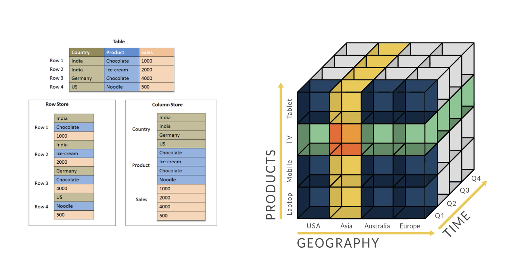
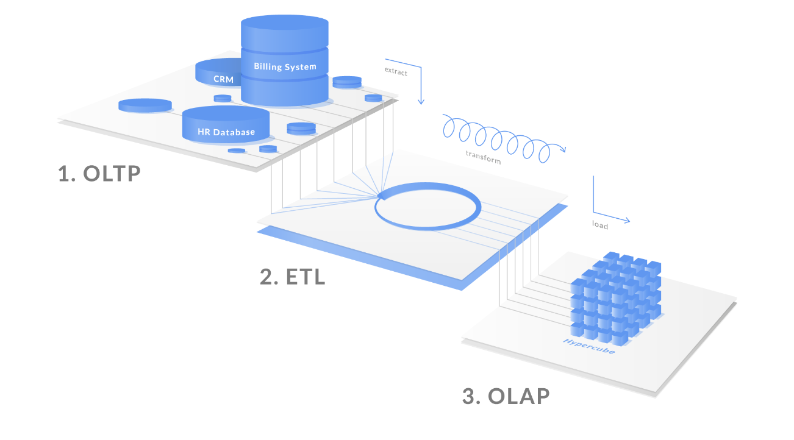
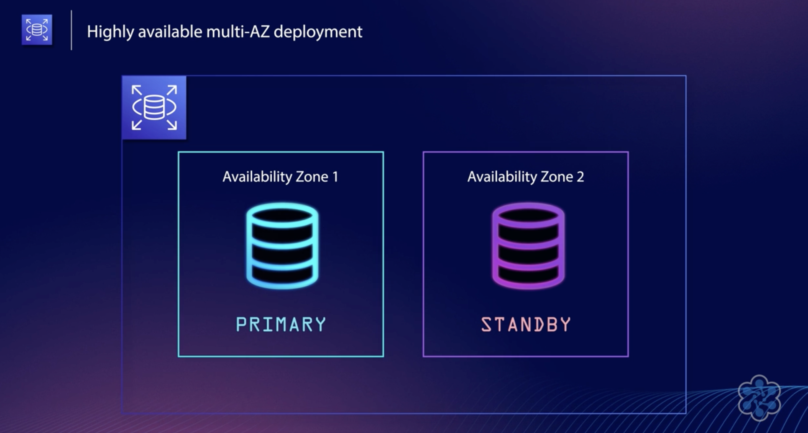
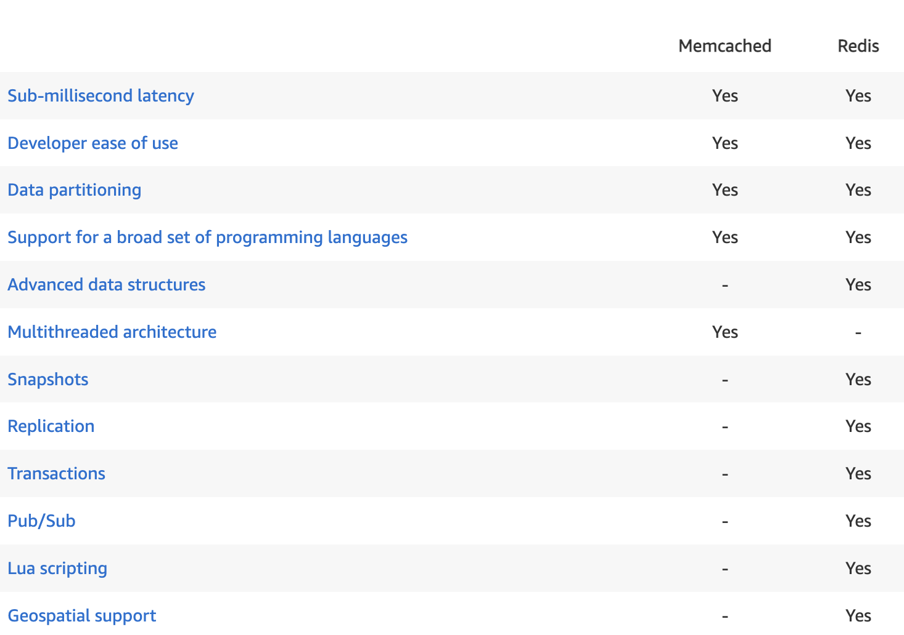
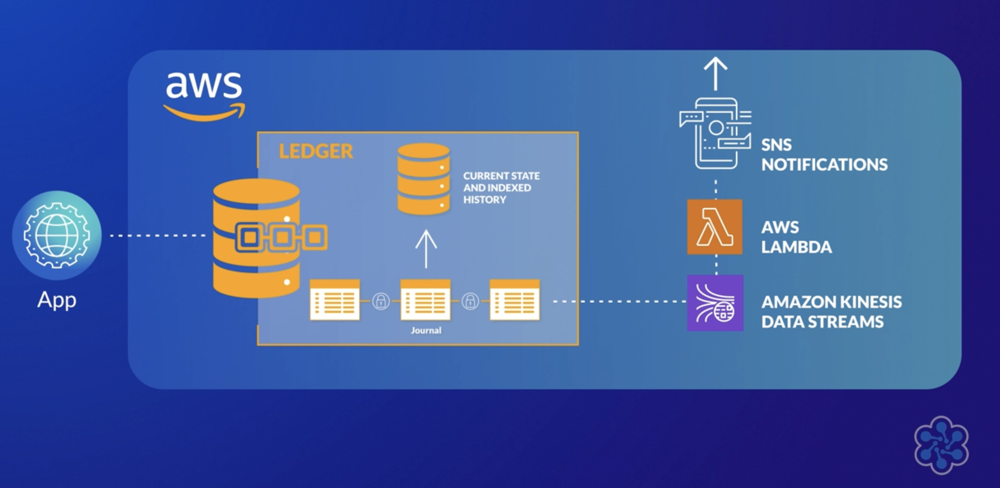

Before we dive into the different database offering from AWS, let's have quickly a look at the differences in how data is managed and  stored (Relational vs Non-Relational) and different use cases  - Operational/Transactional (OLTP ) vs Analytical (OLAP))

| Relational | Non Relational|
| ---- | --- |
| tables, rows and columns |  many different data storage models ( key-value pairs, documents or graphs)|
| rigid schema (SQL ) | Flexible schema (NoSql) |
| rules enforced within the database | defined in application code|
| vertical scalability | horizontally |
| supports joins and complex queries |  unstructured simple query language |

| OLTP (Online Transaction Processing) | OLAP (Online Analytics Processing |
| --- | ---|
| transaction-oriented tasks | analysis and decision making oriented tasks |
| OLTP typically involves inserting, updating, and/or deleting small amounts of data in a database | OLAP performs multidimensional analysis of business data and provides the capability for sophisticated data modelling |
| Short transactions and simple queries | long transactions and complex queries  |
| ie production DB | ie data-warehouse |

> data in OLAP often comes (is aggregated) from multiple OLTP sources.

> OLAP data-warehouses are useful to avoid performance hits on the original source, but, for very simple scenarios having a read Replica would do the job.

----

As with many other services AWS provides us with a very extensive Datastore offering to fit different requirements in terms of use case, scalability, performance and price.

- Amazon RDS  (OLTP)
- DynamoDB (OLTP)
- DocumentDB
- RedShift (OLAP)
- Elasticache
- EMR (hadoop) (OLAP)
- Database on EC2 ( other database not listed above can be directly installed on EC2)

# Amazon RDS

Amazon RDS is an AWS-managed service that allows you to **automatically install and provision relational databases** in the AWS Cloud using popular open-source and commercial database engines:
- MySQL
- Microsoft SQL Server
- Oracle
- PostgreSQL
- MariaDB
and 
- Amazon Aurora which is a MySQL and PostgreSQL-compatible database built for the cloud by AWS.

When spinning up a new database with RDS, AWS will take care of all the typical administrative tasks (**provisioning, security, high-availability, backups, patching and updating minor versions**).

### Scalability
With Aurora RDS we can scale vertically by increasing the size of instance type.
Scaling horizontally is possible only for Reads / Queries using a RDS Read Replica.

A Read replica is created from a Snapshot taken from you **Primary instance** and then is kept updated _asynchronously_. Read-only traffic can be directed to the read replica to offload the Primary Database which will then only take care of the writes.

In case of **Multi AZ** deployment a **Standby Instance** is created together with the Primary and located in a different zone.
Standby instance is not a simple read replica, because replication happens _synchronously_.

Read replicas can be promoted to Primary in case of failure, but this does not happen automatically. 
MultiAZ deployment provides **automatic failover**  (writes and reads are redirected automatically ) therefore it is recommended for **_Disaster Recovery_**.

### Encryption
Encryption at rest is possible ( configured during creation) 
It is possible to encrypt the connection too.
Encryption uses KMS.

> You can't have an encrypted replica of an unencrypted db and similarly you can have an unencrypted replica of an encrypted db.

### Backup and Recovery options
**Automated backups are performed daily and have a retention period** ( of max 35 days) and can be used to restore and create a _new_ database.

Manual (on-demand) backups are called **Snapshots** and have no retention period ( they **do not expire** and must be deleted manually). They backup **entire DB instance**, not just individual DBs and can cause suspension of I/O in case of single AZ (from few seconds to few minutes).
In case of multi-AZ there is not hiccup (with the exception of SQLServer) because backup is taken from the StandyBy instance.

Snapshots can be exported out of RDS to S3 and allow further analysis with other tools like Athena, SageMaker or EMR.
You can choose to simply _export specific databases, tables or schemas._

##Aurora
Aurora is a database offering in the RDS family, compatible with PostgreSQL and MySQL, **built for the cloud and therefore up to 5 times faster.**
It is distributed, self-healing, fault tolerant( with 6 way replicated storage **across 3 AZ** ) and autoscales up to 128TB per instance.

A Single Master instance can be configured with up to 15 Read Replicas (async replication - in millisecs ) across multiple AZ in (same region).
Read Replicas can be promoted to the role of master in case of failure and allow reboot in ~60 seconds ( _failover option_).

**Cross Region Replica** scales read operations across regions with _logical async replication from MySQL database engine_ - (available for Aurora MySql only) - it is slower and can affect performance on primary.

**Global Database** feature allows **cross-region** cluster with **read** scaling ( _physical async replication from Aurora Storage Layer_) - this means it spans multiple regions for **low latency global reads and disaster recovery**. (available for both MySQL and Postgres)

**Multi Master** feature scales out writes _within a region_ (also available only for MySQL) - that means that it provides read after write consistency across AZs.  In case of an outage in one AZ all DB writes will be automatically redirected to another instance without the need of performing a failover.

You can connect to aurora in 4 ways:

- Cluster endpoint: will perform read and write access to the master instance.
- Reader endpoint: load balances connections across the read replica fleet.
- Custom Endpoint: load balances connection across a set of instances that you registered and that you want to use for specific roles or tasks.
- Instance Endpoint: every instance within your cluster, including your primary and read replica instances, will each have their own unique instance endpoint that will point to itself. Useful for load-balancing reasons.

## Aurora Serverless  
- seamlessly scales capacity 
- Application connects via RouterFleet.  
- ACUs (Aurora Capacity Units) are each 2GB of memory.

Aurora serverless is configured with a single connection endpoint, (you don't have an endpoint for writes and replicas endpoints for reads, since it is serverless and scales automatically)

It is the perfect choice in case of 
- infrequently used applications
- new applications where usage is - not know yet or predictable
- very variable workloads

## RDS Proxy

fully managed database proxy, useful when RDS is accessed by serverless applications, it shares infrequently used connections (because it creates a connection pool) and improves efficiency reducing stress on CPU/Memory.
It also controls authentication methods.

### When not to use RDS
There are some use cases where adopting RDS might prove an antipattern.
- In case of key/value data structure or data structure is unpredictable, or not yet well defined, and when automated scalability is a requirement -->  DynamoDB is more suitable.
- In case of **large binary objects --> S3** could be a better choice.
- In case of other database **platforms like IBM DB2 or SAP HANA**, or **if you need root access**, then an EC2 would be the solution.
Since RDS is a managed service you don't have root access to OS and therefore you can't install software such as management tools,  if that is your requirement EC2 will give you a greater level of control over your DB and the underlying server OS, but you will have to manage everything yourself ( backups, redundancy, scaling - and basically all the administrative tasks we have seen above).

### RDS Purchasing Options

- On Demand
- Reserved Instances 
- Serverless
- BYOL (Bring Your Own License) - only for Oracle DB and both for On Demand or Reserved Instances

On Demand instances can be launched at any time within minutes. 
Price depends on instance type. In case of Multi AZ deployment you will incur in additional costs (usually double).

With Serverless there are no instances to manage so pricing is measured in ACUs ( Aurora Capacity Units: 2GB of memory) per hour.

Reserved instances allow you to purchase a discount up to 75% for an instance type for a set period of time (from 1 to 3 year) and depending on payment method ( all upfront, partial-upfront, no-upfront ) you can get further reductions.

**Storage and I/O pricing varies across different DB Engines** and it has to be considered too.
Aurora uses a _shared cluster storage architecture_ while all other DB types use _EBS (Elastic Block Store)_
You can check my [previous post about EBS](https://dev.to/aws-builders/aws-storage-cheat-sheetwrite-up-2i1b) to find out different storage options and its pricing.

In case of Aurora and shared cluster storage architecture, you can't configure any storage options because it will be managed for you automatically, and that is why **the pricing metric is in GB months + number of I/Os processed ( billed per million requests)**

# DynamoDB

It is a fully managed schemaless NOSQL database service.
Non Relational, Key/value and document store
It has Four 9s. (99.99%) of availability ( 5 in case of global tables)
Data is automatically replicated across 3 different availability zones within a single region. 

- Tables
- Items --> basically a row (Maximum record size is **400KB**)
Partition key and Sort Key make up the Primary Key used access items in the tables ( primary key is also known as Composite Key when both attribute are present - you can also specify a PK without SK )
- Attributes --> the information associated with that item ( columns)

Since DynamoDB is schemaless, once you defined the structure of the primary key (Partition and Sort Keys), every item/row can have its own structure.

TTL (TimeToLive) defines when items in a table expire and they will be automatically deleted (**at no extra cost, because they do not use WCU / RCU)
WCU and RCU ( Write and Read Capacity Units ) are the measure of the number of reads and writes per second. Billing is different per WCU from RCU and  / 

### Backups and restore
On demand backups can be scheduled and are performed within seconds, **without impact** on table performance and availability - they don't expire.

**Point-in-time recovery to the second** can be enabled and allow to restore the data of a table to any state between current time and last 35 days. Restoration will be performed **on a _new_ table** on the same region or a different one.

### Dynamo Indexes
DynamoDB lets you create additional indexes so that you can run queries to search your data by other attributes, but it important to remember that **Dynamo Indexes work quite differently from those in Relational Database ( and that you have to run your query against that index ).**
Secondary Index can be Local (used in association with a single partition key) or Global ( let you query across the entire table).

### DynamoDB Streams
Any time an item is inserted/updated/removed from a DynamoDB table, a record in written to the stream and stored for up to 24 hours.

> Streams allow to capture a time-ordered sequence of item level modifications 

Depending on your use case you can define what data to put in the stream:
- Keys only
- New image
- Old image 
- both old and new image ( meaning entire attributes before and after the modification)

### Global Tables
DynamoDB provides a secondary layer of Availability in the form of **Cross Region replication** (Global Tables)
With Global Tables, DynamoDB becomes a **Multi-Master** database  and 
Data is replicated _asynchrounously_ (via DynamoDB Streams that are automatically created as so as you create the Global Table) in tables located in different regions and each table contains the same set of data ( not like memcacheD nodes which have different partitions of the data).
Besides increasing availability in case of regional outage, **Global Tables also reduce latency** because your user will access data from the closest located table replica (**data locality**)

### DynamoDB Accelerator (DAX)
DAX ( fully managed in-memory cache that can increase performance from milliseconds to **_micro_second** latency.
Improve read and write performance.

DAX is optimized for DynamoDB and does not require changes in your code since it is just put in front of you dynamo db and you requests just have to point there. 
In case of Elasticache there is more management overhead ( like cache invalidation ).

DAX is a separate entity to DynamoDB and it is placed within a VPC.

# Amazon ElastiCache
Is a **key/value store in-memory database**, and a managed implementation of Redis and Memcached.
A very common use case is to put it in front of RDS or DynamoDB to improve performance and reduce latency 
 
Good for:
- data that changes infrequently but is frequently accessed
- application that can tolerate stale data
- data that would be more expensive and slower when retrieved by its original source rather than the cache
- Elasticache is often used for storing session state ( an alternative to DynamoDB)

Some examples are websession stores, database caching for popular queries to offload db, leaderboards and streaming data dashboards.
Beyond caching, an in-memory data layer is also useful for analytics and recommendation engines.

Since ElastiCache Nodes run on EC2 billing is based on instance type when they are provisioned.

#### Memcached vs Redis

Memcached is in-memory key store, it is **multithreaded** and support partitions (it can be used as **a cache in addition to a data store**)
Redis on the other hand - is much more than a caching layer, because it supports more advanced data structures, provides **data persistence, encryption** and replication (it's a **purely in-memory data store**).

Both are high performant with sub-millisecond latency.

 

###Elasticache Scalability:

A Node is a fixed size chunk of secure network-attached RAM.
Nodes can be launched using different instance types.  Changing instance type allows Vertical Scaling.

Due to the different nature of Memcached and Redis, Elasticache managed them quite differently.

A Shard (Redis) is a group of up to 6 ElastiCache nodes
A Cluster (Redis) is a group of 1 (Cluster Mode disabled) or up to 90 Redis Shards (when Cluster Mode is enabled) in a single or multiple Availability Zones.
Data is partitioned across all the shards in that Cluster.

with Cluster mode Enabled you can have multiple Shards (within same or across different Availability Zones) where you have Primary node and zero to 5 Replicas.
With Cluster Mode enabled you can also choose between online or offline resharding
 - online resharding you can add or remove shards
you can scale horizontally by adding a new replica 

A Cluster (MemeCacheD) are collection of one or more nodes. Amazon Elasticache automatically detects and replace failed nodes.
Scaling horizontally by adding nodes to a cluster.
For improved fault tolerance, locate your Memcached nodes across multiple Availability Zones (AZs) within the cluster's AWS Region (but remember that each node is a **partition of data** and there is no replica nor backup).

# Other Database services
## DocumentDB
[DocumentDB](https://aws.amazon.com/documentdb/) is a fully managed non-relational document database, with **full MongoDb compatibility**, that means it is very useful for JSON data, it is able to scale automatically up to 64TB.

- Cluster endpoint - for apps that require both read and write -access to the database
- Reader endpoint: used to connect to read replicas
- Instance Endpoint: every instance within your cluster, including your primary and read replica instances, will each have their own unique instance endpoint that will point to itself. Useful for load-balancing reasons.

## Keyspaces ( for Cassandra )
[Keyspaces](https://aws.amazon.com/keyspaces/) is scalable fully managed Apache **Cassandra compatible** database service (serverless), which allows you to use the CQL (Cassandra Query Language).

Cassandra is a free and open-source distributed, **wide column store**, NoSQL database management system.

A Keyspace is basically a group of Tables, Tables are where you write data to. Similarly to DynamoDB you can define Provisioned or On-Demand Capacity Modes.

## Neptune
[Neptune](https://aws.amazon.com/neptune/) is a fully managed **graph database** service, its use cases are for fraud detection, recommendation engines, social networks and applications that use open source APIs like Gremlin, openCypher and SPARQL.
Like DocumentDB, it has Cluster, Reader and Instance Endpoints

## QLDB
[Quantum Ledger Database](https://aws.amazon.com/qldb/)
QLDB is a fully managed , serverless, ledger database for transparent immutable and cryptographically verified transaction log.
Data can be only appended ( no overwrite or deletion ) to journals   therefore QLDB is great when  **Integrity Assurance** is required.

