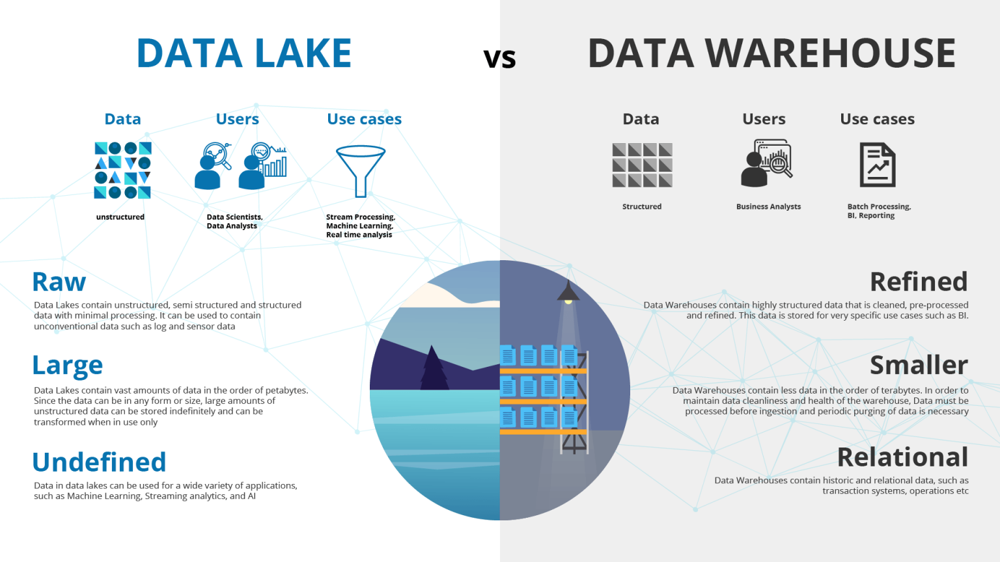
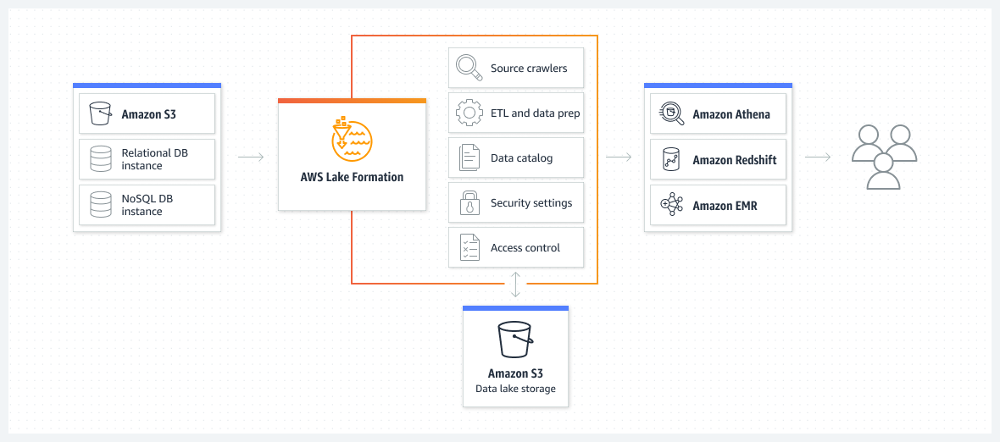
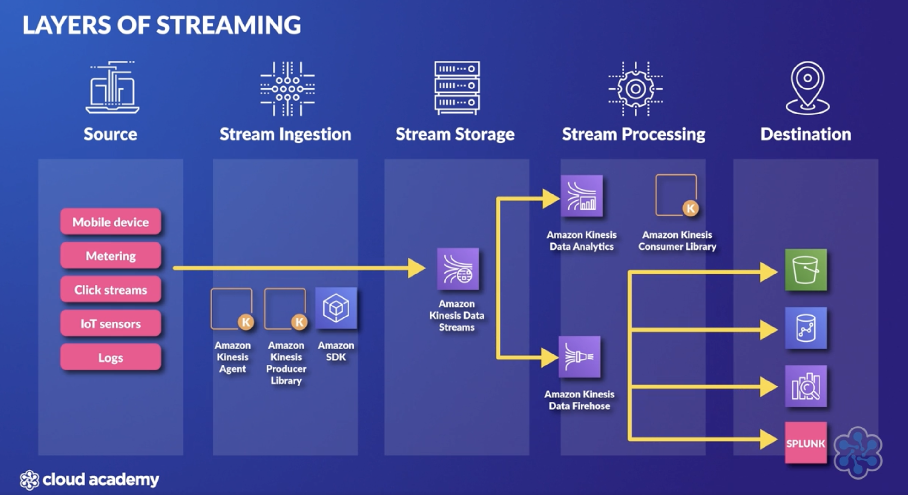
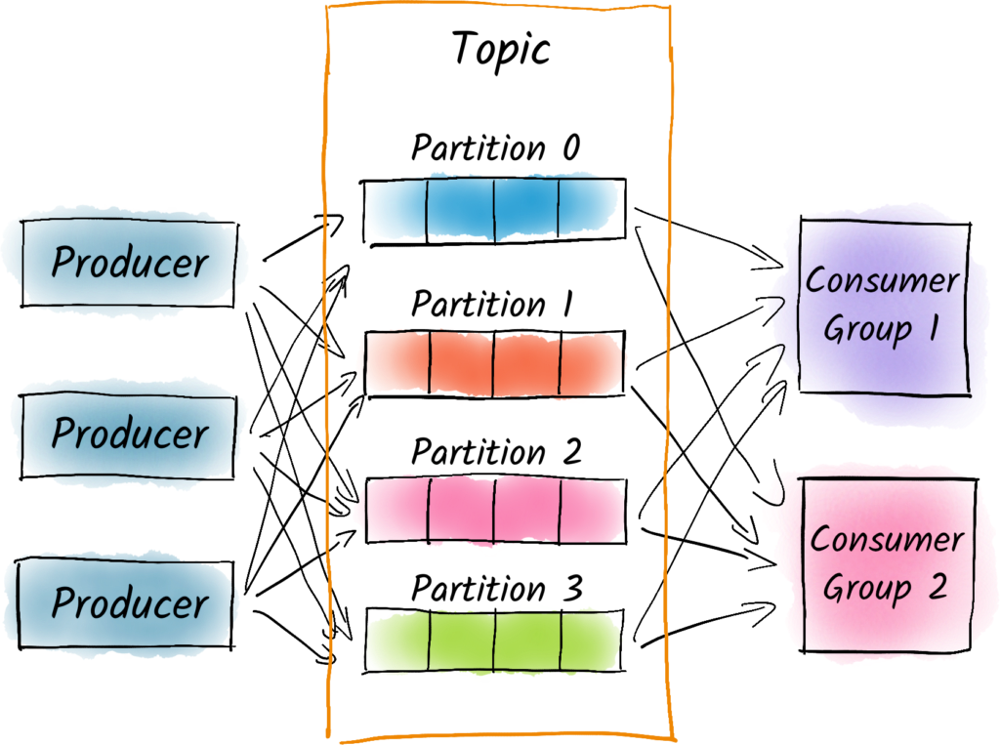
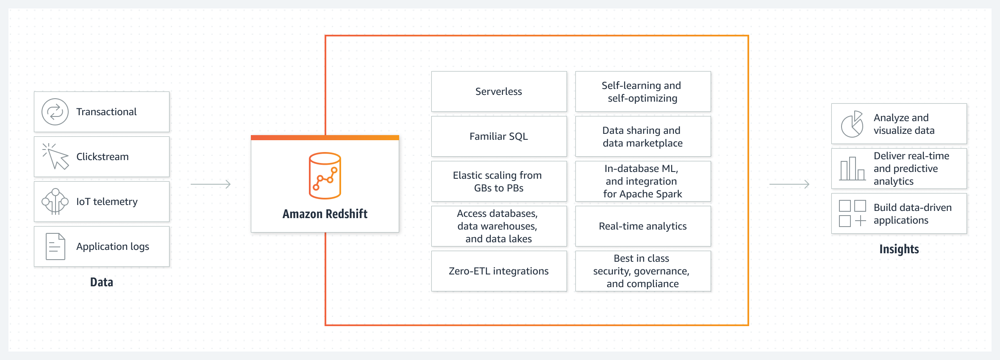
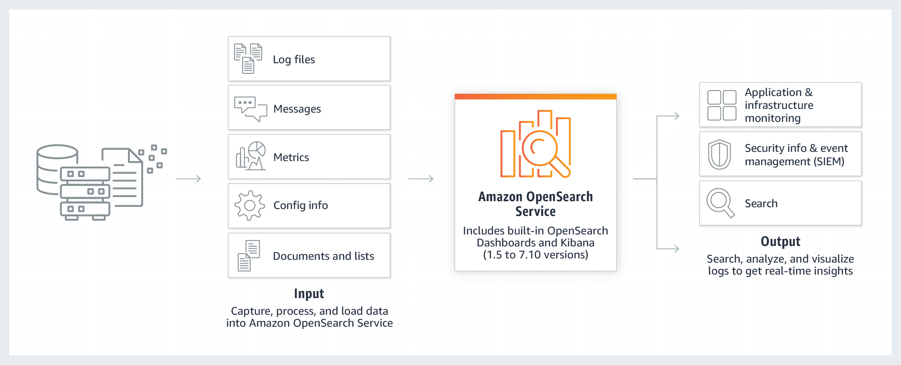
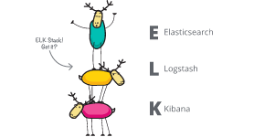

[Recently](https://dev.to/aws-builders/aws-databases-cheat-sheetwrite-up-iik) we went through most of the offering from AWS in regards of Databases, let's now have a look at other services for Data-warehouses, Data-lakes, and Analytics.

But first let's have a look at the main differences between a Data Warehouse and a Data Lake.

# Data Warehouse vs DataLake

A data lake is a central repository that allows you to store all your data – **structured and unstructured** – typically in its raw format, in a volume. 

A data warehouse on the other hand **brings all data together by processing it in a structured manner** and making it available to support highly performant SQL operations. 

### Data lake not Data swamp!
Despite the data lake being the place where unrefined data is placed, that does not mean it should become a data dump where any sort of data from your company or application ends up and then forgotten. 

These are the challenges of a good data lake:  
- **cataloging and discovery** (finding the data and classifying data), 
- **moving** data (how the data gets to the lake)
- **storing** data 
- performing **generic analytics** (making sense of that data),
- performing **predictive** analytics (making educated guesses about the future based on the data).

# AWS Lake Formation
[AWS Lake Formation](https://aws.amazon.com/lake-formation/) is a service that allows you to collect data from different databases and object storage, save it to S3 data lake and clean it and classify it with ML algorithms. It builds on the capabilities of AWS Glue and its data is then usable directly through services like Redshift , Athena and EMR.

Lake Formation uses **blueprints** to identify existing data sources that you want to move into your data lake. Data can be grabbed incrementally or all at once and AWS Lake Formation will take care of user security by creating self-service access by setting up users' access and by tying data access with access control policies within the data catalog **instead of with each individual service**.

> Using the Lake Formation service comes at no charge ( beside the cost of all the services it uses)

# Glue
Fully managed (**serverless** ) ETL service running on **Apache Spark** environment useful for preparing data for analytics.
AWS Glue **discovers data and stores the associated metadata** like table definition and schema in AWS Glue Data Catalog (a **central metadata repository**) by using a _crawler_.
The crawler will parse data from your connected data sources -  data lakes ( S3 ), data warehouses ( Redshift ) or other datastores (RDS, DynamoDB, EC2) - and create Catalog Tables with the representation of the schema and the metadata for that data metadata and information about where source data is stored.
Besides Data Catalog, there are other services within the offering of Amazon Glue, like Studio (that allows you to create, submit and monitor ETL jobs ), Databrew (no-code service for transforming data) , Workflows (to orchestrate ETLs)

# Kinesis
Provides different solutions to ingest, process and analyse data ( like EventLogs, SocialMedia Feeds, Clickstream Data, Application data and IoT Sensor Data).

##Kinesis Datastreams
Data is ingested from Producers and is _stored_ for 24 hours (default) up to 7 and even 365 days (additional charges apply) so that it can be later used for processing by other applications.
A Kinesis Data Stream is a set of Shards, each shard contains a sequence of Data Records.
Data Records are composed of a Sequence Number, a Partition Key, and a Data Blob, and they are stored as an **immutable** sequence of bytes.

Kinesis Datastream is real time ~200ms.
KCL (Kinesis Client Library ) helps you consume and process data from a stream by enumerating shards and instantiating a record processor. 
There are two ways to get data from a stream using KCL:  Classic mechanism happens by **Poll** while **Enhance Fan Out** by Push -  consumers can subscribe to a shard and data will then be pushed automatically. 

Each shard is processed by exactly 1 KCL worker.
One shard provides a capacity of 1MB/sec data input and 2MB/sec data output and allows **1000 PUT records per second**.
Ordering is maintained **by shard**

Destinations are:
- Redshift
- DynamoDB
- EMR
- S3
- Firehose

Kinesis Data Stream does NOT have AutoScaling capabilities, 
To scale you need to **manually add shards** ( and pay for them ) 

## Kinesis Firehose
Fully managed, No shards, elastic scalability, near real time  delivery (~60 seconds latency, because Firehose has a **Buffer in megabytes** with different ranges depending on the destination).
Producers send data to Firehose and data is automatically delivered to other services( data is not stored and you don't need to implement Consumer applications).

Destinations:
- Redshift
- S3
- **Elasticsearch**
- **Splunk**
- Datadog
- MongoDB
- NewRelic
- **HTTP Endpoint**

> Firehose can invoke Lambda to transform incoming source data and transform it ( before delivering to its destination ) - for example for formats other than JSON.

## Kinesis Analytics
provides real time capability of reading, aggregating and analysing data while in motion.
It leverages SQL queries or Apache _Flink_ to perform time-series analytics, feed real-time dashboard and create real-time metrics. 
After processing data can be loaded to AWS Lambda or to Kinesis Firehose.
 
# MSK - Amazon Managed Streaming for Apache Kafka
used for ingesting and processing streaming data in real time,
usage is very similar to that of Kinesis, but while Kinesis is an AWS Service, MSK is a fully managed service to run **Apache Kafka**applications ( which is Open source ).
Advantage of using MSK over own implementation of Kafka is exactly that MSK is fully managed and you don't have to take care of all the administrative tasks.

Main concepts of Kakfa are Producers, Topic and Consumers.

## EMR  (Elastic Map Reduce)
Is a managed implementation of **Apache Hadoop** (but also **Apache Spark**, Apache HBase and **Presto**) that can run on EC2 (EKS, AWS Outposts - and since June 22 even serverless).
EMR abstracts and reduces the complexity of the infrastructure layer used with traditional MapReduce frameworks.
It is a big data platform designed for Extract, Transform, Load function ( ETLs) and for Machine Learning, Data Analysis and Business Intelligence.
EMR has _some_ similarities with Glue in terms of ETLS ( but will outperform it for ML and Data Analysis, or be the only choice if workloads requires any other engine other than Spark)

# Amazon Athena
Is a **serverless** service that can run queries in CSV, TSV, JSON, Parquet and ORC formats.
You can point Athena to a data lake on AWS S3 and run SQL queries and you can use AWS Glue as a metadata catalog and Quicksight for visualization.
There are also other options for data source ( both from AWS and other services ) but you will need a Lambda function to connect Athena to the data source and map the data into tables that Athena can query.

### Athena Performance optimization
[top 10 performance tips](https://aws.amazon.com/blogs/big-data/top-10-performance-tuning-tips-for-amazon-athena/) (same best practices can be applied to EMR too)

Storage optimisations:
- Partition your data (define virtual columns at table creation to keep related data together and reduce the amount of scanned data per query)
- Bucket your data within a single partition
- Use compression ( format like Apache **Parquet** or ORC are recommended because they compress data by default and are splittable - meaning that can be read in parallel by the execution engine)
- Optimise file sizes (files smaller than 128 MB could take longer due to the overhead of opening s3 files, listing directories , getting object metadata and so on).
- Optimise columnar data store generation 

Query optimisations:
- Optimise ORDER BY (by using Limit)
- Optimise joins (specifying larger table on the left side of the joins)
- Optimise GROUP BY (reducing columns in select to reduce amount of memory and by ordering the coluns by the highest cardinality - most unique values )
- Use approximate functions
- Only include the columns that you need

# RedShift
Redshift is a fast, fully managed, _petabyte_ scale, **SQL based, data warehouse** for large volumes of aggregated data.
It is optimised for [OLAP](https://dev.to/aws-builders/aws-databases-cheat-sheetwrite-up-iik) ( online analytics processing ) and allows to perform complex queries on massive collection of data that is **structured or semi-structured**. 
It provides continuous incremental backups and always keeps 3 copies of your data. 
Since it uses EC2 instances, you will pay based on the instance family/type.

Data can be sourced from 
- DynamoDB
- RDS
- S3
- EMR  (Elastic Map Reduce) 
- Data Pipeline
- Glue
- EC2
- On-premises servers

A cluster is the main component of Redshift and each cluster will run its own Redshift engine, with at least one Database.
**A Cluster is a logical grouping of nodes**. When more nodes are present, a Leader Node has the role of coordinating communication between you nodes and external applications accessing your data. 

# AWS OpenSearch 

Opensearch ( successor of AWS ElasticSearch ) is a fully managed, highly available, _petabyte_ scale, service to search, visualise, analyse text and **unstructured** data.

It is based on _open-source Elasticsearch_, supports SQL queries, integrates with open-source tools and can scale by adding or removing EC2 instances (not a serverless service).

Encryption at rest and in transit.
Availability in up to 3 AZ and backups with snapshots. 

Clusters are also know as OpenSearch Service **domains**.

Data populating the clusters can be ingested by different sources like Kinesis Firehoses, ElasticSearch API, LogStash, then you can use Kibana (or other tools ) to search and visualise data.

Access control is managed in the following ways:
- Resource-based polices (aka domain access policies)
- Identity-based policies attached to users or roles
- IP-based policies - restrict access to one or more IP or CIDR blocks -  **can't be used with Opensearch clusters within a VPC**
- Fine-grained - for role-based access control,  security at the index, document and field level, and dashboard multitenancy

Authentication via Federation using SAML to on-prem directories and via AWS Cognito and social identity providers.

#### ELK stash

ELK (Logstash --> Opensearch --> Kibana )it is a very popular combination useful to aggregate logs from systems and applications, analyse them and create visualisations ( for troubleshooting, monitoring and security analytics ) 

#### Opensearch best practices:

[Operational best practices for Amazon OpenSearch Service](https://docs.aws.amazon.com/opensearch-service/latest/developerguide/bp.html)

- deploy mission critical domains across 3 AZ and 2 replica shards per index.
- provision instances in multiples of 3 so that instances are distributed equally across ( the 3 ) AZs
- use 3 dedicated master nodes ( a master node performs cluster management tasks but does not hold data and does not respond to data upload requests, thus increasing the stability of the domain/cluster).

> if not possible (some regions have less AZ) have at least 2 AZ with equal number of instances and 1 replica.

- create domain within a VPC and setup restrictive resource-base policies or fine grained access control.
- Enable encryption in transit and at rest

---
## Other Analytics services

# Timestream
[Timestream](https://aws.amazon.com/timestream/?nc1=h_ls) is a **serverless** database service for _IoT and operational applications_.
It is faster and cheaper than relational database and its core characteristic is that it keeps recent data in memory while moving historical data to a cost optimised storage tier.

# DataExchange
[DataExchange](https://aws.amazon.com/data-exchange/) is a **data marketplace** where you can find, subscribe and use more than 3500 third party data sets (that you can consume directly into data lakes, applications, analytics and machine learning models).
Some of it benefits are _streamlined data procurement and governance, better integration with AWS services and data security_ ( encryption and access management ).

# Data Pipeline
[Data Pipeline](https://aws.amazon.com/datapipeline/) is a managed ETL service to process and move between AWS compute and storage services.
