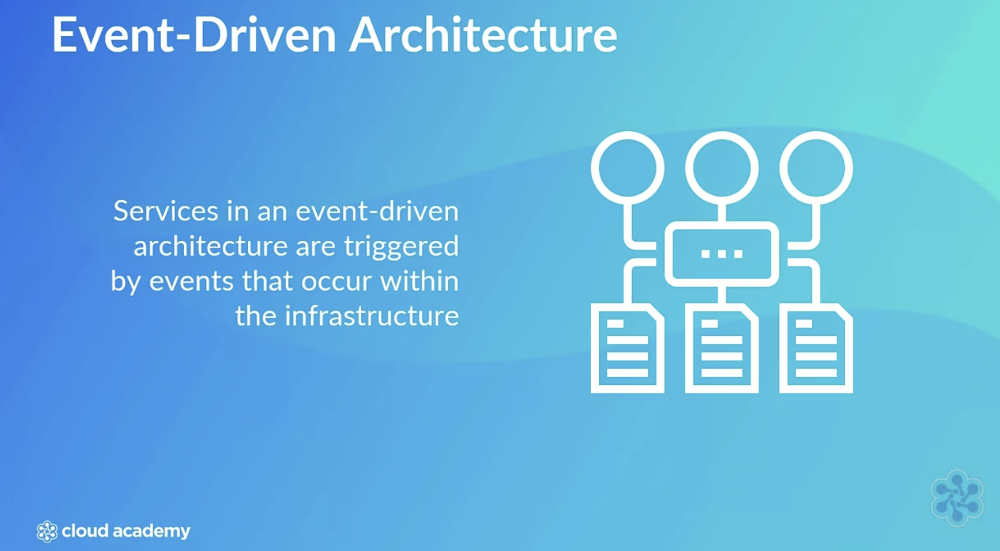
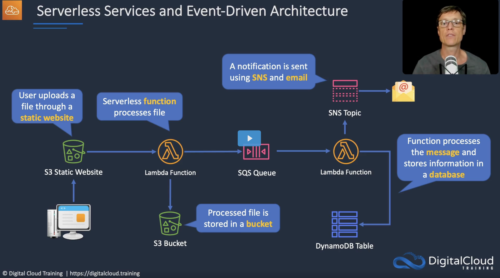
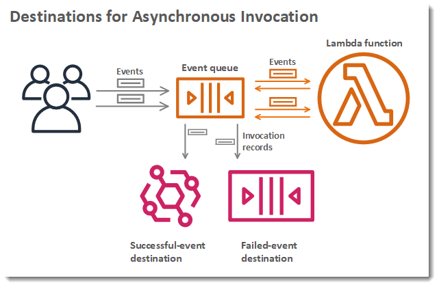
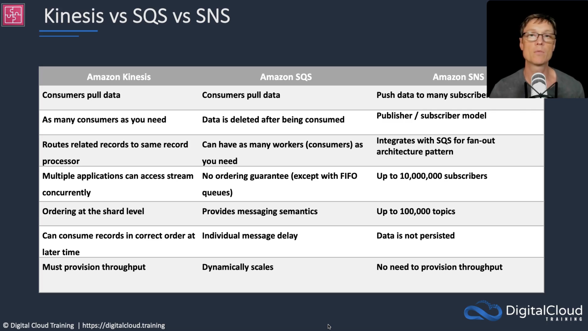
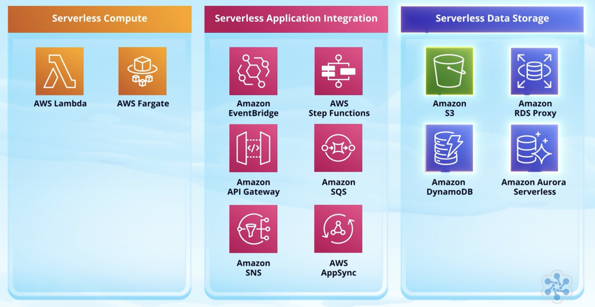

#Monolithic vs Decoupled Architecture
The discussion about monolith vs microservices has been going on for years. And every faction has its fair amount of very good points. 

I must admit that in my career I have encountered microservice applications that were as bad as monolithic ones ( and definetely harder to understand, work with and test!) but my approach of choice is definitely leaning towards a **Decoupled Architecture**! 

Components and services can operate independently from one another, are easier to understand with less domain knowledge and global context and are easier to run and test _on their own_.
Sure there is still the risk that **you have gone from building a pile of mud to orchestrating a lot of shit** (dunno where i read this quote...) but that's another story.

Anyway. Decoupled Architecture, we were saying, and Event-Driven Architecture!

Decoupled and Event-Driven Architectures are patterns that are not exclusive to serverless, but imho its with Serverless where they shine the most!

Serverless frees you from a lot of administrative tasks that keep you away from implementing your business logic. 

> serverless means you don't manage the underlying service that runs the capability

- no instances to manage 
- no hardware provisioning
- no management of OS or software
- no provisioning and patching
- automatic scaling and high availability
- very cost effective

Let's have a look what Serverless services AWS provides to build Decoupled, Event-Driven Architectures.

# Lambda

> Understanding Lambda is the same as understanding almost any function in a piece of code. There are three major parts: 
- input 
- function
- output. 

You create a function, and when an event occurs, your function is executed.
Code is executed only when needed, scales automatically and 
you pay only for the compute time - with **milliseconds billing**.

In order for Lambda to work and use other AWS services it needs to have execution roles with permissions to access DynamoDB or S3 for  example.

Use cases are data processing, real-time file and stream processing as well as serverless backends for web/mobile/IoT applications. 

Lambda execution has a maximum duration of 900 seconds (default is 3 seconds)

#### Reserved vs Provisioned concurrency

[Concurrency](https://docs.aws.amazon.com/lambda/latest/dg/lambda-concurrency.html#understanding-concurrency) is defined as the number of in-flight requests your Lambda Function is handling at the same time.

If a Lambda is invoked multiple times before an invocation has returned, additional functions are initialised - up to the burst limit (3000 , 1000 or 500 depending or region) or account limits.
If concurrency limit is exceeded you will start getting a Rate exceeded Error and 429 **TooManyRequestsException**.  

Reserved concurrency _guarantees the max number of concurrent instances that can be invoked_ (basically you are making sure that whatever happens at account level, maybe other functions are eating up the available concurrency quotas, your function will have at least some instances reserved ) - no charge involved.

Provisioned concurrency on the other end, _initialises a requested number of execution environments_ so that they are prepared to respond immediately when your function is invoked. this incurs costs.

### Invocation Models
Function invocation happens in 3 different ways:

- Event Source Mapping / Stream  Model (  Poll Based )
for example from SQS, Kinesis Data Streams, DynamoDB Streams (event source mapping for these sources is defined _on_ the Lambda itself)
**Lambda Service takes care of polling** the sources on your behalf and consuming the messages **then invoking your Lambda Function** when messages match your use case.

- Synchronous ( Push Based ) :
for example from API Gateway, CLI, SDK
request-response model, after Lambda receives a request, it sends back the response of its executions.
Error handling happens client sides ( retries, exponential backoffs etc)

- Asynchronous ( Event Based )
for example from S3, SNS, CloudWatch events,
response is not sent back to the original service that invoked the  Lambda function. (you can although, configure **Destinations** to send the results of the invocations to other services like SNS, SQS, EventBridge or other Lambdas)
up to 3 automatic retries 
since code will be retried, it must be idempotent!

> This type of invocation has little to do with the fact the lambda contains asynchoronous code ( like async await or promises ) rather to the fact that the service invoking the lambda is actually expecting a response for further processing. 

# SQS (Simple Queue Service)
SQS is a messaging queue, _store and forward pattern_ - useful to build distributed / decoupled applications.  
It does not require to set up a message broker.

### Standard queue
items are pushed to queue in order, but applications polling or receiving records might get them not in the exact order ( **Best-Effort Ordering**) and occasionally a copy of the message could be delivered ( **At-Least-Once delivery** ) 

### FIFO Queue - 
First in First Out delivery - order in which messages are sent and received is strictly preserved
**Exact-once processing** - no duplicates

One of the main difference between Standard and FIFO, which also explain the differences in ordering and delivery, is that Standard Queues support **Unlimited throughput** - unlimited transactions per second (TPS) - while FIFO is High Throughput and supports up to 300 messages per second ( send or receive or delete all counted together) - you can get to 3000 if you batch 10 messages per operation. 

### DLQ ( Dead Letter Queue ) 
is not really a different type of Queues available in SQS ( like Standard or FIFO ) rather a normal Queue which is in charge of handling message failures.
Messages that failed to be processed from a queue can be pushed to a DLQ to be isolated , analysed ( and eventually reprocessed ).

> DLQ must be of same type of origin queue sending failed messages

## Delay and Visibility Timeout
You can define a delay in the visibility of the messages in the queue, depending on _when_ the delay is apply you can have :
- Delayed Queues (between 0 and 15 mins - default 0 seconds)
- Visibility Timeout (between 0 seconds and 12 hours - default 30 seconds ) 

> The difference between the two is that, for delay queues, a message is hidden when it is **first added to queue**, whereas for visibility timeouts a message is hidden only **after it is consumed** from the queue. 

This means that if any message is delayed _first_, your queue will react to that message after that delay, while if messages are delayed _after_, the message will be processed immediately, the delay will affect only possible _reprocessed_ messages.

> Immediately after a message is received, it remains in the queue. To prevent other consumers from processing the message again, Amazon SQS sets a visibility timeout, a period of time during which Amazon SQS prevents other consumers from receiving and processing the message.

Therefore **visibility timeout helps with resiliency** so if an application component processing a message fails to complete the job another one can retry it.

Something you should really be careful with is that **_the value of your visibility timeout should be longer than it takes for your consumers to process your messages_**, otherwise some other consumers will receive the message for processing, before the consumer currently processing the message has finished and send the deletion command to the queue ( meaning your message will be processed twice!)  

## Short vs Long Polling
SQS is a **poll-based** service but we have to distinguish 
short polling returns immediately, while Long polling awaits for messages to arrive therefore reducing number of API costs and lowering costs. 

SQS is an highly available, high throughput service, and you normally have to worry about scalability, but there are some limitations in terms of message size and inflight messages ( 120,000 for standard queue, or 20,000 FIFO).
To avoid hitting these limits it could be advisable to add more queues (and send messages to different queues based on their parameters)

# Amazon MQ
A managed message broker service compatible with **Apache Active MQ and RabbitMQ** - useful to migrate application from existing message brokers. 

# SNS
SNS is a highly available, fully managed Pub-Sub system which allows high-throughput, **push-based**, many-to-many messaging. 

A publisher ( also event producer ) will send events to one SNS Topic - which is basically a group for collecting messages.
Data is immediately forwarded (and does not persist) to the Subscribers of that Topic via different Transport Protocols:

- HTTP/HTTPS
- Email
- SMS
- SQS 

A Subscriber is the actual service (or user, endpoint) that was interested in the event/message and will process that information - a Lambda, SQS, HTTP/S webhooks, Mobile Push, SMS, Emails.

> Lambda is a supported subscriber but not a transport protocol ( while Amazon SMS and SQS are )

**When a message is published, ALL subscribers to that topic will receive a notification of that message**. That is a very important aspect of SNS, which introduces an architecture pattern called Fan Out.

### SNS + SQS Fan Out
You subscribe one or more SQS queues to an SNS topic 
when you publish a message to a Topic, SNS sends it to every subscribed Queue, fanning out the notification to those queues.

If SQS is highly available and scalable you might wonder why you would need fan-out.  Reason is that **you might want different things to be happening in reaction of an event, and you want to decouple this business logic.** 
Without fan-out your Lambda function would then be in charge of all the different responsibilities.  No really decoupled, right?

> You can subscribe multiple queues to the same topic to replicate a message over multiple queues. 

Each queue will receive the identical message and react accordingly. 

There is an interesting tutorial [here](https://aws.amazon.com/getting-started/hands-on/send-fanout-event-notifications/)

On top of this you can also play around with filters and message attribute to replicate messages only to some queues. By specifying a  Filter Policy in the Queue Subscription, you will then have your Publisher sending out the event, and SNS handle the logic to forward it to the multiple interested queues, ignoring those where the attributes don't match the business logic.  (nice article [here](https://betterprogramming.pub/how-to-fan-out-to-different-sqs-queues-using-sns-message-filtering-84cd23ed9d07))
 

Check out how Kinesis work in [previous post](https://dev.to/dvddpl/aws-datastores-and-analytics-cheat-sheetwrite-up-4daf?preview=660155b67ff791adb73b80d493841b151c8da3b09286842d38829f1db4c297cab338aa526f244073f2f7408dc492f3352f3a2c5f2dc362951571845e)

# Step Functions
Step Functions are a State Machine Service, used to build distributed applications as a series of steps in a visual workflow.

ASL is the **Amazon States Language**, and it's JSON based, and it is the language you used to describe your State Machine, a collection of states that can perform a variety of functions:

- Task: Do some work
- Choice: Make a choice between branches of execution 
- Fail/Succeed: Stop an execution with a failure or success
- Pass: forward its input to its output, or inject some fixed data into the workflow
- Wait: delay execution of following steps for a certain amount of time, or until a specified date and time
- Parallel: Begin parallel branches of execution 
- Map: Dynamically iterate steps

Amazon Step Language also provides lots of [intrinsic functions](https://docs.aws.amazon.com/step-functions/latest/dg/amazon-states-language-intrinsic-functions.html) that allow you to perform basic data processing operations without using a Task state.

## Workflows
There are two flavours of Step functions, with different characteristics and costs:
- **Standard**: can run ( or be idle ) for up to **1 year**, employ an **exactly-once** model, where your tasks and states are never run more than once (unless a Retry is specified in your ASL), and are best suit to suited to orchestrating non-idempotent actions, you pay by number of state transitions ( _not_ the duration, that as we said, can be up to 1 year!)

- **Express** : can run up to **five minutes**, are billed by the number of executions, the duration of execution, and the memory consumed and employ an **at-least-once** model, where an execution could potentially run more than once - making them ideal for **orchestrating idempotent actions**  (high-volume, event-processing workloads such as IoT data ingestion, streaming data processing and transformation, and mobile application backends

## Integrations
One of the most interesting aspects of Step Function, often underestimated, causing some overhead and unnecessary costs, is the fact that Step Function integrate directly with lots of AWS Services, so you don't need a Lambda to perform certain actions like pushing a Record to SQS, sending a message to SNS or inserting an item to Dynamo. 

# Simple Workflows (SWF)
It is a service to build application that coordinate work across distributed components. 
You implement **workers** to perform tasks.
It is a good solution for **human enabled workflows** (like when human intervention is required - product order fullfillment system ) or when you need to launch child processes that return a result to a parent. 
Besides very specific use cases, [even AWS suggest using Step Functions over SWF](https://aws.amazon.com/step-functions/faqs/). 

# EventBridge
it is a serverless service that uses events to connect application components together to build scalable event-driven applications. 

> _EventBridge used to be known as CloudWatch Events_

**Event Sources** (AWS Services, or custom apps ) dispatch **Events** (  a **state-change** - something that happened that you likely want something else to react to) to an **Event Bus** which will process the information using **Rules** that will decide if and to what **Targets** the event will be forwarded. 

# API Gateway

It is a fully managed service for publishing, maintaining, monitoring and securing RESTful and WebSockets APIs.

> Together with Lambda, API Gateway forms the app-facing part of the AWS serverless infrastructure.

An API Endpoint type is a hostname for an API Gateway deployed to a specific region.

_Api Endpoints created with Amazon APIGateways are HTTPS only_

- Edge Optimised endpoints - default for REST APIs, is best for geographically distributed clients, because requests are routed to  the nearest Cloudfront POP.
- Regional endpoints - provide reduced latency for clients in the same region
- Private endpoints - securely expose your APIs only to other services within your VPC ( or connect via Direct Connect )

There are 2 options to create RESTful APIs - you can check [here for more details](https://docs.aws.amazon.com/apigateway/latest/developerguide/http-api-vs-rest.html).

- REST APIs
with REST API you can configure Resources and Methods (HTTP verbs)  that you can deploy in one or more stages.

Requests and Responses can be manipulated before/after the integration with backend HTTP Endpoints, Lambda functions and other AWS services.

- HTTP APIs
are designed with minimal features and therefore a lot cheaper. 
They don't provide API Keys, request validation, WAF integration, private endpoint (and can have only Regional Endpoint Types).
HTTP API instead of method requests you have routes

### Mapping Templates and Integration Request/Response
you can map the body or params of a request to specific formats required by the backend, and to map status codes, headers and payload of responses from the backend before they are sent to the client app.
Mapping templates are written in VLT ( Velocity Template language) and with them it's possible to:

- add headers
- modify body content and rename parameters
- remove unnecessary data
- map json to xml

### Integration Type

If you look on the internet you find many example of API Gateway integrated with Lambda to insert items to a DynamoDB or put records in a SQS Queue.  That is not always necessary, because API Gateway provides lots of different direct integrations with other AWS Services (called First Class Integrations).  See my previous post about [Lambdaless integrations](https://dev.to/aws-builders/look-ma-no-lambda-lambdaless-apigateway-and-dynamodb-integration-with-cdk-2hbd)

When integrating with a Lambda function you can have Proxy and HTTP Custom integration, with other AWS Services you can only choose the non-proxy type.

Proxy type forwards request and response as is, while the http custom requires that you configure mappings for request and response.

#### HTTP Proxy integrations and Mock Integrations
> An HTTP proxy integration enables you to connect an API route to a publicly routable HTTP endpoint. With this integration type, API Gateway passes the entire request and response between the frontend and the backend.
This is very useful for example if you have an old API that you are going to gradually migrate and you want to proxy requests to the old api ( until you can replace the HTTP Proxy Integration with a Lambda Integration or First Class integration to other services) 

Mock integrations are a nice way to provide mocked implementation, for example if your backend team is not yet ready with a specific resource or method. I talked about it in [this post](
https://dev.to/dvddpl/mock-a-restful-api-with-aws-apigateway-and-mockintegration-584n)

### Caching
caches the endpoint response, reducing requests to the service down the line and improving latency of the requests.
caching is defined in size in Gigabyte ( and TTL - the amount of time the response will be cached, defaults to 300 seconds, max 1 hour)

### Throttling
Max 10.000 requests per second
Max concurrent requests of 5000 requests ( across all APIs within an AWS account ) !!! 
When you exceed these limits you will get a 429 TooManyRequests error.

### Usage Plans and API Keys
you can use usage plans to differentiate about users that connect to your api endpoint an for example handle throttling differently, or provide additional responses, or deny access to some underlying resources.  
Request will be made specifying an API Key that was configured in a usage plan.

You might as well be interested in checking out my previous posts about [restricting access through Private APIs and APIKeys](https://dev.to/dvddpl/restricting-access-to-your-aws-api-gateway-with-apikeys-and-serverless-fdi) and [overriding already published APIKeys](https://dev.to/dvddpl/create-and-override-apikey-for-an-aws-gatewayapi-bjg). 

# Serverless Application Repository
Is a managed repository for serverless applications and it is a good way to store and share reusable applications.
Applications are packaged with SAM ( Serverless Application Model ).
There are no additional costs for SAR, you will pay for the resources used in the applications once you deployed them.

---

