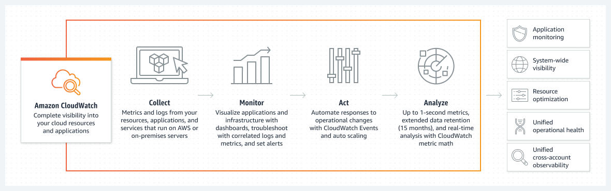
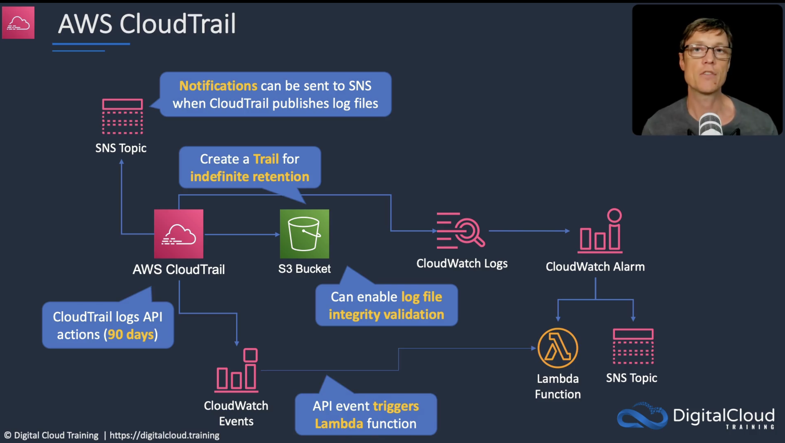
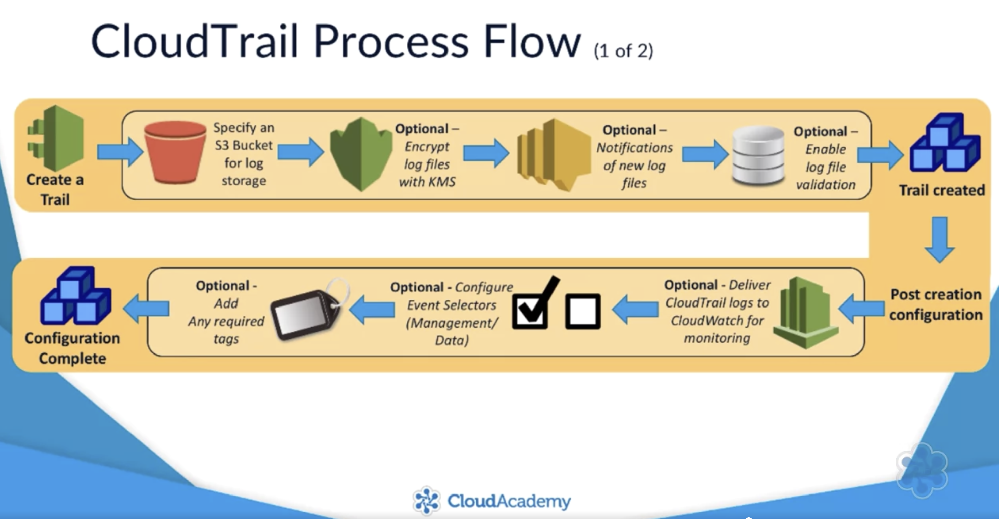
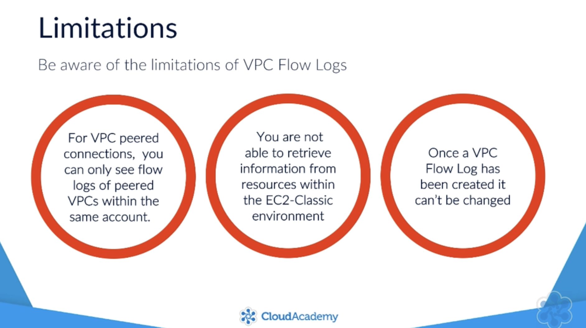
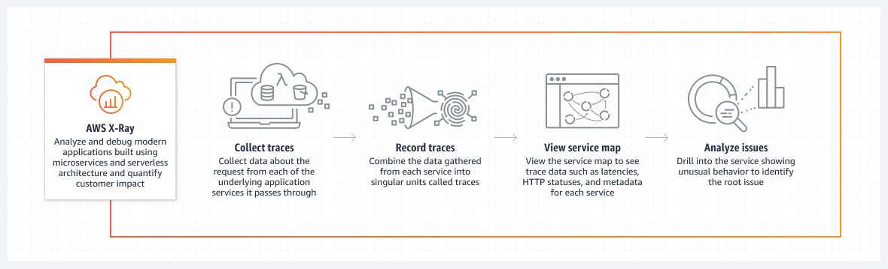
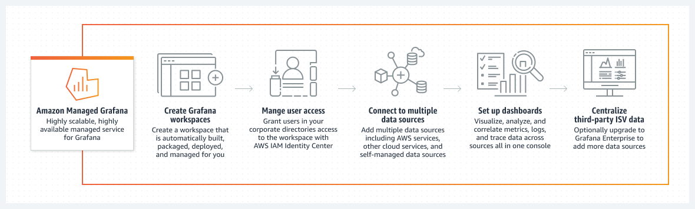

Logging is crucial for every company and project for multiple reasons: 

- Audit control
- Incident resolution
- Monitoring and Alerting
- Trend analysis 
and also in general to better understand your infrastructure ( with the goal of improving performance and optimising costs). 

AWS offers a variety of services for Logging, Monitoring and Auditing. 
Let's have a look:

#CloudWatch
Is a global service with a wide variety of features that allow you to monitor the health and operational performance of your application and infrastructure.

- Metrics and Anomaly Detection
- Alarms
- EventBridge
- Logs
- Insights
- Dashboards

## Metrics, Alarms and Anomaly Detection
Metrics are _time-ordered data-points_ (data points over a period of time like DiskReads on EC2 or NumberOfObjects on S3).
Different AWS Services have different metrics and you can also create custom metrics for your application (with standard - 1 minute granularity - or **high resolution - 1 second granularity**).  
EC2 offers a free set of metrics collated over a period of 5 minutes, but **detailed monitoring** (1 minute) can be enabled at a cost.

Alarms integrates with Metrics and allow to implement automatic actions based on threshold that you configure in relation to each metric. 
These action could be launching  (or terminating) EC2 instances or send SNS Topic  can be configured to send notifications to a SNS Topic ( check [my blog post about Alarms and Slack Notifications](https://dev.to/aws-builders/send-slack-notifications-with-aws-chatbot-5gfe)).

Often Alarms are based on thresholds, but these thresholds could prove too rigid or strict and to be really helpful they need to be  analysed within a context/trend.

**Anomaly Detection**, is a feature that uses machine learning against your metrics to detect activity that lies outside the normal parameters.  

Alarms have 3 states: **OK**, **Alarm** ( if metric is below or above the threshold) and  **Insufficient Data** in case the  metric is not available or not enough data is available to determine the alarm state.

## Logs and Insights
CloudWatch Logs is used to **collate and collect metrics** on resources, monitor their performance and responds to alerts.

It acts like the central repository of log data sent by different AWS services and this log stream can be monitored in real time.
With Insights and you can configure filters to search for specific entries or action you want to react to.

###Unified CloudWatch Agent
Unified CloudWatch Agent allows **collection of _system level metrics_ and logs from EC2 and on-prem servers**. (Unified Agent **must be installed** and its metric data is in addition to the default EC2 metrics - like CPUUtilization, DiskReads and StatusChecks).
If you need in **System Level Metrics ( like memory and disk-usage)** you have to use Unified CloudWatch Agent.
Unified CloudWatch Agent is also very useful to collect logs from terminated instances (ie, in autoscaling groups)

**LogInsights** can analyse our logs with **interactive queries** (and display them with different visualisations)
Container Insights capture additional diagnostic data (at cluster, node, pod and task level) from your containers (EKS - ECS) 
Similarly Lambda Insights provide additional information about Lambda functions. 

> Logs can be sent to S3, Kinesis Data Streams and DataFirehose, and can be exported to Amazon ElasticSearch for real-time log processing with _subscription filters_.

## Dashboards
CloudWatch Dashboards allows you to (via UI console, the CLI, the PutDashboard API, as well as CDK) to build and customise pages with different visual widgets displaying Alarms, Logs and Metrics from applications or projects. 

Dashboards can be shared to other users, even those that have no access to your AWS Account. 
Dashboards incur a charge of 3$ per month ( per dashboard ).

## EventBridge
[Formerly known as CloudWatch Events](
https://docs.aws.amazon.com/AmazonCloudWatch/latest/events/WhatIsCloudWatchEvents.html) is a service that uses events to connect application components together to build scalable event-driven applications.

These are the components of EventBridge:

- Events are basically any state-change in your environment or application
- Event Sources are the AWS services or custom apps dispatching an event
- Event Targets are the destination of the events ( a resource or an endpoint, like SNS, SQS, API Gateway, Lambda, Kinesis, EC2, Code Pipeline and many more)
- Event Rules acts as a filter for incoming streams of event and a router to one or multiple targets (in the same region)
- Event Buses are the components that receive the events and where the rules are associated. ( EventBridge uses a default Bus, but you can create a custom bus)

#CloudTrail
It is a global services supporting ALL regions that records and tracks for auditing purposes ( logs are by default retained for 90 days) ) all AWS API requests made 
- programmatically by a user with SDK
- from AWS CLI
- within AWS Console
- by other AWS services

A CloudTrail Trail captures API requests and stores them as _events_ in a log file ( in JSON format, within 15 mins ) on S3.

Events contain information about 
- caller
- timestamp
- source IP

CloudTrail is very useful for security to monitor restricted API calls and be notified of threshold breaches , as well for solving operational issues ( debugging and root cause analysis).
Even though there is a specific service to monitor and keep track of changes in your infrastructure ( AppConfig ), CloudTrail logs can be used as **evidence for various compliance and governance controls**.

Types of captured events: 
- **Management events**: also called _control plane operations_ normally refers to management operation performed on resources in your account ( like configuring security with IAM, creatingVPC or Subnets and setting up logging)
- **Data events**: aka _data plane operations_ provide information about the resource operations performed in or on a resource ( like accessing S3 Object, invoking Lambdas, editing items on DynamoDB)
- **Insights events**: **capture unusual API call rate or error rate** activity [since additional charges are applied, insights events are disabled by default]

AWS offers the ability to aggregate CloudTrail logs from multiple accounts into a single S3 bucket. This is achieved by - activating CloudTrail on the account owning the Bucket 
- creating a Bucket policy with a permission for each AWS Account we want to aggregate logs for
- activating CloudTrail on the other accounts pointing to the right S3.

This is useful solution, but generally you don't want aws accounts writing logs to a bucket on another account, to be able to see log information from other accounts ( which are logging in the same bucket) therefore the best approach is - in the _primary account_ : 
- to create an IAM Role for each account requiring Read Access
- to assign a Policy to that roles to allow access _only_ to their logs
- to let users assume that Role, by setting Trusted Relationship 
- by creating _on the secondary accounts_  a new Policy that allows to Assume the CloudTrailReadLogs Role.

## LogFile integrity validation
CloudTrail creates an **hash for the log-files** being added to S3.
Every hour a **digest file** is created containing the details of the logs delivered and their hash. 
That allows to verify the integrity of the logs and that log files have not been tampered in any way. (by running a CLI command - not from console and not automatically)

## CloudTrail CloudWatch Monitoring

**CloudTrail can send logs to CloudWatch** which allows metrics and threshold to be configured (as well as subscription filters or LogInsights).
CloudWatch logs have a size limitation of 256Kb, if CloudTrail logs are bigger, they wont be forwarded to CloudWatch.

Using specific filter patterns you can create Metrics (to detect for example when API calls requests change significantly or when EC2 instances are started or there are failed login attempts to the Management Console and so on) and then you can create Alarms specifying thresholds for your metrics.

# CloudFront Access Logs
When Access Logs are enabled you can record any request from each user accessing your website and distribution.
These logs are stored to S3 - and that storage is the only thing you will pay for. 
CloudFront does not write logs to S3 immediately, but it captures them over a period of time and then saves/delivers them to S3 depending on the amount of requests received (usually between 1 and 24 hours).

If your origin is anything other than S3 you can enable **Cookie Logging** alongside your Access Logs.

# VPC Flow Logs
> VPC Flow Logs allows you to capture IP traffic information that flows between your network interfaces of your resources within your VPC. 
VPC Flow logs are usually sent to CloudWatch (within a window of 15 mins), but _can_ also be sent directly to S3.

There are some limitation in the traffic that can be captured by VPC logs ( for example DHCP traffic within the VPC or traffic between NLB Network Interface and an ENI etc ) check [here for more info](https://docs.aws.amazon.com/vpc/latest/userguide/flow-logs.html#flow-logs-limitations).

VPC Flow Logs can be created against :
- Network interface on one of your instances
- a Subnet
- the VPC itself

# AWS Health Dashboard
allows you to _learn about the availability and operations of AWS services_ and to _view personalised communication about your resources/accounts_ (like resources taken down for repairs, upgrades or maintenance).

It integrates with Event Bridge to send notifications, execute lambda functions and so on. 

#X-Ray
Analyses and debugs production and distributed applications, allowing to visualise the components of your application, identify bottlenecks and troubleshooting requests.

X-Ray works with EC2, ECS, ElasticBeanstalk and Lambda.
X-Ray SDK  captures requests made to MySQL, PostgreSQL and DynamoDb as well as requests to SQS and SNS.
X-Ray Agent gathers raw segment data and pass it to X-Ray SDK so that it can be sent to the X-Ray Service

# Amazon Managed Service for Prometheus
[Prometheus](https://prometheus.io/) is an open-source monitoring system and time-series database.
It uses Prometheus query language (PromQL) to filter, aggregate, ingest, and query millions of unique time series metrics **from your self-managed Kubernetes clusters**. 

Since this is a fully managed solution offered by AWS it scales automatically and integrates with EKS, ECS and AWS Distro for OpenTelemetry.

# Amazon Managed Grafana
[Grafana](https://grafana.com/) is an open-source analytics and monitoring solution and it provides **interactive data visualisation** for monitoring and operational data.
As for Prometheus, the [fully managed solution from AWS](https://aws.amazon.com/grafana/) allows for high scalability and high availability.
It integrates with AWS SSO and SAML

