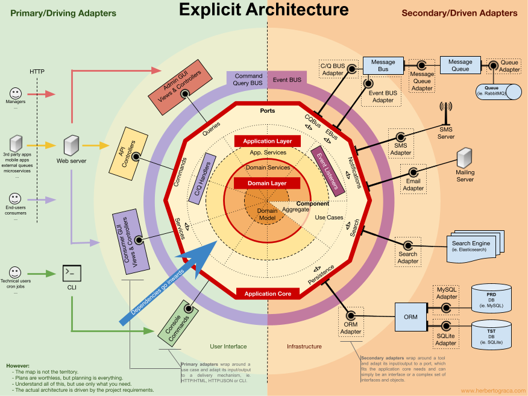

It has been a while since my last digest of interesting articles.  With Re:Invent going on my to-read-list was overflowing and at some point I decide to stop and clear that at once! Then Xmas vacations and a rough start in the new year with some changes at work.  

Still here is a list of gems I really suggest you go reading!

## Testing Step Functions
I have been using Step Functions on a couple of projects and despite the state machine being not so big, I already felt some of the pains related to _testing the integration of the whole thing_.
AWS Hero Yan Cui shows us [a practical guide to testing AWS Step Functions](https://theburningmonk.com/2022/12/a-practical-guide-to-testing-aws-step-functions/).

I had no idea [StepFunctionsLocal](https://docs.aws.amazon.com/step-functions/latest/dg/sfn-local.html) even existed! I am very looking forward to the next project with StepFunctions! 

### Explicit architecture

A very very detailed article by Herberto Graça about [DDD Hexagonal Architecture, Clean Architecture and CQRS](https://herbertograca.com/2017/11/16/explicit-architecture-01-ddd-hexagonal-onion-clean-cqrs-how-i-put-it-all-together/)

Lots of theory and very valuable input in case of complex enterprise applications, but please, don't get carried away and try to implement all that for you next simple RESTful API!  

##Monolith stack vs stateless and stateful stack

When writing IaC and building CDK stacks it might happen you have multiple stacks in one app, or multiple repos with different stacks and then you start referencing ARNs, coupling things etc.  
Yan Cui gives us his point of view about [why we should keep stateless and stateful resources together in the same stack]( https://theburningmonk.com/2023/01/this-is-why-you-should-keep-stateful-and-stateless-resources-together/).

Honestly I never had such a doubt and always automatically went for a monolith stack.
I share the same argument in the article: it makes it easier to create ( and destroy ) ephemeral environments.

The only case when we created different stacks, but was rare, was when after months or years a new feature or API was going to be introduced to a system (which maybe didn't have IaC or IaC had been written and maintained by a different team with a different techstack). In such case, we opted for a separate repo, with our own code and our own stack and the references to the already existing stateful resources.  It was not optimal, but we favoured simplicity and our ease of development.

## CDK Parallel Deployments
Speaking of CDK practices, just recently in the AWS Community Builder Slack Channel there has been an interesting discussion going on.
One of the comments brought me to [this article about parallel deployments](https://www.rehanvdm.com/blog/cdk-shorts-2-parallel-deployments).
I admit I use CDK with a single stack ( but with multiple environments) so I never experienced such a need, but having the possibility to output a Cloud Assembly by `cdk synth` and then use that for parallel deployment with `--exclusively true` is definetely useful and an interesting approach.