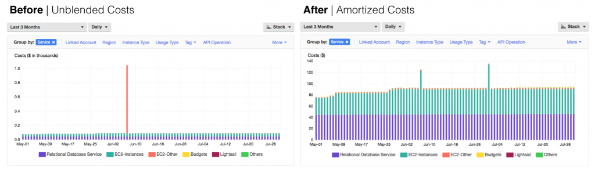
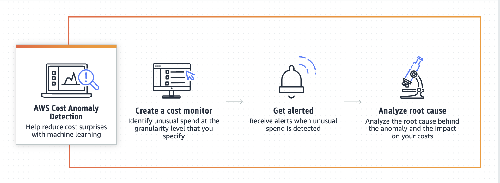

As technical leads or architects it is very useful to know how to view, filter and analyse the costs of the application we build. 

Actually I found Cost Explorer already very useful when I was working as a Senior Engineer because it provided lots of insights about the usage of our services, how much they costed and helped me in looking for possible optimisations. I found that _being aware of costs_ belonged to the idea of _ownership_: I was not just responsible for the task of building an API and retrieve data from a DynamoTable, but to solve a business problem with the best tools and the least costs.

Let's have a look at what AWS provides us with: 

## Billing and Cost Management Dashboard

gives an overview of the costs and what are the services that are concurring the most to the bill.

if you have organisations you can have Bill details by service and by account ( Organisations has Consolidated Billing )

## Cost Explorer
Is a _free_ tool that allows you to get a deeper insights of your billing and have granular views and **filters by service, tags, region, usage** and so on and identify your main cost drivers.
You can have daily and monthly views for free ( or you can enable Hourly view at a cost).

In the Advanced Options you can view costs as:

- unblended costs represent costs on the day that they are charged. This is normally what we as developer/leads will look at to monitor daily and monthly spend or find spikes in usage/cost

- amortized costs distribute costs evenly across the month to avoid spikes related to recurrent fees like reservations/saving plans

- amortized/unblended *net* costs are similar to the above but include discounts

Cost Explorer shows data up to the past 13 months and can forecast your expense over the next 3 months. 

## Cost and Usage Reports (CUR)
CUR is an additional service, (you have to enable it ) that offers **historical by-the-hour data** that can offer clarity on trends and lead to a more accurate data-driven insight.
CRU are **saved to S3 ( from 1 to 3 times a day)** but you can also output files for Athena, RedShift and QuickSight.
With CUR you can keep visibility of costs reports _older than 12 months_.

## Budgets
**Budgets** allow the user to get notified when costs or usage exceed a certain predefined amount.

You define **what you want to track** ( just cost, service usage or utilisation of saving plans and reserved instances ), the amount and the scope (all resources in the account or specific projects/services)
Then you define a **threshold** and the target of your **Budget Notification** ( email, SNS topic or ChatBot). You can also define a **Budget Action** to be triggered (like stopping EC2/RDS instances or changing IAM Permissions or SCPs).
Finally **Budget Reports** can be exported to have an overview of all your budgets and their status.

## Cost Anomaly Detections
Sometimes you might be exceeding your Budgets because your business is growing, sometimes you might experience spikes of costs or usage in your applications which are suspicious even if they are within the budget thresholds.

Spikes and threshold breaches need to be contextualised in order to determine if they are fine or not.

AWS Cost Anomaly Detection is a _free service_ that helps getting an understanding of those spikes by using Machine Learning against your spending patterns. 

##Cost Allocation Tags
Tags provide the functionality to associate metadata as key-value pairs to the resources in your AWS account.

Adding Tags to resources expands the capabilities of Cost Reports because you can **filter by additional dimensions** such application, cost-center, environment, business-unit, owner, and so on.

Tags can be managed via UI Console, CLI and Tag Editor ( which allows editing tags on multiple resources ) - and of course can be defined when setting up your Infrastructure as Code. 

I have used Cost Explorer quite a lot in the last couple of years as I became responsible for the projects my team was building, and  it is a fundamental tool to analyse current applications and start evaluating possible optimisations to your architecture that allow to save considerable amount of money. 

> Tag resources as soon as possible, keep tags simple and consistent, and eventually **adopt policies that prevent deployment of new resources without tags**.  
_Keep the number of different tags as low as necessary, but the information value of each tag as high as possible._

Please check my [previous post about Cost Explorer and Resource Tags](https://dev.to/dvddpl/allocate-aws-costs-with-resource-tags-18j0).

Remember to enable _Cost allocation tags_ in your account so that your tags will be considered cost allocation tags and will be available in the Cost Explorer to set up filters.

## Price List API 
allows you to query the prices of AWS services and be alerted via SNS when prices change