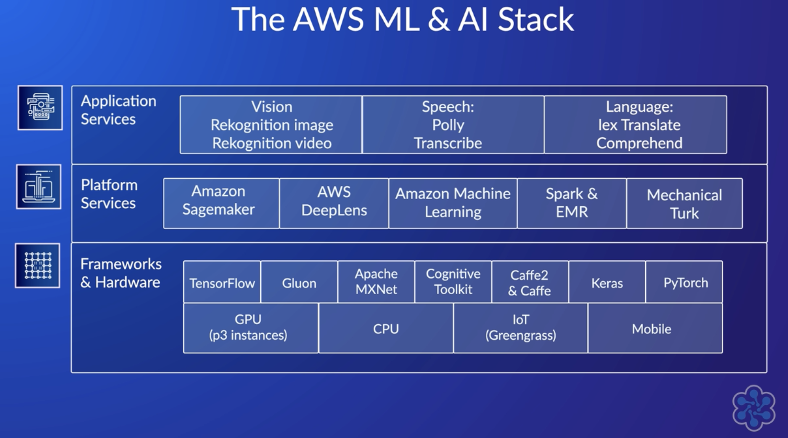

The offering of AWS in terms of AI and ML services is, guess what, broad and impressive. 
The topic is actually not covered that much in the Solutions Architect Associate certification exam so I will just go through some of the most interesting services that can be easily integrated in web and mobile applications for very cool features. 

# Rekognition
A service that can identify objects, people, text, scenes and activities in images and video, then publishes completion status to SNS.
check out some interesting ( and very funny ) posts about it by [AWS Hero Renato Losio](https://dev.to/aws-heroes/how-to-cook-spaghetti-aglio-e-olio-according-to-amazon-rekognition-25na)

# Transcribe 
converts Speech to Text to extracts insights from customer calls, video files and audio recording 

Recorded speech can be converted to text for use in applications
Provides real-time transcription and automatic language identification

# Polly
TTS ( Text To Speech ) service using deep learning technologies to synthetyse natural sounding human speech and creating application that talk

# Translate
Uses deep learning  models for accurate and natural sounding translations
Very useful to localise content on websites and apps.

# Amazon Comprehend

> a fully managed, continuously trained NLP service backed by ML, used to derive meaningful data from any text in utf-8 format or semi-structured document as .doc or .pdf

> Natural Language Processing  a subfield of linguistics, computer science, and artificial intelligence concerned with the interactions between computers and human language. The goal is a computer capable of understanding the contents of documents, including the contextual nuances of the language within them

AWS Comprehend will scan your text looking for:

- Key Phrases: combination of words that contain a noun (a word identifying people, places or things) phrase that describes something 
- Entities: references to the unique name of a real-world object such as _people, places, and commercial items_, and to precise references to measures such as _dates and quantities_.
- Sentiments: relates to the emotional context of a block of text

Can determine what language is being used and (only in your **English text** documents) detect sensitive data (PII: personal identifiable information) to locate/present it or redact it directly.

Topic modelling features help you determine the themes that exist amongst a large amount of text and allows you to organise your documents into different categories.

# Amazon Lex
Conversational AI for Chatbox
use voice and text to build conversational interfaces and to
build bots to increase contact-center productivity and automate simple tasks

# Forecast
Amazon Forecast is a fully managed service that automatically uses machine learning to deliver accurate forecast for any time series data sets.

Amazon Forecast can import the [following types of datasets](https://docs.aws.amazon.com/forecast/latest/dg/howitworks-datasets-groups.html):

- target time-series: the historic time-series data of items that you want to forecast ( like timestamp, item_id, value)
- related time-series: includes information that improve the accuracy of the predictor ( price, promotion)
- item metadata: static information that provides context to the items in a target time-series (brand, color, model)

Once data is imported you create and train the **Predictor** and generate the forecast.

Check some interesting samples [here](https://github.com/aws-samples/amazon-forecast-samples)

# AWS Sagemaker

SageMaker is a fully managed service that provides the tools to build, train and deploy machine learning models: 
- Data preparation
- feature engineering
- statistical bias detection
- auto-ml
- training and tuning
- hosting
- monitoring
- workflows

---

I really suggest a post from another AWS Community Builder about the [_armada of machine learning services_](https://dev.to/aws-builders/chatgpt-vs-the-armada-of-aws-machine-learning-services-21af)

