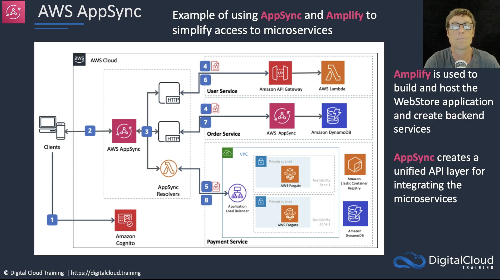
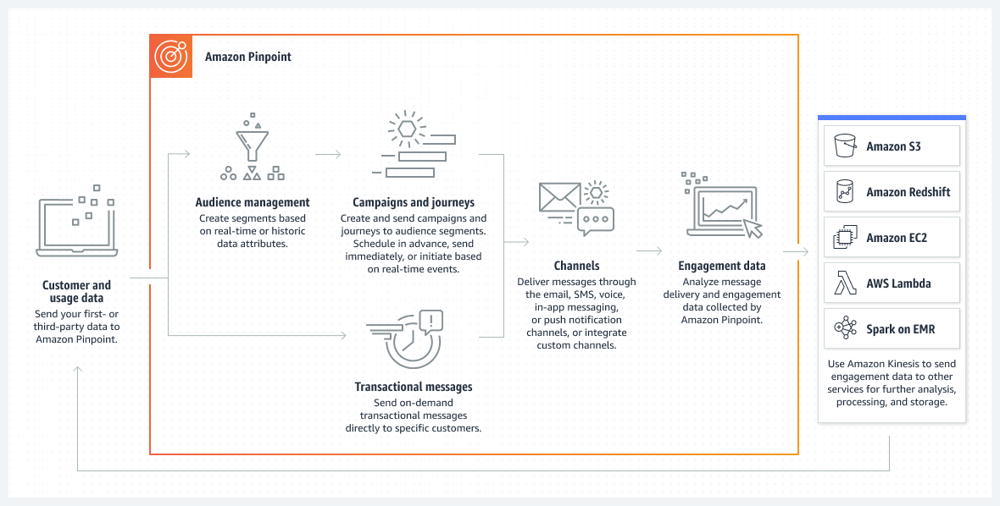

Another very short write-up about some of the services that might appear in the exam certification.

# Amplify

It provides tools and features for building full-stack applications on AWS (even with no or very little backend experience)
Amplify Studio is a visual interface to define data model, user authentication and file storage. 
Broad sets of Amplify libraries for iOS, Android, Flutter, React Native and Web
Amplify Hosting is a fully managed CI/CD and hosting service

I had used [Amplify](https://aws.amazon.com/de/amplify/) in the past just to set up authentication in a React application and to get S3 signed urls, but not much more.  personally, as much as I find Amplify studio useful for "getting stuff done quickly" I don't find that much interesting for production workloads in big teams

# AppSync
is a fully managed service that makes easy to develop GraphQL APIs, so that application can access, manipulate and receive real-time updates from multiple data sources ( resolvers will grab and aggregate sources like Elasticsearch, DynamoDb,  Lambda)
it automatically scales, provides server-side data caching ( without need of managing cache clusters )

AWS Serverless Hero Yan Cui has [some very interesting articles](https://theburningmonk.com/2020/07/how-i-scaled-an-appsync-project-to-200-resolvers/) ( and courses ) about AppSync, defenetely worth a look!

#AWS Device Farm

is an app testing service that lets you test and interact with Android, iOs and web apps on many devices at once.

> No need to purchase and maintain a collection of devices for you dev and qa testing anymore. 

you can perform **automated testing** and **manual testing with through remote access** to interact with a real device through the browser.

Devices are non-rooted and any appropriate app can be installed.
you can simulate real world environments, selecting languages, locations and so on.

#AWS Pinpoint
Amazon Pinpoint allow to deliver customer communications across channels, segments, and campaigns at scale.

- collect app usage data
- built in analytics
- import data from s3 or redshift ( or csv files ) to build segments
- build campaign messages and schedule campaigns
- analyse campaigns 
- funnel analytics

