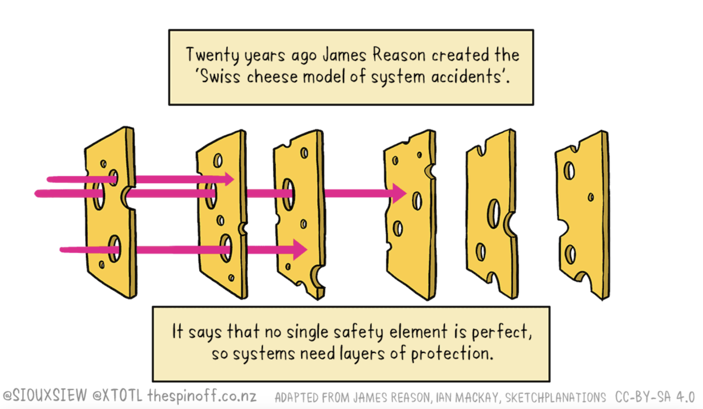
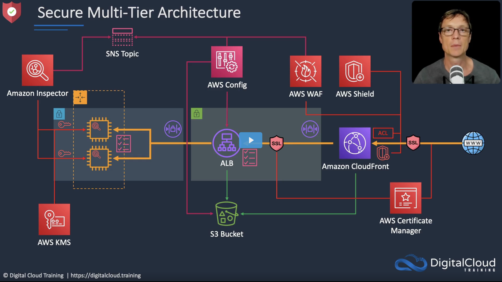
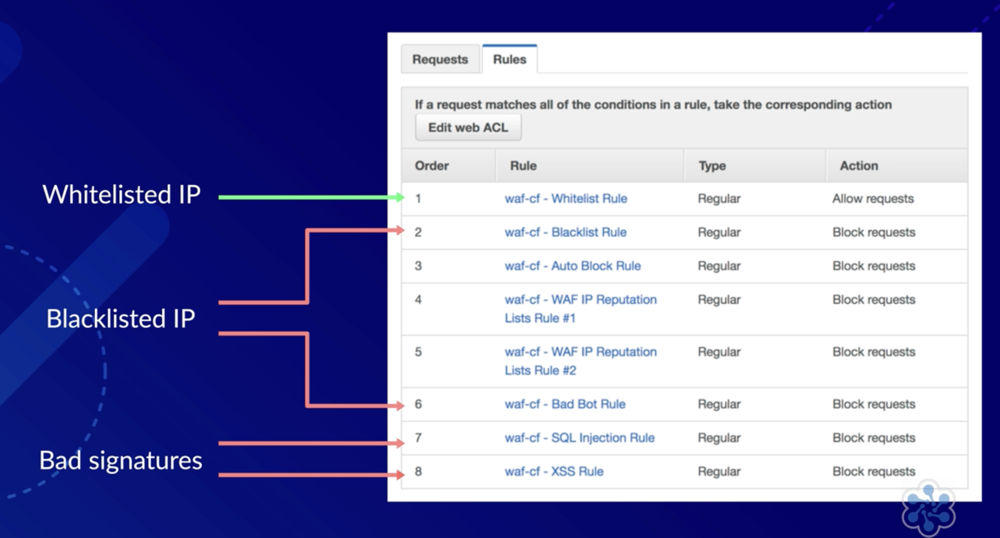
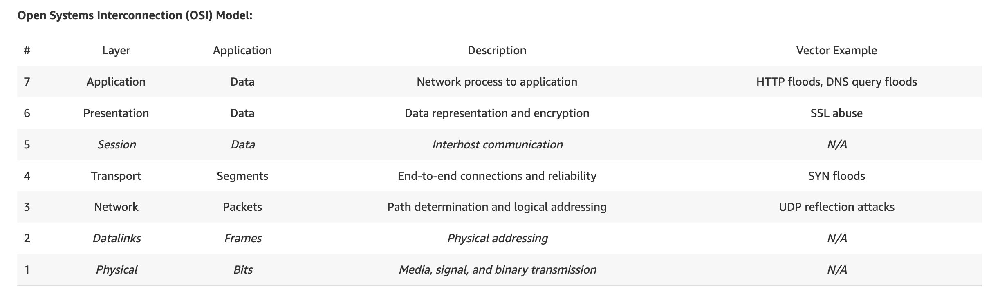
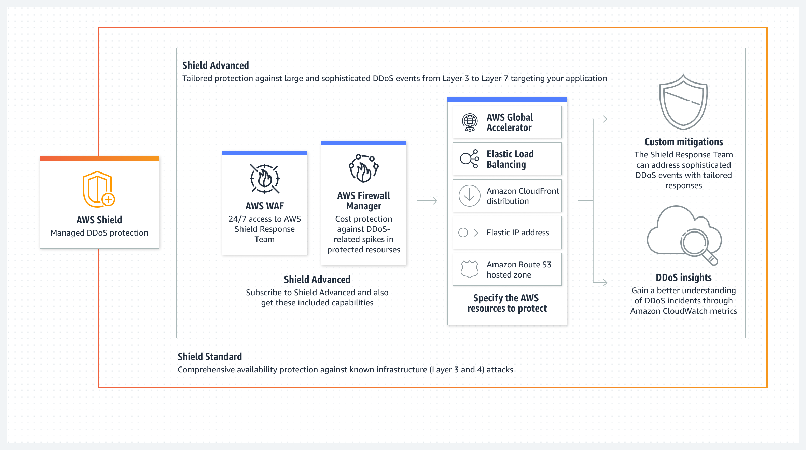
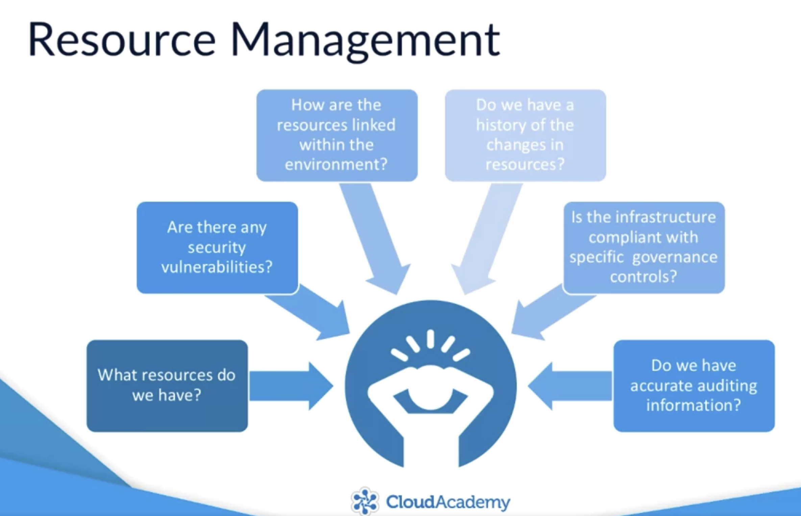
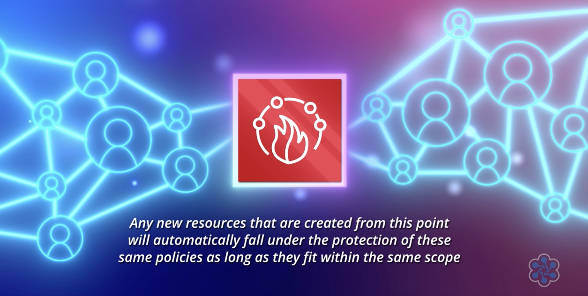
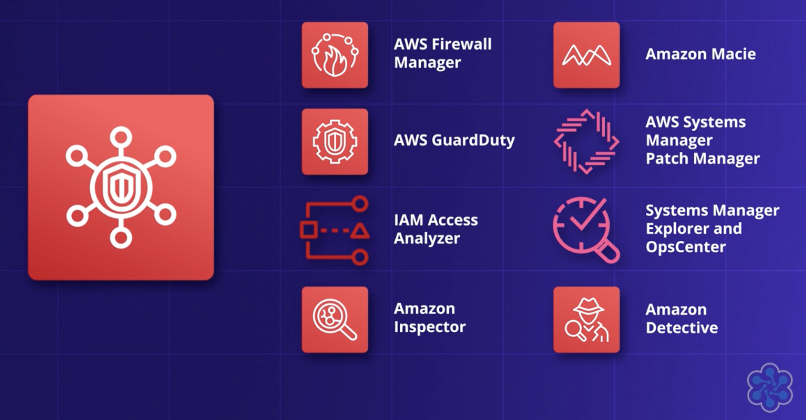

---
title: AWS Security in the Cloud Cheat-sheet/Write-up 
published: true
series: AWS Solutions Architect Associate Certificate Cheat-sheets 
description: Cheat-sheets about AWS Services and Tools for security in the Cloud - for Solutions Architect Certification (but not only)
tags: aws analytics techlead solutionsarchitect
background: /assets/v5cy5hjax79rhqfht8se.png
---

# Defense In-Depth

The idea behind the _defense in-depth_ is to defend a system against attacks by **layering independent methods of defense and providing redundancy** in case of a security control failure or vulnerability exploit.

The necessity of these layering approach is explained clearly by the Swiss Cheese Model:  _since no layer can be 100% secure, if we overlap different layer we can possible reduce the chance of an hole going all the way through._ 

> The five functions of the [NIST Cybersecurity framework](https://www.nist.gov/cyberframework/online-learning/five-functions) :
- Identify
- Protect
- Detect
- Respond
- Recover

There are multiple AWS services that can be used in combination at different levels to build **secure Multi-Tier Applications**:

Let's have a look.

# WAF

WAF is a Web Application Firewall
You can use AWS WAF to block, allow, or monitor HTTP/HTTPS requests based on various conditions such as IP address, request headers, and query strings.
Its rule allow to block web exploits like **SQL injection and XSS (cross site scripting)**.

WAF can be put in front of CloudFront Distributions, ALBs, API Gateways and AppSync/GraphQL APIs.

WAF Concepts:

- Web ACLs ( Access Control Lists ) are used to protect a set of AWS resources
- Rules are statements that define the criteria to inspect the request and the action to be taken (Allow, Block - or Count)
- Rule Groups allow reuse of rules, or logically grouping

Managed Rule Groups are a set of predefined rules that have been created by AWS and other AWS Marketplace sellers (like for example the rule group to protect against [OWASP Top 10 vulnerabilities](https://owasp.org/www-project-top-ten/))

**Managed rules**, are ready to use, tried and tested and can save you a lot of time and effort. 
Web ACL Capacity Units ( WCUs) are the measure of the rule/statements complexity. The more intricate the rule from the inspection perspective, the more WCUs will be consumed.
WebACLs have a limit of 1500 WCUs that can be used by their rules and rule groups. If a WebACL uses rules or rulegroups that exceed the WCU limit, they will fail - that's why a rule group - which is shareable across different Web ACLs, must have an immutable WCU limit set ( to prevent later changes could break WebACLs already using that group ) 

**Custom rules** are rules and rule groups that you define yourself.
- IP Sets are collections of ID address and ranges to be used in a rule statement
- RegEx pattern set is a collection of regular exceptions

**Match statements** compare the request or its origin against specific conditions, to determine if allowing or blocking the request from being forwarded to the origin.
You can build your rules combining AND, OR and NOT arguments between nested statements. 
Rules can be regular or rate-based ( which will count the number of requests over a 5min period)

Rules have a priority which you need to properly define so that the order of execution is correct.

At the time of writing ( for Ireland region ) these are the costs for using WAF features: 

- 5 $ per month for each Web ACL
- 1 $ per month per Rule
- 0.60$ per million requests

Check [Pricing page for more info](https://aws.amazon.com/waf/pricing/)

# AWS Shield

is a managed DDoS (Distributed Denial of Service) protection service and safeguards web applications with detection and inline mitigation.

> A DoS attack is a malicious attempt to disrupt the normal traffic of a web host by running a huge number of simultaneous requests that can overwhelm the servers until normal legitimate traffic is unable to be processed.  Request can come from single connections or from multiple distributed sources (thus DDoS). 
A Layer 7 DDoS attack targets the application interface by mimicking real, human behaviour while Layer 3/4 attacks focus on targeting the transport and network layers.

%20Layers.)

- **Standard** is automatically enabled with Elastic Load Balancing (ELB), Application Load Balancer, Amazon CloudFront and Amazon Route 53. There are not additional costs ( besides those of the services you are using.

It defends against most common network and transport layer (layer 3 and 4)  DDoS attacks. It also provides network flow monitoring and sets static thresholds. 
Automatic mitigations are applied inline without latency impact

- **Advanced** has of course a broader set of features ( like more sophisticated DDoS Attack detection - Application Layer (7) too - , near real-time visibility and integration with WAF + access to Shield Response Team) but at a cost of 3000 Dollars per month with a min 1 year commitment!  (on the other hand, you won't pay for WAF any more)

# Amazon Inspector
It is a **vulnerability management service** that simplifies compliance by running assessments that check for security exposures and vulnerabilities in EC2 instances (but also on Lambda functions and container images in ECR).

Assessments produce **Findings** that describe the vulnerability and rates its severity, identify the affected resources, and provides remediation guidance. 

**Host Assessments**: check for vulnerable software (SSM Agent is necessary)

**Network Assessments**: check configuration for **ports reachable from outside the VPC** (agentless with Network Reachability rules package but if done through an Inspector Agent installed on your EC2 instances, it is also possible to find out reachable **processes**)

# Macie
is a fully managed data security and data privacy service that uses machine learning and pattern matching to analyse S3 Buckets  to discover sensitive data like Personal Identifiable Information (PII), Protected Health Information (PHI), credit card numbers,  API keys, secret keys, access credentials and so on.
It continuously **monitors the security posture of Amazon S3**.

# AWS Config

Is a service useful for resource management and in compliance scenarios.

- captures resource changes
- act as resource inventory
- store configuration history
- provide a snapshot of configuration
- identify relationships among resources
- allows to send/receive notifications if configuration are updated
- use Rules to evaluate that your AWS resource configurations adhere to desired settings.

**Configuration Recorder** is automatically enabled and responsible for recording all the changes in resources in a region and store Configuration Items into S3 Bucket.

**Config Rules** allow to enforce specific compliance checks by running a Lambda function and analysing if the configuration of a resource matches your requirements  ( like for example rules that check that S3 Buckets have default encryption enabled  or if RDS instances are left publicly accessible, or if security groups allow unrestricted incoming SSH traffic ).
If resource configuration is not compliant, SNS will be use to send notifications ( and eventually Systems Manager will be used for remediation)

[Here you can see a long list of AWS Managed Rules](https://docs.aws.amazon.com/config/latest/developerguide/managed-rules-by-aws-config.html), but you are free to write your own custom rules that fit your organisation requirements.

# AWS FireWall Manager
It is a service to help simplify the management of security protection to multiple resources **in multiple accounts**. 
Prerequisite of Firewall Manager is that you have AWS Config enabled and that your account is part of an AWS Organisation.

Firewall Manager **integrates with WAF, Shield Advanced, Network Firewall, VPC Security Groups and Route 52 Resolver DNS Firewall**. 
For each of those resources Firewall Manager allows you to configure Policies to protect them. (100$ per policy per region).

A firewall Manager policy is created by
- choosing policy and region
- describing the policy
- defining the policy scope (which resources and accounts will be covered by the policy) 
- configuring policy tags
- reviewing and creating the policy

# Guard Duty
is an **intelligent threat detection** service that provides you with an accurate way to consistently monitor and protect your AWS accounts and workloads for **suspicious activity**.

It continuously monitors across:
- CloudTrail Management Events
- CloudTrail S3 Data Events
- VPC Flow Logs
- DNS Logs

# Security Hub
It is a service that allows to **consolidate security findings and alerts across accounts** and provider products and display them into a single dashboard. (but only those that are generated after you enable Security Hub, it does not work retroactively).
It integrates with services like GuardDuty, Macie, Inspector and more.

Security Hub also generates its own findings by running automated and continuous checks against the rules of three fundamental standards as defined by the [Center for Internet Security (CIS)]( www.cisecurity.org): 

- CIS AWS Foundations
- Payment Card Industry Data Security Standard (PCI DSS)
- AWS Foundational Security Best Practices

----
We can't talk about security without talking about Encryption

> encryption is the process of encoding information, converting the original representation of the information, known as plaintext, into an alternative form known as ciphertext, which ideally only authorised parties can decipher. [source](https://en.wikipedia.org/wiki/Encryption)

Types of encryption:

###Asymmetric vs symmetric encryption 

With Asymmetric ( also public key cryptography) Public key is used to Encrypt (can be openly distributed without compromising security) while Private key is used to Decrypt (must be kept secret!) 

With Symmetric encription there is just a single key used to encrypt and decrypt the data (both parties know the secret - that must be carefully kept secret!) 

### Encryption at rest vs in transit
As it can be imagine encryption at rest means that data is stored encrypted, while in transit means that data is protected by SSL/TLS as it traverses the network.

# KMS
It is a fully managed service that allows creation and management of (symmetric and asymmetric ) cryptographic keys ( used for Encryption at Rest).

**Customer Master Key** (CMKs) are the primary resources in KMS - 
they contain the key material to encrypt and decrypt data. 
CMK can encrypt data up to 4KB but can also generate, encrypt and decrypt Data Encryption Keys - in case of larger amount of data.

**AWS Managed CMKs**
they are created managed, and used on your behalf by any AWS Service integrated with KMS.
you don't have to manage them ( you can't rotate or change them, AWS does that for you)

**Data Encryption Keys** 
are used to encrypt large amount of data or other data encryption keys.
KMS does not store DEK and you have to manage them outside of AWS KMS

##Cloud HSM
is a dedicated hardware device, running in the VPC used to generate and use your own encryption keys.
Since it is **single tenant** ( an hardware device just for you ) it provide **extra levels of security**.

- offload SSL/TLS processing from your web servers
- protect private keys for issuing certificate authorities 
- store the master key for Oracle DB Transparent Data Encryption 

## Certificate Manager (ACM)
it is the service which generally allows Encryption in Transit across AWS services

Create store, renew SSL/TLS X.509 certificates that work with single domains, multiple domains and wildcards.
It integrates with 
- ELB
- CloudFront
- Elastic Beanstalk
- Nitro Enclaves
- Cloud Formation

You can 
- create Public Certificates signed by AWS CA
- create a Private CA with ACM and then issue private certificates
- import certificates from other issuers
