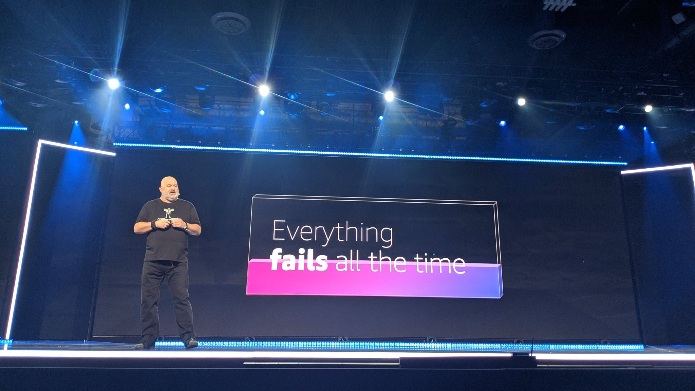
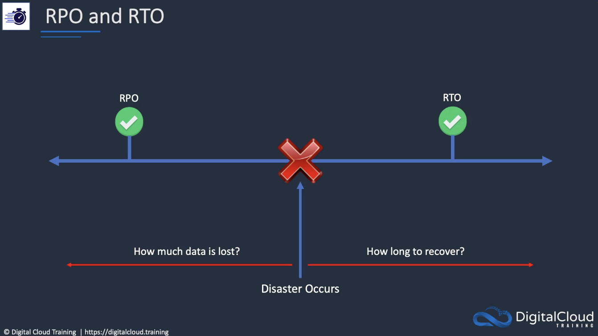
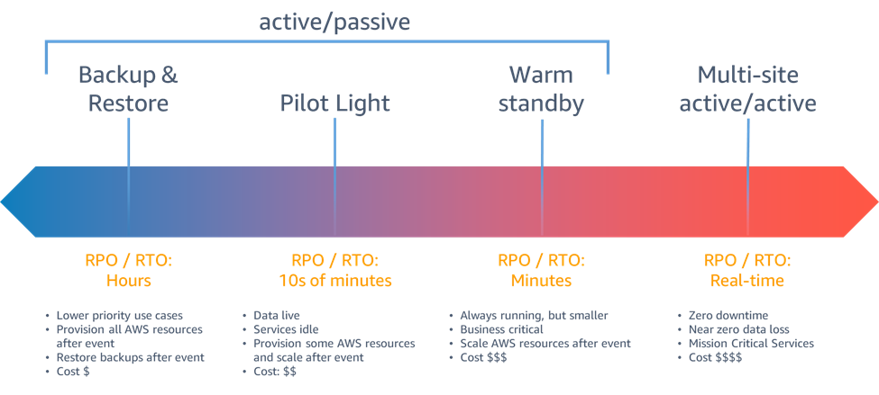
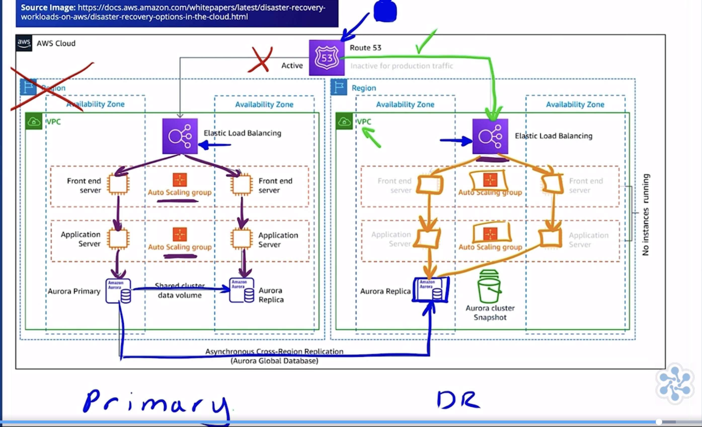
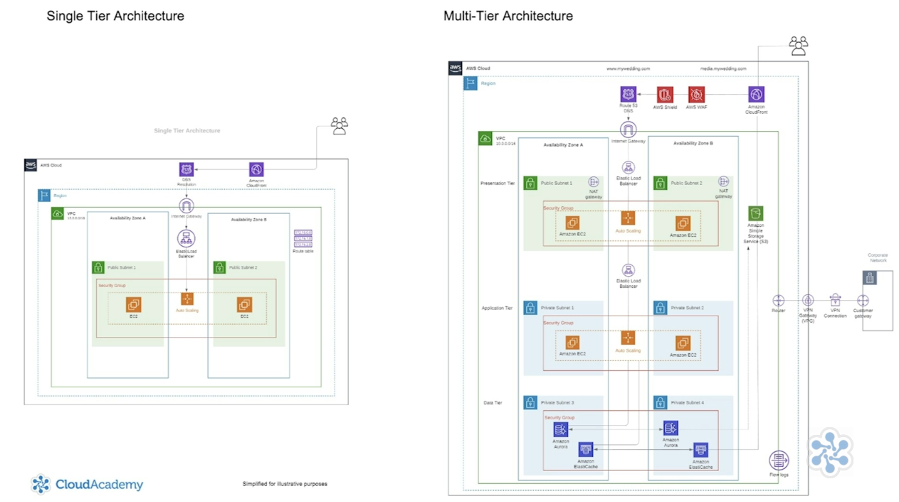
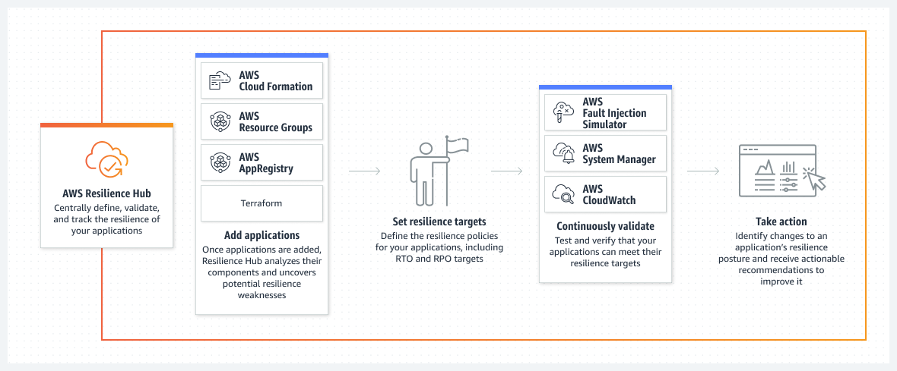

> Everything fails all of the time (Werner Vogels, VP and CTO of AWS)

I love this quote, stretching out my interpretation to daily life, is the acknowledgement that things can and go wrong ( Murphy's law ) and we should not stress too much about what could happen, or freak out when it happens but rather _do our **best** to be prepared_.
We should **prepare for failure** and lay out steps and procedures to mitigate and recover quickly and effectively.
(And this _best that we can do_, really depends from the resources we have available, the level of risk we want to take and the amount of loss we are able to tolerate.)

#Highly Availability and Fault tolerance

I already covered the topic of High Availability vs Fault Tolerance in [this post about autoscaling](
https://dev.to/aws-builders/aws-elastic-load-balancing-and-autoscaling-cheat-sheetwrite-up-48ja) but a refresher will not harm:

An application is highly available when it can react and **quickly recover** from a component failure.
An application is fault tolerant when it tolerate any component fault **avoiding side effects** like performance impact, data loss, or system crashes.

High availability is achieved by removing single points of failure using system redundancy.

Fault tolerance is achieved by adding even more redundant resources, and at different levels, increasing uptime, but also complexity and costs.

> you can check [my previous post about Global AWS Infrastructure ](https://dev.to/aws-builders/aws-virtual-private-cloud-vpc-cheat-sheetwrite-up-1i8b) to refresh the concepts of Availability Zones and Regions. 

A proper design for failure requires weighting carefully COSTS - RISKS - BENEFITS because application designed for Regional Failover has far more complexity and cost than one that is Multi Availability Zone ( or single AZ!).

In the end the driving factors to consider are RTO and RPO:

## Recovery Point Objective (RPO)
It's the measurement of the amount of **data** that can be acceptably lost (_in seconds, minutes or hours_)

> of course nobody wants to lose data, but the less data we accept to lose the higher the costs for maintenance and backups.

If we could afford losing 2 hours of Data in a Database , we can configure backups every 2 hours.  If we want to reduce the data loss, we need to do more frequent backups. 

The lower the RPO the higher the costs and the complexity of the infrastructure ( for example, in case of minutes to hours, snapshots are ok, for seconds to minutes, async replication would be fine, but to get to milliseconds and seconds we would need synchronous replication).

## Recovery Time Objective (RTO) 
Measurement of the amount of time it takes  to restore after a disaster event.
Again, depending on how fast  we want to be able to recover we need different techniques :
- Fault Tolerance
- High availability, load balancing, autoscaling
- Automated recovery, cross site recovery
- Manual recovery
(above list in order of RTO, from milliseconds to hours, to days) 

## Disaster recovery Strategies

[whitepaper](https://docs.aws.amazon.com/whitepapers/latest/disaster-recovery-workloads-on-aws/disaster-recovery-options-in-the-cloud.html)

### Backup and Restore:
RTO measured in 24h or less, RPO within hours
Infrastructure needs to be likely recreated/redeployed, data can be restored using snapshots/backups

### Pilot Light 
Data replication between regions, some core infrastructure already in place in DR region

### Warm Standby
same resources as primary production are already deployed and running on DR Region (although likely scaled down)

### Multi-site Active/Active
it offers the lowest RTO and RPO but it is the most expensive and complex architecture, basically you are not relying on a  
Disaster Recovery Region that you activate in case of failure rather infrastructure is already deployed at full scale across multiple regions. 

# Multi Tier Architecture

Multi-tier architecture provides a general framework to ensure decoupled and independently scalable application components can be developed, managed, and maintained separately.

- Presentation Tier
- Logic Tier
- Data Tier

These _layers_ can be **scaled independently**, and often can be managed by entirely different teams. 

An highly available multi-tier application requires these layers to exist often in different availability zones or regions.

A single tier can be made resilient and run on multi AZ and with  autoscaling, but you are not decoupling your services and you can't scale them independently

#AWS Resilience Hub

It's a service that can run assessments using best practices from the [AWS Well-Architected Framework](https://aws.amazon.com/architecture/well-architected/?wa-lens-whitepapers.sort-by=item.additionalFields.sortDate&wa-lens-whitepapers.sort-order=desc&wa-guidance-whitepapers.sort-by=item.additionalFields.sortDate&wa-guidance-whitepapers.sort-order=desc) to analyze the components of an application and uncover potential resilience weaknesses and **provide actionable recommendations to improve resilience**.

#AWS Backup 
> AWS Backup is a fully-managed service that makes it easy to centralise and automate data protection across AWS services, in the cloud, and on premises.

Using this service, you can configure backup policies and monitor activity for your AWS resources in one place. 
It supports multiple regions and acts a central backup hub where you can configure backup policies and monitor backup activities for services like EBS, EC2, RDS, DynamoDB.

# Continuous replication
As we have seen there are different options to backup data and create manual or automated snapshots in AWS services. 
If we want to have lower RPO and RTO though, it might be necessary to have continuous replication.
This is available in many AWS services: 

- S3 cross-region replication
- RDS cross-region replicas (created from snapshots)
- Aurora Global Database ( low latency reads over multiple regions)
- DynamoDB global tables
- DocumentDB global clusters
- Global datastore for Elasticache for Redis

