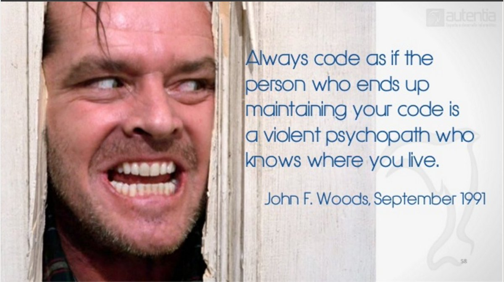
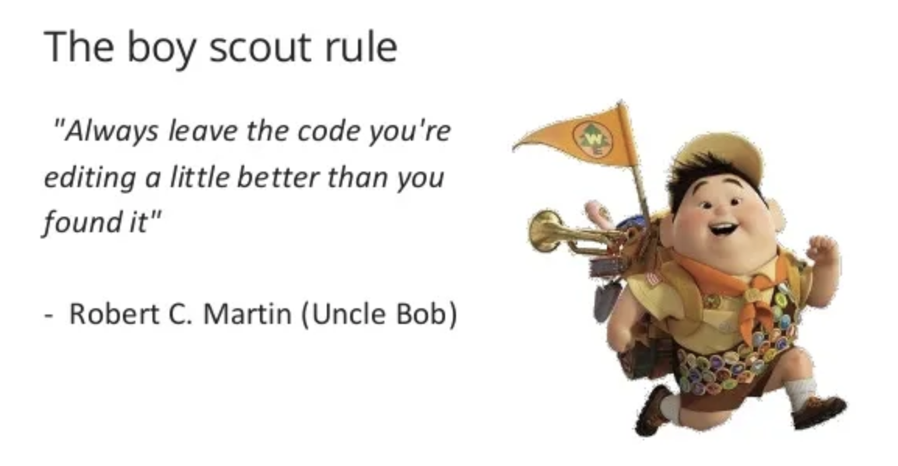

---
title: Working on legacy code-bases can make us better developers, here is why. 
published: true
description: legacy code bases might be overwhelming and cause burnout, but can also reveal as a great learning opportunity. 
tags: mentalhealth softwaredevelopment technicalleadership career
background: /assets/p491dlmr1qji0lpxbmwu.png
---

It does not matter if you are a seasoned senior full-stack engineer or if you just started your journey into this industry, I bet you will have for sure encountered legacy code-bases or projects that grew rapidly from a quick prototype into a full-fledge production application (without receiving enough love and care).

You will agree with me that when confronted with them it is easy to fall into apathy and just give up all the passion we had for software engineering and just start to contribute to the entropy instead of putting all our efforts into _crafting code_.  

> this code base is a smoking pile of crap, why bother?

Or at best, if the fire still burns inside you it is easy to get angry, frustrated, upset, confused, mad at everyone who came before us.  

>"Battle not with monsters, lest ye become a monster, for if you gaze into the abyss, the abyss gazes also into you. (F. Nietzsche)

When you are tackling these monster repositories, don't let the monsters ( bad coding practices, sloppy implementations, lack of discipline and documentation ) take over you. Don't let negative feelings of anger and frustration get hold onto you. 
When you gaze into that abyss, it gazes back, and **it tells you what you are really made of**
(Occasionally) working on such projects can actually give you a lot more than you think, besides headaches. 

I don't know if in my career I have been very unlucky or incredibly lucky.

I started quite late with web development, I was basically self-taught and was hired by a tiny web agency for a rather long internship that ultimately became a junior dev contract.
A few months after that, the senior ( and only ) developer left the company for greener pastures.
I was alone, dealing with the messy undocumented codebase of a bunch of websites. Although painful, it was probably the biggest boost I could give to my first steps in software engineering.
Fast forward 5 years, the small gig has been acquired by a bigger corporation and I find myself being outsourced to different companies to help out in the refactoring of projects where **the technical debt had reached the tipping point**.
Again I was confronted with legacy codebases, touched by dozen of different hands, and the only thing that they had in common was the absence of documentation, consistency and proper error handling or monitoring.
Since then I changed a few companies, and even when staying at the same company I had the opportunity as a lead engineer or technical lead to be assigned to - often critical - projects that were orphans of their creators/maintainers ( due to people resigning, massive layoffs or simply, company reorganisations. Again, adding features or fixing bugs and redeploying the application was **a discovery journey full of unknowns and surprises.**

Despite the fuck-ups, the struggles, the rants ( and sometimes the strong desire of _looking up the address of whatever name Git Blame Annotations were disclosing_) I am grateful for every single project I worked on. 

I learned a lot about coding and reverse engineering, about  sane and safe refactoring (with approaches like **strangler fig** and Test Driven Development).

And they made me realise, that **with hindsight _everything_ is clear and relatively simple**, that no one writes code sloppily ( or wrong ) on purpose.

They taught me to be patient and **avoid blame when I see implementations that make no sense** (in hindsight!).
They taught me to be humble about my own code and solutions; 
to [leave Ego out of coding](https://dev.to/dvddpl/keep-ego-away-from-coding-4gi5), as well as judgment: yes, maybe the code that I see here and now is crappy and unnecessarily complicated, but it is probably _the best that the person who wrote it_ ( that could as well be me, months back!) _could do considering their skills and the information/requirements they got at that point in time_. 

> The only thing that matters is what we can do to improve it or fix it.

Such projects on the other hand taught me that **shitty codebases do not appear overnight**.

They are the result of the sum of all the tiny mistakes, the shortcuts, of all the times we shrug our shoulders when pushing code or close an eye during a code review to avoid conflicts.
It's **the theory of the broken window**. 
It's a slow **death from a thousand cuts**. 

All this has also taught me to be relentless in demanding from myself and my team members discipline and high standards in our deliverables - everyone has to do their part as a **great** boy-scout!

And even when the team and each member are doing their best, repositories might be not in good shape because of **a lack of cohesion, conventions, shared best practices and tools that enable and enforce discipline**.

The projects I hated the most, taught me the importance of consistency, simplicity, and readability. 
The project that I inherited just to fix a bug every 3 months, or to redeploy due to a dependency being deprecated, showed me the necessity of automated tools that enforce productivity and quality best practices among team members.

> I came here to fix a production bug. I found the issue and can fix the code, but how the heck do I install and deploy the application?

Every time I was struggling trying to deploy an application that was missing dependencies, environment variables and tests, I decided that **no-one after me should go through the same struggle** - I documented the necessary steps to install, run and test the app, possibly I took the time to set up a CI/CD pipeline. 
Don't get me wrong, I am not a fan of comments, nor of big text documents in Confluence or Google Drive, just keep the major technical decision as  **Architecture Decision Record**  and some basic instructions about installing, running, testing, deploying ( and maybe some why and hows about the implemented business logic) as close as possible to the code (and up-to-date!).

Every time I had to fix a bug, I added a unit or integration test making sure that no further changes to the code base could regress it, and if possible I added a metric and alarm to catch it before our customer-agents or product-owners came panicking to us asking what's wrong.

I had the opportunity of being exposed to some pretty messed up projects, and had the incredible luck of having some great colleagues - and when I was or felt alone, I resorted to inspiring guides in the community. 

The good and the bad news is that **the journey never ends**:  the longer you work in Software Engineering, the more likely the chances are that you will work on bigger projects and more complex challenges. 

> Knowing how to navigate bad repositories and being able to tolerate the frustration are incredible skills that go far beyond from being a great developer. 

Next time you want to bang your head on the table, just breathe and think about what good you can learn from that code base.

> Your struggle is your strength. If you can resist becoming negative, bitter or hopeless, in time, your struggles will give you everything. (Bryant McGill)

(then when you are over, and possibly you have left it in a slightly better shape for the next unfortunate one, do a favour to your mental health and try to have the chance to work on something new! ;-) )

--- 

Other related articles:
- [Maybe you should start listening to that voice telling that you suck](https://dev.to/dvddpl/maybe-you-should-start-listening-to-that-voice-telling-you-that-you-suck-2i49)
- [What makes a 10x developer](https://dev.to/dvddpl/what-makes-a-10x-developer--1k0f)
- [Lego bricks, pinheads and 10x developers](https://dev.to/dvddpl/lego-bricks-pinheads-and-10x-developers-1jf7)
- [Keep your ego away from coding](https://dev.to/dvddpl/keep-ego-away-from-coding-4gi5)
- [Strive for simplicity](https://dev.to/dvddpl/strive-for-simplicity-2131)
- [are good software engineers pessimists?](https://dev.to/dvddpl/are-good-software-engineers-pessimists-54ll)

---
Foto von <a href="https://unsplash.com/@volkanolmez?utm_source=unsplash&utm_medium=referral&utm_content=creditCopyText">Volkan Olmez</a> auf <a href="https://unsplash.com/de/fotos/wESKMSgZJDo?utm_source=unsplash&utm_medium=referral&utm_content=creditCopyText">Unsplash</a>
