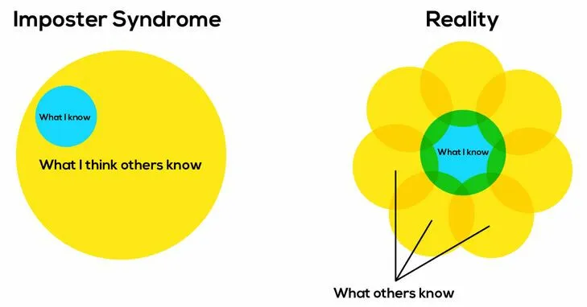

---
title: My first 6 months as AWS Community Builder: boosting my career and fighting Imposter Syndrome!
published: true
description: Becoming an AWS Community Builder is a great boost for your career, thanks to endless learning and networking opportunities. Let's see in detail why.
tags: career techlead community knowledgesharing
background: /assets/dpdapvx1ip4kto7wfp9u.png
# Use a ratio of 100:42 for best results.
---

Last August I became AWS Community Builder!  I decided to wait a bit before publishing this post for two main reasons:

- I wanted to be in the program for a few months to really understand what it is like to be a Community Builder and **provide more info about the pros and eventually, the cons.**
- dev.to, Medium and LinkedIn are literally flooded by posts of new Community Builder telling the world they were accepted and why you should become one too ( and I realise now how my timing is wrong because a new round of community builders has been accepted just this week... 🤦‍♂️) 

# What it is
AWS Community Builders Program is open to any individual who is 18 or older and **passionate about building on AWS** and loves to connect with other developers, exchange ideas and share knowledge. 

While in the program you can get access to technical resources, education, and networking opportunities with other **AWS technical enthusiasts and emerging thought leaders.**  

# How you become one
To apply to the Community Builders program you just need to submit your application by filling up a form where you provide info about yourself, your experience and your motivation and link any resource that you already produced like Blog Posts, Podcasts, Video tutorials and so on.

> **Applications will be reviewed twice a year**, and applicants who are accepted into the program will be invited on a twice-yearly basis. While **there is no single specific criterion for being accepted into the program, emphasis is placed on evidence and accuracy of technical content** that helps other AWS-focused builders, such as blog posts, videos, open source contributions, and presentations. 

You don't have to be already an acclaimed blogger or a guru in AWS stuff to be accepted: **the diversity of people and experiences is one of the great things about the program.**  It doesn't matter if you just started with AWS and you are eager to share your journey or if you are a seasoned engineer and have been building with AWS for many years. There is room for everybody and opportunity to share and access resources at every level of experience.

This does not mean that to get in, you just have to apply, though. There is a selection and **acceptance rate** usually varies each year and it depends on the number of active/renewed members each year and their overall yearly targets. I have no idea if the acceptance rate is 5%, 20% or 50% but I think that some competition to be accepted really exist!
**I applied in 2021**, after blogging for a couple of years - **and my application was rejected**. 

The year after I wrote fewer posts overall, but they were more focused on articles and tutorials about AWS services. Last summer I tried again, and I was accepted! ( and that's why I feel so _honoured and proud_ about being one right now! ) 

At the moment the application form for this program is closed but it will re-open in July 2023 and you can [add your name to the waitlist](https://aws.amazon.com/developer/community/community-builders/) to be notified and give it a chance!.

#Ok, but why should I join?
You can do that for _the fame_ (looks good on your CV), for _the people_ ( great devs you can get in touch with), for _the money_ (vouchers and credits) or for _the skills_ ( workshops and knowledge sharing).
Or simply, _for the swag!_ 

<blockquote class="instagram-media" data-instgrm-permalink="https://www.instagram.com/p/ClmYpsCDWtF/" data-instgrm-version="14"></blockquote>

Seriously, there are really plenty of benefits you have access to, and everyone has more than one reason to join.

Let's see the current benefits (might slightly change year from year): 

### Learning opportunities
- Cloud academy
- Workshops
- Vouchers for Certifications 

There are regular **sessions/webinars** from AWS people or other Builders that will help you level up, both from a technical perspective but also with your skills as a writer, presenter, and conference speaker.
With the Program you get **free access for a year to [Cloud Academy](https://cloudacademy.com/learning-paths/aws-solutions-architect-associate-saa-c03-certification-preparation-for-aws-1-7446/)**, one of the leading global cloud learning platforms.
And since you have access to hundreds of courses, you can then take advantage of the **Exam Voucher** you receive as CommunityBuilder (**one Foundational, Associate, or Professional/Specialty Exams per 12 months**) and finally take that certification [you have always been putting off](https://dev.to/aws-builders/preparing-for-aws-solutions-architect-associate-saa-c03-certification-resources-and-cheat-sheets-2h2k).  

### Experimenting with AWS services
- Beta program
- AWS Credits

As a member you will have access to the Beta Program and will be able to **join special sessions** or discussions with AWS employees about new features or **super secret new services**! 

You will also receive a **$500 AWS credit** to help you learn, experiment, and grow by trying our new AWS services. That's a great way to test services that are out of the free tier, or simply build something cool and then blog/video/tweet about what you learned.

### Connecting with other experts and enthusiasts
Once you are accepted in the program **you get access to a Slack Workspace which is a safe, inclusive place to ask questions** and dig into helping solve each other's tech challenges. Everyone is there to help each other.

I met lots of interesting people from all over the world, had questions answered, or was exposed to threads that proved very interesting and useful weeks later when facing issues at work.
Many questions spawn discussions where many people contribute with their experience and are super helpful to then establish some best practices or simply form an educated opinion. Often this ends up in very detailed blog posts ( like this one about [CDK Pipelines](https://blog.serverlessadvocate.com/serverless-aws-cdk-pipeline-best-practices-patterns-part-1-ab80962f109d)) .

Furthermore, in the Slack channels there are some quite "established voices of the cloud" like [Corey Quinn](https://www.lastweekinaws.com/blog/), [Allen Helton](https://www.readysetcloud.io/blog/), 
[Lee Gilmore](https://blog.serverlessadvocate.com/)
[Yan Cui](https://theburningmonk.com/) and many others AWS Heroes as well. 

 I am not usually a fanboy but having the possibility of reading their threads and having questions answered directly by people I have been reading and following for years, and contributed a lot to my professional growth is kinda exciting!

Besides the Slack Channel, you have access to a special Organisation here on Dev.to, so that your posts have automatically a bigger visibility thanks to all the followers that subscribed.  

###Swag
Each Builder will receive a welcome kit full of great branded stuff. 
And often, not only that.  During workshops and calls some other swag is given out to participants, as well as based on the contribution ( below one mega mug I won thanks to some posts here on Dev) or by engaging on slack. 
The quality is very high and since they are made for the builders are simply great to show (off) in the office or at meetups and conventions for an instant **feeling of belonging!**

<iframe width="560" height="315" src="https://www.youtube.com/embed/dms7RlAPNDs" frameborder="0" allow="accelerometer; autoplay; clipboard-write; encrypted-media; gyroscope; picture-in-picture" allowfullscreen></iframe>

Of course you also have sweet logos, banners and other assets that you can use in your content and to tell the world that you are a Community Builder!

#Cons
I mentioned at the top of the article that I wanted to wait to share my experience to reveal possible cons. Do they exist?

Well, Of course not!  The program is amazing, so the people and the opportunities arising. But... and this is entirely subjective, you need to be aware of a couple or things:

###Beware of Imposter Syndrome
It is a bit daunting. I have been working in Software Engineering for 18 years, and have been building serverless applications for the last 5. Despite that, when reading some discussions. or checking other people's content, **I realise how much I don't know.**  
This is good of course,  _getting out of the comfort zone_, _learning in public_ and _not being the smartest in the room_ have always be my mantra, so I am more than happy being exposed to all this **AWSomeness**! 

There were days when I kinda felt miserable (and guilty) for publishing one post every 2 weeks, and about a _simple write-up about something so trivial like IAM, when out there students with already 3 certifications are posting daily tutorials about AWS services I haven't even heard of yet..

This brings me to the second issue:

### Be Self Disciplined
We are a lot of Community Builders. 
We all love to learn, experiment and share knowledge.
**The amount of content being produced by Community Builder is enormous**.
Sometimes I log into slack in the morning and I see dozen or hundreds of messages of people asking questions and boosting their content.  So many interesting topics, great videos or podcasts, tutorials about that service you always wanted to start using.
The urge of reading them all or follow all the discussions is very high. You need to keep it under control.  Or you might spend the entire day reading and watching other people's content, not getting anything done yourself ( and feeling bad about it - see Imposter Syndrome above).

Try to be self-disciplined, **keep your curiosity under control**, set a timer to when and how long to spend on slack, and reading other people's content, **set boundaries**.
> 
Being motivated and enthusiastic about learning and sharing is great, but we all need some time off.

## Balance consumption and creation

Reading other people's content and learning new stuff is great, but **we became Community Builder because we also want to share our knowledge, talk about our journey, so we need time to build and create**. 
This is again strictly connected with self discipline,  I realised that sometimes I had to stop _consuming_ for a while to concentrate on producing my own work.  (Furthermore, sometimes I had been put off by publishing an article, because I felt I wasn't adding much value compared to others or because someone else, just published a similar one..

Don't compare yourself to others, we have all our own style, our perspective, and level of experience. There is room for everybody. But make sure you have enough time at the end of your day ( or at the beginning ) to reduce the noise and concentrate on what you want to share!

# Final thoughts

I have been a Community Builder for about 7 months and I love it, I really hope my application is renewed for the next year.

By being community builder I am prompted to write more blog posts and in order to do that i have to learn, read and experiment more.  
This proved very beneficial in my daily job, I could solve problems or come up with solutions much faster and with more confidence.
By participating in discussions and reading content from other Builders I was able to connect with lots of other passionate engineers. 
**You never know what positive impact could have in your next career step.  It might be collaborating on an open-source project or having a job offer**. Or simply you might change your mind about something you are strong opinionated, or you find friends sharing the same passion. 

Joining the Community Builder program is not a guarantee to land a 6 figures job in Big Tech, but will definitely help shape your skills and step up your game!

<blockquote class="instagram-media" data-instgrm-permalink="https://www.instagram.com/p/CouWyv9N86Q/" data-instgrm-version="14"></blockquote>
