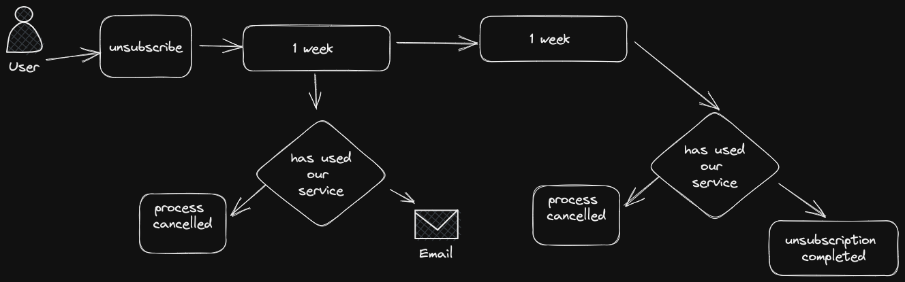
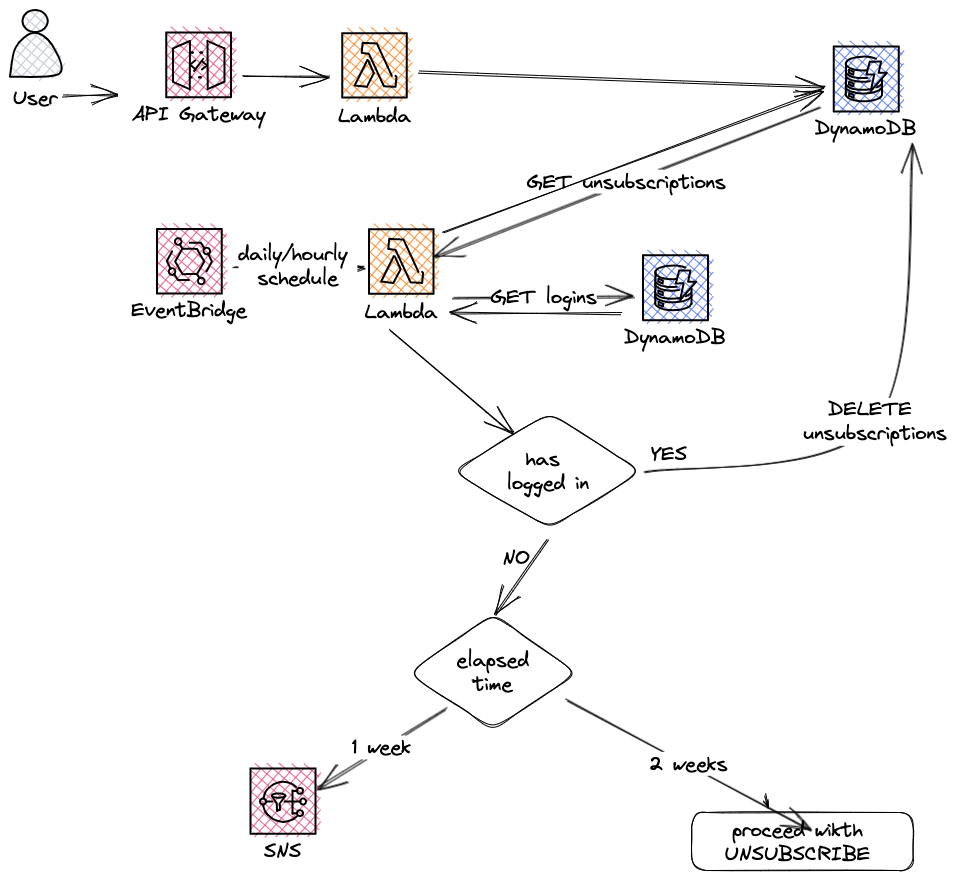
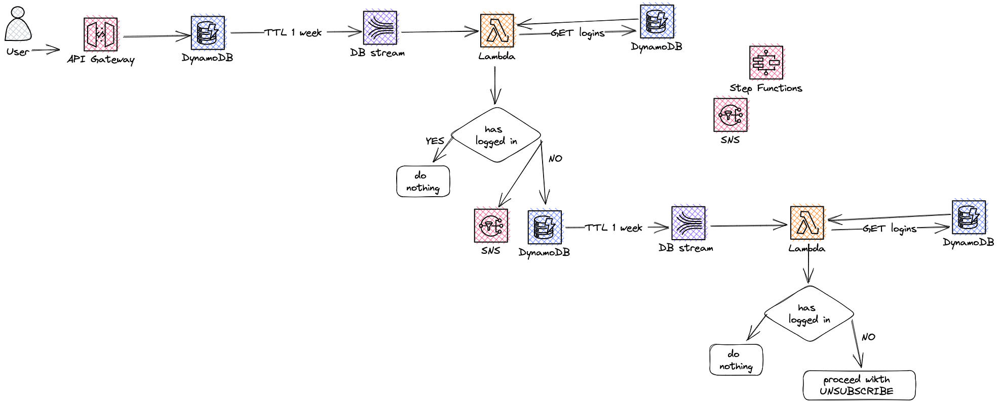
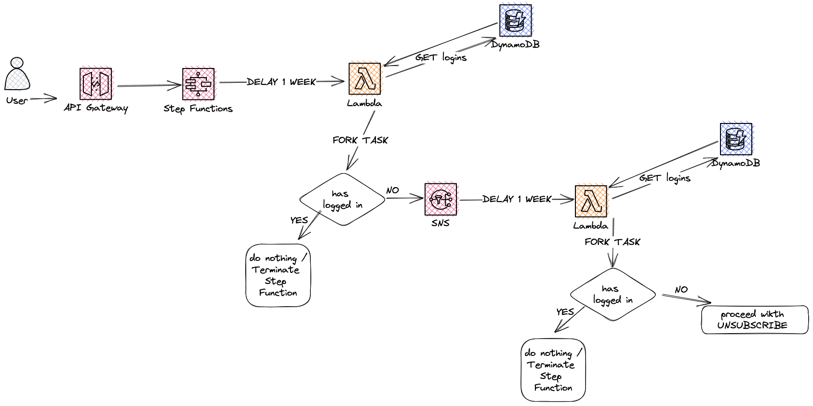
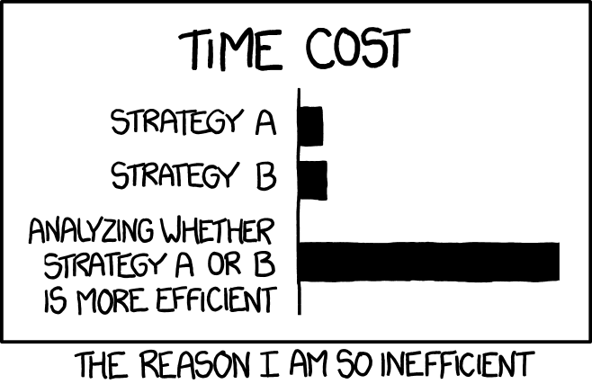

  
I am standing in my kitchen, waiting for my cappuccino to be ready. I am still, but my mind is restless.

I just had a meeting with my director, a senior engineer and a couple of stakeholders from the marketing department to discuss a new functionality they need in one of our apps.

How can we do that?

As soon as multiple AWS services pop into my mind, I draw imaginary diagrams in my head connecting all the pieces of the puzzle together.

Only the beeping coffee machine brings me back to reality, but I have a pretty neat idea already!

Time ago I would have rushed into coding a PoC or creating a Diagram of the solution to attach to tickets thoroughly described for my team members. 
But not now!

## Haste makes waste
As enthusiastic as I can be, and as good as my solution can look, this is not a good approach though. Neither as an Engineer nor as a Lead (which should _empower people, help them in their growth, and gather their valuable input_).
**We need different perspectives**, we need alternatives, we need options.

Remember the _Fast, Cheap & Good - Pick two_? 

This is a simplification, and even if we were in an ideal world where all the 3 can be achieved, it would still be beneficial to consider different approaches instead of sticking to the first idea that popped into our minds.

- What would be the fastest way of implementing that? ( they want it yesterday, of course!)
- What would be the best (performance-wise and in terms of architecture)?
- What would be the cheapest? ( what AWS service should we use? Lambda, EC2, Fargate?)

Recently I was listening to [Episode 120 of Tech Lead Journal ](https://techleadjournal.dev/episodes/120/) and I was struck by one statement.

> It's better for me as an architect to know that there are five different concurrency solutions to this problem than to know how to solve this concurrency problem deeply in one of those solutions. Cause as an architect, you need options, because you're doing trade-offs, and **you need to be able to trade-off one thing versus another.**

<blockquote class="instagram-media" data-instgrm-permalink="https://www.instagram.com/p/Co6M6hXOM5N/" data-instgrm-version="14"></blockquote>

This is such a nice way to phrase it, and I could not agree more.

Having options is the only way you can do trade-offs, and it is the only way to **make educated choices**.

Not having options, or not thinking through possible alternatives does not allow you to experiment with different solutions and **ultimately decide what is best, or the least worst** - because yes, sometimes budget, time and other constraints allow us only to choose _the best among unsatisfactory alternatives_.

It's also the "Law of the Instrument" at play. The famous cognitive bias of the Golden Hammer:

> If the only tool you have is a hammer, it is tempting to treat everything as if it were a nail.

I talked about it in another post some time ago - [The screw and the hammer: Love the problems, not your solutions.](https://dev.to/dvddpl/the-screw-and-the-hammer-love-the-problems-not-your-solutions-2i0a).

For these reasons ( and maybe because **you never really overcome your Imposter Syndrome**, and it's good so ) I try to resist the urge of sticking to that one solution.

Whenever I am confronted with a problem, when I am asked to think about a solution, **I force myself to come up with multiple approaches.** Or if I am short on time or ideas, I ask other colleagues ( and have great meetings discussing requirements and brainstorming solutions ).
Depending on the complexity **RFCs (Requests For Comments )** are a great way to structure your thoughts and ask your peers for more input.

This is also something I try to teach to junior devs - as developers, we tend to get excited easily - **we have a task, we have an idea, convert that idea into a few lines of code and _dopamine_ starts to flow** ( if it works, if it does not, we are dragged down in a loop of fix-test-fix-test and we have already lost track of the original problem, focused as we are in fixing our own bug.

No matter how simple or complex the task is, try to come up with multiple solutions: 
> is a `map.filter.reduce` better here, a `for … of`, or maybe a `while` loop ?

Think about **the quickest and dirtiest**, or easiest ( most familiar ) solution.
Then think about the best solution you could come up with if you had no budget or time constraints, really the _by the book_ solution!
Then find a middle ground. Or simply a different one.

Sure it requires time and effort, but it is a great exercise. 
**It sparks your creativity, your problem-solving skills, and your ability to think outside the box**, and will help you in properly, extensively, and objectively considering pros and cons and doing trade-offs.

Challenging your own ideas and solutions also **fosters critical thinking and reduces the ego** we inevitably put in our code/design. 
It is not _my_ code, _my_ solution anymore. Is one of the many possible ones, I know there could be others better or worse or similar, but I picked that in the end because of… _reasons_ - that you hopefully have documented in an ADR (Architecture Decision Record).

## An example
Let's have a look at a (greatly simplified) example of the feature discussed in the above meeting:

- The user should be able to unsubscribe from a service by making a request to an API.
- After 1 week from that request they should receive a reminder that the service is going to be disabled the following week.
- The week after, the service is disabled.
- If during the previous 14 days the user happened to have accessed the service (another API keeps tracks of user logins to that service) then the entire process is interrupted: no email will be sent and no unsubscription will take place, the user will have to make another request if still willing to unsubscribe. 

###Solution 1 -  Dynamo & Lambda Scheduler
The unsubscription request goes through an API Gateway, a Lambda takes care of validation and adds request to DynamoDB.
EventBridge (aka the good ol' CloudWatch Event) schedules the invocation of another Lambda at regular interval ( every day, or every hour) to load all the pending requests and checks for each if there was a login by the user. 
If a login is found, the request is deleted from Dynamo and process ends, otherwise depending on how much time has passed, we send an Email via SNS or we inform another service of the completed unsubscription.

###Solution 2 - Lambdaless integration and Dynamo Streams
API Gateway + direct Dynamo Integration to save request for unsubscription

We don't really need a Lambda to add the request to Dynamo - we can use a JSON Schema Validator ( and a Velocity Template,  to manipulate the payload itself) within API Gateway and use a direct integration to DynamoDB.
Check out my previous posts about [JSON Schema for APIGateways](https://dev.to/dvddpl/reduce-lambda-invocations-and-code-boilerplate-by-adding-a-json-schema-validator-to-your-api-gateway-15af) and [Lambdaless integrations](https://dev.to/aws-builders/look-ma-no-lambda-lambdaless-apigateway-and-dynamodb-integration-with-cdk-2hbd).
The item on DynamoDB will have a TTL so that it will be automatically removed after one week.  At that point a DynamoDB Stream will trigger a Lambda, in charge of checking for the logins.
If the user logged in, we simply do nothing, since process is automatically terminated with the TTL removal of the item from Dynamo. 
Otherwise we invoke SNS to send an email, and add another item to Dynamo, with similar TTL, specifying we are at stage 2 of the process.
Stage 2 will be similar: TTL, DynamoStream and Lambda trigger.
 
As you can see, we have less Lambda functions, less unnecessary invocation by the scheduler and we don't need to manually code the deletion from dynamo.

### Solution 3 Step Function!
StepFunctions are a perfect way of **orchestrating** this kind of behaviour.
Standard Workflows are priced by state transitions and allow a duration of up to a year ( way more than we need).

APIGateway can [start the execution](https://docs.aws.amazon.com/step-functions/latest/apireference/API_StartExecution.html) of a Step Function and we can define our first state as a Delay of a week. The next state will be a Lambda function to assess user logins, the we add a Fork Task. Then the step function will either be terminated or proceed with SNS notification and another Delay Task.
After that a similar flow is followed.

## Which solution is best?
This is a pretty basic example, and I believe that giving it more thought or bringing in more people, many other approaches could come up. 
Often by thinking different approaches you can then mix and match some of the ideas ( like using direct integration in the first scenario ) or possible pitfalls (will DynamoDB be able to hyper-scale or should we add SQS in the recipe? - [this was one of the great talks](https://www.webdayconf.it/e/sessione/3122/From-0-to-1-000-000-How-to-build-a-serverless-raffle-service-for-hyperscale) I watched last week at WebDay23 in Milan).
Or simply challenging our solutions and discussing them with others can bring up aspects of the problem that were not specifically addressed by the stakeholders and need to be clarified:
- What if we need to authorise the request to API Gateway?
- What if we want to prevent multiple requests from the same user? 
- What about another API returning the status of the current request?

So, guess what? **there is no best solution** _it depends_, on time, skills and budget (step functions can be expensive, but how much would we pay for unnecessary Lambda executions and Dynamo read&writes, and for the code complexity of solution 1?)

> Of course I have my preference and my opinions, I am very interested in what is yours, and especially if you have other approaches that are radically different.

## Final Thoughts
It doesn't matter if your idea popped up while playing kicker with your colleagues, by walking the dog, explaining the problem to a rubber duck or by taking a shower. 
Challenge it, **play the devil's advocate**, and come up with alternatives. So that you can compare the options and choose the trade-off that fits best your requirements and constraints. 

But while doing that, beware of **[analysys paralysis](https://en.wikipedia.org/wiki/Analysis_paralysis)** and remember that **perfection does not exist**, requirements will change (and likely _corrupt_ our plans) no matter how sound and future-proof our solution was, so don't waste _too_ much time in coming up with ideas until you have the best. 

Exercise your critical thinking, your thinking outside the box and evaluate alternatives, but do not fall in the overthinking trap.

> Imperfect action is better than perfect inaction

Often it is better to get started with something and **iterate quickly** / adjust the course.

Other articles related to the topic that you might find interesting: 

- [Learn how to ask good questions. Be aware of the XY Problem](https://dev.to/dvddpl/learn-how-to-ask-good-questions-be-aware-of-the-xy-problem-1ic3)
- [The screw and the hammer: Love the problems, not your solutions.](https://dev.to/dvddpl/the-screw-and-the-hammer-love-the-problems-not-your-solutions-2i0a)
- [Keep your Ego away from coding](https://dev.to/dvddpl/keep-ego-away-from-coding-4gi5)
- [Make mistakes, it's ok!](https://dev.to/dvddpl/make-mistakes-and-ask-questions-its-ok-gah)

---
Foto von <a href="https://unsplash.com/@soymeraki?utm_source=unsplash&utm_medium=referral&utm_content=creditCopyText">Javier Allegue Barros</a> auf <a href="https://unsplash.com/de/fotos/C7B-ExXpOIE?utm_source=unsplash&utm_medium=referral&utm_content=creditCopyText">Unsplash</a>
  
