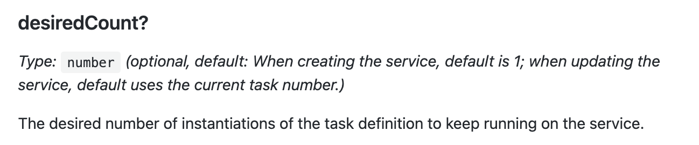
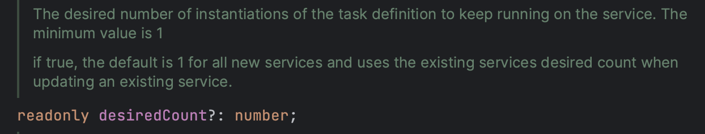

In some teams there are (un)written rules: 

> _never deploy on Fridays or any day after 3 PM_

This is understandable, you don't want to push that button, then leave the office - or even just close your laptop if you are working remote - just to be called back a couple of hours later because productions is on fire. And definitely you don't want your application to be broken overnight or over the weekend.

**I don't know if that shiver when pushing to production will ever go away**, even after years in the industry, but deployment should not be _that_ scary and such forbidding rules should not be necessary within a sane production cycle.

I haven't managed to make the projects I am working on entirely CI/CD, but at least we have proper pipelines and automated deployments to development environments for branches and to staging for main. 

Still, even with the confidence of env and staging working fine, **things can still go unexpectedly wild when pushed to production**.

Here I want to share a fuckup that happened recently and the learning that came from it. ( well, I don't know if it actually classifies as fuck-up since it was no blatant mistake and it was due to the combination of [two root causes](https://dev.to/dvddpl/what-do-you-mean-with-there-is-no-root-cause-4gpa)).
  
---

I recently joined a project whose backend was running on AWS Fargate, but had no autoscaling set up, meaning that we were paying for all the running container even though we are not really using needing them, thus **not really taking advantage of its serverless capabilities**.

> [AWS Fargate](https://aws.amazon.com/fargate/?nc1=h_ls) is a **serverless, pay-as-you-go compute engine** compatible with ECS Amazon Elastic Container Service (Amazon ECS) which is a **fully managed container orchestration service** that simplifies your deployment, management, and scaling of containerized applications. 

That means that you can build your application for example in Node or Go, create a Docker image, set up some configuration about CPU/Memory and _simple_ autoscaling capabilities and then you can forget to worry about managing your servers and you pay only for the resources that you use. 

Those _simple_ autoscaling settings are indeed simple. 

Creating a Fargate service with CDK is straightforward and you can find many [examples online](https://docs.aws.amazon.com/cdk/v2/guide/ecs_example.html) or ask ChatGPT for the entire code, therefore I will skip some parts and focus on the relevant parts.

```
const myFargate = new ApplicationLoadBalancedFargateService(this, "fargateService", {
        cluster: myCluster, 
        cpu: 1024,
        memoryLimitMiB: 2048 ,
        desiredCount: 7, 
        taskImageOptions: { image:  ContainerImage.fromDockerImageAsset(myDockerImageAsset)},
        publicLoadBalancer: true
 })

const scalableTarget = myFargate.service.autoScaleTaskCount(
  {
     minCapacity: 5,
     maxCapacity: 40,
  })

scalableTarget.scaleOnCpuUtilization('CpuScaling', {
        targetUtilizationPercent: 50
    })
```

Let's review the code:

We specify `desiredCount` in the constructor properties of our Fargate Service,  then we define the `autoScaleTaskCount minCapacity / maxCapacity` and create a `scaleOnCPUUtilisation` rule so that tasks are started (scale-out)  or killed (scale-in) in order to achieve a target of 50 % of CPU utilization.

A Task ( in Fargate / ECS ) is basically a container so what will happen is that Fargate and ECS will adjust the number of containers running our application based on CPU utilisation, starting with our desired count and clamping the number of containers to the min and max settings ( so that we are sure we never go to low, and we are able to scale but **keep the scaling - and therefore our bill! - under control**).

That's pretty much it! What could go wrong? Where is the fuck-up?

##What could go wrong? Heres' what happened.

As I said, I added the autoscaling props to 5 and 40 and left the desiredCount as it was (10).
I deployed the stack, and kept an eye on the monitoring dashboard for about a week: everything was smooth, at night tasks were dropping to 5 and during the day they got to 15 or higher.

Since we noticed that CPU utilisation and Memory consumption were quite high, we decided to bump them up a bit and deploy.
It was noon. A time of the day were our app had quite some traffic, but not the highest, and we had still a few hours before EOD to monitor and eventually make other adjustments.

Unexpectedly the number of the tasks that was running at that moment - 18 - dropped to 7 and despite all effort by the Fargate and the Autoscaling group, every new task that was being started because of the CPUUtilisation was suffering under the load and dying immediately and therefore being deregistered.  :scream:

For some stressful minutes until we progressively fiddled in the AWS console directly with the desired count bringing it up to 25 or higher (and shortly stopped entirely the traffic in from the ELB to the targets), we were not able to have any healthy task running...

Can you figured out what happened?

####Why if the current running tasks were 18, after the deployment they dropped to 7? 
Because of the DesiredCount!

This is what the CDK docs say:



> when updating the service, default uses the current task number

which is _similar_ to what you can see in the code itself: 


> uses the existing services desired count when updating an existing service.

Since we explicitly set the desired count, that value was used, and not the value of the currently running tasks!!

DesiredCount is the initial value of the task we want Fargate to start when we deploy, then alarms and scaling policies change that value according to the min and max values.
What I did not know was that the value shown in the console of the desiredCount also changes, not only the number of running tasks.  
Therefore **whenever you redeploy, the value of desiredCount, and thus of the running tasks, is reset to the original one (unless you leave it blank), despite whatever autoscaling policy is valid at the current moment. 

####Why didn't I noticed on my first deployment?
Because at that time, it was early morning, traffic was low and running tasks were less than the desiredCount.  At noon of the day of the incident they were much more.  

####But why was Autoscaling not able to increase the task and restore CPU utilisation to a value that was sustainable?

Because of the `scaleOutCooldown` which is a optional property that defaults to Duration.seconds(300). 

> scaleOutCooldown : Period after a scale out activity completes before another scale out activity can start 

For 5 minutes no new task could be started and in the meantime, due to some unexpected and toxic retry behaviour from the client (the second root cause and learning for the team), requests were exponentially growing and piling up, making things worse!

When the emergency was over and I had a clearer picture of what happened, I decided to share it on the Slack Channel of AWS Community Builders. No wonder, (it such a great honour to be in this community of enthusiasts and experts!) within minutes I received advice, confirmation of my assumption, and [a link to a post](https://blog.cloudglance.dev/deep-dive-on-ecs-desired-count-and-circuit-breaker-rollback/index.html) written by **AWS Hero Rehan van der Merwe** that explain in much more detail what desiredCount does and how we can take advantage of **circuit breaker rollback** and **over-scaling on deployment**.  Really, a must read!
 

##Recap

- Autoscaling min and max properties clamp the number of tasks that the autoscaling policy can start and stop. 
- The value of the current running tasks as defined by the last autoscaling activity is set as (last) desiredCount.
- The value you set in the desiredCount property in your stack overrides the value of the current running tasks
- you can **leave the value out of your configuration or you can over-scale setting it as the max number of tasks**

Something else that is worth to be reminded is that 
- Mistakes and Fuckups can and will happen, 
- it's good to have proper monitoring in place, 
- it's great to be surrounded by an amazing team and colleagues ready to jump in and help
- that from each mistake we can learn a lot and for such experiences to be a **growth opportunity** ( for the team and the product) **psychological safety**  (opposed to **blame culture** ) is paramount.

Hope it helps.

---
Other related articles that might be of interest:

- [What do you mean with: "There is no root cause" ?!?](https://dev.to/dvddpl/what-do-you-mean-with-there-is-no-root-cause-4gpa)
- [When everything is urgent, nothing is. What is Alarm Fatigue and how to deal with it.](https://dev.to/dvddpl/when-everything-is-urgent-nothing-is-what-is-alarm-fatigue-and-how-to-deal-with-it-1321)
- [Make mistakes, and ask questions. It's OK!](https://dev.to/dvddpl/make-mistakes-and-ask-questions-its-ok-gah)

---
Foto von <a href="https://unsplash.com/@chuttersnap?utm_source=unsplash&utm_medium=referral&utm_content=creditCopyText">CHUTTERSNAP</a> auf <a href="https://unsplash.com/de/fotos/Odc4dcsjUBw?utm_source=unsplash&utm_medium=referral&utm_content=creditCopyText">Unsplash</a>
  
