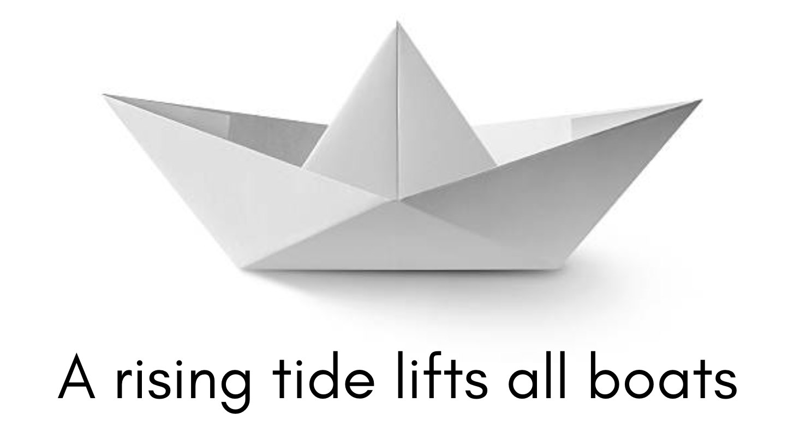

### What makes us good?  What makes us effective?

Some time ago I was chatting with an ex-colleague about career paths: We have both been in Software Engineering for around 3  lustres and we had both moved to a Technical Leader / Lead Engineer position a couple of years back. 

We both felt at a crossroads.  Which way to go? 

Take the pure **Leadership path** - which would mean giving up most of the technical aspects of our daily job and switching to a more people management focus - or stick to the **Technical Path**  with Code Design and Architecture and become Subject Matter Experts? 

- Technical Director, Engineering Manager, Director of Software Engineering, CTO?

- Principal Engineer,  Staff Engineer, Solutions Architect?

Should we venture into (partially) unknown grounds, where **the needed skills are different from what the ones we have** ( and that proved to be working very well for us)? Or should we stick to what has worked, and that we know we love 100%?

Will Larson (CTO at Carta, previously worked at Stripe, Uber and others - and author of the book _An Elegant Puzzle - Systems of Engineering Management_ - that after years I finally moved from the ToRead list onto the CurrentlyReading list) wrote a very insightful post about how [Tech Leadership roles can reveal themselves as traps](https://lethain.com/tech-lead-managers/) because of the mixed nature of the role that does not allow to fully experience each of its components and really take on the new challenges.

<blockquote class="instagram-media" data-instgrm-permalink="https://www.instagram.com/p/Criwe92NQPC/" data-instgrm-version="14"></blockquote>

I personally found working as Tech Lead very satisfying _exactly because of the variety of tasks_ and the possibility of exploring and growing as a Leader and continuing to express my creativity as an Engineer.  (but under some circumstances, size and skill set of the team, time pressure and deadlines - I had indeed fallback to some behaviours mentioned in the article and felt the same pain).

Anyway, the chat was indeed as generic as deep and almost philosophical:

> - What makes us good?
- What makes us valuable?
- What makes us effective?

> - What makes us great team players?
- What makes us great leaders?

> - How do we define ourselves? 
- What is our role in the business?

###How can we scale our productivity and efficiency?

At some point, after talking about **what type of leaders we would like to have, or to become.**.
After discussing what it means to be a 10x developer, **how to delegate and avoid micro-management**, and how to find the balance between us actively solving-problems versus empowering/enabling other's own problem solving skills, my friend dropped a quote that really struck: 

| **A rising tide lifts all boats**

"_A rising tide lifts all boats_" is originally a phrase used mainly by politicians (JF Kennedy) and economists that refers to the macro-economic theory that _improvements in the general economy will benefit all participants in that economy_.  

In our daily lives and jobs, it can simply mean that the positive effect of our actions spreads around us and lifts the people around us too, be it family members and friends or colleagues and reports. (of course, the opposite is also true, with our behaviour and our mood we can totally bring people down!).

In one of my first posts about [10X Mythical creatures](https://dev.to/dvddpl/what-makes-a-10x-developer--1k0f), I wrote that **_the real multiplying factor is sharing knowledge, fostering growth, and being an example of passion and hard work_**.
I believe that moving on in the career ladder ( be it technical, or even more in the management path) these characteristics take even more weight and allow us to scale.

> We can forward and grow as a team by sharing information about what makes us good.

As a lead ( or senior ) or mentor for trainees and junior devs,  share your secrets ( your habits, your toolbox ).
Don't just help others by solving their problem: teach them, point them in the right direction, challenge them and help them find the solution themselves, only as a last resort, show them how it is done. 

I know, it can be scary. You might think that if you share _too much_, or help out too often, others might become better than you, or simply learn and reach your level too quickly.  And you might be concerned that that promotion you are hoping for, might land on their desk. Don't worry, and remember that "a rising tide lifts all boats", **while you help others grow, you are also building new skills**. 
Don't be the hero of your team, the rockstar, and definitely don't be a brilliant jerk! 

Great leaders and great people in general _lift people up_.

Help everyone improve, at their pace, based on their current skill. With your help, overall performance will rise. 

It does not matter if you are a junior, a senior, a lead or a CTO, at different levels and with different scopes you can help people achieve their goals and that of your team or your company. 

All the questions in the conversation with my ex-colleague were kinda blurred out by the biggest and most important question: 

> **Are we a rising tide for our team?**

After the conversation I googled a bit about the quote and about the application in leadership I ended up in this amazing Ted Talk by _Paresh Shah_ that asks a similar question: **Are you a Lifter**?

<iframe width="560" height="315" src="https://www.youtube.com/embed/Em_MUmYDqmY" frameborder="0" allow="accelerometer; autoplay; clipboard-write; encrypted-media; gyroscope; picture-in-picture" allowfullscreen></iframe>

A rising tide lifts all boats.
**Become the rising tide in your team.**

--- 

Other related articles you might find interesting:
- [What makes a 10x Developer?](https://dev.to/dvddpl/what-makes-a-10x-developer--1k0f)
- [From Engineer to Tech Lead - Doubts and Challenges](https://dev.to/dvddpl/from-engineer-to-tech-lead-doubts-and-challenges-4n9e)
- [Lego bricks, pinheads and 10X developers](https://dev.to/dvddpl/lego-bricks-pinheads-and-10x-developers-1jf7)
- [Love the problems not your solutions](https://dev.to/dvddpl/the-screw-and-the-hammer-love-the-problems-not-your-solutions-2i0a)

----

Foto von <a href="https://unsplash.com/@iam_robin?utm_source=unsplash&utm_medium=referral&utm_content=creditCopyText">Robin Spielmann</a> auf <a href="https://unsplash.com/de/fotos/TUiNzx1vMBM?utm_source=unsplash&utm_medium=referral&utm_content=creditCopyText">Unsplash</a>
  
