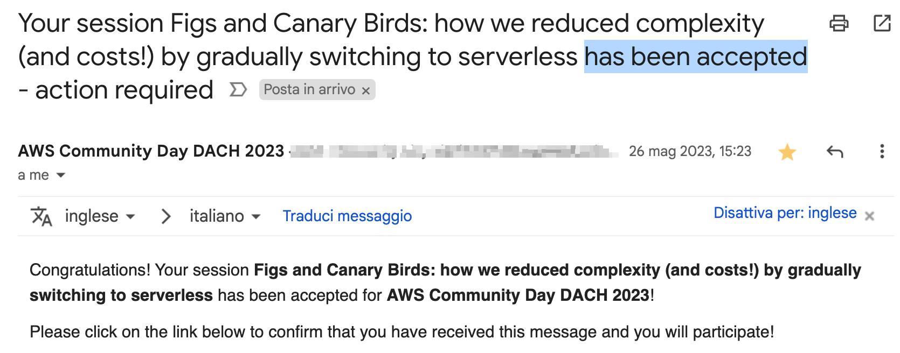
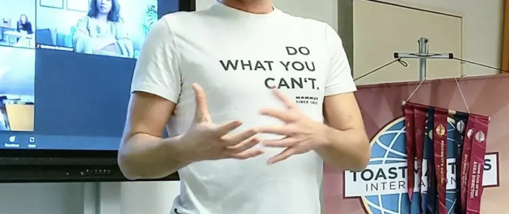
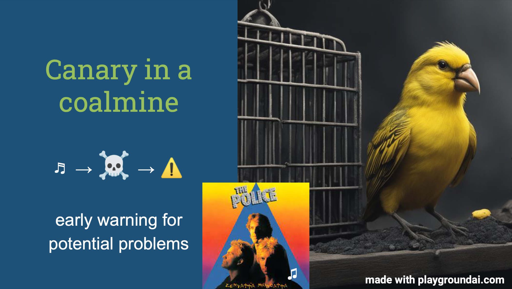
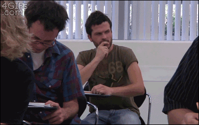
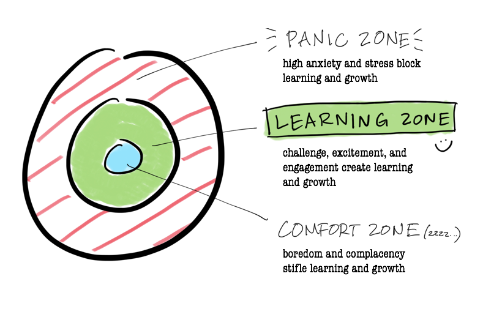
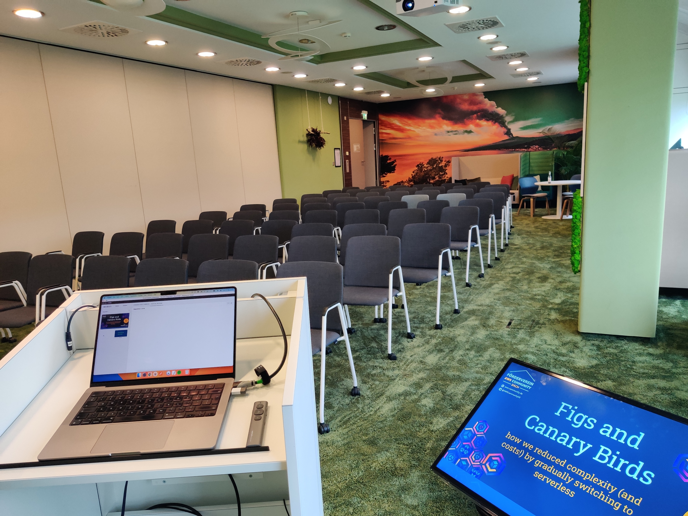
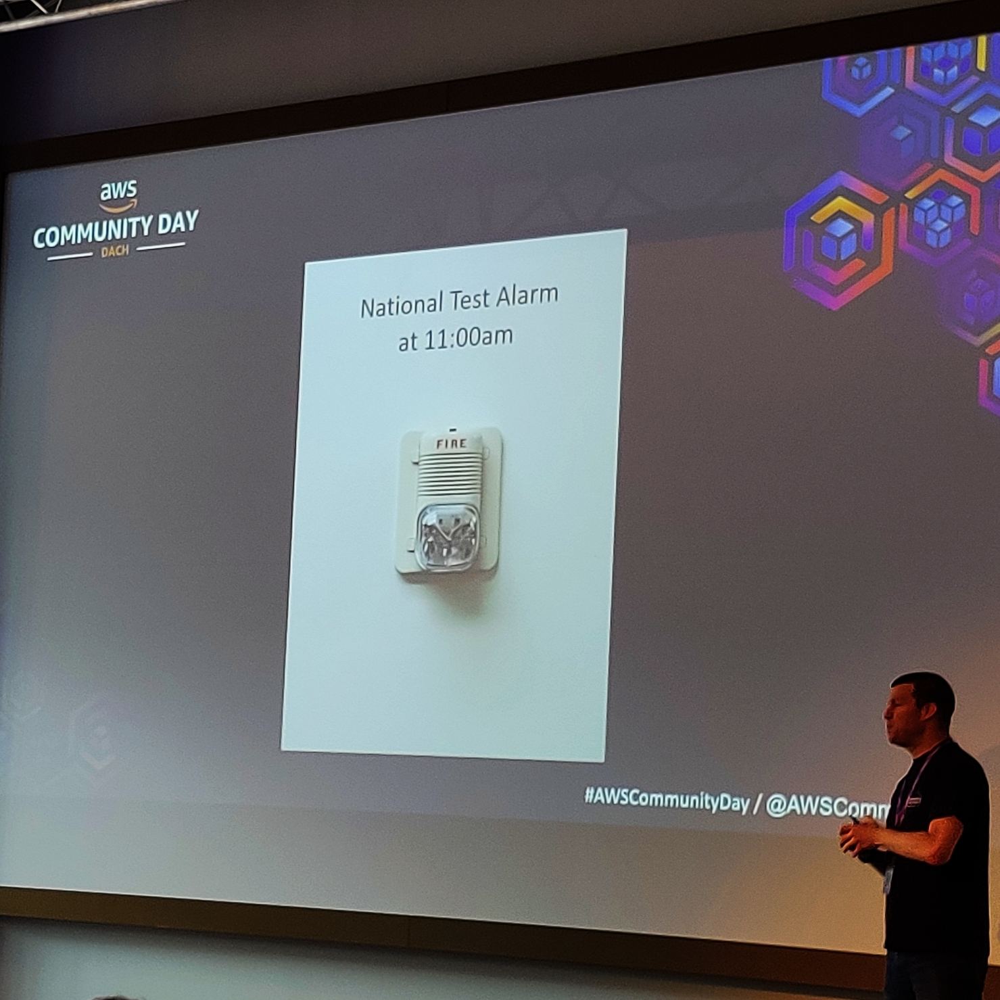
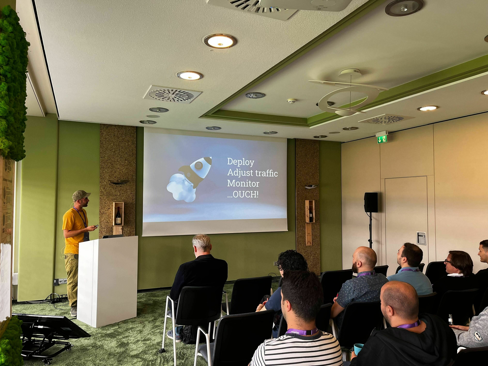
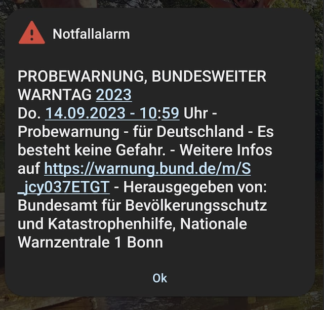
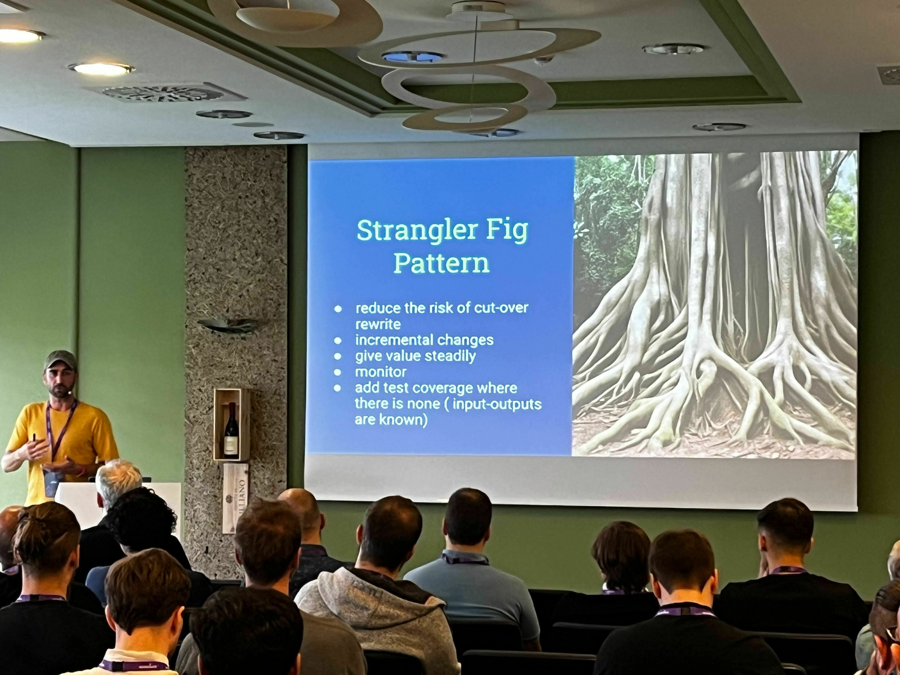

At the beginning of the year, [I set myself the goal of speaking at a conference](https://dev.to/dvddpl/2023-this-year-go-for-smart-goals-and-habits-1l9k). I applied to a bunch of them, of any size, location and format, then stopped thinking that much about it. 
As it happens, and happened most of last year, one after another, **rejections landed in my mailbox**.  
Likewise when looking for a job as a trainee/junior, getting accepted as a speaker can prove difficult: 

> You need experience to be accepted as a speaker, but if you never get the chance to speak, how do you gain it?

Then, one day I received an email telling me that my talk had been accepted. 

I was super happy and excited of course, but then some panic started to creep in: me, on stage, at the [AWS Community Day DACH (Germany - Switzerland - Austria) in Munich](https://www.aws-community-day.de/) ?!?  

>There are so many more brilliant software engineers and better speakers than I am, who am I to be there?
Am I good enough?
Is my topic interesting and technical enough?

##My first talk! 
I was almost tempted to cancel my submission, _"Naaa, what was I thinking?! Was I still drunk when I listed my New Year´s resolution and applied as a speaker?! Better start with some small local meetup and apply to some conference next time"_ but then I reminded myself that I had dreamt about it for years and that is too easy to be blogging and bragging about **going out of the comfort zone**, but then retreat like this when the opportunity comes.

And I also reminded myself that yes, it would be my first conference, but it´s not that I have never spoken in front of people -  I have held multiple workshops, presentations, and meetings throughout my career, simply never on a stage and in front of strangers.  And that [I also completed the Toastmasters pathway](https://dev.to/dvddpl/reflecting-on-my-path-what-becoming-a-toastmaster-meant-for-me-eof) exactly to learn public speaking skills and prepare for such an event.  

Therefore I really had to do that.

Here is how I prepared and how it went: hopefully you find it interesting and useful if you plan to give public speaking a try!

##Preparation
First of all, I started to **put the slide deck together**. [I had already written a post about the topic](https://dev.to/aws-builders/from-php-monolith-to-serverless-multi-stack-cross-account-canary-rollout-njo) so I had a starting point and tried to give it a more _storylike_ structure.  Then looked for pictures on [Unsplash](https://unsplash.com/) that conveyed the message and the emotions I had in mind. 
**People want to hear stories, either success stories, or war stories**, and I never liked that much those presentations where the slides were full of text and the speaker just enumerated bullet points.
The speaker is there to deliver the content, in their unique way, not just to read out the slides.

Still, I roughly wrote in the speaker's notes, the text that I would "recite" on stage. I **did not memorize it** though, that is never a good idea, because if for some reason you forget something, if you get interrupted or you kinda black out, when you are relying on a fixed script it is much more difficult to get back on track and keep talking.

So what I do is rehearse it multiple times, use different words, and rephrase some sentences. In the end, it should **feel like you are telling a story to friends**. It has to flow, **not to sound scripted**. 

**I bought a clicker** and I connected my laptop with an HDMI cable to my TV and I practiced at home (about 15 times!) so that I could see the speaker's note on my laptop and refer to the slides on the TV. By doing this I could practice as I would be on stage, moving around the room and advancing the slides and their animation with the clicker.  

I organized an **online rehearsal with some colleagues** and ex-colleagues or friends who had experience either as speakers or with different levels of expertise in AWS. After the talk, **I shared a Google Form for them to gather their feedback** in a structured and useful way. I got some very useful tips and lots of valid points even though **some feedback was kind of conflicting**:

> Drop the 2 slides about canary deployments,  they are too descriptive for such a trivial topic: _who does not know that!?!_ 

vs 

> The slides about canaries in the coal mine were entertaining and useful: _I was not aware of that!_

or 

> I missed some more detailed info (and code snippets ) about what you did and how you did it, otherwise, it is just a nice story but too shallow.

vs 

> Code slides are not so easy to follow during the presentation, and they are very language-specific. I care more about the experience, the whys, and the abouts, rather than code snippets.
 

Those comments helped me refine the structure of the story and improve some slides but also left me wondering **how I could make everyone happy**. 
**Spoiler: you can´t** - even at a conference where your talk has _"experience points"_ so that your audience can choose whatever fits them, there will always be someone that considers your topic too easy and some other too hard. I left the slides about the canaries and decided to be flexible with how much time dedicate to the explanation depending on public reactions. 

I arranged to present the talk in our local AWS User Group but just a few days before, the event was canceled due to an issue with the location. That caused me a bit of anxiety because I really wanted to have a bit more practice in front of the public: _Since Covid, I only had online meetings and presentations!_ 

**The more I was preparing, the more I was insecure** that my topic would have been of interest,  not so technical, not about a massive project hitting the AWS service quotas, "_what if the solution we adopted was considered dumb or plain wrong?_".
**Imposter syndrome** kicked in violently, but the feedback I got so far reassured me it was a solid presentation about an interesting topic.  

## The worse happens in your head
**The day before I almost felt sick** but forced myself to go bouldering to really get some distraction and release some stress.  

The morning of the Conference, needless to say, I was very nervous, but I really tried to _leave the insecure Davide at home_. By now, it is not only useless but also harmful and counterproductive to linger on negative thoughts or insecurities. **I was prepared** and motivated to do well, and even if I were not, I would have had no time to remediate, so why let those thoughts creep in?

As silly as it sounds, I followed the advice of a couple of friends to close in the bathroom for a couple of minutes to **breathe, do a Power Pose, and practice tongue twisters** to warm up my voice.  It definitely helped.

The main point is tricking your brain and **reframing those sensations** you have in your throat and stomach from fear into excitement. 
>_Of course, my heartbeat is fast, yes I am sweating, and my legs and hands shake a bit but **that is not anxiety, it is excitement**!  I wanted to do this for a long time and now I am here!!!_

Something similar happens often when I go climbing, I am super excited, then I see those steep overhang walls and I am scared, but then I turn, that uncomfortable feeling into the joy of challenging myself. 

**The line between fear and excitement is very blurry** and it all depends on how your mind interprets it.  (of course, the challenge has to be just out of your comfort zone, not in the panic zone - if I threw myself onto the stage of **Re:Invent** for the opening keynote, the fear and pressure would be paralyzing)

## So, how did it go?
When I entered the room to prepare the laptop and do a sound check, I realized the room was relatively small, accommodating about 60 people and there was no real stage, therefore it felt just a bit more than hosting a meeting in one of our biggest rooms in the company. Furthermore, I had a smaller screen on the ground, which meant I could check my speaker´s notes on my laptop, and the slides on the small screen, without turning and showing my back to the audience. 

As people came in I started chatting with a couple of attendees and that also felt quite natural. All the tension was gone. 

As soon as I started speaking I identified a couple of **_nodders_, those attendees who always smile and nod when they hear something they like and agree with (thank you, you are a gift for every public speaker!)** - and kept them as different reference points in the room so that I could look at all the audience (left-right, front-row and bottom) while boosting my confidence. 

<blockquote class="instagram-media" data-instgrm-permalink="https://www.instagram.com/p/CxJKtlnPnD7/" data-instgrm-version="14"></blockquote>

##Sirens on
Something I was a bit worried about was that Thursday, September 14th was the ["Nationwide Warning Day"](https://www.bbk.bund.de/DE/Warnung-Vorsorge/Bundesweiter-Warntag/bundesweiter-warntag_node.html), the day when the federal government's modular warning system is being tested.  A warning message is sent to radios and TVs, while cellphones,  loudspeakers, and sirens are triggered.

That meant that **at 11:00 a.m. towards the end of my talk, all cellphones and alarms in the building would start ringing!**

I decided that I could adjust my slides to kind of **integrate the real alarm into my talk** - the timing was about right for when I was explaining how the deployment did not really go as expected, but of course, it would have been hard to synchronize it. 

In the end, German punctuality failed me, and the alarm was triggered 1 minute before, and exactly one slide before the one that I prepared.  

It was still a very fun moment, which didn´t disrupt the presentation.

##The dreaded Q&A

I must say that this is the part that always made me uncomfortable and put me off from giving tech talks.
That´s when a _know-it-all_ could prove to anyone that **I am an impostor**, that I should not be there telling people how to use serverless and I should better go home and study computer science...

But this is really hardly happening. In many years at meetups and conferences, **I have never seen somebody in the audience behaving like an asshole willing to prove the speaker wrong**. 
Remember that **people are there because they are interested and everybody is happy to be at the event**  - which is different from giving a workshop to some bored co-workers who maybe were forced to participate, and they might even just try to correct you to show everybody they know more than you.

And even if during the Q&A session you realize that you were wrong (in my rehearsal in front of colleagues I messed up M5 with T3 and said that we used T5 EC2 instances and immediately in the Q&A somebody pointed out they don´t exist) or don´t know something, just admit it and show you available to follow-up after the presentation.  

The point is, you are not there as the super expert teaching people, you are there to share your experience and often that is the result of teamwork, so there might be questions about the tech specs you don´t recall)  It´s not a big deal. Be honest and don´t pretend to know.

After my presentation, I had a couple of questions and everything went smoothly and I really enjoyed continuing the conversation for a good 20 minutes with a couple of people when we left the room. 

##Achievement unlocked!
I was super happy to be one of the first speakers of the day because that meant that I could relax and spend the rest of the day watching other talks and networking or talking with other people who were congratulating me for the talk and asking additional questions. 

The tension was all gone and I was feeling tired but really happy.  The company I had with other AWS Builders and AWS enthusiasts was amazing and we got home late after a few rounds of beer. 

I couldn´t be more grateful to the [Förderverein AWS Community DACH e.V.](https://www.aws-community.de/team) for organizing such an amazing event, and for having me as a speaker!

------  

## Learnings from this experience

Preparing for this event has taught me so much, I am sharing some points that might help you face the challenge of public speaking!

- Do not stress over details, do your homework and aim high, but there is no need to be perfect

- you don´t have to be the biggest expert on a topic, most people want to hear stories, something they can relate to

- Probably you do not need so much time to prepare the slides and definitely to rehearse the talk so many times! Practice until you get confident, but then do not obsess over it. 
Remember that people do not know what you are going to say, 
you are not reciting a famous poem in theater and happen to forget a verse. **Your audience cannot tell if you forgot something; don't fret or apologize**, if it was important you can always mention it, otherwise just move on.

- you don´t have to be a perfect speaker. Body language, tone, pitch, proper language and pronunciation matter a lot, on the other hand, even at most conferences, you are there not as a professional speaker, **you are a passionate developer who happens to be sharing in public your work or ideas**, just accept it. **I had been super neurotic about my Italian cadence, my gestures, my swaying** from one side to another (all things years at Toastmasters taught me to look at and improve) but I was relief at seeing each speaker have their own peculiarities ( who had a very strong German or Russian accent, who was rocking on their legs or ending every sentence with, "Right?" ) IT IS OK! of course, being aware and trying to improve it´s good, but just don´t stress over it, don´t demand from yourself to be perfect, don´t pretend it to be, just have fun, share your story and engage with your public. 

- **Stop saying _I Can't do it_. Start saying _I can handle it_** ( handling is different from succeeding - but it is not already putting you down as not being able to...)

- go to local meetups and other conferences and ... network!!
**get to know people, talk to people**.  I was always a bit too shy - and wasted precious time in the past -  but really,  start talking to people,  it is not just because you need connections, (that would be opportunistic and not a great way to make meaningful relationships), you will know lots of inspiring individuals

- If you want to achieve something, you should go for it, don´t wait until you are ready - you will never feel ready.

## How do you start? 

Take every opportunity you have at work to hold meetings, present something you just learned, at a brown bag session or organise a workshop.

Joining a public speaking group like Toastmasters is a great chance to learn and improve

Check out local meetups and user groups: watch talks from other people and connect with the organisers - propose your talk at a small venue. ( I should definetely have done it years ago...)

Apply to Call For Papers (CFP): conferences usually publish CFP to search for speakers many months in advance. Subscribe to some newsletters or just use [https://sessionize.com/](Sessionize) or other similar websites/apps to find conferences all over the world and apply. I wrote a post about finding CFPs) [https://dev.to/dvddpl/where-do-you-find-cfps-call-for-papers-and-conferences-to-speak-at-4b14] - you can find some interesting links in the comments. 

Remember that **you don´t need to have a presentation ready**,  to apply as a speaker you just need a compelling title and an abstract. If you have a topic you like or are passionate about, something interesting you have been experimenting with or even something you are planning to learn, you do not need to waste precious hours on a presentation nobody will accept, just focus on the title and a short description, submit it and hope for the best!

Hope it helps! 

