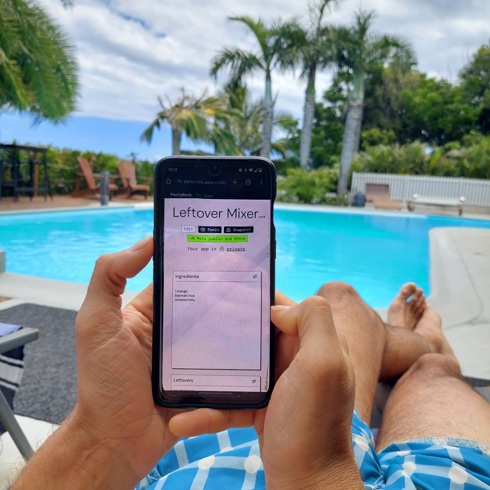
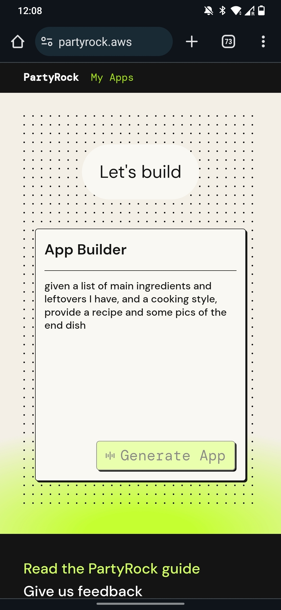
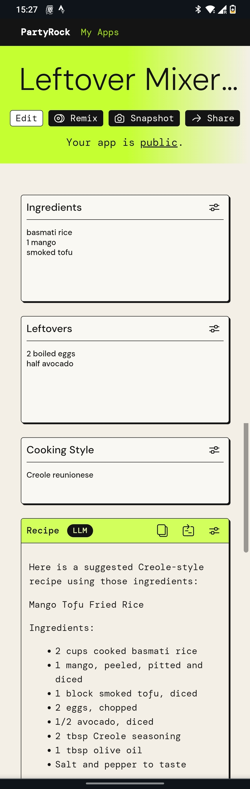
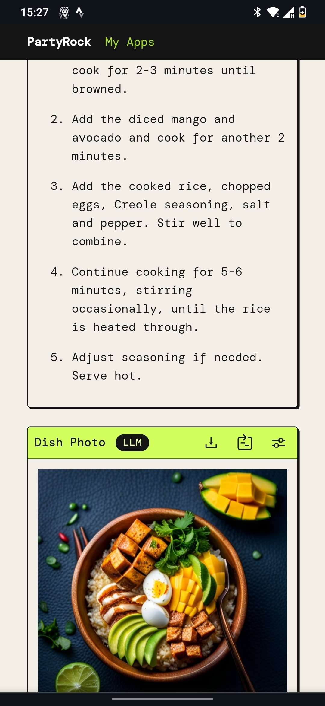

I'm currently on vacation and I'm typing this from mobile. So this post will be very short.
But I just wanted to tell you that I had the opportunity to experiment with PartyRock, a playground for Amazon Bedrock. 

It's a tool that allows you to experiment with generative AI and  lets you build your own AI based app in a matter of minutes. 
seriously, 

On vacation I never take my laptop with me and I tried PartyRock from my mobile phone and in less than 2 minutes I had my app ready. 

what app? well, not the most original but as I said I am on vacation, and more precisely on **Reunion Island**, where I habe been eating delicious **creole food** all week. in my apartment I had some ingredients and some leftovers and thought about an app that creates a recipe with those, following a specific style like Italian, Vietnamese or in these case Creole, and showing you a picture of the prepared dish (as well generate by AI).

this is the simple prompt I had to feed into the playground to get my app. 

> it's really that simple, 

it worked out pretty well I think. you can find it      ,[here](https://partyrock.aws/u/ddp/HVHXmz8zm/Leftover-Mixer%253A-Recipe-Finder-and-Meal-Planner/snapshot/ch19aQKRw) (recipe included!) 

when i'll be back I will have a proper look at the tool and see what more it has to offer to experiment with generative AI, in the meantime you can give it a try **creating your own app or _remixing_ mine or other existing ones!**
party on 🥳🥳! 
