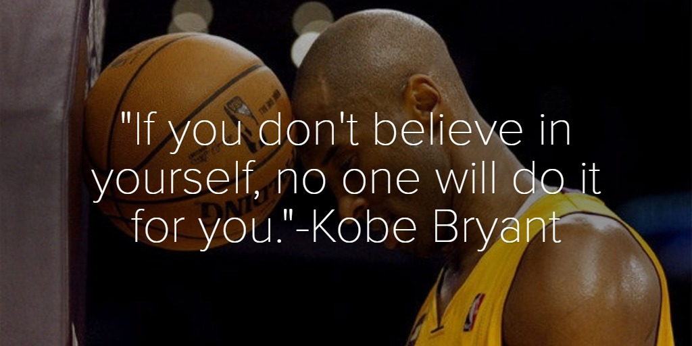
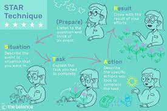
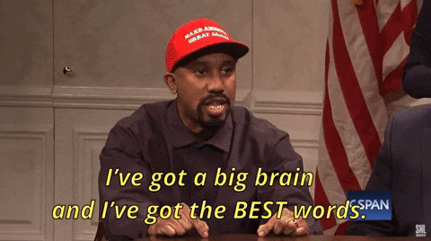

Many years ago when I  was asked **what I had been working on lately** during an interview or my yearly feedback ( that is often, a salary negotiation, because, of course, we want to have great feedback and we want to know that we are good and we have grown a lot as developers, but... in the end, we also want more money for that! ) I often stood there, stuttering, trying to remember what I did months before, and trying to find the right words to give the proper value to the tasks I completed:

> _Ähm... oh.. what did I do in the last months?  well... there is that API I built, then I worked on that component.  Mmm, let me think what else... Ah yes, yes! I organized and ran the workshop about TDD! Wait, I also fixed that nasty bug on production in February, that was tough!_

Not very convincing and not very professional either. 

The problem was that week after week, **sprint after sprint**, project after project, I quickly forgot all the tasks I worked on and lost the global picture of my professional growth. On top of that, I used to always minimize the impact of what I was doing - it´s just a React form with a couple of hooks in the end...  not rocket science!

The reason for both was that **I did not know the tools** to properly keep track of my work and of my progress and relied on **my memory and my self-talk/inner voice** to evaluate them. 

### Bad memory
Our brain has the tendency to remember more (or put more emphasis on) **experiences that are freshest, even if they are not the most relevant or reliable.**
That is called **Recency Bias** and shows that **our memory is not our best ally** when it comes to recalling what we worked on to prove a point during a salary negotiation or a job interview.

Maybe you saved the company lots of money with a one-liner bug fix in January but you just mention the React Login Form you built in October. 
Maybe in March we built a CI Pipeline that allowed to increase the productivity of your entire team and make the builds more stable, but you start telling about that Lambda you built last week. 

###Positive and Negative Self-talk

Willing or not, consciously or unconsciously, we all have an inner voice that, sometimes whispering, some other times shouting, can give us courage: 

> - C´mon you can do it! 
- Calm down, relax, you have done it before and you can manage it now.

or completely put us off: 

> - What do you think you are doing here, noob!
- ehi, are you sure you really want to do that?

This is all good and normal when Positive and Negative talks are balanced and objective. Indeed negative self-talk has its benefits, I have talked about the _positive_, _motivational_ side of the negative voice [in this post](  https://dev.to/dvddpl/maybe-you-should-start-listening-to-that-voice-telling-you-that-you-suck-2i49) but you should keep it under control! 

>The intention of that _(negative)_ voice is to protect you, alert you to potential risks, and help you avoid mistakes. 
For some personalities, negative self-talk can work as a **motivational catalyst**, as they are eager to _prove the negative whispers wrong_. They will work harder and try again to get it right next time.  
The problem is that **you might start believing those destructive thoughts if you repeat them too many times**. These thoughts can then become ingrained in your perception of yourself.    
[from [16 personalities](https://www.16personalities.com/articles/exploring-the-conversations-we-have-with-ourselves-how-self-talk-impacts-us?utm_source=newsletter-general&utm_medium=email&utm_campaign=issue-9&utm_content=read-more-article-9)]

Another big problem of the Negative Talk, which also compounds with the Recency Bias, is **Filtering**, meaning: 

> Remembering the one thing that went awry while you forget the 10 other good things that happened. When you filter thoughts in this way, **you discount the positive and selectively focus on only the negative.**  
[from [16 personalities](https://www.16personalities.com/articles/exploring-the-conversations-we-have-with-ourselves-how-self-talk-impacts-us?utm_source=newsletter-general&utm_medium=email&utm_campaign=issue-9&utm_content=read-more-article-9)]

Despite all my efforts something like this still happens quite often to me, for example when I climb:  I look at the route, check the difficulty grade that was assigned to it, and think: "Shit, that´s hard and scary. Don´t know if I can make it".
Soon after, if I managed, instead of being content and proud of myself, the negative voice tells me :
"bah, it was easy, too easy. It has likely been rated wrong. It was definitely not that hard grade it was given." 

My negative voice tends to discount my achievements, and highlight my failures: 

>**If I fail it´s because "_I_ suck", if I succeed it´s because "_It_ was an easy one".**

So how do you contrast that? How do you counterbalance the negative voice?  You need to put extra effort into documenting your small successes, and your tiny achievements so that when the negative talk starts to be a bit overwhelming and to filter out or discount your wins we can shut it up and become more confident and convincing.

The thing is, if _you_ don´t believe in yourself, why would/should others do that?  If _you_ are not convinced, you don´t believe you deserve that job or that raise, how can you convince others?

To gain confidence and become more convincing, we have 2 tools, the Brag book and the STAR method. let´s have a look:

## Brag book

The Bragbook, also called  **Winventory** in my [Pip Decks](https://guides.pipdecks.com/productivity-recipes/how-to-boost-confidence/ )  (will write a post about those soon)
is basically a collection of _evidence_, a list of things that you have done/accomplished in your private and professional life.

Just a simple Word document is enough to keep track of your achievements - actually, I have multiple ways and places (I  must admit I am not so organized and disciplined): 

- a Trello board where I just list some of the stuff/tasks I do at work monthly 
- a Google Doc with the learnings of the week (can be snippets of code, interesting articles, or inspiring talks) - which is useful, both to fight Imposter Syndrome (you can browse back and realize how noob you were one or 5 years ago, and therefore how much you have learned and have grown so far), and to retrieve some snippets of code, or recall some things.
- a Google Doc where I list all the small and big things I accomplish ( both privately and professionally) during the year - that I also use as a yearly retrospective document. (hadn´t I had that I would still be thinking [last year was rather dull](https://dev.to/dvddpl/my-2022-was-not-as-bad-as-i-thought-after-reading-all-other-peoples-yearly-retrospectives-a5p))
 
##S.T.A.R Method
S.T.A.R. is an acronym that stands for **Situation, Task, Action, and Result**. The method helps candidates provide well-organized and detailed responses that effectively demonstrate their skills and experiences.

- **Situation**: Start by describing the specific situation or context in which the event or task occurred. Provide enough details to help the interviewer understand the background and setting.

- **Task**: Clearly explain the task or challenge you faced in that situation. Describe the goals, objectives, or expectations that were assigned to you or your team.
 
- **Action**: Describe the actions you took to address the situation or complete the task. Focus on your individual contribution and highlight the skills and competencies you utilized. Explain the steps you took, the decisions you made, and the strategies you employed.

- **Result**: Share the outcome or result of your actions. Discuss **the impact of your efforts and quantify the results** whenever possible. Highlight any positive feedback, achievements, or lessons learned from the experience.

I find the S.T.A.R. method a great way to structure your thoughts and explain yourself in a structured and appealing manner. 

## Example of Brag book entry with S.T.A.R

I asked **ChatGPT** to create an entry for the brag book of a Fullstack Developer working on a Serverless Project with AWS and this is what it spat out:

>Here's an example of an entry in a brag book for a Fullstack Developer with experience in TypeScript, React, and AWS Serverless using the S.T.A.R. method:

> Situation: As a Fullstack Developer at ABC Tech, I was involved in a project to build a scalable and serverless web application using TypeScript, React, and AWS Serverless architecture. The goal was to **create a highly performant application that could handle a large user base and effectively utilize cloud resources.**

> Task: My task was to architect and develop the frontend and backend components of the application, ensuring seamless integration between the user interface and the serverless infrastructure. **I was responsible for designing the system architecture, implementing key features, and optimizing performance.**

> Action: To accomplish the task, I followed these actions:
- I began by thoroughly understanding the project requirements, including user stories, wireframes, and performance targets. I collaborated with the product team to gain clarity on the desired functionality and user experience.
- Based on the requirements, I designed the frontend architecture using React and TypeScript, focusing on component modularity and reusability. I leveraged the latest best practices and design patterns to create an intuitive user interface.
- I implemented various frontend features, such as user authentication, dynamic form handling, and real-time updates using React hooks and Redux for state management. I ensured the application was responsive, accessible, and optimized for performance across different devices and browsers.
- For the backend, I adopted an AWS Serverless architecture using services like AWS Lambda, API Gateway, and DynamoDB. I designed serverless functions and integrated them with the frontend components using RESTful APIs.
- I optimized the serverless functions to minimize execution time and reduce costs. I utilized TypeScript to ensure type safety and utilized AWS CloudFormation for infrastructure-as-code, enabling smooth deployment and scalability.
- I implemented serverless functions for handling user authentication, database operations, and business logic. I conducted thorough testing and debugging to ensure reliable functionality. I also implemented logging and monitoring solutions using AWS CloudWatch for proactive issue identification and resolution.

> Result: The result of my actions was a robust and scalable web application that met the project's goals. The application successfully handled a large user base without compromising performance. Key metrics, such as response time and cost per transaction, significantly improved compared to the initial benchmarks. The project received positive feedback from users and stakeholders, contributing to increased user engagement and business growth.

I think this is a great example for an interview but definitely **way too verbose** for your own brag book - you want to **remind** yourself what you did well over time not, so you need less context and less level of detail. 

Also **if you need to spend lots of time writing it, you will likely abandon this habit pretty soon**, thus, better a short sentence consistently, than nothing.

> Our app using DynamoDB grew a lot over the years and became slow and expensive, as a tech lead I was in charge of keeping costs under control and performance high, thus I analyzed the available AWS metrics and dug in the code base to understand how our tables were accessed. 
Following DynamoDB best practices, I introduced in some circumstances global secondary indexes, refactored the code to use Batch or parallelize requests, and ultimately introduced caching. This brought a reduction of costs of about 30% and reduced the latency of some requests from almost 1 second to 200 ms.  

This is a real example ( if you want to know more, you can read [this post](https://dev.to/aws-builders/there-is-no-right-or-wrong-as-long-as-it-works-actually-how-you-use-dynamodb-makes-a-lot-of-difference-2668)) - it´s still quite long, depending on your level and area of experience it could be something like this :

> Our Date Picker was laggy and caused our API to be invoked multiple times (S), as a Junior dev I was in charge of debugging and fixing (T), I identified the issue in its React hook and fixed it (A) after that page was loading fast and our API was hit only when necessary ( thus, more speed and less costs) (R)

## Recap

Keeping a journal with these small/big wins will have great benefits for both your personal and professional development. 
Of course, it may not directly increase your chances of passing an interview or getting a raise, but it´s certainly a valuable resource in these circumstances.

I spoke about Bragging, but in the end, the journal and the S.T.A.R. method are great tools for many reasons.

**Self-Reflection and Growth**: You can review your experiences, identify areas for improvement, and track your personal and professional growth over time.

**Accurate and Detailed Records**:  you have a reliable record of your accomplishments. 

**Improved Communication**: you learn and get better at articulating your thoughts and experiences more effectively. 

**Boosted Confidence**: Recognize and celebrate your achievements, big and small. When facing new challenges or adversities, you can look back and find proof of your capabilities:   _It might be hard, and it might be new, but it´s not the first time you faced some challenges and you made it! You will manage this one too!_

## A word of warning
I spoke about Bragging, but that was a bit of clickbait. the purpose of the Brag book is to boost your confidence and shut up the negative self-talk.  But pay attention to how you articulate your wins when speaking with colleagues and at interviews, you definitely don´t want to be bragging there.
You want to fight your **Imposter Syndrome** but you don´t want to fall on the other side of the spectrum, the **Dunning-Krueger Effect** and sounding arrogant. 
So remember to **be humble** and **give proper credit to your team members!**

I hope you´ll find this helpful, let me know in the comments what strategies you are using and how they helped you in your career/personal growth!

----

Other related articles you might be interested in:

- [Your jobs is boring and everything sucks - Here are some tips.](https://dev.to/dvddpl/my-jobs-is-boring-and-everything-sucks-or-not-1lnp)

- [Are good software engineers Pessimists?](https://dev.to/dvddpl/are-good-software-engineers-pessimists-54ll)

- [Focus on the positive! - No! the world needs more pessimists!](https://dev.to/dvddpl/focus-on-the-positive-30hl)

- [Maybe you should start listening to that voice telling you that YOU SUCK!](https://dev.to/dvddpl/maybe-you-should-start-listening-to-that-voice-telling-you-that-you-suck-2i49)

--- 

Foto von <a href="https://unsplash.com/de/@srz?utm_content=creditCopyText&utm_medium=referral&utm_source=unsplash">sydney Rae</a> auf <a href="https://unsplash.com/de/fotos/getrocknete-blatter-auf-sand-braun-geM5lzDj4Iw?utm_content=creditCopyText&utm_medium=referral&utm_source=unsplash">Unsplash</a>
  
