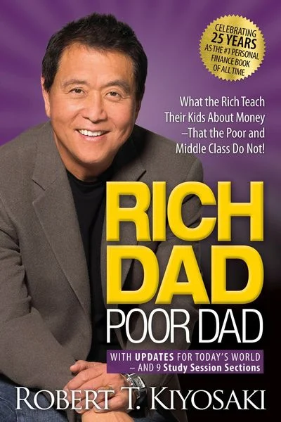
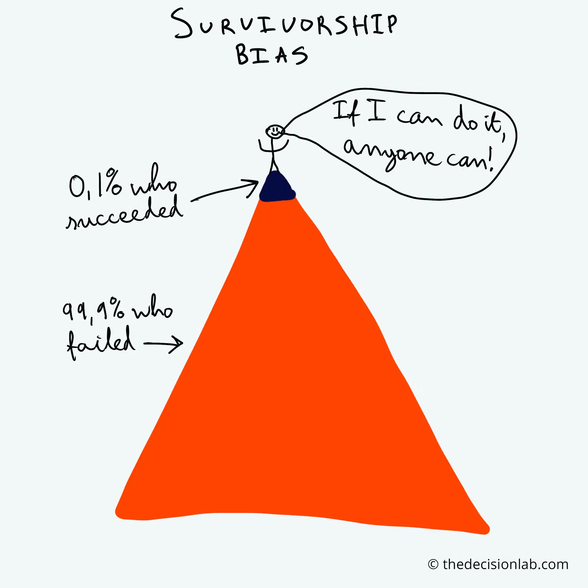
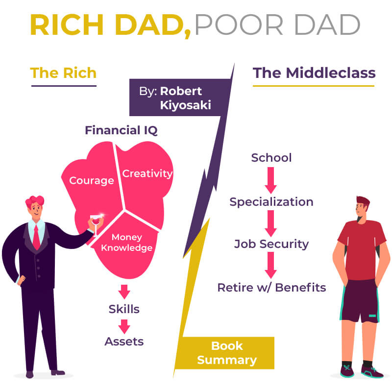
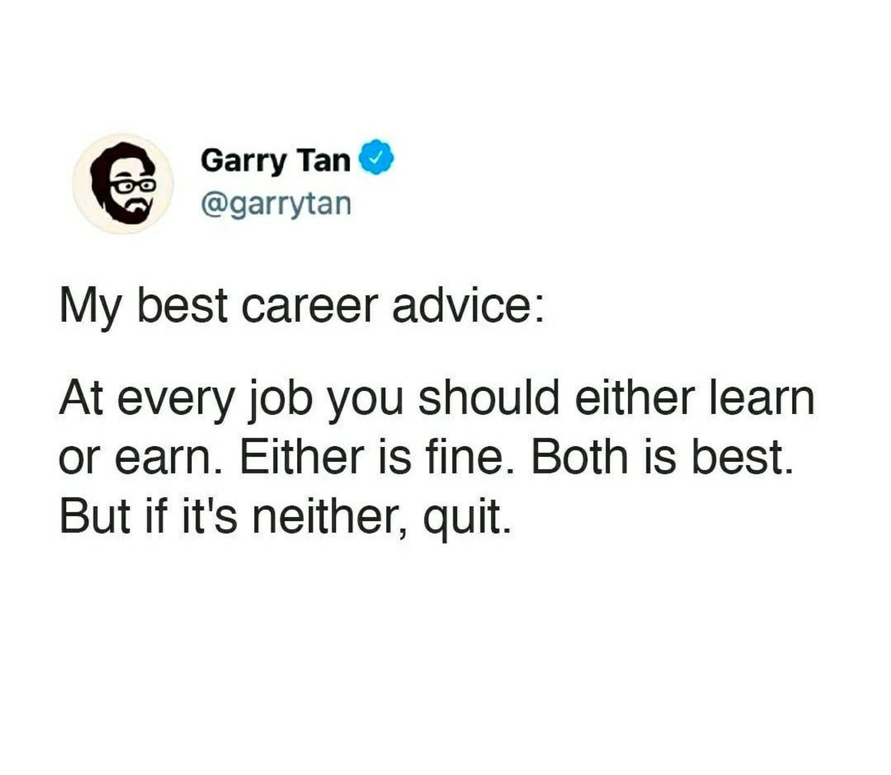
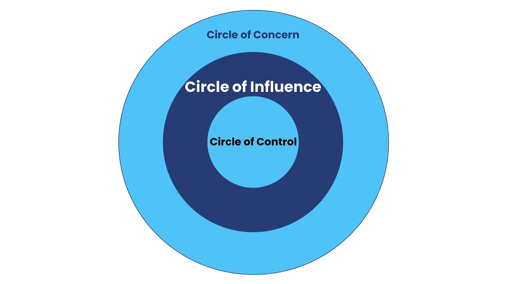

I love reading and exposing myself to different perspectives and points of view. I try to read articles and books that teach me something and possibly change my mind on a topic. 
In the last few years, I heard a lot about "Rich Dad, Poor Dad" by Robert T. Kiyosaki as it was described as a mindblowing source of tips to have a successful mindset, get passive income, increase wealth, escape the hamster wheel and of course ultimately to learn about Finance and Investing.

So recently, when during a trip I finished the book I was reading earlier than expected and found Rich Dad, Poor Dad while browsing at the airport, I decided to give it a try, even though I was skeptical. 

I was not wrong.

I immediately found the narrative irritating: the amazing tale about the success of a self-made man, who in simple, and very repetitive language, 100 % self-help style, with a sprinkle of arrogance and lots of survivor bias and privilege guarantees success for everybody.

Although I admit to skipping a few pages, mostly the annoying summary at the end of every chapter ( a "summary" which is 40% of the entire length of the chapter, where the author speaks in the third person, instead of in the first person and narrating the dialogs that happened with the poor and the rich father) and the useless "empty pages" for your notes, I have read it with till the end.  seriously, money and time wasted. 

Of course, there is quite some clash in political views - 
the way he built his wealth was through pure speculation, often to the detriment of people facing financial crises. There is no hard work, there is no value added to society, just some **financial intelligence without scruples** and a bunch of tips that are anyway not reproducible for normal people - but I found many stories and examples infuriating:

> I met so many people who say that they are not interested in money but then spend 8 hours a day in their workplace! They lie to themselves. Why would they work, if they are not interested in money? 

or when he says that he is surprised at how low the salary of talented and educated people (on very necessary jobs) and states that instead of specializing and working hard **any average citizen could with the right investments make a passive income of 100.000 dollars a year!**

or when it puts boxes that appear eye-opening but that have no real value:

> What is more difficult:
- Work hard, pay 50% taxes, and save some money if something is left after paying your bills. Get peanuts of interest eaten away by inflation and more taxes.
or
- Develop your financial intelligence to increase the gap between your spending and your earnings.

Nice words, but where exactly is the tip? what solution is he advocating? 

Anyway, in these **280 pages** and 13 chapters there is indeed some valuable content (**that could have fit into 5** pages) so, so here is a summary, so that I can take the best out of this book and you don't have to read it ( believe me, it's not worth it). 

##Buy assets, not liabilities
buy things that generate assets and avoid buying things that produce expenses.  If that goes down mostly to **reduce expenses** that are unnecessary, and explains that buying a house is not an investment, then the suggestion to become rich is buying real estate ( for rent and reselling ) or buying stocks. 

## Don't work for money, make the money work for you.  
this is the entire **mantra** of the book, repeated dozens of times, in every chapter.  
How to make the money work for you, however, is not clear. What the author tells us is that studying, specializing, and aiming at a well-paid job is a trap that does not make you rich. Throwing a shitload of money on investment funds and real estate is.  

## Pay less taxes
The rich ( and the corporations ) don't play by the same set of rules - quoted from the book, not my political stance - because they pay taxes after all their expenses are deducted while employees are taxed before and they are left with peanuts. Aim to become self-employed or found your own company and try to deduct all the possible expenses like car, restaurant, and trips as "business-related" (and of course avoid your investment gains to be taxed by constantly reinvesting) 

##  _I can not afford it_ vs _how can I afford it?_ mindset
This is maybe the only great tip I can take away from the book. A suggestion that could make the difference in your attitude and prompting you to take control of your life and act upon it instead of reacting to circumstances.
If you desire something that you can't afford, instead of thinking "I cannot afford it", try to think creatively, work harder and smarter to find ways to finally afford it!

## Start with investing early
start early and face the fear of losing.
The author suggests investing in stocks, getting your invested money out when you have a gain, and leaving the surplus ( you will not worry about losing your money, and if you are lucky and stocks continue to rise, you will have an extra gain ).
A nice idea, still it works in the order of thousands of dollars ( if I invest 10.000 and I am lucky to get 10% and then I leave invested 1000, assuming the same % next year, you will get an extra 100 bucks, nice, but way far from "building a fortune" )

## Be open-minded, and look around for opportunities -
Another very generic but worth-remembering advice. 
But as many other examples in the book, they are not very practical for _normal people_ and also a bit disrespectful:
like when he says that he always walks around different neighborhoods over time and keeps his eyes open **while jogging to look for property** that stays unsold for a few weeks/months and then he can approach the owner - now desperate and in financial crisis - and buy his house for half the price, then renovate and rent or resell.

##Learn to sell yourself and your skills 
this is something that I learned too late in my life.  I always thought I did not care if other people "discover or appreciate" my abilities, and always shied away from networking, or from properly highlighting my value and my skills during job interviews or annual feedbacks, but it is indeed important.  
And in this case, I found the example quite funny: 
  > To a journalist who wanted to be a writer, and was upset by his suggestion to enroll in a Sales Workshop, he replied,  "The claim on my book says _best-selling_ author" not _best-writing_ author!"
It does not matter how good you are at something if others don't know you and don't buy your product.

##Work to learn, not to get paid

The learning that you are getting will bring you further ( and will make you more money in the long run) so try to learn as much as you can ( in different areas ).

## Beware your feelings
or better be aware of your feelings and don't let emotions like fear and anger get in the way of your judgment. ( about this, a much better read is [Clear Thinking by Shane Parrish](https://www.amazon.de/Clear-Thinking-Turning-Ordinary-Extraordinary/) 

## Change what is in your control
Worrying or complaining about stuff brings us nowhere. We should focus on what we can control, which is mostly ourselves and our behavior.

---
That is it.  

I repeat, I enjoy spending time reading but in this case, the amount of useful information is minimal, and it was money and time wasted. If you want to know more, just better watch this video summary instead 

<iframe width="560" height="315" src="https://www.youtube.com/embed/rd7Ov_RijSU" frameborder="0" allow="accelerometer; autoplay; clipboard-write; encrypted-media; gyroscope; picture-in-picture" allowfullscreen></iframe> 

---
Foto von <a href="https://unsplash.com/de/@helloimnik?utm_content=creditCopyText&utm_medium=referral&utm_source=unsplash">Nik</a> auf <a href="https://unsplash.com/de/fotos/braune-buchseite-Im93gzsDbf4?utm_content=creditCopyText&utm_medium=referral&utm_source=unsplash">Unsplash</a>
  
