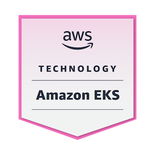
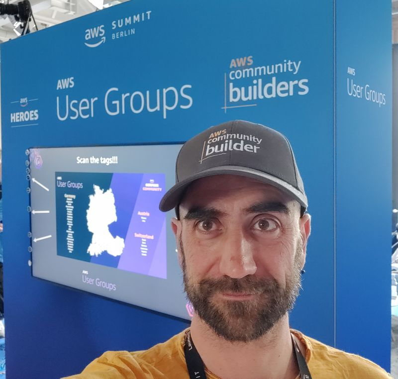
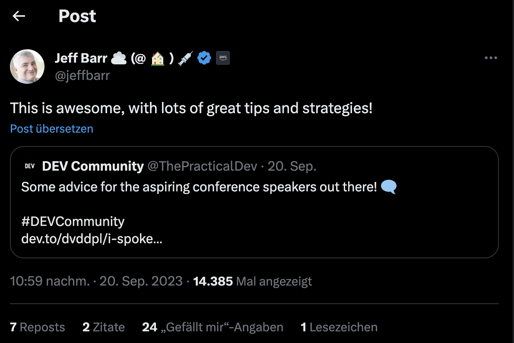
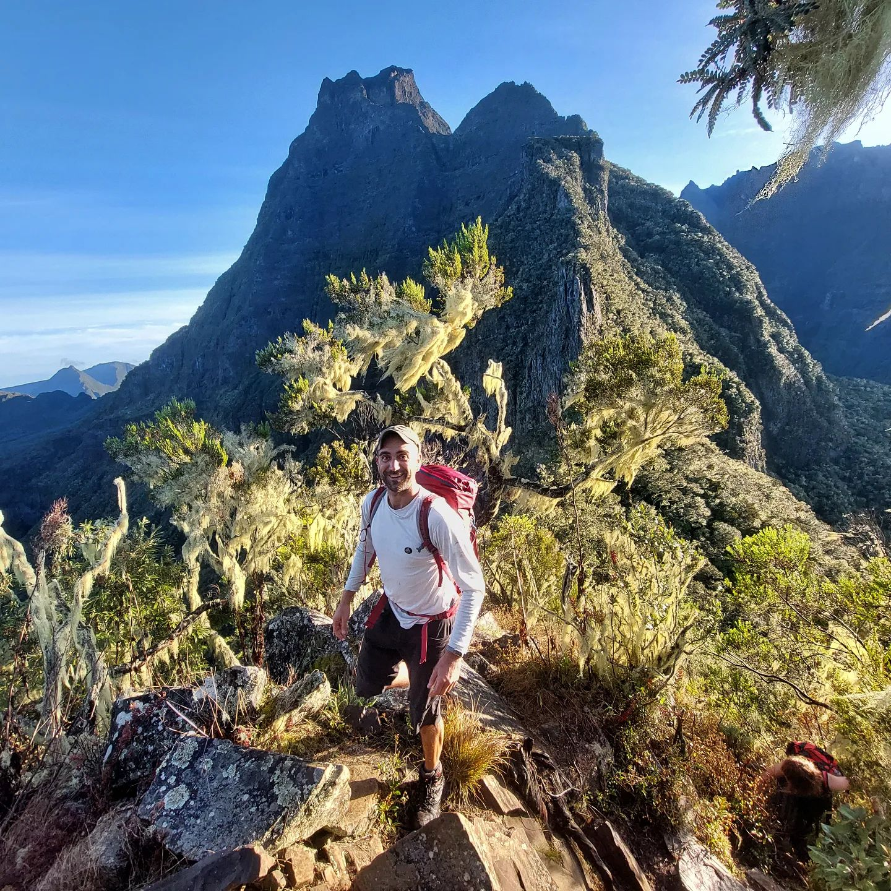

If 2022 started off great, with career advancement and a substantial salary raise, **2023 showed signs of uncertainty and negative changes ahead already since the very first couple of weeks**.
**The team I was leading, had been ripped apart by a reorganization** and was merged into another team working on a completely different scope and tech stack. Normally I am open to changes, even drastic ones, but since that was the second time in less than a year, I started doubting about my future in the company. 
I had been working in the same company for a little more than 9 years ( in different projects and teams ) and all the options of working on interesting projects, having an impact, and changing things for the good seemed now exhausted.
That meant many **frustrating months** where I was still learning something new, and having fun with the new project but where **I grew more and more detached** from the company and started looking elsewhere. Luckily I managed to find a great company where I started in December, and thus I can salute this stressful 2023 full of enthusiasm for the challenges awaiting me next year. 

Of course, this change had a great impact on my achievements this year, but even if it took a different track than expected I cannot say I am disappointed, and the last quarter was intense and mindblowing.

Let's review my 2023 in detail (the title of the post comes from the [Mad Sad Glad Retrospective model](https://www.teamretro.com/retrospectives/mad-sad-glad-retrospective)):

## Career and Professional Growth

### GoLang and Fargate
The new project I started working on in February had a Frontend in Unity, and a backend written in Golang running of Fargate.  My main responsibility had been rewriting some parts in NodeJs and Serverless, making the core more stable, and most importantly introducing/improving monitoring and observability. That meant that I had to **learn a bit of GoLang, work on ECS Fargate**, and spend a lot of time fiddling with **CloudWatch Metrics Alarms and Dashboards**.

### From Technical Lead to Engineering Manager
Since the 1st of December, I joined another company as an Engineering Manager for a Platform Team. The role is less hands-on, but since the tech stack is completely different ( **Terraform + EKS** (running a bit of everything from PHP to Kotlin) instead of AWS CDK + Serverless I am learning a lot of new things.  (I still like Serverless more, but EKS is allowing me to gain a different perspective - and the team is focusing more on Infrastructure than product development).

<blockquote class="instagram-media" data-instgrm-permalink="https://www.instagram.com/p/C0UsOtUtPdU/" data-instgrm-version="14"></blockquote>

Techstack aside, a lot of challenges in the **people management** area are waiting for me and I am looking to put my _soft skills_ to the test!
Furthermore, at least for now the main language in the company is **German**, which means that for the first time since I moved to Hamburg, I will be speaking German most of my day. This will change since the company is growing and [we are hiring](https://sevdesk.de/karriere/software-engineering/), but I want to improve my German skills as much and fast as I can. 

### No AWS Certification, just a couple of badges
My main goal for this year was getting the AWS Solution Architect Associate Certification and since the end of last year I studied quite a lot ( and posted a few write-ups ) but since May when things at work got really worse and I was focusing on finding a new job, I did not have the energy nor the motivation to continue.  Still, I used AWS Skill Builder a lot to ramp up my learning in the new teams and managed to get a couple of Readiness Badges. 

## Public speaking and personal branding

- I was **renewed as AWS Community Builder** for the 2nd year.  and I am so grateful and honored to be part of such a great community.  

- After working on an interesting project to improve DynamoDB usage I wrote [an article here on DEV.to](https://dev.to/aws-builders/there-is-no-right-or-wrong-as-long-as-it-works-actually-how-you-use-dynamodb-makes-a-lot-of-difference-2668) and run an **online workshop** at my company to share the learnings.

- I participated as a **guest at Logicata Podcast** where we discussed the latest news and announcements in the AWS Cloud world.  A great experience!

<iframe width="560" height="315" src="https://www.youtube.com/embed/wsNGhen5SUc" frameborder="0" allow="accelerometer; autoplay; clipboard-write; encrypted-media; gyroscope; picture-in-picture" allowfullscreen></iframe>

- After reading one of my posts on the topic, I was contacted by a writer at Dice.com to **contribute to an article** on [Tech Interviews and how to handle preparation and rejections](https://www.dice.com/career-advice/turning-a-failed-tech-interview-into-a-learning-opportunity) 

- I visited [WebDay in Milan](https://www.webdayconf.it/) in March and **took part in a panel** of AWS Community Builders and Heroes at Web Day Milan. (that was more a friendly conversation streamed live on YouTube and I simply happened to be sitting in the part of the room on the camera side, rather than a planned engagement, still, it was an exciting experience!)

- I visited the AWS Summit in Berlin in May and spent some time at the AWS Community Builders/Heroes and UserGroup Lounge to talk about the different programs with other AWS enthusiasts.   The summit itself has been an incredible experience, and for the first time I had the opportunity to meet many great Builders and Heroes I had been following or in contact only on Slack for months. 

- I **gave a talk at the AWS Community Day in Munich** in September. Needless to say, that was the highlight of my year, my first conference, and an incredible experience. The community is amazing. I talk about the conference and how I prepared for it [in this post](https://dev.to/aws-builders/i-spoke-at-aws-community-day-in-munich-how-i-prepared-and-how-it-went-39c9)

<blockquote class="instagram-media" data-instgrm-permalink="https://www.instagram.com/p/CxNIVncNqC6/" data-instgrm-version="14"></blockquote>

- Gave the same **talk at AWS User Group Hamburg**
<blockquote class="instagram-media" data-instgrm-permalink="https://www.instagram.com/p/CzUN4Y1tPwk/" data-instgrm-version="14"></blockquote>

- I **wrote 27 posts** this year, but I am not happy with the consistency nor with the quality of some of them. (those I am proud of, are probably around the 10...) 

- On the other hand, a couple of posts got some traction and were **featured in the newsletter** of [Jeremy Daly](https://offbynone.io/issues/237/) and the Serverless Picks of [Allen Helton](https://www.readysetcloud.io/newsletter/52/).
My post about how I prepared for the AWS Conference was even **reposted by Jeff Barr**! 

 
## Private Life 

- I have **read 14 books** this year, not as many as I used to years ago ( when I had no kids, was training less, and had a very long commute!) 

<blockquote class="instagram-media" data-instgrm-permalink="https://www.instagram.com/p/C1cxDCQNxso/" data-instgrm-version="14"></blockquote>

>
Top 3:
* [Radical Candor - Kim Scott](https://www.radicalcandor.com/)
* [Multipliers: How the Best Leaders Make Everyone Smarter - Liz Wiseman](https://www.amazon.de/-/en/Liz-Wiseman/dp/0061964395)
* [An elegant Puzzle: System of Engineering Management - Will Larson](https://lethain.com/elegant-puzzle/?ref=blog.pragmaticengineer.com)

>Worst:
* [Rich Dad, Poor Dad - Robert. T. Kiyosaki](https://dev.to/dvddpl/i-have-read-it-so-you-dont-have-to-rich-dad-poor-dad-by-rt-kiyosaki-4d0k)

- attended a **First Aid Outdoor** course 

- after a pause of a few years I started **donating blood** again 

- finally got the **German Citizenship** (not a real achievement of mine, more a matter of bureaucracy, but still an important milestone.
 
- I climbed the iconic multi-pitch route **Luna Nascente** in Val di Mello (360 m, 7 grade, granite) and had the best day ever.

<blockquote class="instagram-media" data-instgrm-permalink="https://www.instagram.com/p/CyUIlWStww1/" data-instgrm-version="14"></blockquote>

- I **climbed consistently 3 times a week** this year and finally managed to climb a few 8- (6c+) routes

- Finished the [TK Fit Challenge](https://www.tk.de/techniker/magazin/digitale-gesundheit/spezial/tk-fit/tk-fit-challenge-2077602) - a bonus points program organized by my [Medical Insurance where I had to walk **8000 steps a day for 12 weeks**. Must say that maintaining that consistency was tough.

- in between the 2 jobs I decided to have a short **hiatus** - where I was supposed to finish learning for the AWS certification, but then, considering how stressful the year had been, and that it was an opportunity that won't happen anytime soon. I decided to **spend it traveling** and had a great time hiking in Basque Country and La Reunion! 

## Final considerations 
This year has not been easy, I had my share of failures ( I was rejected at more than a bunch of Conferences, I failed embarrassingly a System Design challenge and did not land a job after 5 rounds of interviews and despite having enough time, I did not get the Solution Architect certification.

Furthermore, if I compare my goals with other AWS Builders or Heroes I follow I feel I haven't done much: 

[Allen Helton](https://www.readysetcloud.io/authors/allen.helton/)
- wrote 56 posts 
- did 31 podcasts
- sent 51 newsletters
- and 12 conference talks

[Luca Mezzalira](https://lucamezzalira.com/)
- did 34 public talks
- wrote 25 blog posts 
- sent 50 newsletters

[Yan Cui](https://theburningmonk.com/) did not post a review of his year but the amount of posts, talks, and courses he publish is shocking. 

**I have no idea how people can achieve so much**, produce so much content, and - hopefully, still have a life! 
Anyway, **comparing ourselves with others is never fair** and we should do that only to the extent that pushes us to improve and do better and more, not to feel like failures. 

I am proud of what I went through and achieved. And even more, I am **grateful** for everything that happened, and for all the people I met on the way, who inspired me, supported me, and helped me achieve my goals. 

Other posts you may find interesting:

- [What does _Agile_ mean to you? An open letter to my Project Manager](https://dev.to/dvddpl/what-does-agile-mean-to-you-an-open-letter-to-my-project-manager-4mgb)
- [I spoke at AWS Community Day in Munich: how I prepared and how it went.](https://dev.to/aws-builders/i-spoke-at-aws-community-day-in-munich-how-i-prepared-and-how-it-went-39c9)
- [Be the rising tide - grow as a leader or engineer by helping others](https://dev.to/dvddpl/be-the-rising-tide-grow-as-lead-or-engineer-by-helping-others-2jig)
- [My first 6 months as AWS Community Builder: boosting my career and fighting Imposter Syndrome!](https://dev.to/aws-builders/boost-your-career-by-becoming-an-aws-community-builder-4hkj)
- [What mass layoffs, cancelled projects and chinese farmers can teach us about resiliency.](https://dev.to/dvddpl/what-mass-layoffs-cancelled-projects-and-chinese-farmers-can-teach-us-about-resiliency-1ln1)
- [How to deal with rejections and failures](https://dev.to/dvddpl/how-to-deal-with-rejections-and-failures-cgb)
- [https://dev.to/dvddpl/2023-this-year-go-for-smart-goals-and-habits-1l9k](https://dev.to/dvddpl/2023-this-year-go-for-smart-goals-and-habits-1l9k)
- [Let's make the best out of every opportUNITY](https://dev.to/dvddpl/lets-make-the-best-out-of-every-opportunity-4lg2)
- [Software Engineering is about trade-offs: make sure you have options!](https://dev.to/aws-builders/software-engineering-is-about-trade-offs-make-sure-you-have-options-architecture-patterns-comparison-p00)

----

Foto von <a href="https://unsplash.com/de/@marknealphoto?utm_content=creditCopyText&utm_medium=referral&utm_source=unsplash">Mark Neal</a> auf <a href="https://unsplash.com/de/fotos/schwarzer-autoseitenspiegel-der-tagsuber-braunes-feld-reflektiert-qkEVL7UOf4U?utm_content=creditCopyText&utm_medium=referral&utm_source=unsplash">Unsplash</a>
  
