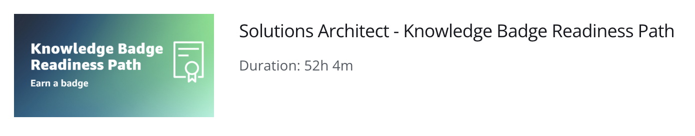
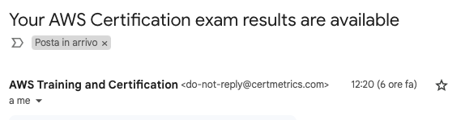
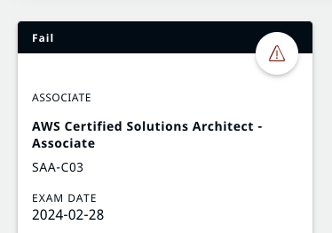
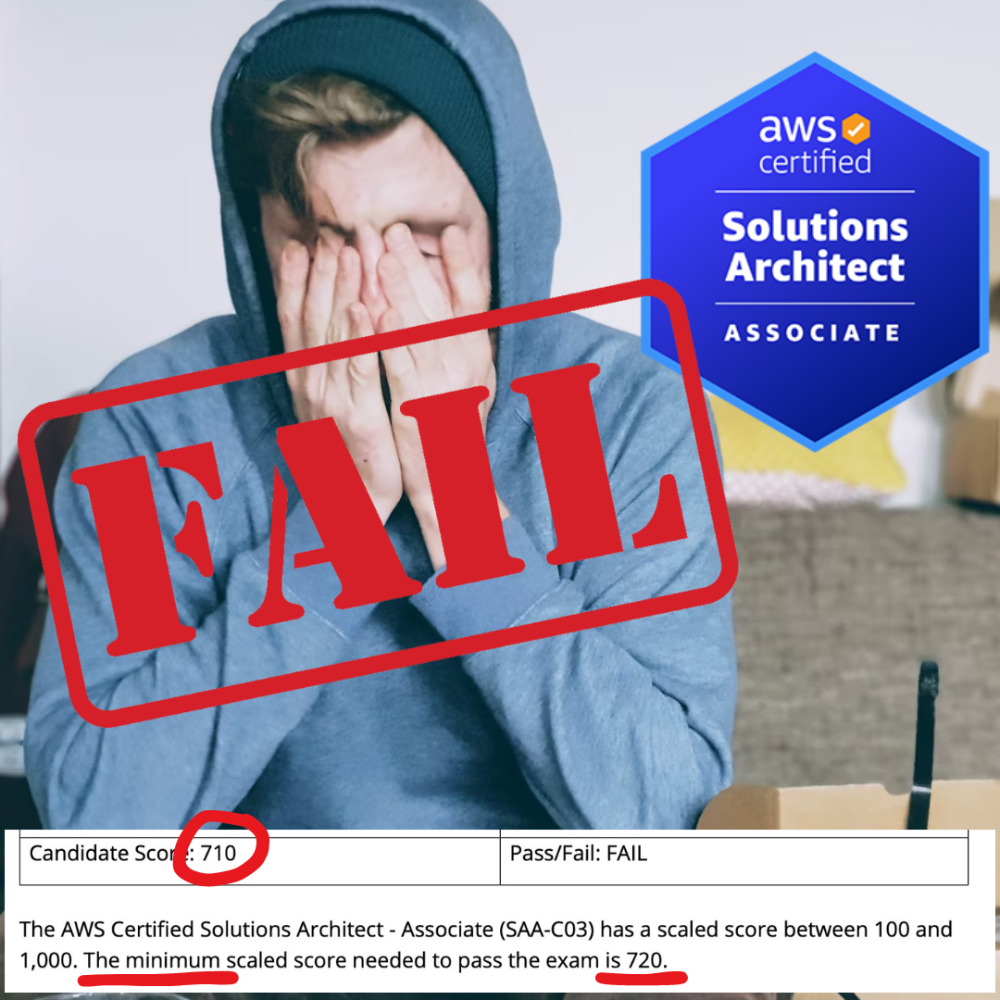

---
title: I failed the AWS Solutions Architect Associate exam, so what?!
published: true
description: I attempted the solutions architect exam without preparation and this is how it went! some tips and useful links to prepare for it. 
tags: aws solutionsarchitect certification career
background: /assets/psnf54p2l1x9azlnpngk.png
# published_at: 2024-02-28 16:44 +0000
---

Today I finally took the exam for the AWS Solutions Architect Associate. It has been in my yearly resolutions for at least 2 years but I never really committed to it.  Only toward the end of 2022 / beginning of 2023, I started watching preparation courses and [writing summaries](https://dev.to/aws-builders/preparing-for-aws-solutions-architect-associate-saa-c03-certification-resources-and-cheat-sheets-2h2k) that helped me consolidate my learnings.

Then [life got in the way](https://dev.to/dvddpl/my-2023-in-review-sad-mad-sad-glad-glad-glad-142g): some health issues, frustration and busy times at work, some needed vacation, then a new job with a completely different tech stack -  **a lot of valid and less valid excuses** kept me away from studying since May 2023.

Beginning of January I received an email - the voucher to take the exam for free, which I received when [I became AWS Community Builder](https://dev.to/aws-builders/boost-your-career-by-becoming-an-aws-community-builder-4hkj), was going to expire end of February 2024. 

I almost wanted to look away and shrug it off, after all, it was a voucher and I was not going to lose any money for this missed opportunity. 

Then I remembered the messages in the Community Builders Slack where AWS Community Managers asked people to **not request the vouchers and let them expire** because they consume real AWS Budgets (and because they are a great opportunity to try them out, gain knowledge anyway, and experience with the examination setup) and I felt very bad, therefore **I booked the exam for the very last day available**. 
I was sure that in almost 2 months I would have had the opportunity to open again _the books_ and refresh what I learned almost one year ago. 
Guess what?, I didn't (besides a couple of evenings, when, after a long day at my new job, I could just go through my old posts for a few minutes before falling asleep).

**This morning I felt ridiculous**, what was the point of sitting the exam so unprepared...

Still, I did not want to waste the voucher, and I told myself:
- the setup of the examination is kind of stressful,  it is online, in the comfort of my home, but requires a very rigid setup,  nothing on your table, no food, no watch or phone around, and you are not allowed to move away or stand up, your head must not leave the camera screen otherwise you are immediately kicked out of the proctored environment and so on; it is better to experience this when I have not pressure of succeeding.
- **by failing, I could still get a useful reality check**, understand how much I know or I think I know, and understand how much effort I need to put into studying if I decide to retry the exam.

The exam lasted 150 minutes and consisted of 65 questions.
Remember:  _A 30-minute exam extension is available upon request to non-native English speakers when taking an exam in English._
Ask for it, **before** you book the exam!  More info [here](https://aws.amazon.com/certification/policies/before-testing/)
I probably did not need the extension, since I was done 34 minutes before the end, but I am glad I took it because, had it been an exam that I was taking seriously, I would have probably stressed out, seeing the clock ticking. 

I must say that with not much surprise, **I had no idea what to answer to some, _many_, questions**, especially about the topics that put me off most of the time during my preparation,  about very specific services for hybrid cloud that are very far away from my experience ( and my interests ).

I submitted the exam almost without reviewing my answers and I was very relieved, this exam had been haunting me for too long, and at least now I could focus on other goals that I consider more important right now. 

A couple of hours later  - to my surprise, because I was expecting the result between 1 and 5 days, as communicated during submission, I received an email telling me the result was ready.

I clicked on the link and no wonder, the result was  - **FAILED**

That was expected, **I have not studied at all in the last 10 months**, what I was interested in was, **how bad did it go?** How much was I unprepared? How many things are missing in my current knowledge? The minimum point to pass the exam is 720 out of 1000, did I get 300 or 600?

Well, that was a surprise indeed. I had 710 points!  I did not pass the exam for 10 points on 1000!

Now, that is a bit irritating, but I must say that
- **I would have not been proud** to get the certification with the _bare minimum_ and without deserving it
- I am instead super happy because it proves that my experience on the job and the knowledge I gathered in these years is something that almost allows me to get certification without preparation whatsoever (and believe me, almost half of the stuff covered by the exam is something I have never seen or needed in more than 6 years of working with AWS since I mostly built serverless applications)
- it is a bit of **confidence boost** and proof that ( if getting the certification will again become a priority or necessity for me) I can make it, just putting in a little bit of effort.

Of course, it sucks, it would have been great to start the year with this Resolution ticked, but at least now I can focus on something else ( blogging again, finding conferences to speak at, reading a lot, and being successful and fulfilled at my new job - where my team is building a great platform using lots of AWS I never used before ). 

Most importantly, I hope to be confirmed **AWS Community Builder**  for the 3rd year and get another voucher, to retry the exam next time, with a bit more preparation ( or just a bit more luck!).

---
Foto von <a href="https://unsplash.com/de/@christnerfurt?utm_content=creditCopyText&utm_medium=referral&utm_source=unsplash">Christian Erfurt</a> auf <a href="https://unsplash.com/de/fotos/mann-der-sein-gesicht-mit-beiden-handen-bedeckt-wahrend-er-auf-der-bank-sitzt-sxQz2VfoFBE?utm_content=creditCopyText&utm_medium=referral&utm_source=unsplash">Unsplash</a>
  

