As I look back on the past year, I can't help but feel a bit disappointed with my efforts here on the blog. I haven't written any technical posts for a long time, any posts in the last 12 months to be honest - aside from one piece where I [reflected on my attempt—and failure—at the Solutions Architect exam](https://dev.to/aws-builders/i-failed-the-aws-solutions-architect-associate-exam-so-what-3jpk) (that indeed resonated and gained some attention). After changing jobs, taking on new responsibilities, and diving into a different tech stack, I struggled to find the time, energy and, mostly, **confidence to write**.

It wasn't that I wasn't learning — far from it — but I fell out of the habit of _"learning in public."_ I let the idea of needing to be an "expert" hold me back from sharing my journey, even though I know the value of **writing about the process, not just the outcomes.** It's something I need to work on and hope to return to in the coming year.

While this blog has been quiet, one thing I'm particularly proud of in my third year as an AWS Community Builder was the opportunity to speak at four conferences. These experiences allowed me to **share knowledge in a new way and reminded me how rewarding it is to contribute to the community.**

In April, I had the chance to travel to Warsaw and **speak at AWS Community Day Poland**. My talk expanded on a blog post I had written the previous year about [common mistakes developers make when working with DynamoDB](https://dev.to/aws-builders/there-is-no-right-or-wrong-as-long-as-it-works-actually-how-you-use-dynamodb-makes-a-lot-of-difference-2668). 

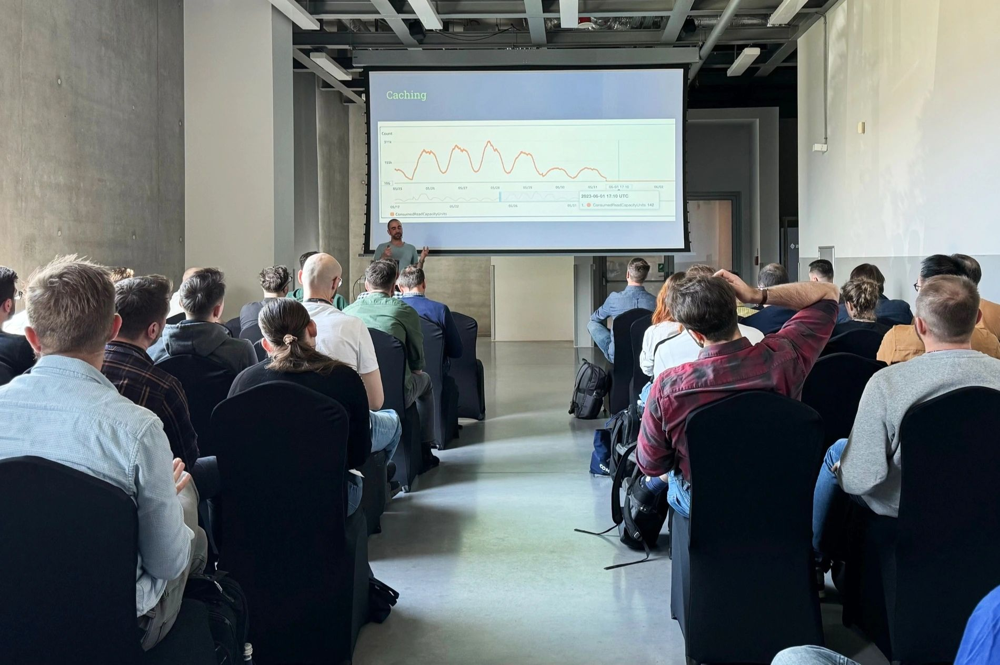

I dove deeper into both the technical solutions and the empathetic challenges these mistakes can create. This was my first time in Poland, and I was excited to meet so many talented engineers. Having worked in Germany, with some of my colleagues being Polish and exceptionally skilled, I admit I was a little nervous about the level of detail the Q&A session might require — but it turned out to be an incredibly positive experience.

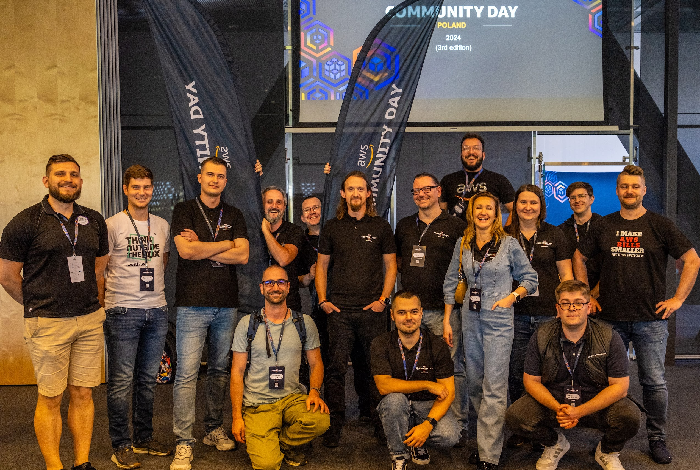

The same talk was later accepted for **AWS Community Day Italy**, held in Rome at the end of September. Flying to my home country and speaking in the capital was a unique experience. 

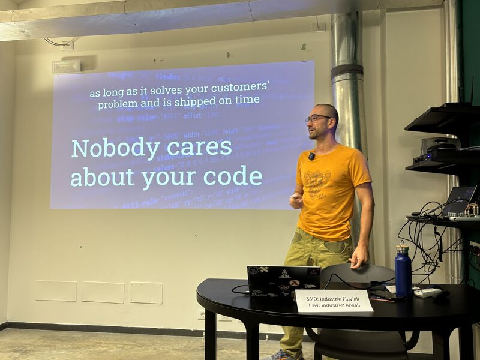

My main challenge was deciding whether to give the talk in English or in Italian — my mother tongue but also a language I haven't used professionally in over 12 years. Ultimately, English proved to be the right choice given the diverse, international audience.

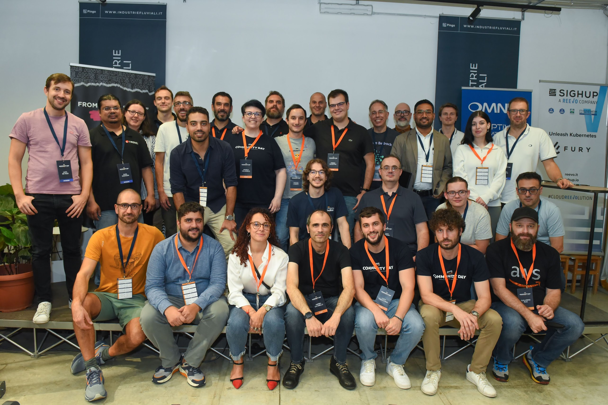

For the second year in a row, I had the privilege of speaking at AWS Community Day DACH in Munich in September ([I wrote about my first conference experience here](https://dev.to/aws-builders/i-spoke-at-aws-community-day-in-munich-how-i-prepared-and-how-it-went-39c9)). 

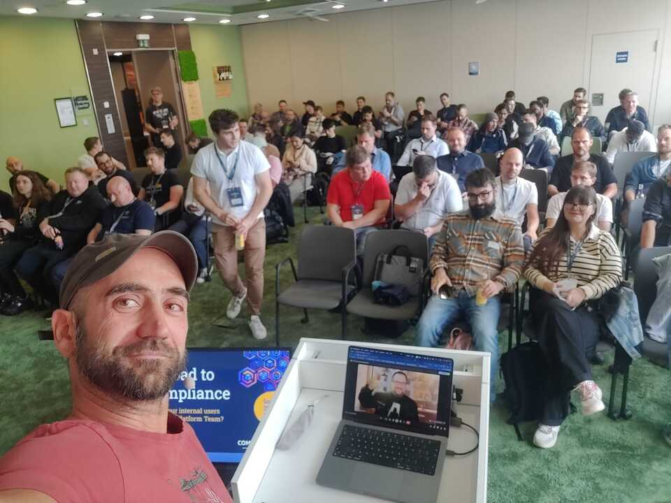

This year, however, was different — I wasn't presenting alone. Sharing the preparation process and the stage with a colleague was both a new and rewarding experience. Our talk focused on the challenges our Platform Engineering team has faced in introducing and enforcing internal compliance. We highlighted how AWS services like Security Hub, Config, and GuardDuty have been incredibly helpful in addressing these challenges.

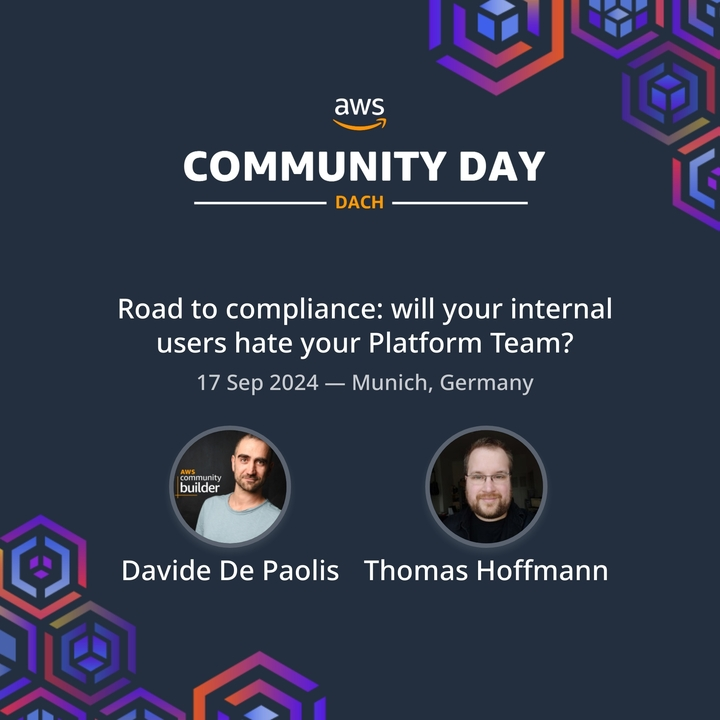

The same talk was later accepted at AWS Community Day in Malta. Unfortunately, when it came time to book the flight, the costs had skyrocketed. Since **I had to cover all the expenses by myself**, I ultimately had to decline the invitation. It was really a pity to miss out, but I'm hopeful that there will be other opportunities in the future.

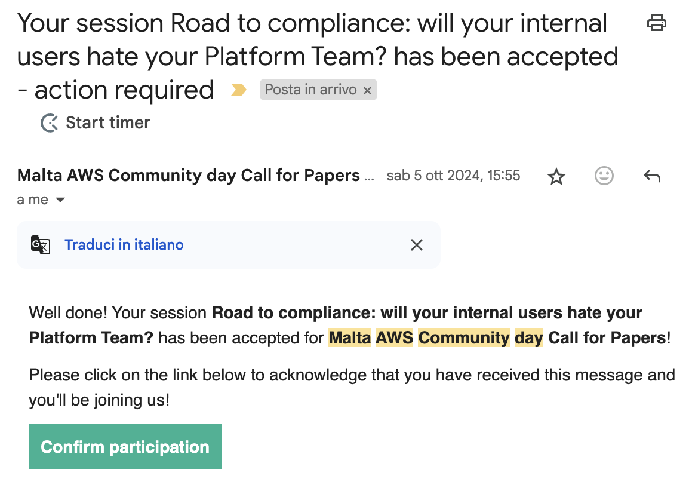

Despite missing out on the Maltese Community Day, I managed to achieve my yearly resolution of speaking at four conferences: this time, it wasn't an AWS Community Day but the [Cloud Computing Conference in Frankfurt](https://www.ccxconference.de/), where I co-presented once again. Our talk focused on how we are using AWS EKS, and I'm considering expanding it into a solo talk next year to share my thoughts on this transition **from serverless to Kubernetes**.
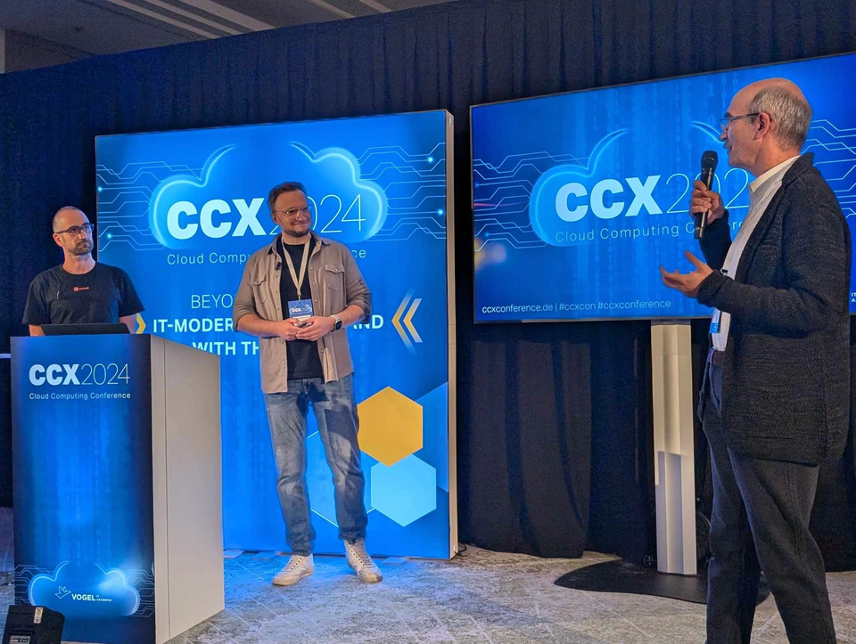

For 4 talks being accepted, there had been plenty Call For Papers that were not successful ( and I learned over the years that this is absolutely normal ) - one of those was the one I submitted to the **AWS Summit in Berlin** (specifically for the AWS Community Lounge). Still, I made the short train trip from Hamburg to Berlin to attend. As always, the event was absolutely mind-blowing, and I'm already excited for next year when the Summit will take place in my own city.

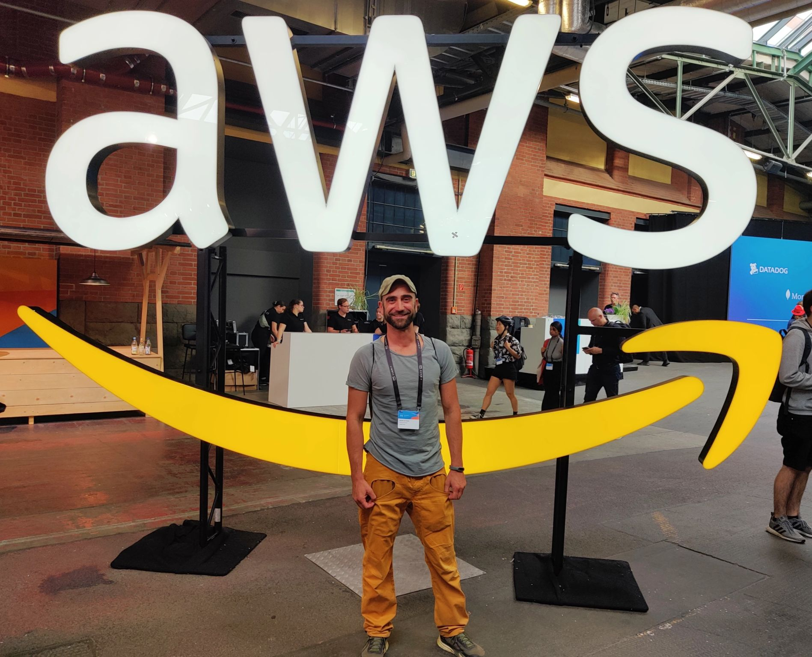

Like last year, I reached out to the Community Lounge organizers to help introduce attendees to the AWS Community Builders program and User Groups. However, this time I discovered the existence of the [AWS DACH Community Booster Club](https://www.aws-community.de/association), which had already assigned roles at the booth. I joined immediately, and it turned out to be a fantastic opportunity to contribute in a different way.

Joining their monthly meeting ( unfortunately not as often as I'd like since it often collided with my work schedule ) I could experience more closely the incredible work done by Heroes and Builders to organize the DACH Community Association's activities and the behind-the-scenes effort that goes into events like Community Days — everything from sponsorships to call-for-papers processes and marketing strategies. I even **participated in the initial evaluation rounds of submitted talks** where I learned about the [Elo Rating system](https://en.wikipedia.org/wiki/Elo_rating_system) used to fairly compare and evaluate submissions — a fascinating approach that's critical when you receive nearly ten times more submissions than the 28 available slots. If you want to get more insights about the huge endeavour of organising such an event I highly suggest reading [the post by AWS Hero Phillip Garbe](https://garbe.io/blog/2024/09/20/aws-community-day-behind-scenes-call-for-paper/), who is also core team member of the AWS Dach Association.

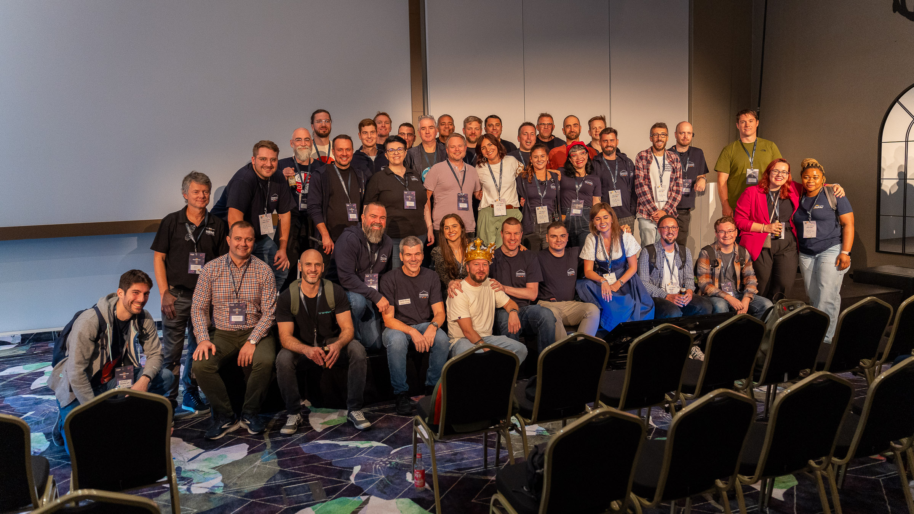

Looking ahead, I hope to become even more involved in the activities of the AWS Community DACH Association, especially with the AWS Summit coming to Hamburg next year, and of course continue visiting ( as long as money and vacation days budget allow ) AWS Community Days all over Europe. 
These community events have been a source of incredible inspiration for me, although sometimes overwhelming too:  Meeting so many passionate, talented, and hard-working individuals is both energizing and humbling.  I always come home exhausted but enthusiastic and full of energy and ideas - commitments that do not always fit with family and work demands.

Even without writing much this year, I hope my contributions at the conferences — sharing my journey with AWS — have added value to the community. For next year, I'm determined to get back into **learning in public**, whether through talks, posts, or other ways.

Above all, the greatest takeaway from this year has been the power of connection. The friendships, collaborations, and shared experiences in this community are what make it truly special. I'm deeply grateful to be part of this journey and hopeful that I can continue as an AWS Community Builder for a fourth year — and maybe, in the years ahead, work my way toward becoming an AWS Hero.

I wish you an happy and productive 2025 and hopefully we will meet around! 

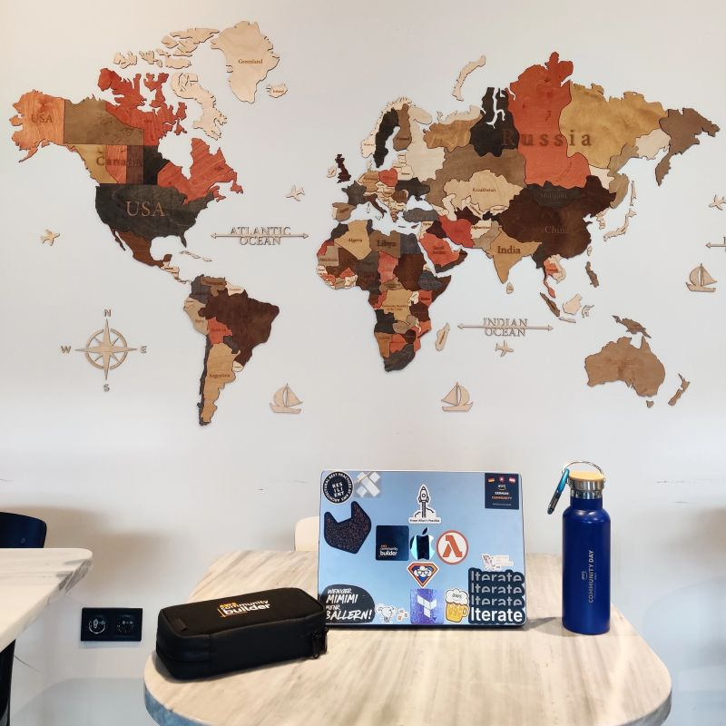

