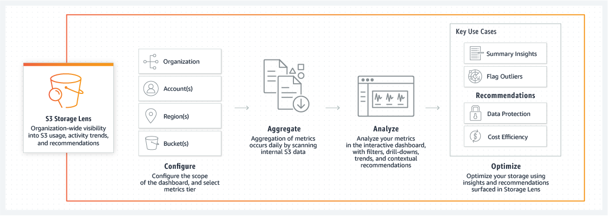
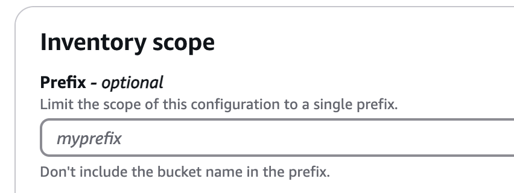
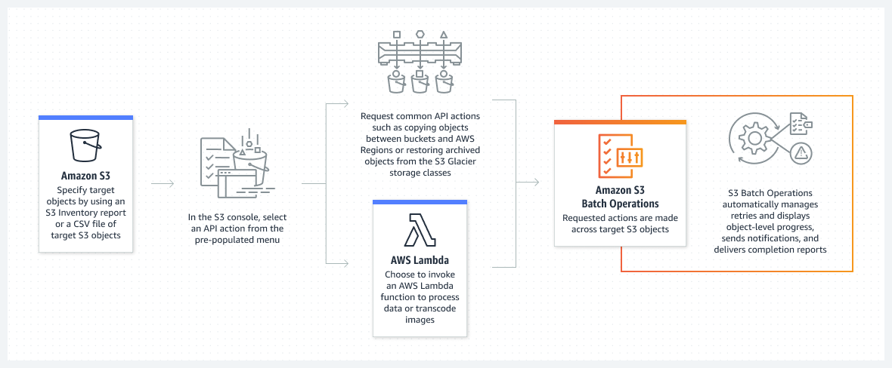
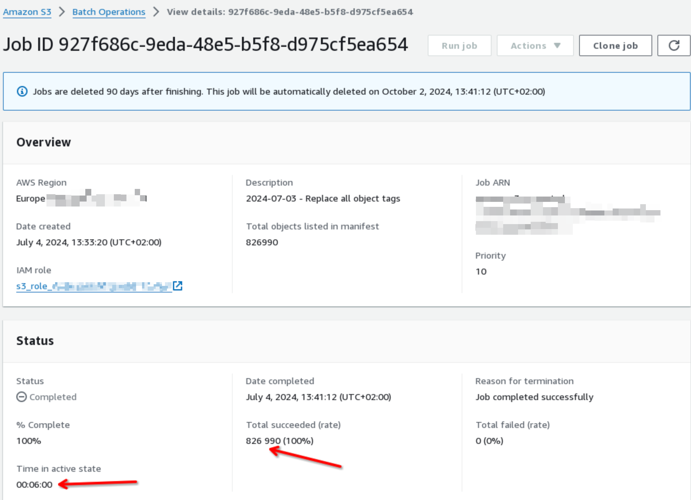
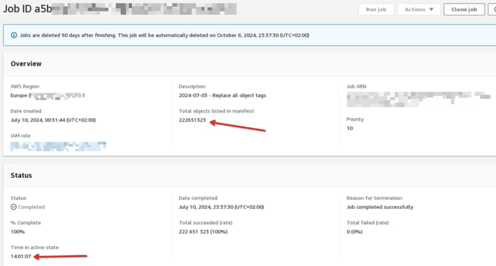
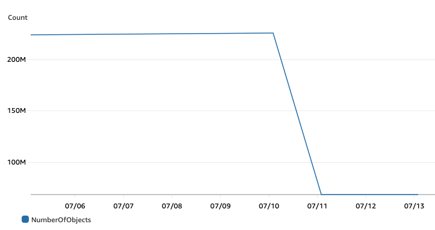
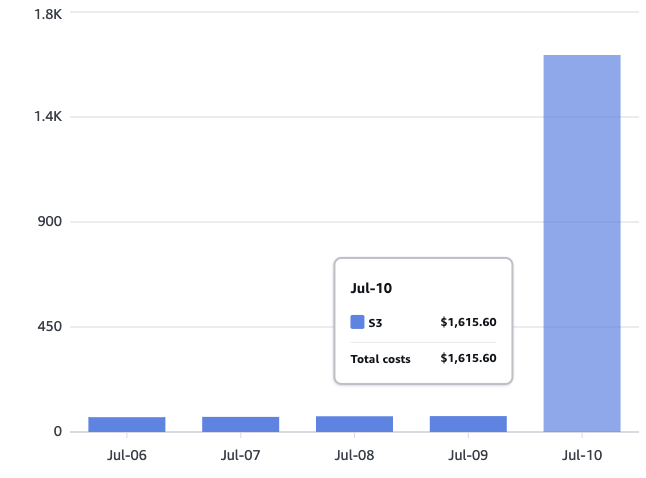
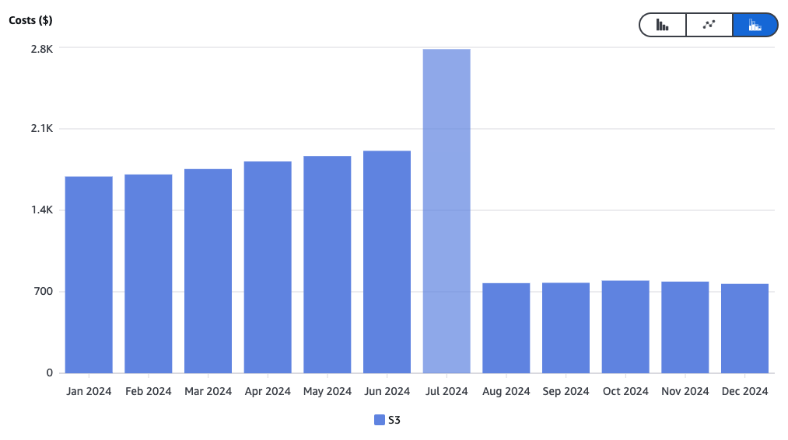
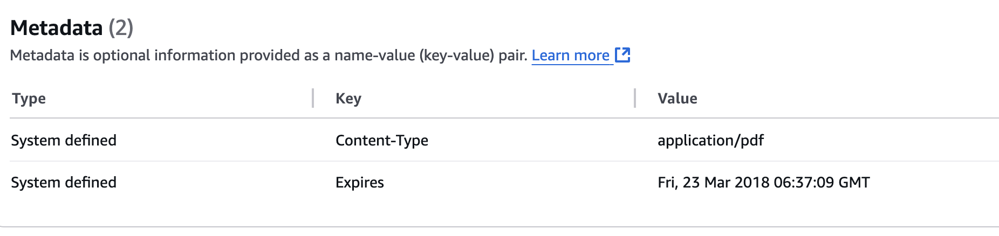

---
title: Clean up S3 with Batch Operations, Tags and Lifecycle policies, they said. It will be cheaper, they said. 
published: true
description: a learning opportunity for a developer and a saving opportunity for the company turned into quite a surprise, a little less savings than expected but definitely much more learning!
tags: aws learning storage finops
background: /assets/8w50sslubkysiegj6vbk.png
---

During my first year as Engineering Manager for the **Platform Engineering** Team at my new company, we had to take ownership of some services ( and some AWS accounts ) that had been orphaned, sometimes for years. 
Of course, cleaning up stuff and reducing waste (by decommissioning obsolete services, shutting down, resizing, or other optimizations) is one of my goals (implementing a **FinOps strategy** is a long process). Still, it was not our first and foremost priority or responsibility.   Let's say that we agreed to - I hate to use this - _grab the low-hanging fruits_ only as we found them.  During spontaneous discovery or simply when touching a system for a reason, and realising there would be a substantial, and easy to implement, opportunity for cost savings.


One day, I was checking out [S3 Storage Lens](https://aws.amazon.com/de/s3/storage-lens/), which is a service that _provides organization-wide visibility into how you use S3 among your accounts and can make actionable recommendations to optimize costs and apply data protection best practices._ 




By browsing its dashboard, we immediately saw that one specific bucket was quite big: **~80 Terabytes for more than 220 million files*, too big for something not directly related to one of our critical applications. 

## Opportunity for cost-savings and learning
 
The cost of this bucket alone was around 1500 Euro monthly for something that had no real use since the activity was very low, and files were untouched for months. 

It was immediately clear that this was a great opportunity to save some money while also being a _stretch assignment_ for one of my cloud engineers with limited AWS experience. 

After some investigation and asking around, we discovered this was a bucket used for Model training purposes. No developer was left from the original team, and the only available info was that we could not simply delete the oldest files, but we could indeed delete all that were already evaluated by the model ( saving the evaluation results).
So basically, Simply **adding a Lifecycle policy** to delete the old files was not a viable solution, nor was **moving everything to Glacier**. 

It turned out that the only files still relevant to the projects were those under specific prefixes stored in an old CSV file. 
That file contained ~155000 entries, but from a quick search, we found that at least 5 different objects existed in the bucket for each entry/prefix.


We had two alternatives: 
- Finding all the files we must keep and deleting all others.
- or the other way around, finding all the files that can be deleted and keeping only the others. 

How could we get the list of all the files under those prefixes? 
We quickly realized, that simply listing the objects with aws `s3api list-objects` command alone was not sufficient, so we opted to generate the list with the **AWS S3 Inventory** feature instead. 

> AWS S3 Inventory is a feature that provides a scheduled report of the objects and metadata in an S3 bucket. It helps you manage and audit objects in your S3 buckets by generating lists of objects, including details like size, last modified date, storage class, encryption status, and more. The Inventory Job can be set to run daily or weekly and it will deliver the reports to another S3 bucket in CSV, ORC, or Parquet formats. [[https://docs.aws.amazon.com/AmazonS3/latest/userguide/storage-inventory.html](See Docs)]

<iframe width="560" height="315" src="https://www.youtube.com/embed/-eYnb_s1Hbw" frameborder="0" allow="accelerometer; autoplay; clipboard-write; encrypted-media; gyroscope; picture-in-picture" allowfullscreen></iframe>


S3 Inventory allows you to retrieve a list of objects filtered by Prefix, but unfortunately, you can only specify one. So, we opted to retrieve the entire bucket's content and do the filtering later. 



Alone the list of objects and their metadata returned by the storage inventory was totalling almost 20 GB in size and more than 220 million objects.

Now we had the entire list of files stored in the bucket and the list of prefixes we needed to keep.  The plan was to tag each file under such prefixes as important (_lifecycle=RETAIN_) so that they would never be deleted.

```
aws s3api put-object-tagging --bucket ${BUCKET} --tagging 'TagSet=[{Key=lifecycle,Value=RETAIN}]' --key ${obj}
```

Since, again it was immediately clear that we could not directly use S3 API calls to tag those million objects we decided to use  [S3 Batch Operations](https://docs.aws.amazon.com/AmazonS3/latest/userguide/batch-ops.html): that would allow that by conveniently uploading a manifest file( an Amazon S3 Inventory report or a CSV file containing bucket name, object key, and optionally, the object version for each object).



Before running the S3 Batch Operation to tag all the files we wanted to retain, **we had to write a script to go through the S3 Inventory and find the intersection** ( only the files with the prefix ) and prepare the Manifest File. 

> S3 Batch Operations has the functionality to automatically generate a Manifest file based on object filter criteria (_MatchAnySubstring, MatchAnyPrefix, and MatchAnySuffix_) that you specify when you create your job, but again, given the huge list of prefixes, that has not revealed possible for us. 

Once the script ran and Manifest File was created - that script alone took ~74 minutes on a 16-core PC with 96GB of RAM and returned a list of _only_ ~850.000 files out of the original 220 Million - we uploaded it into S3 and executed an AWS S3 Batch operation to tag the objects in the bucket. 

That operation took about 6 minutes to complete. (for more info see [Creating an S3 Batch Operations job](https://docs.aws.amazon.com/AmazonS3/latest/userguide/batch-ops-create-job.html)).

We were ready to now configure the S3 Lifecycle policy so that all other files could be deleted!

## Wrong assumptions
As I said, since the beginning the plan had been: _"we know what files we want to keep - let's delete the other files by letting them expire through a S3 Lifecycle Policy."_

This is how the developer working on the project thought the Lifecycle policy would look like:

```
{
    "Rules": [
        {
            "Expiration": {
                "Days": 365
            },
            "Filter": {
              "Not": {
                "Tag": {
                    "Key": "lifecycle",
                    "Value": "retain"
                }
              }
            }
        }
    ]
}
```
Basically: set the expiration date and a **negating** filter: all the files **not having** the Tag _lifecycle:retain_" would fall under the policy and be deleted.

Unfortunately, the assumption about how Lifecycle policies work was flawed because **Lifecycle policies do not support negation** - thus the NOT filter was not working. 

##Starting over
That meant that we had to revert the concept: tag all the files that are not in the file as "deletable/non-important" and set up the lifecycle policy to expire those:

Unfortunately, that required re-running the script in charge of the intersection between the S3 Inventory list and our CSV file, then re-running an S3 Batch Operation to tag all the files as _lifecycle:delete_ and then enable the policy with the right filter: 

```
{
    "Rules": [
        {
            "Expiration": {
                "Days": 365
            },
            "Filter": {
                "Tag": {
                    "Key": "lifecycle",
                    "Value": "delete"
              }
            }
        }
    ]
}
```

No big deal right? The changes were easy on their own, we just had to wait for the S3 Batch Operation to complete the tagging then let the Lifepolicy kick-in.
This time though - having to tag more than 200 Million objects - **the job took 14 hours** instead of 6 minutes.




After that, the Expiration Policy worked like a charm - by checking `aws s3api get-object --bucket MY-BUCKET --key any-tagged-file.csv` we could see the file had a tag and already an expiration date set
```
{
    "Expiration": "expiry-date=\"Sun, 07 Feb 2025 00:00:00 GMT\", rule-id=\"CleanupTest\"",
    "ContentType": "text/csv",
    "Metadata": {},
    "TagCount": 1
}
```


Since the files were untouched for quite a while we just had to wait the next day to see the effects of the Lifecycle Policy.
Indeed, we dropped from ~80TB to ~25TB and from ~220 Million to 60 Million.





We were all pretty excited and expected to see a similar drop in the Cost Explorer, little did we know.. 

## a bad surprise




What happened? well... we had indeed reduced the number of objects in the bucket and its overall size, what **we underestimated was the cost of tagging each object** - an operation that unfortunately, due to the wrong assumption, we had to run twice - first to tag the _important_ object, afterwards to tag all other objects as _deletable_.

So, it was not a problem of S3 Inventory - which with $0.0027 per 1 million objects listed, concurred with a risible 0,60$, nor the cost of the couple of S3 Batch Operation jobs that we ran ( each 0,25$ ). 

No, again, **a _wrong assumption_/understanding of how S3 Batch Operations are charged** - with $1 per 1 million object operations, led us to think that the cost would be ~250$, tops! 

S3 Batch Operation though, is a nice service to automate and run operations in batches, to prevent you from running s3api requests individually and yourself, thus **the costs of the actual operation being performed are still to be considered! ** 

> You can create, update, or delete them during any part of the object's life cycle. Tags cost $0.01 per 10,000 tags per month. Requests that add or update tags (PUT and GET, respectively) are charged at the usual rates. [docs](https://aws.amazon.com/de/blogs/aws/s3-storage-management-update-analytics-object-tagging-inventory-and-metrics/#:~:text=Tags%20cost%20%240.01%20per%2010%2C000,read%20about%20S3%20Object%20Tagging.)

In our case, adding the tags, multiple times, over all the bucket content caused that huge spike in the bill!


##did we regret it? 

We wanted to save money on a semi-abandoned project and we ended up spending 1800$ and a few hours of developer's time working on this.

**Was it a good idea? Of course it was!**- despite the initial spike, costs on the bucket went down at least by half, so that mistake was levelled out in about 1.5 months, and **we are saving a lot of money every month since then**. 



> Just to be clear again here,  **there is nothing wrong or hidden in the way AWS documents these services nor in how those services are charged.**
The spike in cost was a consequence of a mistake by the developer in approaching the problem and in their implementation.  The title is a joke and exactly how we both reacted after noticing the cost increase, to defuse a bit the panic. 

What mattered to me was that the developer had the opportunity to experiment with AWS services, that we as a team gained a better understanding of the cost mechanisms behind those services, and most importantly, that we **fostered a sense of safety in making mistakes** while learning directly from them. Of course, spending more time reading documentation, relying less on code generated by helpers and AI, testing on smaller subsets of data, and so on, could have solved the problem more efficiently, saved money, and generally been a better approach. 
However, it likely wouldn't have been as valuable a learning experience.


----

## some additional thoughts

### but files were uploaded to S3 with an Expire Date, why weren't they deleted? 


Despite the lack of tagging strategy or clean-after-yourself logic in the ML application adding files to the bucket, we noticed that all the files add an Expire Date set on them. 

[PutObject](https://docs.aws.amazon.com/AmazonS3/latest/API/API_PutObject.html#API_PutObject_RequestSyntax) API has indeed an Expire parameter,  and the developers that originally worked on the project, knowing that these files had to be temporary, had probably thought that setting that date was going to delete automatically the files 



This did not happen because that attribute refers to _the date and time at which the object is no longer cacheable_  (see [Expires](https://www.rfc-editor.org/rfc/rfc7234#section-5.3)) not when it has to be automatically deleted by S3.  For that you need to set [Lifecycle policies](https://docs.aws.amazon.com/AmazonS3/latest/userguide/lifecycle-expire-general-considerations.html)


###Could we have used Athena instead? 
Instead of running s3api queries, and writing scripts to run intersections and filter out the prefixed files, we could have probably used Athen to run SQL queries on the S3 Inventory.

We did not. we did not think of it, and even if we had, that would have required more than the time we timeboxed for the learning/cleaning up experiment. So that's definitely a topic for another time! 

[Querying Amazon S3 Inventory with Amazon Athena](https://docs.aws.amazon.com/AmazonS3/latest/userguide/storage-inventory-athena-query.html)

If you have tips feel free to share them in the comments.


### List of useful commands:
```
aws s3api get-object --bucket MY-BUCKET --key MY-FILE.csv`
aws s3api get-object-tagging --bucket MY-BUCKET --key MY-FILE.csv`
aws s3api get-bucket-lifecycle-configuration --bucket MY-BUCKET
```

---


Another article you might find interesting on the topic: 

[Make mistakes, and ask questions. It's OK!](
https://dev.to/dvddpl/make-mistakes-and-ask-questions-its-ok-gah)

