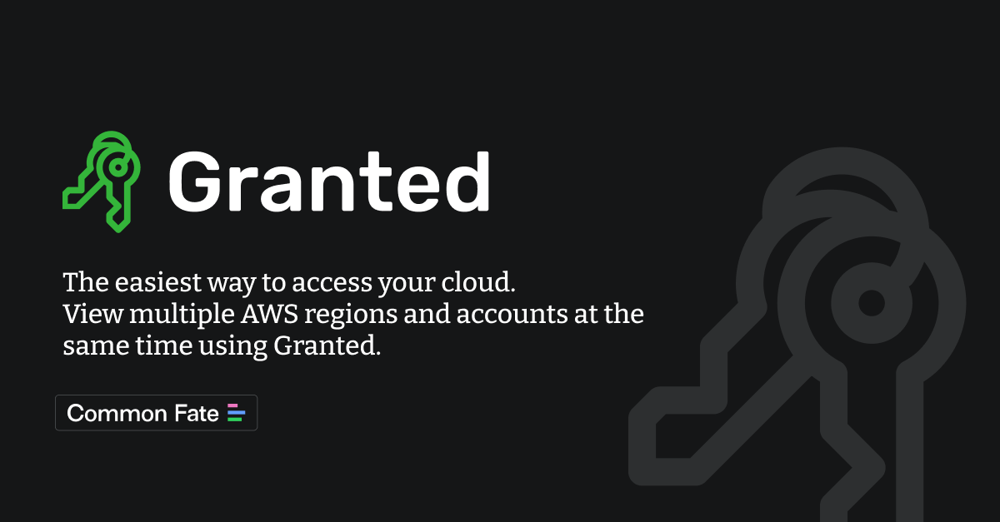

3 years ago [I wrote about using SSO and IAM Identity Center](https://dev.to/aws-builders/drop-those-credentials-use-single-sign-on-login-instead-144h) to access your AWS resources via the terminal, although Re:invent after Re:invent a lot has changed in AWS, the process of configuring your SSO, and filling your .aws/config file with your profiles has not changed much. Usually, **unless you are changing your laptop, team, or company, it is very unlikely you will touch these configurations**.  

Since in recent times it happened that we had to onboard new engineers in our company, and even in our team we are working on our Cloud Infrastructure and creating more and more Accounts and Roles, we had to go through the configuration process multiple times,  here a super simple step by step guide of how to do that.

Why should that be the easiest?  because the most hated, and error-prone part is adding all the different profiles you have access to, and thanks to one tool that was introduced to us months ago by a new hire,  the process is really incredibly smooth.




You still have to install the latest version of the AWS CLI, of course (see the [Installation Instructions](https://docs.aws.amazon.com/cli/latest/userguide/getting-started-install.html) on how to do that for Linux and Windows,  honestly if you are on Mac, I'd really suggest using [Homebrew](https://brew.sh/) instead of the approach suggested there, but it's a matter of tastes.

```
brew install awscli
```

Once that is installed and you have verified it's working `aws --version`, it's time to start configuring it.

This is usually the tedious part. By running `aws configure sso`
the wizard will ask you for some basic information about your company's SSO URL and default region, then the browser will show you the code to grant access, and then, once back to the terminal you are shown all the accounts and roles, by picking one, the profile will be created in your .aws/config file.

**Repeat for all your accounts/profiles and you are ready to go. 
 Boring, right?**


With [Granted by CommonFate](https://docs.commonfate.io/granted/introduction), all this is not necessary and the configuration of all your profiles happens with just one command. 

Again, if on Mac I suggest installing it via Homebrew, in other cases check [their installation guide](https://docs.commonfate.io/granted/getting-started) 

```
brew tap common-fate/granted
brew install granted
```

Then install the [Granted Browser Extension](https://docs.commonfate.io/granted/usage/browser-extension) that will simplify the SSO login process through the browser (usually the browser opens, you are shown a code and you have to allow permission.

By running the `generate` command the browser will open and you can confirm the login, then all the available profiles will be shown. 

```

granted sso generate --sso-region YOUR-REGION --profile-template="{{ .AccountID }}-{{ .RoleName }}" https://YOUR-COMPANY.awsapps.com/start

```

Depending on the format/template you passed as a parameter you will see something like this:
```
Engineering-123456789-AdministratorAccess
Engineering-123456789-ReadOnlyAccess
Data-987654321-ReadOnlyAccess
Martec-456789123-ReadOnlyAccess
```

If you are fine with how the template look like ( maybe you want to adjust it and add the AccountName first (`{{ .AccountName }}-{{ .AccountID }}-{{ .RoleName }}`)  you can run again granted again but this time with `populate` instead of `generate`, so that the information will be stored in your .aws/config 

> Beware! The `populate` command will overwrite any existing profiles (with the same name) -  I really suggest testing with `generate` first. but you can also run the populate specifying a prefix so that you can compare the generated profiles with the ones you have already.  [Docs](https://docs.commonfate.io/granted/usage/automatic-config-generation/#_top)

```

granted sso populate --sso-region YOUR-REGION --profile-template="{{ .AccountID }}-{{ .AccountName }}-{{ .RoleName }}" https://YOUR-COMPANY.awsapps.com/start

```

**Done. You really don't need anything else.** Your config file is set up and contains all your accounts and roles. 


When you run `assume` you will see the list of all profiles in your config - you can use arrows to move up/down and select, or start typing to filter and select. If you know already the profile name, you can directly type `assume PROFILE_NAME`.

Normally, before running commands against the CLI I usually double check on what profile I am (_better safe than sorry_).
 
```
➜ aws sts get-caller-identity
{
    "UserId": "ABCDEFGHIJKLM:me@company.com",
    "Account": "123456789012",
    "Arn": "arn:aws:sts::123456789012:assumed-role/my-role/session-name"
}
```

If you are using [Oh My ZSH](https://ohmyz.sh/) as your shell of choice, you can add `plugins=(... aws )` to your .zshrc / profile and besides having autocomplete for the AWS CLI you will also immediately see in the terminal window what is the current AWS profile you are logged in. 


That is extremely useful if, for example, you want to compare the available S3 Buckets in 2 accounts: just open two terminal windows, use `assume` in each window and you will be able to run AWS CLI commands to the different profiles ( while always seeing which is in which window).


It is really that simple

Just one thing,  if you are still used to running `aws sso login --profile PROFILE_NAME`, you might see, after following this guide, that this is not working any longer: 

> Missing the following required SSO configuration values: sso_start_url, sso_region. To make sure this profile is properly configured to use SSO, please run: aws configure sso

The reason for this is that with the automatically generated profiles do not have those properties but custom `granted` prefixed ones. If for some reason you need to use the aws command ( maybe you have scripts in your automation relying on that, you can manually add the profile, or those properties too (  haven't tried though) 

```
[sso-session old-profiles]
sso_start_url = https://company.awsapps.com/start
sso_region = eu-central-1
sso_registration_scopes = sso:account:access


[profile new-granted-profiles]
granted_sso_start_url      = https://company.awsapps.com/start
granted_sso_region         = eu-central-1
granted_sso_account_id     = 12345678
granted_sso_role_name      = rolename
```

Hope this helps!


---

Foto von <a href="https://unsplash.com/de/@silas_crioco?utm_content=creditCopyText&utm_medium=referral&utm_source=unsplash">Silas Köhler</a> auf <a href="https://unsplash.com/de/fotos/schwarze-skelettschlussel-C1P4wHhQbjM?utm_content=creditCopyText&utm_medium=referral&utm_source=unsplash">Unsplash</a>
      