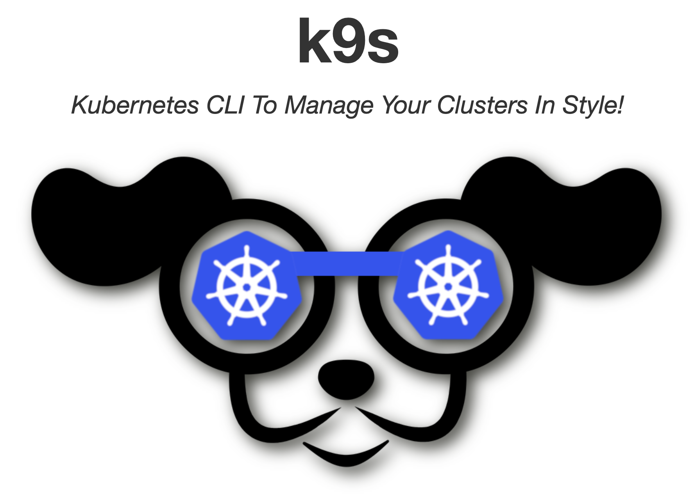
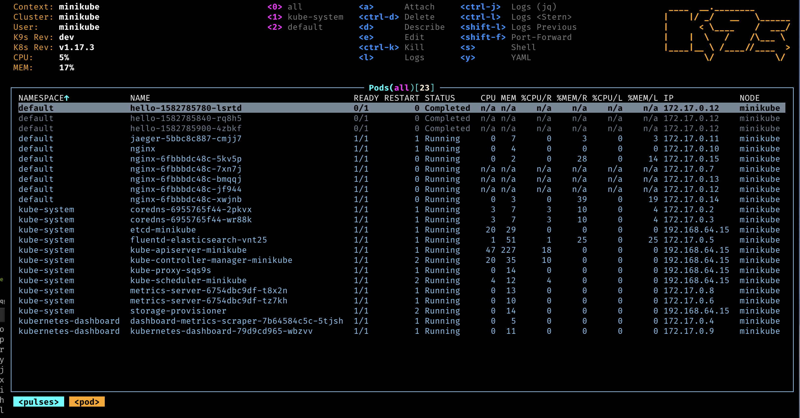

Recently with my Platform Engineering team, we have been introducing quite some changes in **how we and the teams can run, deploy and debug their applications on our EKS Clusters.**
In our effort to reduce complexity, and costs, we removed some components in our infrastructure like **Harbor** (an open-source container image registry), **Longhorn** (an open-source, distributed block storage system) **Keycloak** (an open-source Identity and Access Management) and **Rancher** (an open-source Kubernetes management platform) - all self-hosted on our Cluster.
As often happens, **changing habits and processes is hard**, and we now have the challenge of onboarding many developers - especially those that, although great software engineers have less experience in things DevOps - to adopt the AWS services that we introduced instead.  (a colleague and I presented the story of these challenges in [a Talk at the last AWS Community Day DACH](https://dev.to/aws-builders/my-2024-and-3rd-year-as-an-aws-community-builder-acn)).

I wrote in this post [how to easily configure your AWS CLI](https://dev.to/aws-builders/the-easiest-way-to-set-up-and-configure-your-aws-cli-5g08) so that the engineers can seamlessly assume roles on different accounts to interact with AWS Resources on the different environments. In this one, I'll show how to configure your kubeconfig as easily and how to debug the applications running on the cluster without Rancher ( that had the great advantage for the engineers to be very easy to use thanks to its friendly UI).

To access your EKS cluster you need to configure your _kubectl_  ( [install instructions here]( https://kubernetes.io/docs/tasks/tools/))


If you are starting from scratch, running `kubectl config view` will likely be empty:

```
apiVersion: v1
clusters: null
contexts: null
current-context: ""
kind: Config
preferences: {}
users: null
```

To fill it with data, after you logged in to your AWS account ( check how to **assume** the profile in the post I linked above) you can run 

```
aws eks update-kubeconfig --name EKS-CLUSTER_NAME --alias EKS-CLUSTER_NAME
```

> Make sure to specify the alias, it seems redundant but it makes a big difference when you switch contexts because if you don't specify an alias the name that will be saved in the kubeconfig will be the full arn, which is not so handy to pass-in every time.


Running again `kubectl config view` you will see all the info has been added to your config file ( which is by default located at ~/.kube/config):

```
apiVersion: v1
clusters:
- cluster:
    certificate-authority-data: DATA+OMITTED
    server: https://1Q2W3E4R5T6Y7U8I9O0P.gr7.eu-central-1.eks.amazonaws.com
  name: arn:aws:eks:REGION:ACCOUNT:cluster/EKS-CLUSTER-NAME
contexts:
- context:
    cluster: arn:aws:eks:REGION:ACCOUNT:cluster/EKS-CLUSTER-NAME
    user: arn:aws:eks:REGION:ACCOUNT:cluster/EKS-CLUSTER-NAME
  name: EKS-CLUSTER-NAME
current-context: EKS-CLUSTER-NAME
kind: Config
preferences: {}
users:
- name: arn:aws:eks:REGION:ACCOUNT:cluster/EKS-CLUSTER-NAME
  user:
    exec:
      apiVersion: client.authentication.k8s.io/v1beta1
      args:
      - --region
      - REGION
      - eks
      - get-token
      - --cluster-name
      - EKS-CLUSTER-NAME
      - --output
      - json
      command: aws
      env:
      - name: AWS_PROFILE
        value: ACCOUNTID-ACCOUNTNAME-ACCOUNTROLE
      interactiveMode: IfAvailable
      provideClusterInfo: false
```

If like us, you have multiple clusters where you are running your applications, and those clusters are on different AWS accounts ( to preserve isolation between accounts and environments) you will have to run `aws eks update-kubeconfig` multiple times, then you can connect to a different cluster by switching context, but you still have to log in to your correct AWS account first.
```
kubectl config use-context ANOTHER_EKS_CLUSTER_NAME
```

The process can be simplified thanks to Granted ( the tool I showed you in the previous post) because Granted can be used as a **kubectl credential plugin to authenticate to EKS clusters.** 
In order to do so, you will need to modify the kubeconfig file (see [detailed instructions here](https://docs.commonfate.io/granted/recipes/eks)
Basically in the `exec` section you need to replace/wrap the `aws eks get-token` command within the `granted assume command`:

```
users:
- name: [arn:aws:eks:REGION:ACCOUNT:cluster/EKS-CLUSTERNAME]
  user:
    exec:
      apiVersion: client.authentication.k8s.io/v1beta1
      args:
     [
          "<PROFILE_NAME>",
          "--exec",
          "aws --region <CLUSTER_REGION> eks get-token --cluster-name <CLUSTER_NAME>",
        ]
      command: assume
      env:
        - name: GRANTED_QUIET
          value: "true"
        - name: FORCE_NO_ALIAS
          value: "true"
      interactiveMode: IfAvailable
      provideClusterInfo: false
```

## Automation to the rescue

> As you can imagine, with multiple accounts and clusters in your kubeconfig, this editing process can be very **tedious and error-prone**, and indeed at my first - unsuccessful - attempt I realised that while copying stuff around and manually editing snippets, I set up the right cluster but with the wrong role. 

That's when my awesome **colleague wrote a Python script to automate this process**. Check out [this repo](https://github.com/komaspieler/kubeconfig-tool/tree/main), run the script and you will be prompted with all the available accounts/cluster and **your kubeconfig will be automatically updated** to work with Granted.


Once you are all set-up with your AWS CLI, Granted and kubectl, you can start interacting with any cluster by simply switching context - Granted will take care of the authentication for you almost seamlessly.

(Depending on your permissions) you can check what nodes/namespace/pods/services are available and debug their configuration and logs:
```
kubectl get nodes
kubectl get namespaces
kubectl get pods -n your-namespace
kubectl get services -n your-namespace
kubectl describe service your-service
kubectl logs pod-name
```

Explaining the different commands of the kubectl is outside the scope of this tutorial, see [here the quick reference](https://kubernetes.io/docs/reference/kubectl/quick-reference/)

The thing is, for me  kubectl is not the best way to check what's going on in your application,  and definitely not the most user-friendly. Therefore, we need to find a proper alternative to the UI that Rancher was making available to our developers.


## A better Terminal alternative


If with KubeCTL you use the terminal and cli to interact with your cluster, K9s is a terminal based UI to interact with your Kubernetes clusters: you are in the terminal, and you navigate via shortcuts and commands, but the experience is still a lot GUIish. (check [here how to install it](https://k9scli.io/topics/install/) - as usual, the easist option on Mac is via `brew install derailed/k9s/k9s`.




> If you know your role has limited access to the cluster, remember to always start K9S specifying your namespace to avoid permission Error `k9s -n <namespace>`

```
:ns → View and switch between namespaces
:po → View and manage pods
l → View logs
```

Again,  listing [all the available commands](https://k9scli.io/topics/commands/) would be out of scope, but thanks to K9S it is much easier to have an overview of the namespace, pods and services, and debug their configuration and logs, without repeatedly type commands in the terminal, just a bunch of shortcuts, arrows, enter and esc to move back and forth, TADAA! 

<iframe width="560" height="315" src="https://www.youtube.com/embed/ZwOOJqcKQ8g" frameborder="0" allow="accelerometer; autoplay; clipboard-write; encrypted-media; gyroscope; picture-in-picture" allowfullscreen></iframe>


##Kubernetes in your IDE
If instead you really prefer a more point and click approach, I really suggest you installing a Kubernetes plugin for your IDE of choice.  There is one for [Intellj Idea](https://www.jetbrains.com/help/idea/kubernetes.html) and one for [VS Code too](https://code.visualstudio.com/docs/azure/kubernetes).


<iframe width="560" height="315" src="https://www.youtube.com/embed/Si6og3Wa2Hg" frameborder="0" allow="accelerometer; autoplay; clipboard-write; encrypted-media; gyroscope; picture-in-picture" allowfullscreen></iframe>

I find interacting with the terminal via K9S faster but especially if you are starting out with Kubernetes, having the possibility of checking the configuration of your services directly alongside your code, can be much easier. 


I really wish you find this helpful, happy debugging!


---
Foto von <a href="https://unsplash.com/de/@ratushny?utm_content=creditCopyText&utm_medium=referral&utm_source=unsplash">Dmitry Ratushny</a> auf <a href="https://unsplash.com/de/fotos/person-die-durch-das-loch-schaut-xsGApcVbojU?utm_content=creditCopyText&utm_medium=referral&utm_source=unsplash">Unsplash</a>
      