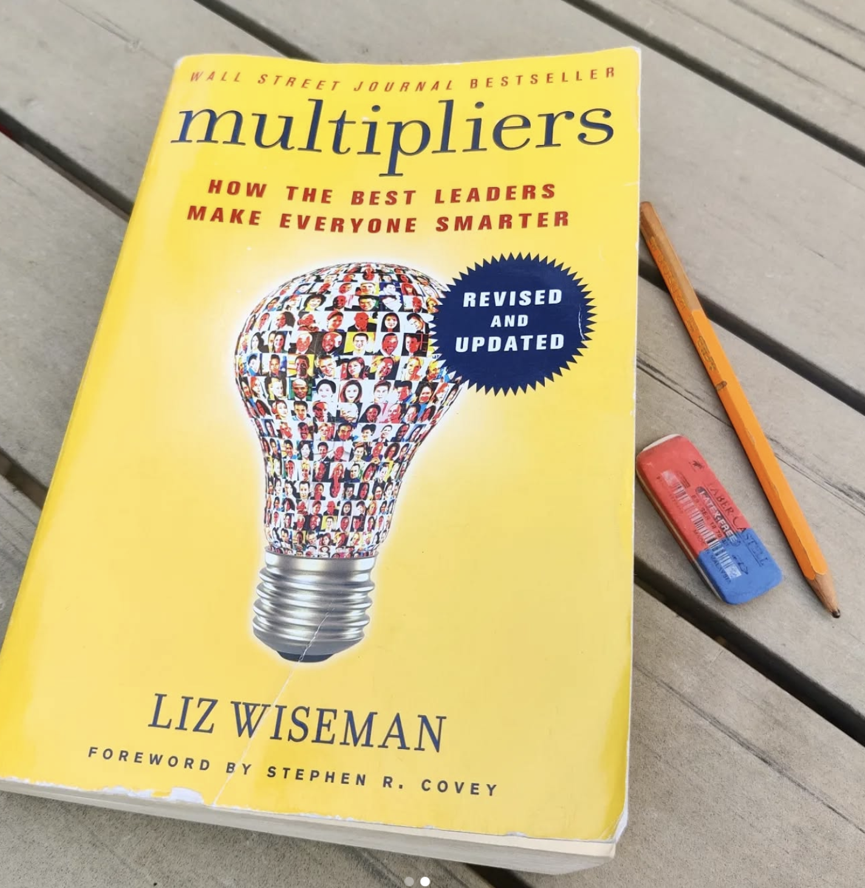
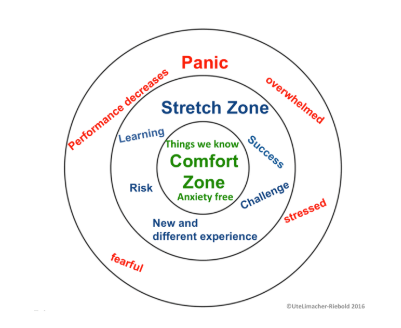

More than 7 years ago, I wrote my first blog post on the "real" multiplying factors of so-called **10x developers**. Spoiler: it's not raw speed or brilliance.

👉 [What makes a 10x developer](https://dev.to/dvddpl/what-makes-a-10x-developer--1k0f)

The true multiplying factor is the ability to share knowledge, foster growth, and lead by example with passion and hard work. That's what really raises the bar for an entire team, even if it's made of "average" developers.

Later, as a technical lead, I came back to this idea from another angle. I wrote about leadership being like a rising tide: growth comes not from **solving problems for others**, but from helping them learn, iterate, and gain confidence.

👉 [Be the Rising Tide](https://dev.to/dvddpl/be-the-rising-tide-grow-as-lead-or-engineer-by-helping-others-2jig)

##Multipliers vs. Accidental Diminishers

Not long after, I stumbled on Liz Wiseman's Multipliers, a book I both loved and hated. I loved its clarity, but hated the mirror it held up.

It forced me to resist the urge to **"just solve the problem myself,"** (_"I can do it faster - and prove my value!"_) and it made me aware of the risk of becoming an Accidental Diminisher. Leaders with the best intentions can fall into patterns that actually shrink others' capabilities: micromanaging, overprotecting, or pushing too hard. I know I've been guilty of this at times.

That thin line between enabling and diminishing is one I try to navigate constantly.

## See, Say, Support

Recently, I came across a simple reminder in Marisa Murray's Leadership Tips newsletter (highly recommended: [Leaderley](https://www.leaderley.com/leadership-tips)
). She shared a practical framework to become a multiplier:

- SEE potential in someone.
- SAY it, sincerely and specifically.
- SUPPORT them to rise (provide resources and encouragement)

At its core, this is about **helping others stretch toward something bigger** than what they currently see for themselves.

##The Power of "One More"

This framework connects beautifully with another idea I read in [Shane Parrish's Brain Food newsletter](https://fs.blog/brain-food/august-31-2025/): the concept of "one more".

- One more rep. 
- One more step. 
- One more minute. 
- One more revision. 
- One more practice test.

It's easy to stop, but most of the value lies just past that moment of resistance.

When you SEE someone's potential and SUPPORT them, you give them the courage to push that "one more" further than they thought possible.

## Lessons from Climbing

As a climber (and father of two young athletes who compete at a National level), I know this balance well. 
Growth happens just outside the comfort zone: one more movement to reach the next hold, one fall more until you master the movement, then one more route, one grade harder. 

That's where confidence builds and learning accelerates.

But push too far, and you hit the panic zone: hands and legs shaking, breathing heavy, mental blockage - then your progress could stall for weeks or even backtrack -or worse you might get injured.

Climbing is a constant reminder that growth lies in the tension around this discomfort: if things are too easy, there is no challenge, if they are too hard, it's frustrating. 

Leadership is similar.

##No Fixed Recipe

The balance is subtle:
- Push, but don't burn out.
- Support, but don't create dependency.
- Stretch, but don't paralyze.

The thin line between supporting, holding hands (or _spoon-feeding_), micromanaging, challenging, pushing and stretching too far is one I constantly try to navigate (sometimes successfully, often less so) because it shifts every day, with every individual.

That's what makes leading more difficult than coding: the same "instruction" can have very different results.

**Leadership has no fixed recipe**. It depends on you, the challenge, and the person in front of you.

This mindset closely aligns with Situational Leadership, a model introduced by Paul Hersey and Ken Blanchard. The core idea: there is no single "best" leadership style. Instead, effective leaders adapt their approach based on the readiness, competence, and motivation of the person they're leading.

- Sometimes that means **directing**.
- Sometimes it means **coaching**.
- Sometimes it's about **stepping back** and simply supporting.
- And sometimes, it's about **trusting enough and delegating completely**.

Like climbing, leadership is never static. The right grip, the right pace, and the right kind of support change depending on the hold in front of you and the conditions in and around you.

And that's what makes leadership so challenging, sometimes so frustrating yet so rewarding.