This week, I had the privilege of speaking at InfoQ Munich, a conference "by senior developers for senior developers." 

Beyond my session, the two days were packed with inspiring keynotes, deep technical insights, and some of the most honest conversations I've had about **platform engineering, DevOps, and the future of AI**.

Here are some highlights and takeaways from my time at InfoQ Munich 2025.

##🌐 Busting AI Myths and Embracing Reality by Katharine Jarmul — 

Katharine kicked off the conference with a sobering but empowering keynote about AI, privacy, and security.

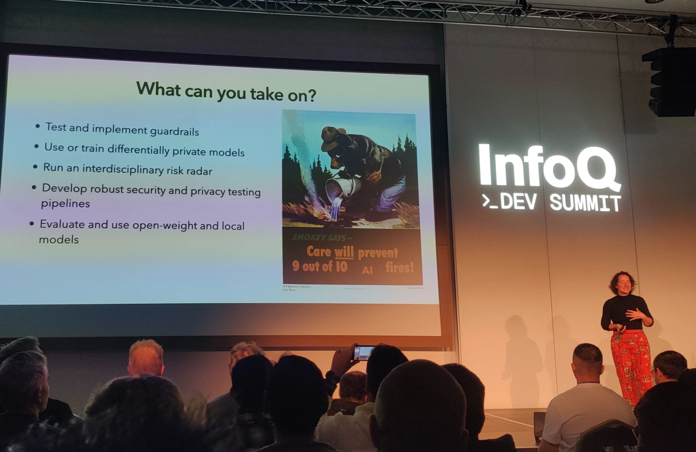

She dismantled the illusion that "guardrails" or regulations alone will save us. In the end we live in capitalism, and we can't expect much in terms of security and privacy - unless there's is money to be made.

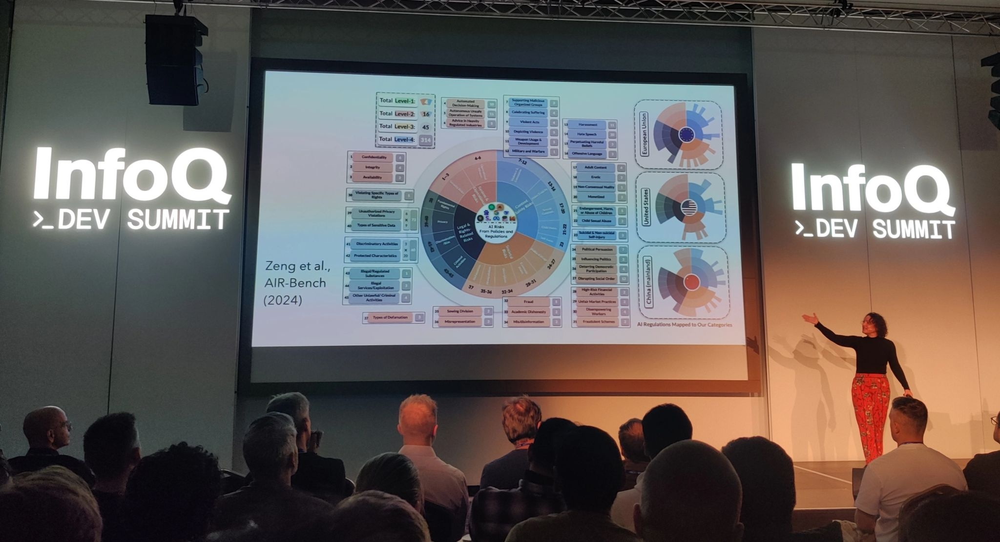

> "Only we can save ourselves."

Her message was simple and strong and meant that ( among other things) we should evaluate and embrace open-weight and local models, rather than relying solely on closed systems.

📚 Further reading:
- [Swiss AI - Apertus](https://www.swiss-ai.org/apertus)
- [GPT4All](https://www.nomic.ai/gpt4all)
- [Plot4.ai](https://plot4.ai/)

##🔍 Building a Future-Proof Observability Platform by Wayne Bell & Dan Gomez Blanco

Wayne and Dan delivered one of the most entertaining and insightful talks of the conference.

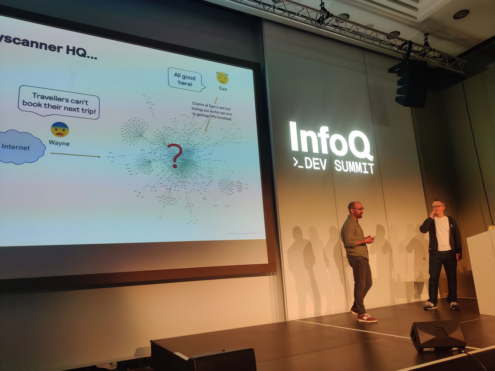

They argued that the old _"three pillars of observability"_ ( metrics, traces, and logs) actually create silos, making correlation nearly impossible.
Their solution? Adopting [OpenTelemetry](https://newrelic.com/instant-observability/opentelemetry) which unifies observability under a single instrumentation standard, minimizing vendor lock-in and enabling better correlation across systems.

They also introduced the concept of **Observability Ambassadors** and a focus on the "Golden Path" for engineers.

Two quotes that stuck with me:

>"Culture is how we behave when we think no one is watching."

> "Drink your own champagne." 🍾  (Definitely an upgrade from "eat your own dog food.")

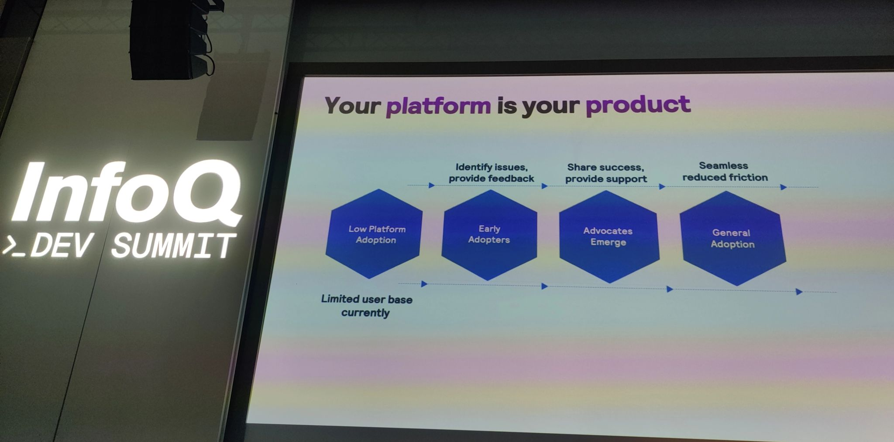

They also reminded us that platform teams must _be comfortable with the uncomfortable_ - serving domain experts without pretending to be one themselves. Too often, platform teams **"come down from the mountain with the tablets of guidelines"** only to find that adoption doesn't follow.

##🧭 Platform Engineering for Everyone: Success Can't Be Coded by Max Körbächer

Max's talk resonated deeply with my own experience.

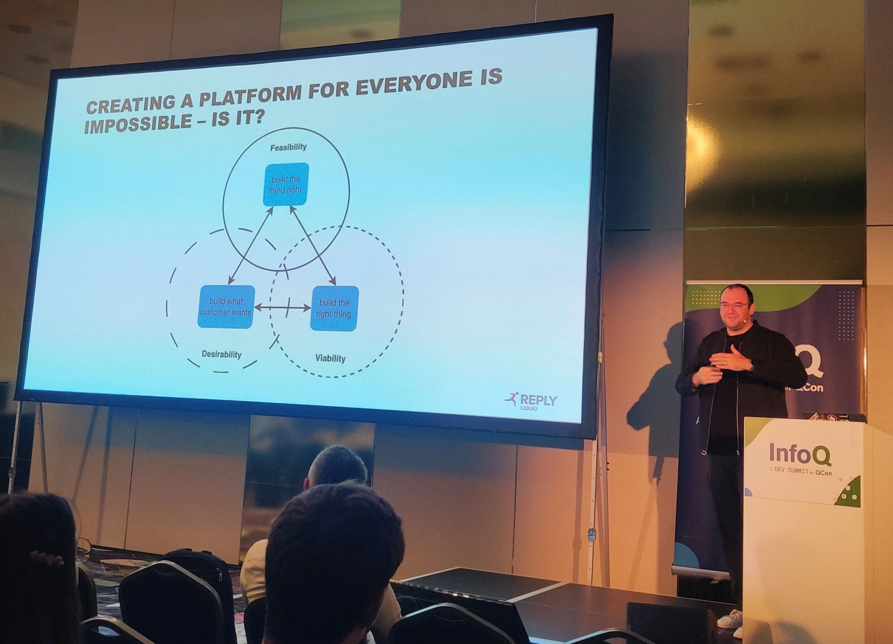

He emphasized that most internal developer platforms fail not due to technology, but because they're built like infrastructure projects, not products developers actually want to use.

Key insights and quotable moments:

>"Define principles, not directives — principles align perspectives, directives demand."

>"Shift left or shit left 💩 — dumping problems on teams isn't empowerment."

>"I don't like to think of deadlines. It's when your project is dead. 🪦"

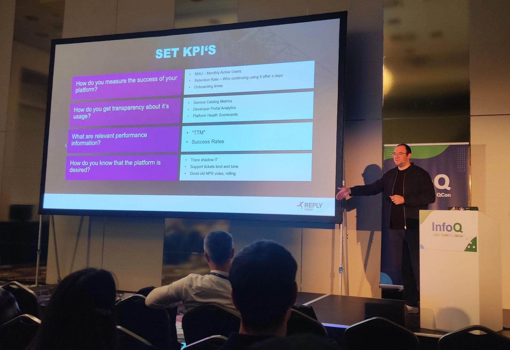

Success, he argued, comes from adopting a product mindset: doing user research, building communities, and continuously measuring adoption.
His book **[Platform Engineering for Architects](https://www.oreilly.com/library/view/platform-engineering-for/9781836203599/)** is now high on my reading list.

## 🏛️ From Legacy to Sovereignty: Driving the Future of Insurance through Platform Engineering by  Sergiu Petean

Sergiu explored how platform engineering can drive innovation sovereignty in the insurance industry, using adaptive DevOps topologies and bold tech choices to regain control.

What stood out to me was his focus on metrics and measurement:
>how do we actually quantify platform success, especially when so much innovation happens in non-production environments?

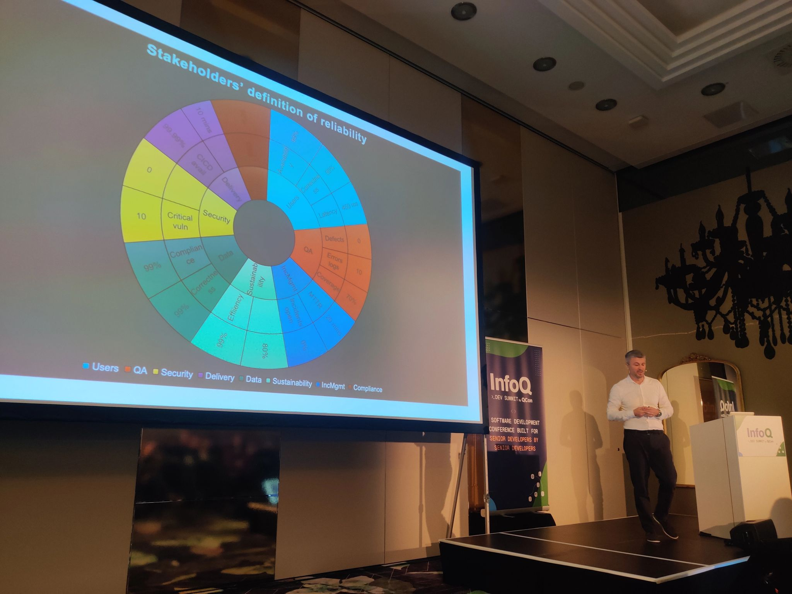

I related strongly to his approach of mapping business metrics to technical KPIs, defining what "reliability" means for each stakeholder:
- security → vulnerabilities, 
- data → correctness, 
- product → latency
- etc

He also emphasized defining a clear operational model:

> "A central platform team provides self-service tools and abstractions, while development teams retain ownership of their applications."

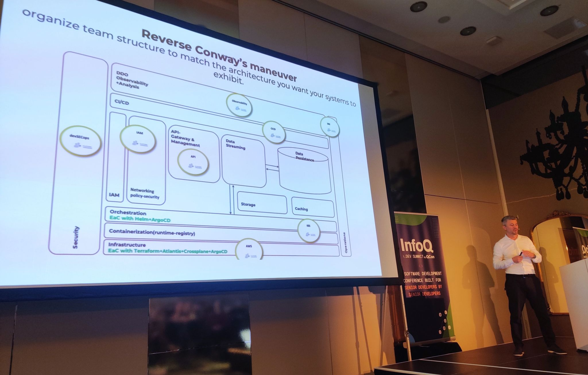

I also loved his quote (that I've already referred to in my own talk the next morning):

>"You build it, you run it.  But you're not alone. Platform is here to help"

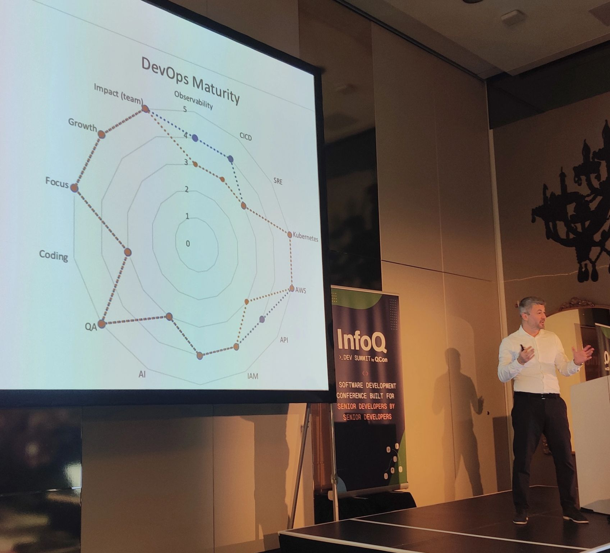

This talk inspired me to revisit frameworks like **[CALMS (Culture, Automation, Lean, Measurement, Sharing)](https://www.atlassian.com/devops/frameworks/calms-framework)** and **DevOps Maturity Radar Charts** for better communication of platform value.

## ☁️ Balancing Innovation and Control: AWS European Sovereign Cloud by Markus Ostertag

Markus brought clarity to one of the most misunderstood topics: data sovereignty.

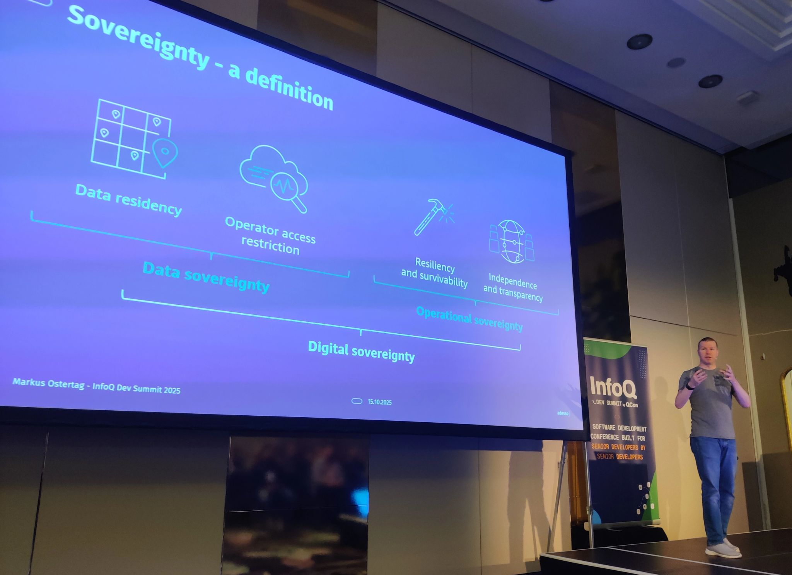

He explained how sovereignty isn't just about where your data resides (for that, choosing AWS Frankfurt region would already be enough) , it's about who has access to it ( and how much trust you put into the provider) and how resilient your systems are in times of crisis.

Key takeaways:
> Sovereignty is not **Autarchy** and  there's no such thing as total sovereignty: it's always a trade-off between cost, control, and innovation.

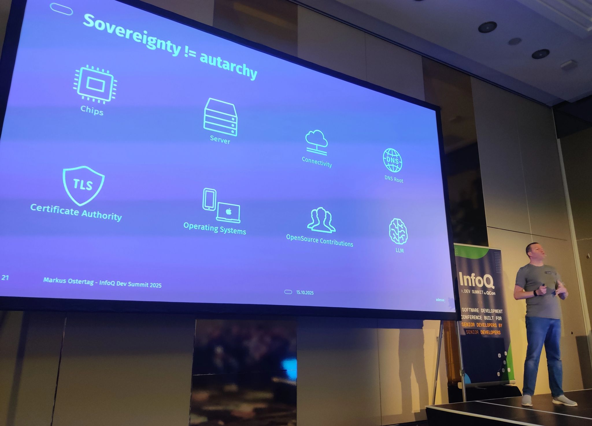

Infrastructure as Code (IaC) is your real sovereignty enabler, because, together with AWS Sovereign Cloud it provides an exit strategy that it's as easy to implement as to parametrize the partition and your aws account.

I loved the reminder that "your sovereignty model is not my sovereignty model." Each organization must define its own balance.
Avoid falling into the "100% national cloud" trap, it's rarely necessary or beneficial.

## ⚡ Beyond Speed Limits: Exploring the Power of Valkey by Viktor Vedmich

Valkey is an open-source replacement for Redis, and Viktor's talk was a masterclass in caching strategies and real-time performance.

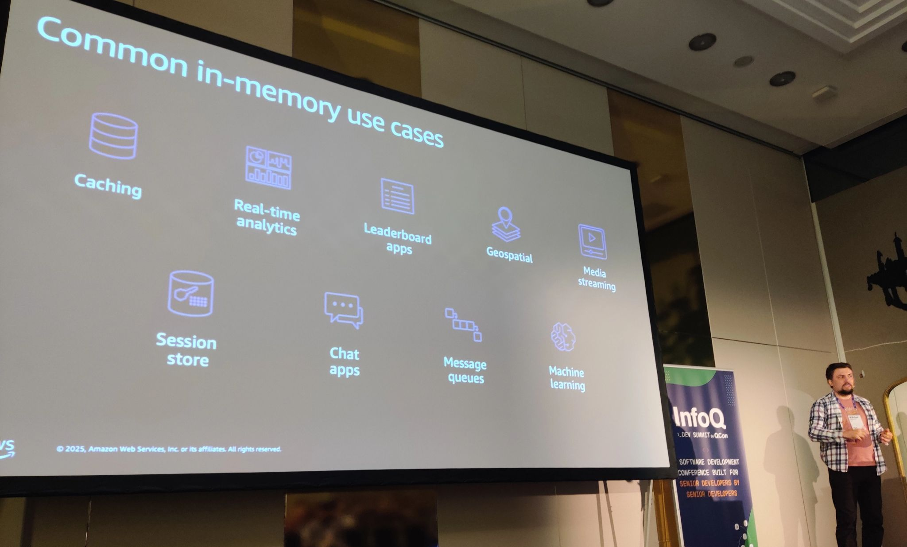

He covered:

- Lazy loading vs write-through caching
- Cache invalidation patterns
- TTLs and random jitter to prevent simultaneous expiry
- Using hash maps + skip lists for leaderboards

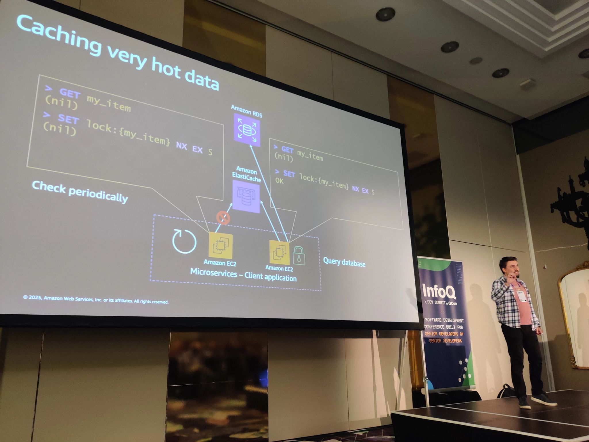

A highly technical and engaging session that was interesting to attend although I am a bit far from the topic.

##🗣️ Birds of a Feather: Unconference and Peer Discussions
After the talks were over for the day, we stayed one more hour to engage in spontaneous - but facilitated by us speakers - conversations about several topics.  Of course I was at the Platform Engineering table.

Best quote from the evening:

> "To go faster, you need better brakes." 🏎️💨

It perfectly encapsulates the paradox of platform engineering: safety and speed are not opposites — they can go hand in hand. Guardrails (and "brakes") aren't there to restrict, but to enable faster and safer delivery.

We also discussed **fitness functions and scorecards** for measuring platform maturity — something I'll be exploring further.

## 🎤 Day Two

On the second day I held my talk. 

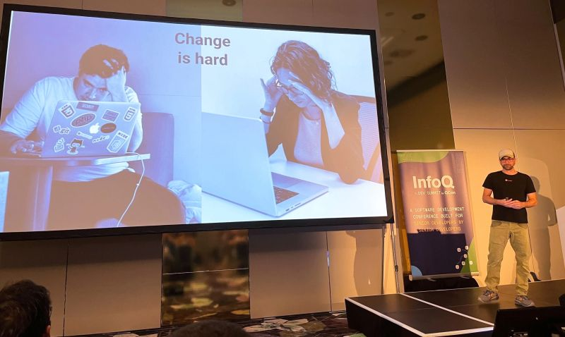

Until the slides and the video recording are published on the InfoQ website, you can read more about the content of my talk **Road to Compliance: Will Your Internal Users Hate Your Platform Team?**  and the journey in Platform Engineering at my company [here](https://devsummit.infoq.com/presentation/munich2025/road-compliance-will-your-internal-users-hate-your-platform-team) 

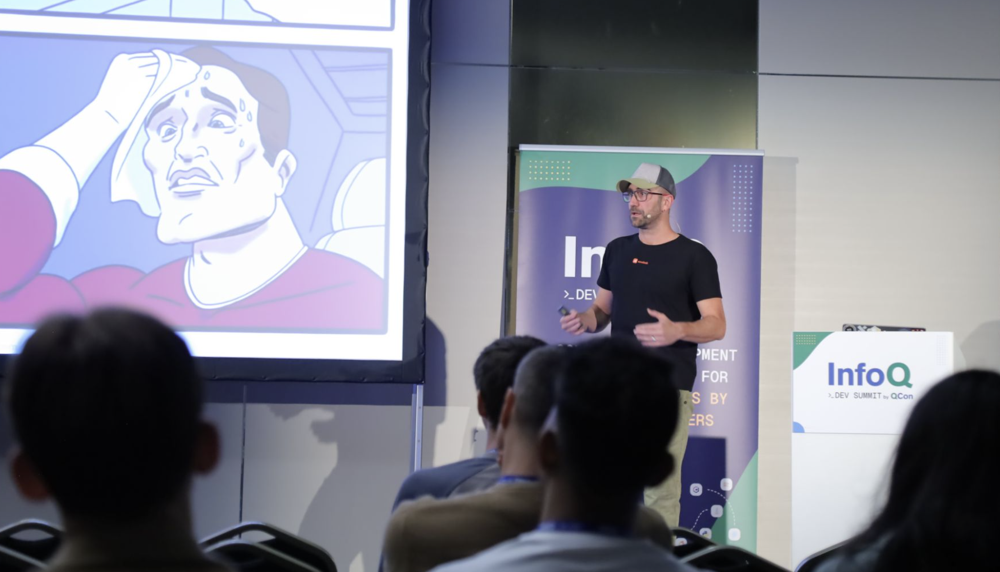

As it often happens when speaking at conferences, I missed a couple of sessions, the keynote right before my talk and the one right after. I like to take some quiet time before presenting, and after the Q&A, conversations with attendees often continue in the hallway (which is honestly one of the best parts of these events).

That meant I unfortunately missed:

- Tejas Kumar's keynote "AI Innovation in 2025 and Beyond"
- Stéphane Di Cesare & Cat Morris' "Product Thinking for Cloud Native Engineers"

I did have the chance to chat with them afterwards, and I'm looking forward to watching the recordings once published. The product mindset they promote feels increasingly essential, learning from product management to treat platforms as products is, in my view, one of the most powerful cultural shifts happening in our industry.

## 🏢 Building a CTO Office: Technical Lessons from Cloud Migration and Platform Harmonization in Regulated Industries by 

This session focused on migrating to the cloud under strict compliance requirements, consolidating heterogeneous systems, and using architectural patterns to support product delivery and data-driven use cases.

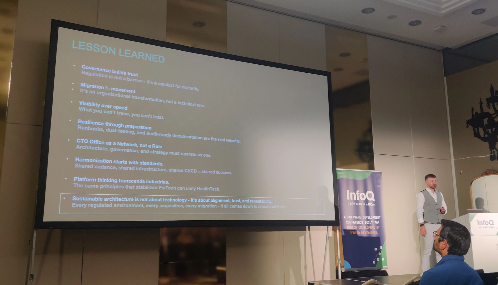

It was slightly outside my usual domain but still offered interesting insights into governance and large-scale transformation.

## 🎬 Evolution of a Backend for a Streaming Application by Daniele Frasca

This one was ( as usual when it comes to Daniele talks) absolutely the highlight of day two.

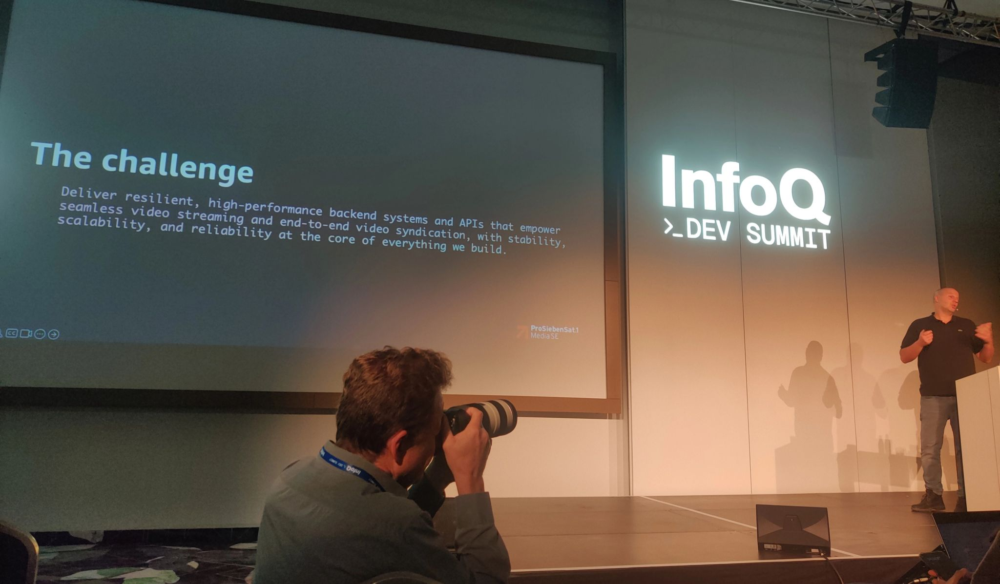

Daniele delivered an enthusiastic, technically rich, and entertaining deep dive into serverless architecture, scalability, and reliability.

Some great reminders and patterns:

- Sparse vs. full events, claim-check patterns, and spoke-hub architectures.
- Cell-based architecture is key for scalability and reliability.
- SLA calculations across dependent services (ALB × Lambda × DynamoDB) reminded me how critical system-level thinking is.  [Interesting read about Composite SLO](https://blog.alexewerlof.com/p/composite-slo)

>You're always trading operational complexity for cost, everything "works" (Kafka, EventBridge, serverless, containers, any type of database), but with different trade-offs.

Other teams may "build for the happy path," but resilience demands planning for failure; testing for it should be embedded in the development workflow, not an afterthought.

An excellent talk that combined practical engineering insights with energy and humour — exactly how technical storytelling should be done.

## 🧠 4 Patterns of AI-Native Development by Patrick Debois

Patrick closed the conference with humour, insight, and a fresh take on the intersection of AI and software engineering.

His four patterns of AI-native development:

**Producer → Manager**: less typing, more reviewing and steering
**Implementation → Intent**:  describe goals, let AI build
**Delivery → Discovery**:  experiment faster
**Content → Knowledge**: expertise becomes the differentiator

We're moving from prompting to **spec-driven development**, and from writing code to managing intent.

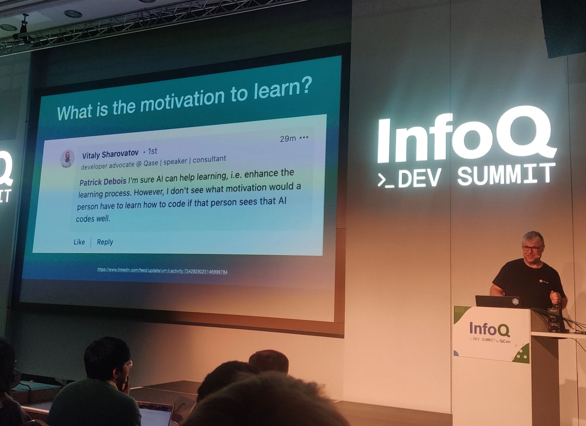

His talk left me with plenty of new tools to explore, like 
- [backlog.md](https://github.com/MrLesk/Backlog.md) 
- [memory bank MCP server](https://github.com/alioshr/memory-bank-mcp), 
- [Spec Driven Development](https://www.youtube.com/watch?v=tEHzFedonNc)
and a lot to reflect on about the role of engineers in the age of AI.

🎤 Wrapping Up

InfoQ Munich was an incredible experience, perfectly organized, packed with great content, and (I have to say) amazing food. 🍽️

The conversations, both on stage and in the hallways, reminded me how much of platform engineering is about people and culture, not just technology.

I came back with a notebook full of ideas, a few new connections, and plenty of inspiration for where to take our own platform next.

Here's to drinking our own champagne, building better brakes, and continuing the journey toward platforms that developers actually love to use. 🥂

