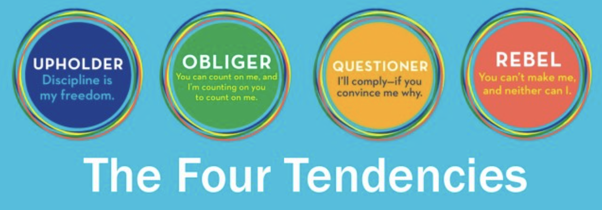
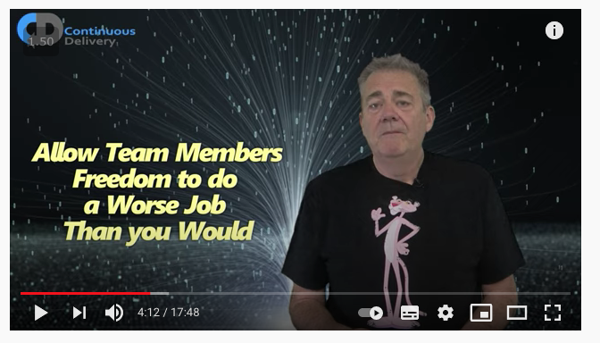
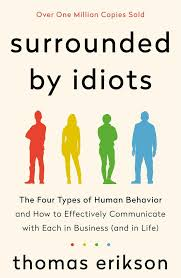
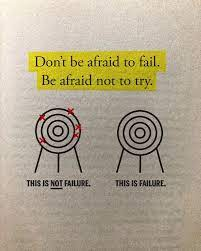

Recently, our People & Culture team shared something in our **Learning Nuggets** Slack channel: ["The Four Tendencies" quiz](https://gretchenrubin.com/quiz/the-four-tendencies-quiz/), a framework by Gretchen Rubin that explores how people respond to expectations.

The premise is straightforward: we all face external expectations (from others) and internal expectations (from ourselves). The way we respond to these defines which of the four tendencies we belong to:

###Upholders
>_"I do what others expect of me—and what I expect from myself."_

They meet both outer and inner expectations with discipline and consistency. Their motto: _"Discipline is my freedom."_

###Obligers
>_"I do what I have to do. I don't want to let others down, but I may let myself down."_

They readily meet outer expectations but struggle with self-imposed ones.

###Questioners
>_"I do what I think is best, according to my judgment. If it doesn't make sense, I won't do it."_

They turn all expectations into inner ones. They comply, if you can convince them why.

###Rebels
>_"I do what I want, in my own way. If you try to make me do something, even if I try to make myself do it, I'm less likely to do it."_

They resist both outer and inner expectations alike.

##My Result ( No Surprise!)

When I took the quiz, the result didn't surprise me.
To some extent, I somehow longed and feared coming out as a Rebel, but the description of the Questioner fit almost perfectly.

I don't suffer from **analysis paralysis** (anymore): I've learned to embrace the [AWS Leadership Principle](https://www.amazon.jobs/content/en/our-workplace/leadership-principles) _"Bias for Action."_ I also love the quote by Dr. Ellen Langer:

>"Rather than waste your time being stressed over making the right decision, make the decision right."

That resonates deeply with how I approach both work and life.

##Understanding the Questioner

The more I read about this tendency, the more I recognised myself in it, sometimes smiling, sometimes grimacing.

Questioners:

- Value logic, reason, research, and fairness above all else.
- Question all expectations and comply only if they believe the reasoning is sound.
- Trust authority only when they respect the authority's expertise.
- Can appear uncooperative or defiant because of their relentless questioning.
- Hate arbitrary rules ("Five garments per fitting room" drives them mad).
- Often dislike being questioned themselves.
- Sometimes struggle to delegate because they doubt others will act with enough urgency or thoughtfulness.

This was spot on, and I absolutely loved the line:
> **"They wake up and think, 'What needs to get done today—and why?'"**

That's exactly how my brain starts every morning.
But a few of these points really made me pause and think.

1. Disliking being questioned (yes, the irony)

When someone challenges my decision, there's an instant internal reaction:
> "Do you think I didn't research? Do you think I'm talking without thinking? Do you think I am stupid?"

It's not arrogance, but a reflex, a consequence of my awareness of how much thought I put into my own decisions.

I am open to feedback, and I can change my mind quickly when proven wrong. But I realise that this initial defensiveness can make me seem less open than I actually am. It's something I need to pay attention to, especially my tone ( and likely my facial expressions).

2. Authority and Expertise

I follow authority only if I trust its expertise — and for me, that usually means _technical_ expertise.
That's been one of my biggest leadership challenges.
Sometimes I still feel I need to prove my technical ability to deserve respect, even though my role now is no longer about being the most technical person in the room.

Learning that influence and impact don't always require technical authority, literally letting go of that has been an ongoing process.

3. Delegation and Trust

I sometimes hesitate to delegate decision-making because I worry others won't have the same bias for action.
And yes, I've been burned before by **people who** took ages to decide, or **made poor choices after endless deliberation**.

But I'm learning that leadership isn't about optimising every decision, it's about enabling others to grow, even if that means tolerating inefficiency in the short term.

And that (as arrogant as it may sound), as David Farley said in [this amazing and inspiring talk](https://www.youtube.com/watch?v=jMpCF0Z623s):

> Allow team members freedom to do a worse job than you would

I know these kinds of tests are far from being scientifically rigorous; they're as valid as horoscopes.
We answer based on how we see ourselves (or how we want to see ourselves), and the results are kind of blanket statements - they can always be true at some point for someone.

Still, I love what they provoke: reflection.
They make me see myself and others through slightly different lenses.
(If you've ever read **"[Surrounded by Idiots](https://www.amazon.de/Surrounded-Idiots-Behavior-Effectively-Communicate)"**, you know the value of such frameworks when used as mirrors, not labels)

##Growth and Acceptance

One line from Gretchen Rubin's website resonated deeply because it feels like the essence of growth:

> "We can accept ourselves and also expect more from ourselves."

I often get frustrated by the oversimplified messages in personal growth, self-help or mental health content that say: _"Just accept yourself as you are."_

Yes, acceptance matters. But acceptance doesn't mean stagnation.
**I accept who I am today, and I'm also committed to improving** not because I think I'm bad, but because **I strongly believe in getting better**. 
The desire to improve does not always come from insecurity, a negative feeling of inferiority or guilt  (although I also wrote about that in my post [Maybe you should start listening to that voice telling you that YOU SUCK!](https://dev.to/dvddpl/maybe-you-should-start-listening-to-that-voice-telling-you-that-you-suck-2i49), it can simply be inspired by what we see around us. 

Probably I have been strongly shaped by the sports I have always practiced in my life: skateboarding, snowboarding, slacklining, climbing. Sport where **failure is a constant**, where progress comes from repetition, discipline, and yes, a bit of pain. You master one move, then immediately start working on the next, harder one.
And you start learning that failure is giving up, or not even trying, not not achieving your goal. You will, at some point, and right around the corner, there will be a new challenge. 

So, understanding that we can always improve, it's not self-rejection, it's evolution.

Maybe personality frameworks like The Four Tendencies aren't about boxing ourselves in.
Maybe they're about understanding the forces that drive us, so we can work with them, not against them.

And as a lifelong Questioner, that's enough reason for me.
